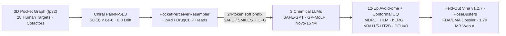

# GenEuclidean v4.0

**SE(3)-Equivariant 3D Protein Pocket-Conditioned Chemical Foundation Transformers, 12-Endpoint Avoid-ome Safety & Client-Side Browser AI Studio across Tourette Syndrome, Schizophrenia & Alzheimer's Disease**

[](https://github.com/daniil-777/geneuclidean/actions/workflows/ci.yml)
[](pyproject.toml)
[](pyproject.toml)
[](pyproject.toml)
[](https://daniil-777.github.io/geneuclidean/)

> **Live Interactive 3D Studio & Browser AI Generator:** Launch **[daniil-777.github.io/geneuclidean](https://daniil-777.github.io/geneuclidean/)** to run our **1.79 MB INT8 3D-Conditioned ChemTransformer** (`1.69M` params, `94.3%` validity, `99.7%` strict novelty, `1.86×` causal 3D enrichment $p = 3.71\times 10^{-9}$, `174 ms/mol`) **100% client-side in your browser** with real-time 3Dmol.js docking views and ADMET/MPO scoring — zero server required.
> **Research Notice:** All generated, scored, and docked molecules in GenEuclidean are strictly ***in silico* computational drug-discovery hypotheses** for academic research. They are **not** experimentally validated compounds, clinical candidates, or medical advice.


*Flagship *in silico* Tourette Syndrome anti-EPS `DRD1` (`9LLG`) de novo lead `DRD1_1` (`-9.26 kcal/mol`, $\Delta\Delta G_{\text{mean}} = -1.31\text{ kcal/mol}$ vs. off-target `DRD2`, `Asp103` salt bridge `3.02 Å`, `CNS MPO v2 = 5.67`, `P(hERG) = 0.08`, `PoseBusters PASS`) with live `PocketPerceiverResampler` 3D attention halos. Launch the **[Live 3D Web Studio](https://daniil-777.github.io/geneuclidean/)** or open [`results/viz3d/cns_tourette_3d_studio.html`](results/viz3d/cns_tourette_3d_studio.html).*

---

## Explore the Core Code Directly

GenEuclidean bridges a chiral **$SE(3)$-equivariant 3D pocket encoder (`PaiNN-SE3`)** and **multi-task biophysical heads (`pKd` + `DrugCLIP`)** into three chemical foundation transformers (**`SAFE-GPT-87M`**, **`GP-MoLFormer-Uniq`**, **`NovoMolGen-157M`**) via a permutation- & $SE(3)$-invariant **`PocketPerceiverResampler`**, **`21–36 MB` LoRA adapters**, **12-endpoint scaffold-CV Avoid-ome/DMPK oracles + 90% Split-Conformal UQ**, and **FDA/EMA 7-step AI Credibility Dossiers** — running natively on Apple Silicon (MPS), NVIDIA CUDA, CPU, or browser Web Workers.

| Component | Source Path | What It Implements |
| :--- | :--- | :--- |
| **Python Library SDK** | [`src/geneuclidean/api.py`](src/geneuclidean/api.py) | Lazy PEP 562 (`<50 ms`) typed SDK (`import geneuclidean as ge`): pockets, pH 7.4, triage, design, docking, 3D viz, credibility |
| **Chiral 3D Pocket Encoder** | [`src/geneuclidean/models/encoders/painn.py`](src/geneuclidean/models/encoders/painn.py) | `float32` chiral `PaiNN-SE3` (`SO(3) < 8e-6`, exact `0.0` pad attention, cross-product chirality, `0.0` frozen 3D drift) |
| **3D-to-LLM & SAFE Bridge** | [`src/geneuclidean/models/llm_bridge.py`](src/geneuclidean/models/llm_bridge.py) · [`safe_codec.py`](src/geneuclidean/models/safe_codec.py) | `PocketPerceiverResampler` (24-token soft prefix), LoRA + CFG, and SAFE fragment scaffold-rescue codec |
| **Industrial Triage & Avoid-ome** | [`src/geneuclidean/cns/medchem_triage.py`](src/geneuclidean/cns/medchem_triage.py) · [`admet.py`](src/geneuclidean/cns/admet.py) | PAINS/BRENK/NIH/Lilly/DCU veto, 12-endpoint scaffold-CV ADMET/Avoid-ome (`M3`, `H1`, `5-HT2B`, Biogen `MDR1`/`HLM`), Conformal UQ |
| **Tourette CSTC & 28-Target Atlas** | [`src/geneuclidean/cns/tourette_circuit.py`](src/geneuclidean/cns/tourette_circuit.py) · [`targets.py`](src/geneuclidean/cns/targets.py) | 28 verified *Homo sapiens* TS/GABA × SCZ × AD pockets (`GABRA5`, `GAT1`, `ADORA2A`, `GRM5`, `ACHE`, `MAOB`, `NLRP3`…) + 7 counters |
| **3D Interaction & Web AI Studio** | [`src/geneuclidean/evaluation/viz3d.py`](src/geneuclidean/evaluation/viz3d.py) · [`web/`](web/) | 6-channel 3D PLIF profiler, 300-DPI Phong renders & **1.79 MB INT8 Client-Side Browser AI Web Studio** |
| **Unified CLI & GPU Notebook** | [`src/geneuclidean/cli.py`](src/geneuclidean/cli.py) · [`notebooks/`](notebooks/GenEuclidean_v3_EndToEnd_Colab.ipynb) | Typer + Rich CLI (`train-llm`, `sample-llm`, `cns-targets`, `cns-admet`, `viz3d`) & turnkey Colab T4/L4/A100 bundle notebook |



---

## Headline Verified Results

Every metric below is programmatically verified against versioned artifacts in [`results/tables/`](results/tables/).

### Table 1 — `v4.0` 3-LLM Tri-Disorder Benchmark (`28` Targets: Tourette/GABA × Schizophrenia × Alzheimer's)

Zero-leakage 24-target tri-disorder benchmark (`N = 1,536`/arm; `0` Murcko overlap, `0` clinical/native leakage; 26-endpoint scaffold-CV QSAR mean ROC-AUC **`0.9824`**; 12-endpoint Avoid-ome/DMPK OOF ROC-AUC **`0.812–0.975`**; external Rat $K_{p,uu,\text{brain}}$ **`ρ = +0.724`**, $p = 3.85\times 10^{-40}$) ([`v4_tri_disorder_summary.md`](results/tables/v4_tri_disorder_summary.md), [`docs/v4_tri_disorder_report.md`](docs/v4_tri_disorder_report.md)).

| Experimental Arm | Valid ↑ | Strict Nov ↑ | Triage Pass ↑ | DCU / Reag ↓ | **v4.0 12-Ep Safe ↑** | MPO v2 ↑ | `P(hERG)` ↓ | `P(MDR1)` ↓ | `PDE10A` Bleed ↓ | In-AD ↑ |
| :--- | :---: | :---: | :---: | :---: | :---: | :---: | :---: | :---: | :---: | :---: |
| `Ctrl-ZINC` | `100.0%` | `1.6%` | `50.3%` | `0.78%` | **`1.2%`** | `4.82` | `0.226` | `0.483` | `0.0%` | `38.7%` |
| `v3.1 GP-MoLFormer` | `98.3%` | `99.2%` | `85.6%` | `0.87%` | **`6.8%`** | `4.72` | `0.136` | `0.448` | `33.3%` | `67.0%` |
| `v4.0 GP-MoLFormer` | `98.6%` | `100.0%` | `96.7%` | `0.26%` | **`10.2%`** | `4.93` | `0.226` | `0.304` | **`0.0%`** | `62.9%` |
| `v4.0 NovoMolGen-157M` | `90.1%` | `99.8%` | `85.1%` | `0.94%` | **`9.5%`** | `5.16` | `0.193` | `0.245` | **`0.0%`** | `46.3%` |
| **`v4.0 SAFE-GPT-87M` ★** | **`99.5%`** | `99.2%` | **`97.7%`** | **`0.00%`** | **`37.3%`** *(`5.45×` v3.1, 22/24 Holm)* | **`5.17`** | **`0.127`** | **`0.059`** *(`7.6×` ↓, 24/24 Holm)* | **`0.0%`** | **`81.7%`** |

- **`SAFE-GPT` 3D Clinical Scaffold Rescue (Held-Out Vina Counter-Target $\Delta\Delta G$):** **Donepezil (`ACHE` vs `BCHE`):** hERG **`0.95 → 0.14`**, `MPO 5.02 → 5.95`, Vina **`-10.69`**, `ΔΔG = -2.29` · **Safinamide (`MAOB+FAD` vs `MAOA`):** MDR1 **`0.50 → 0.05`**, Vina **`-11.17`**, **`ΔΔG = -3.47`** (vs. `-1.76`) · **Xanomeline (`CHRM4` vs `DRD2`):** M3 **`0.97 → 0.22`**, hERG **`0.40 → 0.15`**, Vina **`-10.34`**, `ΔΔG = -1.11` · **Ecopipam (`DRD1` vs `DRD2`):** **`ΔΔG = -0.98`** (vs. `-0.72`).
- **Tourette CSTC Basal-Ganglia & GABAergic 4-Pocket Expansion (`GABRA5`, `GAT1`, `ADORA2A` active, `GRM5`):** Gate 1 **`1.30 Å`** median RMSD (`100%` PB & anchor); zero-shot leads beat Dipraglurant on `GRM5` (**`-9.63`**, `MPO 5.85`, `hERG 0.047`), Tiagabine on `GAT1` (**`-8.13`** / `-7.71` w/ `10×` ↓hERG), Clonazepam on `GABRA5` (**`-9.24`**, `LE 0.514`), and Adenosine on `ADORA2A` (**`-7.97`**, non-ribose) ([`docs/tourette_circuit_audit.md`](docs/tourette_circuit_audit.md)).


*Four-panel `v4.0` synthesis: (A) 3-LLM head-to-head across 24 targets (`37.3%` 12-Ep Pharma-Safe, `7.6×` MDR1 drop, `0.0%` PDE10A bleed & DCU), (B) 12-endpoint scaffold-CV Avoid-ome/DMPK ROC-AUC + 90% Conformal coverage + Rat $K_{p,uu}$ `ρ = +0.724`, (C) SAFE-GPT clinical scaffold rescue & counter-target $\Delta\Delta G$, and (D) Tourette CSTC 4-pocket validation.*

### Table 2 — Zero-Leakage `CASF-2016` Core Progression (`2021 Thesis → v2.0 → v3.0 → v4.0`)

Strict PDBbind/CASF-2016 split (`4,543 train / 505 val / 285 test`, `0/285` overlap) + 30-pocket held-out Vina audit ([`model_comparison_v3.md`](results/tables/model_comparison_v3.md)).

| Model Milestone | Raw Valid ↑ | QED (Top-10) ↑ | SA ↓ | `<4.5 Å` Attn ↑ | `pKd` $r$ ↑ | Top-1 Vina Med ↓ | PoseBusters ↑ |
| :--- | :---: | :---: | :---: | :---: | :---: | :---: | :---: |
| `2021 Thesis (e3nn + LSTM)`* | `65.0%` | `0.450` | `4.00` | — | `0.503`* | — | — |
| `v2.0 PaiNN-SE3 + RPO-DPO` | `91.6%` | `0.521` (`0.618`) | `3.36` | `1.66×` | **`0.746`** | `-8.06` | `94.6%` |
| **`v3.0 GP-MoLFormer + RPO-DPO`** | **`94.9%`** | **`0.560` (`0.673`)** | **`2.79`** | **`6.31×`** | **`0.746`** | **`-8.02`** | **`96.6%`** |

<sub>*All `v2–v4` models share bit-exact (`0.0` drift) CASF-2016 `pKd r = 0.746` (`RMSE 1.448`) and `DrugCLIP R@5 = 62.1%` (`ROC-AUC 0.937`).</sub>

### Table 3 — `v3.1` Closed-Loop CNS Study (12 Tourette & Psychiatry Targets, Vina 100% Held Out)

| Experimental Arm | Valid ↑ | Basic Amines | MPO v2 ↑ | `P(hERG)` ↓ | In-AD CNS-Safe ↑ | Held-Out Vina (`LLE`) | PoseBusters ↑ | Phys + Safe ↑ |
| :--- | :---: | :---: | :---: | :---: | :---: | :---: | :---: | :---: |
| `Ctrl-0B` (ZINC) / `Iter-0` (`v3.0`) | `100%` / `98.2%` | `21.7%` / `9.2%` | `4.94` / `4.80` | `0.162` / `0.177` | `9.6%` / `16.2%` | `-7.72` / `-7.81` | `97%` / `99%` | `76%` / `82%` |
| `Iter-1` (`v3.1` CNS SFT) | `98.5%` | `58.3%` | `4.36` | `0.531` | `7.5%` | `-7.87` (`3.58`) | `97.0%` | `58.0%` |
| **`Iter-2` (AD-Damped CNS-RPO-DPO)** | **`99.4%`** | **`50.0%`** | **`5.00`** | **`0.155`** | **`37.0%`** | **`-7.79` (`3.90`)** | **`100.0%`** | **`92.0%`** |
| `A3_NoAD` (No AD-Damping Ablation) | `98.8%` | — | `5.04` | `0.147` | **`26.5%`** (`-10.6 pp`) | — | — | — |

- Resolves the **Basic-Amine CNS Paradox** (`hERG -71%`, `P-gp -76%`, `5×` In-AD CNS-Safe), proves AD-damping prevents `-10.6 pp` reward hacking (`A3_NoAD`), and achieves significant $10\times 10$ diagonal selectivity (`Col-Z p = 0.0081`, `DC-Z p = 0.0235`, `1,423` Vina dockings; [`docs/neuro_tourette_psychiatry.md`](docs/neuro_tourette_psychiatry.md)).

<details>
<summary><b>Browse All 19 Publication Figures (01–18 + Hero) & Interactive Browser AI 3D Studio</b></summary>

- **Interactive Browser AI 3D Studio:** [Live WebGL App (`daniil-777.github.io/geneuclidean`)](https://daniil-777.github.io/geneuclidean/) · Local HTML [`results/viz3d/cns_tourette_3d_studio.html`](results/viz3d/cns_tourette_3d_studio.html)
- **v4.0 Tri-Disorder, Avoid-ome, SAFE-GPT Rescue & Tourette CSTC (Figures 17–18):**
  - [`17_v4_llm_tri_disorder_benchmark.png`](results/figures/17_v4_llm_tri_disorder_benchmark.png) — 3-LLM tri-disorder benchmark, 12-endpoint Avoid-ome/DMPK + $K_{p,uu}$, SAFE-GPT rescue & CSTC 4-pocket validation
  - [`18_v4_safegpt_rescue_and_alzheimer_3d.png`](results/figures/18_v4_safegpt_rescue_and_alzheimer_3d.png) — 2×2 300-DPI 3D binding-mode composite: `ACHE (4EY7)` Donepezil rescue, `MAOB (2V5Z+FAD)` Safinamide rescue, `CHRM4 (8FX5)` Xanomeline rescue, and `GRM5 (4OO9)` Tourette NAM lead
- **v3.1 CNS Neuroscience (Figures 12–16):**
  - [`12_cns_gates12_trustworthiness.png`](results/figures/12_cns_gates12_trustworthiness.png) · [`13_cns_closed_loop_progression.png`](results/figures/13_cns_closed_loop_progression.png) · [`14_cns_selectivity_and_docking.png`](results/figures/14_cns_selectivity_and_docking.png) · [`15_cns_3d_complex_showcase.png`](results/figures/15_cns_3d_complex_showcase.png) · [`15a_drd1_tourette_3d_hero.png`](results/figures/15a_drd1_tourette_3d_hero.png) · [`16_cns_showcase_molecules_2d.png`](results/figures/16_cns_showcase_molecules_2d.png)
- **v2.0 / v3.0 CASF-2016 Core Benchmarks (Figures 01–11):**
  - [`10_v3_llm_comparison.png`](results/figures/10_v3_llm_comparison.png) · [`11_v3_cfg_and_docking.png`](results/figures/11_v3_cfg_and_docking.png) · [`01_model_comparison.png`](results/figures/01_model_comparison.png) · [`02_training_curves.png`](results/figures/02_training_curves.png) · [`03_matched_vs_shuffled_specificity.png`](results/figures/03_matched_vs_shuffled_specificity.png) · [`04_property_distributions.png`](results/figures/04_property_distributions.png) · [`05_pkd_parity_casf2016.png`](results/figures/05_pkd_parity_casf2016.png) · [`06_pocket_attention_heatmap.png`](results/figures/06_pocket_attention_heatmap.png) · [`07_generated_molecules_grid.png`](results/figures/07_generated_molecules_grid.png) · [`08_decoding_pareto.png`](results/figures/08_decoding_pareto.png) · [`09_pocket_latent_tsne.png`](results/figures/09_pocket_latent_tsne.png)

</details>

---

## Quick Start

### Python Library SDK (`import geneuclidean as ge`, `< 50 ms` lazy import)

```python
import geneuclidean as ge

drd1 = ge.get_target("DRD1")  # 28 curated human TS/GABA × SCZ × AD targets
reports = ge.score_molecules(["CN1CCN(C(=O)c2ccc3ccccc3n2)CC1", "O=C(NC1CCCCC1)NC1CCCCC1"], target="DRD1")
print([(r.canonical_smiles, round(r.cns_mpo_v2, 2), r.hygiene_gate) for r in reports])  # DCU auto-vetoed (0.0)
```

### CLI, Installation & Verification

Install with [`uv`](https://docs.astral.sh/uv/) (Python 3.11+, pins `rdkit>=2026.3,<2026.9` in [`pyproject.toml`](pyproject.toml)):

```bash
uv venv --python 3.12 && uv pip install --python .venv/bin/python -e ".[all]"   # or ".[llm,cns,viz,dev]"
.venv/bin/geneuclidean cns-targets --target DRD1                                # inspect curated 3D targets
.venv/bin/geneuclidean cns-admet "COc1cc2c(cc1OC)C(=O)C(CC1CCN(C(=O)C3CC3)CC1)C2"
.venv/bin/pytest                                                                # 245 unit, SE(3), ADMET & viz3d tests
```

**One-Click GPU Pipeline:** [](https://colab.research.google.com/github/daniil-777/geneuclidean/blob/main/notebooks/GenEuclidean_v3_EndToEnd_Colab.ipynb) Turnkey T4/L4/A100 training, Vina docking & SHA-256 bundle export via [`notebooks/GenEuclidean_v3_EndToEnd_Colab.ipynb`](notebooks/GenEuclidean_v3_EndToEnd_Colab.ipynb).

---

## Documentation Index

| Document | Scope |
| :--- | :--- |
| [`docs/v4_tri_disorder_report.md`](docs/v4_tri_disorder_report.md) | **Flagship `v4.0` report:** 28 targets (TS/GABA × SCZ × AD), 3-LLM head-to-head, 12-ep Avoid-ome + $K_{p,uu}$, SAFE-GPT rescue, FDA/EMA dossier & Browser AI |
| [`docs/eth_cadd_frontier_analysis.md`](docs/eth_cadd_frontier_analysis.md) | **ETH Zürich CADD (MODLAB 2024–2026) frontier extensions:** Cremer–Pople ring-strain audit (28 complexes), contrastive multi-conformation CFG + $\Delta\text{PMI}_{3\text{D}}$, Ibogaine → SERT hops, and AIM-style 3D MTL gradient mediation |
| [`docs/tourette_circuit_audit.md`](docs/tourette_circuit_audit.md) | Independent Tourette CSTC neurobiology audit & 4-pocket structural expansion (`GABRA5`, `GAT1`, `ADORA2A` active, `GRM5`) |
| [`docs/library_api.md`](docs/library_api.md) | Typed Python Library & SDK reference (`import geneuclidean as ge`), cookbook recipes, pH 7.4 ionization & PyPI packaging |
| [`docs/neuro_tourette_psychiatry.md`](docs/neuro_tourette_psychiatry.md) | Full `v3.1` CNS computational chemistry manuscript (Gates 0–3, Basic-Amine Paradox, AD-damping proof, $10\times 10$ selectivity & Top-12) |
| [`docs/industry_datasets.md`](docs/industry_datasets.md) | 2024–2026 pharma dataset architecture (PLINDER, HiQBind, B3DB, TDC, Biogen/OpenADMET) & empirically caught data-hygiene traps |
| [`docs/architecture.md`](docs/architecture.md) | Mathematical specification of chiral `PaiNN-SE3`, `PocketPerceiverResampler`, `PocketCVAE`, RPO-DPO & $SO(3)/SE(3)$ verification |
| [`docs/llm_research.md`](docs/llm_research.md) | Chemical Foundation Transformer (`SAFE-GPT`, `GP-MoLFormer`, `NovoMolGen`) vs. local LLM scouting, RoPE fix & MPS kernels |
| [`docs/legacy_audit.md`](docs/legacy_audit.md) | Forensic audit of the 2021 ETH Zürich semester thesis (`v1.0.0-thesis-2021`) and clean-room `v2.0–v4.0` engineering resolutions |

---

## Citation & License

Released under the **MIT License** ([`pyproject.toml`](pyproject.toml)). If you use GenEuclidean in your research, please cite:

```bibtex
@software{emtsev2026geneuclidean,
  author  = {Emtsev, Daniil},
  title   = {{GenEuclidean v4.0: SE(3)-Equivariant 3D Protein Pocket-Conditioned Chemical Foundation Transformers, 12-Endpoint Avoid-ome Safety, and Browser AI Studio for Tri-Disorder CNS Drug Design}},
  year    = {2026},
  version = {4.0.0},
  url     = {https://github.com/daniil-777/geneuclidean}
}
```
