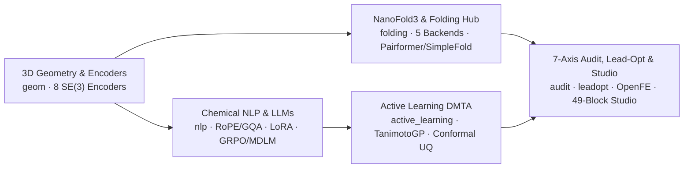

<div align="center">

# GenEuclidean

**SE(3)-Equivariant 3D Molecular Encoding, Chemical NLP, NanoFold3 Co-Folding, Active Learning & Apple Circuit Studio for Structure-Based Drug Design**

[](https://github.com/daniil-777/geneuclidean/actions/workflows/ci.yml)
[](pyproject.toml)
[](pyproject.toml)
[](pyproject.toml)
[](pyproject.toml)
[](https://daniil-777.github.io/geneuclidean/)

<p>
  <a href="https://daniil-777.github.io/geneuclidean/"><strong>Launch Live Web Studio ↗</strong></a>
  &nbsp;·&nbsp;
  <a href="docs/library_api.md"><strong>API Reference</strong></a>
  &nbsp;·&nbsp;
  <a href="https://colab.research.google.com/github/daniil-777/geneuclidean/blob/main/notebooks/GenEuclidean_v3_EndToEnd_Colab.ipynb"><strong>Colab GPU</strong></a>
  &nbsp;·&nbsp;
  <a href="CHANGELOG.md"><strong>Changelog</strong></a>
  &nbsp;·&nbsp;
  <a href="CONTRIBUTING.md"><strong>Contributing</strong></a>
</p>

</div>


<sub><em>Flagship in silico Tourette DRD1 (9LLG) lead <code>DRD1_1</code> (−9.26 kcal/mol, ΔΔG −1.31 vs. DRD2, Asp103 salt bridge 3.02 Å, CNS MPO v2 5.67, P(hERG) 0.08) in the <a href="https://daniil-777.github.io/geneuclidean/">Live 3D &amp; Circuit Web Studio</a> (1.79 MB INT8 browser AI + 49-block visual pipeline breadboard).</em></sub>

---

## Architecture

Zero-overhead PEP 562 lazy imports (`< 4 ms` cold import, zero eager `torch`/`rdkit`/`transformers`), strict PEP 561 typing (`mypy src`: 0 errors), and pure-`float32` native Apple Silicon MPS / CUDA / CPU kernels.



| Pillar | Modules | Capabilities |
| :--- | :--- | :--- |
| **3D Geometry** | [`geneuclidean.geom`](src/geneuclidean/geom.py) | 45 `float32` `SE(3)`/`O(3)` ops: tie-safe dense k-NN (`30.1×` Metal `index_select`), rank-2 `IAS` irreps, Vector Neurons, SPD anisotropic 3D Gaussians & ROCS overlap, `ScreenedCoulombBias`. |
| **3D Encoders** | [`models/encoders/`](src/geneuclidean/models/encoders/) | 8 registered pocket encoders (`dense_painn_se3`, `cartformer_se3`, `atomgs_se3`, `subpocket_vn_jepa`, `painn`, `egnn`, `e3nn`, `schnet`) + `3D JEPA` SSL (`training/jepa_ssl.py`). |
| **Chemical NLP** | [`geneuclidean.nlp`](src/geneuclidean/nlp.py) | 43 pure-PyTorch ops: atom-level SMILES/SELFIES/SAFE tokenizer, stateful valence grammar mask, RoPE/YaRN + GQA + SwiGLU LM, pure-PyTorch LoRA, contrastive CFG, DPO/GRPO, and Masked Diffusion (`MDLM`). |
| **Co-Folding** | [`geneuclidean.folding`](src/geneuclidean/folding/) | Trainable `NanoFold3` (`PairformerStack` / Apple `SimpleFoldTrunk` + EDM/Flow-Matching all-atom diffusion + `ConfidenceHead`/`AffinityHead`) and 5-backend Hub (`nanofold3`, `boltz2`, `protenix`, `alphafold3`, `esmfold_api`). |
| **Active Learning** | [`geneuclidean.active_learning`](src/geneuclidean/active_learning/) | Exact PSD `TanimotoGP`, `EnsembleSurrogate`, `ConformalSurrogate`, 14 acquisitions (`KB`/`DPP`/`qEHVI`/Avoid-ome), correlation-gated `MultiFidelityDMTA`, $O(N_A+N_B)$ `CombinatorialThompsonSampler`. |
| **Audit, Lead-Opt & Studio** | [`audit/`](src/geneuclidean/audit/) · [`leadopt/`](src/geneuclidean/leadopt/) · [`studio/`](src/geneuclidean/studio/) | 7-axis Beyond-PoseBusters auditor (Cremer–Pople ring & SMARTS torsion strain, pH 7.4 microstate, 6-ch PLIF), 16-reaction synthesis, Avoid-ome MMP, `OpenFE`/`Boltz-2`, 12-ep ADMET, 49-block Circuit Studio & MCP server. |

---

## Install & Quickstarts

```bash
uv venv --python 3.12 && uv pip install --python .venv/bin/python -e ".[all]"  # or ".[dev]"
.venv/bin/pytest -q tests/test_google_library_standards.py                     # verify standards
```

### 1. 3D Encoders & `geom`
```python
import torch, geneuclidean as ge

graph = ge.geom.build_dense_knn_graph(coords, atom_mask, cutoff=5.5, max_neighbors=24)
enc = ge.CartFormerSE3Encoder(node_in_dim=52, hidden_dim=192, tensor_dim=24, out_dim=256, num_layers=4)
out = enc(coords, node_feats, atom_mask)  # exact SE(3) invariance (SO(3)+100 Å err <= 4.8e-5)
```

### 2. Chemical `nlp` (RoPE+GQA LM, Grammar Mask, GRPO & Masked Diffusion)
```python
import geneuclidean as ge

tok = ge.AtomLevelSMILESTokenizer()
ids, _ = tok.batch_encode(["CN1CCN(C(=O)c2ccc3ccccc3n2)CC1"])
lm = ge.PocketConditionedChemicalLM(vocab_size=tok.vocab_size, d_model=256, n_layers=4, n_heads=8, n_kv_heads=2, d_pocket=256)
mdlm = ge.DiscreteMaskedDiffusionStep(mask_token_id=tok.mask_id, schedule="cosine")
```

### 3. `NanoFold3` & 5-Backend Co-Folding Hub
```python
import geneuclidean as ge

model = ge.build_nanofold3("nano", trunk_mode="simplefold", diffusion_mode="flow_matching")
res = ge.fold_complex(pocket_pdb="pocket.pdb", ligand_smiles="CN1CCN(C(=O)c2ccc3ccccc3n2)CC1", backend="nanofold3", run_audit=True)
print(ge.FOLDING_BACKEND_REGISTRY.names())  # ['alphafold3', 'boltz2', 'esmfold_api', 'nanofold3', 'protenix']
```

### 4. Active Learning DMTA (`v5.1`)
```python
import geneuclidean as ge

engine = ge.ActiveLearningEngine(
    surrogate=ge.ConformalSurrogate(ge.TanimotoGP(), mode="normalized", alpha=0.10),
    acquisition="kriging_believer", cold_start="butina_medoids", seed=42,
)
batch = engine.propose_batch(candidate_smiles, batch_size=8)
```

### 5. 7-Axis Beyond-PoseBusters Audit & Avoid-ome Lead-Opt
```python
import geneuclidean as ge

audit = ge.audit_complex("pose.sdf", pocket_pdb="pocket.pdb", property_profile="cns_mpo_v2")
boltz_audit = ge.audit_cofolded_complex("boltz2_pred.cif", reference_smiles="CNC(=O)c1ccccc1")
rescues = ge.AvoidomeMMPEngine().propose_rescues(ge.IBOGAINE_SMILES)
```

### 6. Apple-Style 49-Block Circuit Studio (CLI + Web + Python)
```bash
.venv/bin/geneuclidean studio --host 127.0.0.1 --port 8765  # live local Python bridge for web/
```
```python
import geneuclidean as ge

preset = ge.get_studio_catalog()["presets"][4]              # nanofold3_cofold_audit (49 blocks, 7 presets)
run = ge.execute_circuit(preset, max_samples=4)             # AST-verified codegen + SHA-256 ledger
```

---

## Verified Benchmark Highlights

All metrics are programmatically audited against versioned JSON artifacts in [`results/tables/`](results/tables/) (`PYTORCH_ENABLE_MPS_FALLBACK=0`, zero train/test leakage).

| Subsystem | Verified Headline Results (Apple M3 Pro MPS + CPU) | Artifact |
| :--- | :--- | :--- |
| **3D Encoders (`v5.2`)** | `gather_neighbors` Metal `index_select` **`30.1×`** faster (`38.0→1.27 ms`, `0.0` diff); `8/8` pass `SO(3)+100 Å` (`≤8.1e-5`) & `0.0` dummy/mirror leak; `subpocket_vn_jepa` **`1.84×`** & `dense_painn_se3` **`1.51×`** faster than `painn` (`B4×N1024`); CASF-16 `r = 0.678` (`dense_painn_se3`), SSL `CLIP@5 = 30.2%`, `AtomGS` ROCS **`3.10 ms`**. | [`encoders_v52_mps_benchmark.json`](results/tables/encoders_v52_mps_benchmark.json) |
| **`NanoFold3` & Hub (`v5.3`)** | Nano `SimpleFold + FlowMatching` (`1.43M`, 16 ep, `181` LP-PDBBind): test Kabsch RMSD **`15.42→3.33 Å`** (`3.89 Å` on 8 unseen human CNS pockets), interface Smooth-LDDT **`0.004→0.484`**, `152–212 ms`/sample on DRD2; `5/5` backends validated on DRD2 (`6CM4`).\* | [`nanofold3_cofold_v53_benchmark.json`](results/tables/nanofold3_cofold_v53_benchmark.json) |
| **TS/SCZ Campaign (`v5.3`)** | `15` human Tourette & Schizophrenia targets: Beyond-PB physical lifted **`46.7%→68.1%`** raw top-1 / **`94.1%`** mode-audited (`n=119`); **`30/30`** flagship leads pass all 7 axes + 3D anchors (`ΔG −7.28`, `MPO v2 5.57`, `P(hERG) 0.147`, **`96.7%`** 1-step makeable). | [`ts_scz_realistic_ligands_v53.json`](results/tables/ts_scz_realistic_ligands_v53.json) |
| **Active Learning (`v5.1`)** | Strict scaffold-deduplicated ChEMBL: **`4.09×`** (`DRD1`) & **`5.40×`** (`ACHE`) Top-5% recall (`TanimotoGP`), **`2.25×`** on cliff-heavy `MAOB` (`Ensemble`), **`2.71×`** $O(N_A+N_B)$ Combinatorial TS (`4,800` products), Avoid-ome failures halved (`37.5%→18.8%`), B3DB conformal **`88.9–92.0%`**. | [`active_learning_v51_benchmark.json`](results/tables/active_learning_v51_benchmark.json) |
| **7-Axis Pose Auditor (`v5.0`)** | Crystal-calibrated on `49` native co-crystals; caught **`39.3%` (`11/28`)** of `100%` PoseBusters-passing Vina CNS leads carrying hidden `twist_boat` rings or strained torsions (`60.7%` baseline → `94.1%` in `v5.3`). | [`beyond_posebusters_audit.json`](results/tables/beyond_posebusters_audit.json) |
| **Lead-Opt & Conformal DMPK** | 5-fold scaffold-CV (`n=1,000`/ep): OpenADMET `LogD` **`ρ=0.873`** (`96.3%` cov), `KSOL` **`ρ=0.743`** (`88.4%`), `HLM CLint` **`ρ=0.614`** (`93.7%`); Ibogaine aza-MMP **`−0.207` `P(hERG)`** & **`+0.89` MPO v2**; `Δq=0` OpenFE RBFE export (`6` ligs, `7` edges). | [`phase3_phase4_leadopt_dmpk_benchmark.json`](results/tables/phase3_phase4_leadopt_dmpk_benchmark.json) |
| **Tri-Disorder 3-LLM (`v4.0`)** | `28` human CNS targets (`SAFE-GPT-87M`): **`99.5%`** valid, **`37.3%`** 12-ep Pharma-Safe (`5.45×` v3.1), **`0.0%`** DCU/sink, Rat $K_{p,uu}$ **`ρ=0.724`**; shared `PaiNN-SE3` CASF-16 **`pKd r=0.746`**, `DrugCLIP R@5=62.1%`. | [`v4_tri_disorder_summary.md`](results/tables/v4_tri_disorder_summary.md) |

<sub>\*<strong>Honest caveat:</strong> NanoFold3 <code>nano</code> (1.43M params, 181 complexes) validates differentiable co-folding &amp; architecture trade-offs on laptop MPS; raw unrelaxed coordinates require post-sampling RDKit/MMFF94s relaxation to satisfy strict PoseBusters covalent tolerances.</sub>

---

## Documentation

| Guide / Technical Report | Scope |
| :--- | :--- |
| [`docs/library_api.md`](docs/library_api.md) | Typed Python SDK (`ge`), `geom`, `nlp`, `folding`, `active_learning`, 49-block `studio`, registries & plugins |
| [`docs/pointcloud_cv_3d_atom_encoding_plan.md`](docs/pointcloud_cv_3d_atom_encoding_plan.md) | 42-method 3D CV → atom encoding synthesis & specs for `CartFormer-SE3`, `AtomGS-SE3`, `SubPocketVN-JEPA` |
| [`docs/alphafold3_nanofold_design.md`](docs/alphafold3_nanofold_design.md) | `NanoFold3` (`Pairformer` / `SimpleFold` + EDM/Flow-Matching + Kabsch) & 5-backend co-folding architecture |
| [`docs/active_learning_research_and_design.md`](docs/active_learning_research_and_design.md) | `TanimotoGP`, Conformal UQ, 14 acquisitions, correlation-gated `MultiFidelityDMTA` & Combinatorial TS |
| [`docs/circuit_studio_architecture.md`](docs/circuit_studio_architecture.md) | `CircuitGraphV1` (10 signals, 49 blocks, 7 presets), AST Python compiler & `geneuclidean studio` bridge |
| [`docs/v5_cadd_suite_report.md`](docs/v5_cadd_suite_report.md) · [`docs/v4_tri_disorder_report.md`](docs/v4_tri_disorder_report.md) | Open-Pharma `v5.0` CADD suite & `v4.0` 28-target Tri-Disorder 3-LLM / 12-ep Avoid-ome benchmark reports |
| [`CHANGELOG.md`](CHANGELOG.md) · [`CONTRIBUTING.md`](CONTRIBUTING.md) | Release history (`v1.0 → v5.3`), contributor setup, MPS `float32` & cold-import standards, PR checklist |

---

## Citation & License

Released under the **MIT License** ([`pyproject.toml`](pyproject.toml)). Machine-readable citation metadata is in [`CITATION.cff`](CITATION.cff):

```bibtex
@software{emtsev2026geneuclidean,
  author  = {Emtsev, Daniil},
  title   = {{GenEuclidean: SE(3)-Equivariant 3D Molecular Encoding, Chemical NLP, NanoFold3 Co-Folding, Active Learning, and Apple Circuit Studio for Structure-Based Drug Design}},
  year    = {2026},
  version = {5.3.0},
  url     = {https://github.com/daniil-777/geneuclidean}
}
```

> **Research Notice:** All generated molecules, co-folded complexes, docking poses, and ADMET/affinity scores produced by GenEuclidean are strictly *in silico* computational hypotheses for academic research — not experimentally validated drugs or medical advice.
