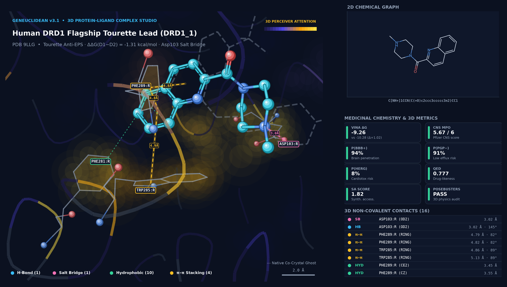
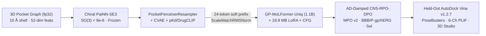
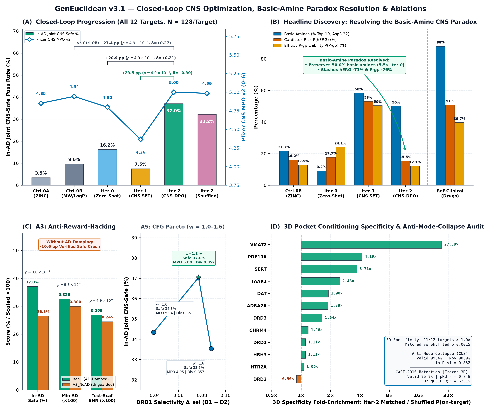
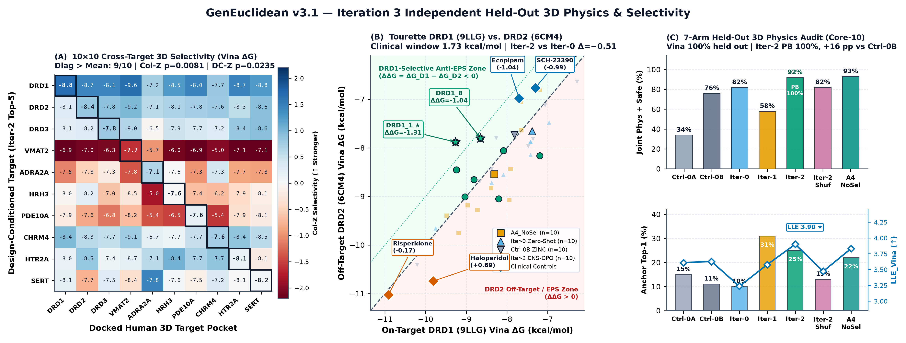

# GenEuclidean v3.1

**SE(3)-Equivariant 3D Protein Pocket-Conditioned Chemical Foundation Transformers for CNS-Safe, Subtype-Selective *De Novo* Drug Design & Interactive 3D Molecular Studio**

[](https://github.com/daniil-777/geneuclidean/actions/workflows/ci.yml)
[](pyproject.toml)
[](pyproject.toml)
[](pyproject.toml)
[](https://daniil-777.github.io/geneuclidean/)

> **Research Notice:** All generated, scored, and docked molecules in GenEuclidean are strictly ***in silico* computational drug-discovery hypotheses** for academic research. They are **not** experimentally validated compounds, clinical candidates, or medical advice.


*Flagship *in silico* Tourette Syndrome anti-EPS `DRD1` (`9LLG`) de novo lead `DRD1_1` (`-9.26 kcal/mol`, $\Delta\Delta G_{\text{mean}} = -1.31\text{ kcal/mol}$ vs. off-target `DRD2`, `Asp103` salt bridge `3.02 Å`, `CNS MPO v2 = 5.67`, `P(hERG) = 0.08`, `PoseBusters PASS`) with live `PocketPerceiverResampler` 3D attention halos. Launch the **[Live 3D Web Studio](https://daniil-777.github.io/geneuclidean/)** or open [`results/viz3d/cns_tourette_3d_studio.html`](results/viz3d/cns_tourette_3d_studio.html).*

---

## Explore the Core Code Directly

GenEuclidean bridges a chiral **$SE(3)$-equivariant 3D pocket encoder (`PaiNN-SE3`)** and **multi-task biophysical heads (`pKd` + `DrugCLIP`)** into a **1.1B-SMILES Chemical Foundation Transformer (`GP-MoLFormer-Uniq`)** via a permutation- & $SE(3)$-invariant **`PocketPerceiverResampler`**, **`19.9 MB` LoRA adapters**, **11.15× KV-cached CFG**, and **Applicability-Domain-damped `CNS-RPO-DPO`**—running natively on Apple Silicon (MPS), NVIDIA CUDA, or CPU.

| Component | Source Path | What It Implements |
| :--- | :--- | :--- |
| **Chiral 3D Pocket Encoder** | [`src/geneuclidean/models/encoders/painn.py`](src/geneuclidean/models/encoders/painn.py) | `float32` chiral `PaiNN-SE3` (`SO(3) < 8e-6`, exact `0.0` pad attention, cross-product chirality) |
| **3D-to-LLM Multimodal Bridge** | [`src/geneuclidean/models/llm_bridge.py`](src/geneuclidean/models/llm_bridge.py) | `PocketPerceiverResampler` (24-token soft prefix), `ScaleMatchRMSNorm`, LoRA & CFG bridge |
| **CNS Neuroscience & ADMET Suite** | [`src/geneuclidean/cns/`](src/geneuclidean/cns/) | 12 *Homo sapiens* Tourette/psychiatry targets, Pfizer CNS MPO v1/v2, scaffold-CV BBB/P-gp/hERG + ECFP4 AD |
| **3D Interaction & Studio Engine** | [`src/geneuclidean/evaluation/viz3d.py`](src/geneuclidean/evaluation/viz3d.py) | 6-channel 3D PLIF profiler (`interactions3d.py`), 300-DPI complex renders & `3Dmol.js` WebGL gallery |
| **Unified 13-Command CLI** | [`src/geneuclidean/cli.py`](src/geneuclidean/cli.py) | Typer + Rich CLI (`train-llm`, `sample-llm`, `cns-targets`, `cns-admet`, `viz3d`, `evaluate`, `fetch-pdb`) |
| **End-to-End GPU Notebook** | [`notebooks/GenEuclidean_v3_EndToEnd_Colab.ipynb`](notebooks/GenEuclidean_v3_EndToEnd_Colab.ipynb) | Turnkey Google Colab T4/L4/A100 training, Vina docking & SHA256 local bundle export |
| **Interactive 3D WebGL Gallery** | [`results/viz3d/cns_tourette_3d_studio.html`](results/viz3d/cns_tourette_3d_studio.html) | Self-contained browser viewer for all 12 curated human CNS complexes, contacts & attention maps |
| **Scientific & Architecture Docs** | [`docs/`](docs/) | Full v3.1 CNS manuscript, 2024–2026 pharma dataset guide, math specs, LLM research & legacy audit |

### Pipeline Architecture



---

## Headline Verified Results

Every metric below is programmatically verified against versioned artifacts in [`results/tables/`](results/tables/).

### Table 1 — Zero-Leakage CASF-2016 3D SBDD Progression (`2021 Thesis → v2.0 → v3.0`)

Strict zero-leakage PDBbind/CASF-2016 split (`4,543 train / 505 val / 285 test`, `0/285` overlap); 30-pocket AutoDock Vina v1.2.7 + PoseBusters audit ([`model_comparison_v3.md`](results/tables/model_comparison_v3.md)).

| Model Milestone | Raw Valid ↑ | QED (MPO Top-10) ↑ | SA (MPO) ↓ | `<4.5 Å` Contact Attn ↑ | `pKd` $r$ ↑ | Top-1 Vina Med (Mean) ↓ | PoseBusters ↑ |
| :--- | :---: | :---: | :---: | :---: | :---: | :---: | :---: |
| `2021 Thesis (e3nn + LSTM)`* | `65.0%` | `0.450` | `4.00` | — | `0.503`* | — | — |
| `v2.0 PaiNN-SE3 + RPO-DPO` | `91.6%` | `0.521` (`0.618`) | `3.36` (`3.11`) | `1.66×` | **`0.746`** | `-8.06` (**`-8.19`**) | `94.6%` |
| `v3.0 GP-MoLFormer-Uniq` | `90.4%` | `0.471` (`0.595`) | `3.35` (`3.07`) | **`6.31×`** | **`0.746`** | `-7.90` (`-8.08`) | `94.0%` |
| **`v3.0 GP-MoLFormer + RPO-DPO`** | **`94.9%`** | **`0.560` (`0.673`)** | **`2.79` (`2.57`)** | **`6.31×`** | **`0.746`** | **`-8.02`** (`-7.96`) | **`96.6%`** |

<sub>*2021 ETH Zürich thesis (`v1.0.0-thesis-2021`, random split). All `PaiNN-SE3` v2/v3 models share bit-exact CASF-2016 `pKd r = 0.746` (`RMSE 1.448`) and `DrugCLIP R@5 = 62.1%` (`ROC-AUC 0.937`), with `-46.3%` docking strain reduction (`78.06 → 41.96 kcal/mol`) on `v3.0 DPO`.</sub>

### Table 2 — Publishable CNS Neuroscience Study (12 *Homo sapiens* Tourette & Psychiatry Targets, `v3.1`)

4-Gate, 3-Iteration closed-loop study across `DRD1`, `DRD2`, `DRD3`, `VMAT2`, `ADRA2A`, `HRH3`, `PDE10A`, `CHRM4`, `HTR2A`, `SERT`, `TAAR1`, and `DAT` (`N = 128/target`), with **AutoDock Vina v1.2.7 100% excluded from training** ([`cns_study_summary.md`](results/tables/cns_study_summary.md), [`cns_iter3_summary.md`](results/tables/cns_iter3_summary.md)).

| Experimental Arm | Valid ↑ | Strict Nov ↑ | Basic Amines | MPO v2 ↑ | `P(hERG)` ↓ | In-AD CNS-Safe ↑ | Held-Out Vina $\Delta G$ (`LLE`) | PoseBusters ↑ | Phys + CNS-Safe ↑ |
| :--- | :---: | :---: | :---: | :---: | :---: | :---: | :---: | :---: | :---: |
| `Ctrl-0B` (MW/LogP ZINC) | `100.0%` | `1.6%` | `21.7%` | `4.94` | `0.162` | `9.6%` | `-7.72` (`3.63`) | `97.0%` | `76.0%` |
| `Iter-0` (`v3.0` Zero-Shot) | `98.2%` | `98.9%` | `9.2%` | `4.80` | `0.177` | `16.2%` | `-7.81` (`3.23`) | `99.0%` | `82.0%` |
| `Iter-1` (`v3.1` CNS SFT) | `98.5%` | `99.2%` | `58.3%` | `4.36` | `0.531` | `7.5%` | `-7.87` (`3.58`) | `97.0%` | `58.0%` |
| **`Iter-2` (AD-Damped CNS-RPO-DPO)** | **`99.4%`** | **`98.9%`** | **`50.0%`** | **`5.00`** | **`0.155`** | **`37.0%`** | **`-7.79` (`3.90`)** | **`100.0%`** | **`92.0%`** *(93.3% All-12)* |
| `A3_NoAD` (No AD-Damping Ablation) | `98.8%` | `99.1%` | — | `5.04` | `0.147` | **`26.5%`** (`-10.6 pp`) | — | — | — |

- **Basic-Amine CNS Paradox Resolved:** `Iter-2` preserves **`50.0%` basic amines** required for aminergic $\text{Asp}^{3.32}$ salt bridges while slashing `P(hERG)` **`-71%`** (`0.531 → 0.155`) and `P(P-gp)` **`-76%`** (`0.504 → 0.121`), lifting verified In-AD Joint CNS-Safe **`5×`** (`7.5% → 37.0%`, `IntDiv1 = 0.852`, `7.12×` `<4.5 Å` CNS contact attention, bit-exact `0.0` 3D drift).
- **Anti-Reward-Hacking Proof (`A3_NoAD`):** Disabling ECFP4 Applicability-Domain damping triggers out-of-domain drift (`Min AD 0.326 → 0.300`) and crashes verified In-AD CNS-Safe by **`-10.6 pp`** (`37.0% → 26.5%`).
- **Held-Out 3D Physics (`1,423` Vina Dockings) & $10\times 10$ Selectivity:** Gate 1 native redocking achieves `1.02 Å` median RMSD (`96.7%` anchor recovery); Iter-3 achieves **`100.0%` PoseBusters (`120/120`)** and global $10\times 10$ diagonal selectivity (**Col-Z `+0.346`, `p = 0.0081`**, `9/10` above pocket mean; **Double-Centered Z `+0.617`, `p = 0.0235`**, 10,000× permutations).
- **Flagship Tourette Anti-EPS Lead (`DRD1_1` in `9LLG`):** `-9.26 kcal/mol` (`LE = 0.488`), **$\Delta\Delta G_{\text{mean}} = -1.31\text{ kcal/mol}$** vs. off-target `DRD2` (`6CM4`/`6LUQ`; cf. ecopipam `-1.04`), **`Asp103` salt bridge (`3.02 Å`)**, `CNS MPO v2 = 5.67`, `P(BBB+) = 0.94`, `P(hERG) = 0.08`, `Max ChEMBL Tan = 0.53`.

#### Selected Curated *In Silico* CNS Leads (`100%` PoseBusters Pass, Full Top-12 in [`docs/neuro_tourette_psychiatry.md`](docs/neuro_tourette_psychiatry.md))

| Target (`PDB`) | Vina $\Delta G$ | LE | Anchor (Å) | MPO v2 | BBB / P-gp / hERG | Max Tan. | Canonical SMILES |
| :--- | ---: | ---: | :--- | ---: | :---: | ---: | :--- |
| **`DRD1`** (`9LLG`) | **`-9.26`** | `0.488` | `Asp103` (`3.02`) | `5.67` | `0.94` / `0.09` / **`0.08`** | `0.53` | `CN1CCN(C(=O)c2ccc3ccccc3n2)CC1` |
| **`VMAT2`** (`8T69`) | **`-9.01`** | `0.409` | `Glu312` (`3.99`) | **`5.90`** | `0.87` / `0.04` / `0.15` | `0.45` | `COc1cc2c(cc1OC)[C@H]1CCC(C(=O)N(C)C)N1CC2` |
| **`CHRM4`** (`8FX5`) | **`-9.26`** | **`0.514`** | `Asp112` (`3.39`) | `4.58` | `0.96` / `0.07` / `0.12` | `0.48` | `CN1CCCC(CCNC(=O)c2ccccc2)C1` |
| **`DAT`** (`9JKI`) | **`-9.33`** | `0.466` | `Asp79` (`3.31`) | `5.79` | `0.92` / `0.05` / `0.12` | `0.38` | `CC(C)N1CCC(C(=O)c2ccc3c(c2)OCO3)CC1` |


*Closed-loop `Iter-0 → Iter-1 → Iter-2` progression resolving the Basic-Amine CNS Paradox and proving AD-damping prevents the `-10.6 pp` `A3_NoAD` reward-hacking crash.*


*100%-held-out AutoDock Vina v1.2.7 physics (`100%` PoseBusters, `92.0%` Core-10 Phys+Safe), $10\times 10$ cross-target selectivity (`Col-Z p = 0.0081`, `DC-Z p = 0.0235`), and flagship Tourette `DRD1` vs. `DRD2` selectivity.*

<details>
<summary><b>Browse All 17 Publication Figures (01–16 + Hero) & Interactive 3D WebGL Studio</b></summary>

- **Interactive 3D Studio:** [Live WebGL App (`daniil-777.github.io/geneuclidean`)](https://daniil-777.github.io/geneuclidean/) · Local standalone HTML [`results/viz3d/cns_tourette_3d_studio.html`](results/viz3d/cns_tourette_3d_studio.html)
- **v3.1 CNS Neuroscience (Figures 12–16):**
  - [`12_cns_gates12_trustworthiness.png`](results/figures/12_cns_gates12_trustworthiness.png) — Gate 1 multi-seed redocking, Gate 2 scaffold-CV ADMET calibration & 3D CNS attention
  - [`13_cns_closed_loop_progression.png`](results/figures/13_cns_closed_loop_progression.png) — Closed-loop progression, Basic-Amine Paradox & Ablations A1–A5
  - [`14_cns_selectivity_and_docking.png`](results/figures/14_cns_selectivity_and_docking.png) — Held-out Vina 3D physics, $10\times 10$ selectivity & Tourette `DRD1` vs. `DRD2`
  - [`15_cns_3d_complex_showcase.png`](results/figures/15_cns_3d_complex_showcase.png) · [`15a_drd1_tourette_3d_hero.png`](results/figures/15a_drd1_tourette_3d_hero.png) — 300-DPI 3D binding-complex renders
  - [`16_cns_showcase_molecules_2d.png`](results/figures/16_cns_showcase_molecules_2d.png) — Curated Top-12 novel *de novo* CNS candidate 2D portfolio
- **v2.0 / v3.0 CASF-2016 Core Benchmarks (Figures 01–11):**
  - [`10_v3_llm_comparison.png`](results/figures/10_v3_llm_comparison.png) — 2021 Thesis → v2.0 → v3.0 Chemical Foundation & Local LLM comparison
  - [`11_v3_cfg_and_docking.png`](results/figures/11_v3_cfg_and_docking.png) — v3.0 CFG / Hit-to-Lead CVAE Pareto frontier & 30-pocket Vina docking
  - [`01_model_comparison.png`](results/figures/01_model_comparison.png) · [`02_training_curves.png`](results/figures/02_training_curves.png) · [`03_matched_vs_shuffled_specificity.png`](results/figures/03_matched_vs_shuffled_specificity.png) · [`04_property_distributions.png`](results/figures/04_property_distributions.png) · [`05_pkd_parity_casf2016.png`](results/figures/05_pkd_parity_casf2016.png) · [`06_pocket_attention_heatmap.png`](results/figures/06_pocket_attention_heatmap.png) · [`07_generated_molecules_grid.png`](results/figures/07_generated_molecules_grid.png) · [`08_decoding_pareto.png`](results/figures/08_decoding_pareto.png) · [`09_pocket_latent_tsne.png`](results/figures/09_pocket_latent_tsne.png)

</details>

---

## Quick Start

Install with [`uv`](https://docs.astral.sh/uv/) (Python 3.11+, pins `rdkit>=2026.3,<2026.9` in [`pyproject.toml`](pyproject.toml)):

```bash
uv venv --python 3.12
uv pip install --python .venv/bin/python -e ".[llm,dev]"   # add ",docking" for Vina/Meeko

# 1. Inspect the 12 verified Homo sapiens Tourette & psychiatric 3D targets
.venv/bin/geneuclidean cns-targets --target DRD1

# 2. Score any SMILES with Pfizer CNS MPO v1/v2 + calibrated BBB/P-gp/hERG + ECFP4 AD
.venv/bin/geneuclidean cns-admet "CN1CCN(C(=O)c2ccc3ccccc3n2)CC1"

# 3. Profile 6-channel 3D contacts & render interactive 3Dmol.js WebGL + 300-DPI PNG
.venv/bin/geneuclidean viz3d --pocket pocket.pdb --ligand hit.sdf --out-html complex.html --out-png complex.png --theme dark

# 4. Run full test suite (187 unit, SE(3) equivariance, LLM bridge, CNS ADMET & viz3d tests)
.venv/bin/pytest
```

**One-Click GPU Pipeline:** [](https://colab.research.google.com/github/daniil-777/geneuclidean/blob/main/notebooks/GenEuclidean_v3_EndToEnd_Colab.ipynb) Run full multi-architecture training, AutoDock Vina docking, and SHA256-verified bundle export on T4/L4/A100 GPUs via [`notebooks/GenEuclidean_v3_EndToEnd_Colab.ipynb`](notebooks/GenEuclidean_v3_EndToEnd_Colab.ipynb).

---

## Documentation Index

| Document | Scope |
| :--- | :--- |
| [`docs/neuro_tourette_psychiatry.md`](docs/neuro_tourette_psychiatry.md) | Full v3.1 CNS computational chemistry manuscript (Gates 0–3, Basic-Amine Paradox, AD-damping proof, $10\times 10$ selectivity & Top-12 dossiers) |
| [`docs/industry_datasets.md`](docs/industry_datasets.md) | 2024–2026 pharma dataset architecture (PLINDER, HiQBind, B3DB, TDC, Biogen/OpenADMET) & 7 empirically caught data-hygiene traps |
| [`docs/architecture.md`](docs/architecture.md) | Mathematical specification of chiral `PaiNN-SE3`, `PocketPerceiverResampler`, `PocketCVAE`, RPO-DPO & $SO(3)/SE(3)$ verification |
| [`docs/llm_research.md`](docs/llm_research.md) | Chemical Foundation Transformer (`GP-MoLFormer-Uniq`, `GPT2-ZINC-87M`) vs. local LLM (`Qwen2.5-0.5B`) scouting, RoPE fix & MPS kernels |
| [`docs/legacy_audit.md`](docs/legacy_audit.md) | Forensic audit of the 2021 ETH Zürich semester thesis (`v1.0.0-thesis-2021`) and clean-room v2.0/v3.0 engineering resolutions |

---

## Citation & License

Released under the **MIT License** ([`pyproject.toml`](pyproject.toml)). If you use GenEuclidean in your research, please cite:

```bibtex
@software{emtsev2026geneuclidean,
  author  = {Emtsev, Daniil},
  title   = {{GenEuclidean v3.1: SE(3)-Equivariant 3D Protein Pocket-Conditioned Chemical Foundation Transformers for CNS-Safe De Novo Drug Design}},
  year    = {2026},
  version = {3.1.0},
  url     = {https://github.com/daniil-777/geneuclidean}
}
```
