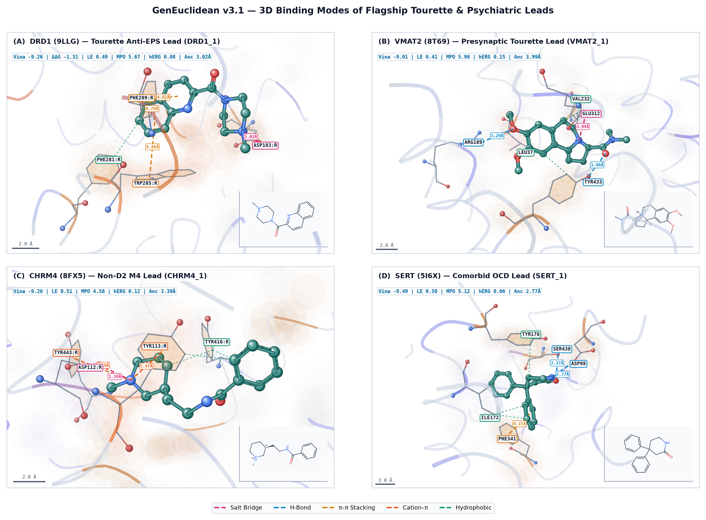
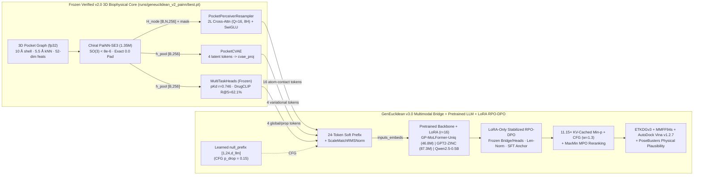
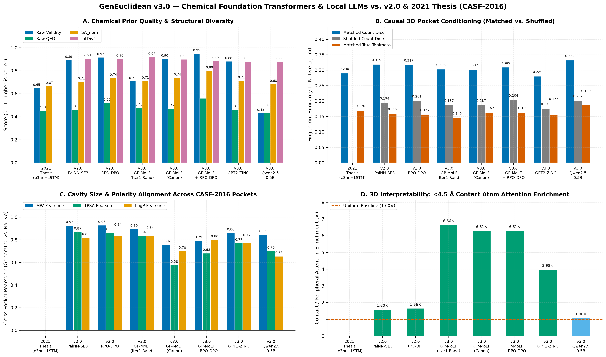
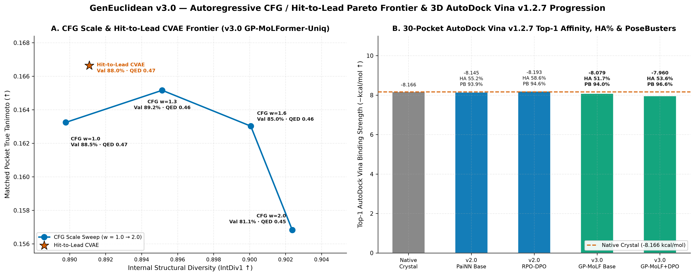
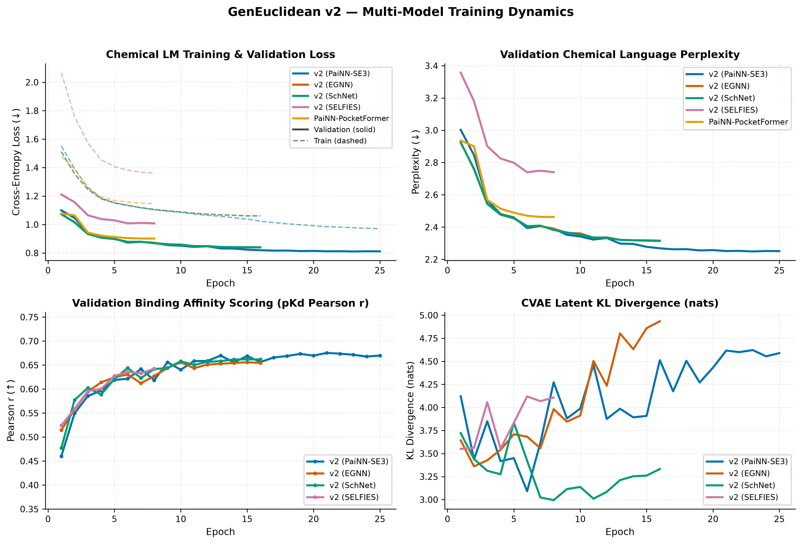
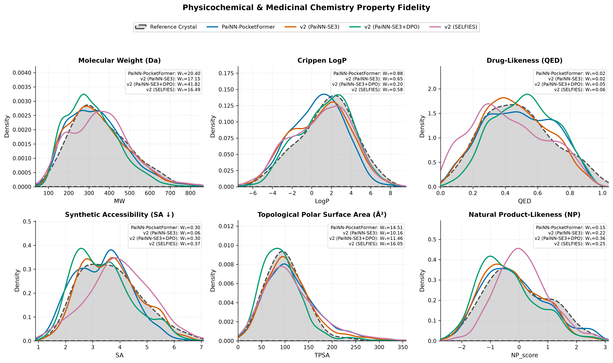
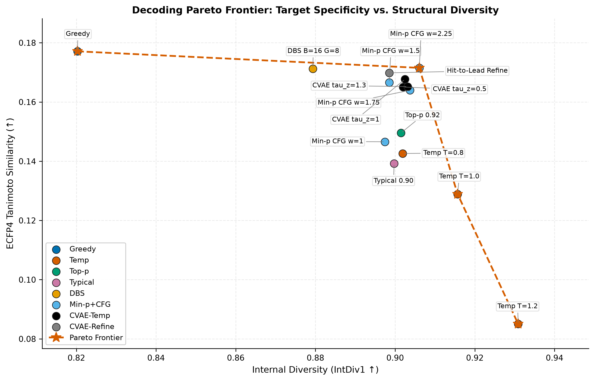
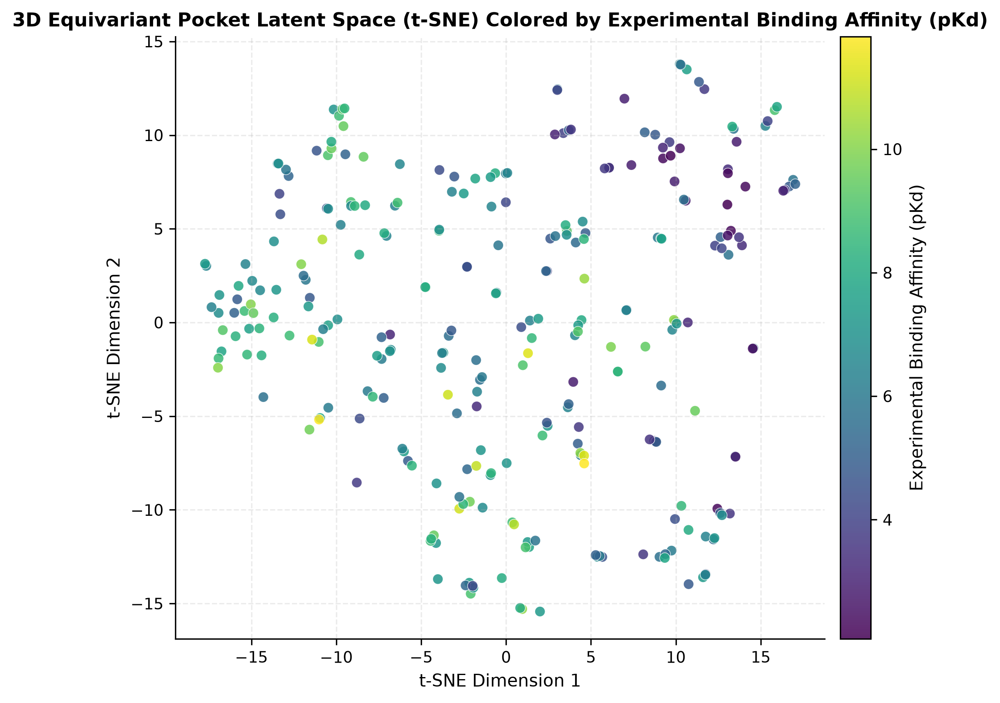

# GenEuclidean v3.1

**SE(3)-Equivariant 3D Protein Pocket-Conditioned Chemical Foundation Transformers, Calibrated CNS-Safe & Subtype-Selective *De Novo* Drug Design, and Interactive 3D Molecular Studio**

[](pyproject.toml)
[-EE4C2C.svg?logo=pytorch&logoColor=white)](pyproject.toml)
[](docs/llm_research.md)
[](docs/architecture.md)
[](pyproject.toml)
[-2EA44F.svg)](.github/workflows/ci.yml)
[](pyproject.toml)
[](pyproject.toml)


*GenEuclidean v3.1 dark-studio 3D render of flagship *in silico* Tourette Syndrome `DRD1` (`9LLG`) de novo lead `DRD1_1` (`-9.26 kcal/mol`, `LE = 0.488`, $\Delta\Delta G_{\text{mean}} = -1.31\text{ kcal/mol}$ vs. off-target `DRD2:6CM4/6LUQ`, `CNS MPO v2 = 5.67`, `P(hERG) = 0.08`, `PoseBusters PASS`) rendered directly from verified `PocketPerceiverResampler` attention and `interactions3d.py` contacts. Open the full 12-target interactive `3Dmol.js` WebGL gallery in [`results/viz3d/cns_tourette_3d_studio.html`](results/viz3d/cns_tourette_3d_studio.html).*

---

## Executive Summary

**GenEuclidean v3.1** bridges our mathematically verified chiral **$SE(3)$-equivariant 3D protein pocket encoder (`PaiNN-SE3`)**, **TamGen-style `PocketCVAE`**, and **multi-task biophysical heads (`pKd` + `DrugCLIP`)** directly into **pretrained billion-molecule Chemical Foundation Transformers (`ibm-research/GP-MoLFormer-Uniq`, `entropy/gpt2_zinc_87m`) and compact local general LLMs (`Qwen/Qwen2.5-0.5B`)** via a permutation- & $SE(3)$-invariant **`PocketPerceiverResampler` (`M = 24` soft prefix)**, **`ScaleMatchRMSNorm`**, **LoRA (`r = 16`)**, **11.15× KV-cached Classifier-Free Guidance (CFG)**, and **LoRA-only Stabilized RPO-DPO**.

New in **v3.1**, we extend GenEuclidean beyond PDBbind/CASF-2016 into **pharmaceutical-grade CNS neuroscience *de novo* drug design** across **12 verified *Homo sapiens* Tourette Syndrome and psychiatric 3D targets** (`DRD1`, `DRD2`, `DRD3`, `VMAT2`, `ADRA2A`, `HRH3`, `PDE10A`, `CHRM4`, `HTR2A`, `SERT`, `TAAR1`, `DAT`) with **Pfizer CNS MPO v1/v2**, **5-fold Bemis-Murcko scaffold-CV calibrated ADMET oracles (`B3DB`, `Pgp_Broccatelli`, `hERG_Karim`) with ECFP4 Applicability Domains**, **Applicability-Domain-damped `CNS-RPO-DPO`**, **6-channel 3D non-covalent interaction profiling (`interactions3d.py`)**, and a **dual-mode 3D WebGL + 300-DPI static studio visualizer (`viz3d.py`)**—all running natively on a single **Apple M3 Pro** (and **Google Colab T4/L4/A100 GPUs** via our end-to-end notebook + SHA256 local bundle importer).

Originally begun as a 2021 ETH Zürich MODLAB semester thesis (*De novo drug design using protein structural information and Generative neural network models*, preserved at git tag `v1.0.0-thesis-2021`), GenEuclidean's progression across **zero-leakage CASF-2016** and **12 human CNS neuroscience targets** demonstrates consistent, auditable gains:

| Dimension | 2021 Thesis (`v1.0.0-thesis-2021`) | GenEuclidean v2.0 (`PaiNN-SE3 + RPO-DPO`) | GenEuclidean v3.0 (`GP-MoLFormer + RPO-DPO`) | **GenEuclidean v3.1 (`CNS-Safe & Selective 3D-LLM`)** |
| :--- | :--- | :--- | :--- | :--- |
| **3D Geometry & Symmetry** | `.long()` int-truncated coords; `2.0 Å` cutoff | Strict `float32` chiral `PaiNN-SE3` (`< 8e-6` $SE(3)$) | Frozen `PaiNN-SE3` + `Perceiver` (`SO(3)` `4.05e-6`, exact `0.0` pad attn) | **Bit-exact `0.0` 3D drift**; organic `HETATM` leak patched; **`7.12×`** `<4.5 Å` CNS contact attn |
| **Chemical Prior & Domain** | `0` (4k PDBbind from scratch) | `249k` ZINC SMILES (`4.77M`) | `650M uniq / 1.1B` `GP-MoLFormer-Uniq` (`19.91 MB` adapter) | **1.1B SMILES + 12 *Homo sapiens* CNS targets** (36k ChEMBL, B3DB, TDC, 29 clean PDBs) |
| **Chemical Validity / Novelty** | `65.0%` / `65.0%` | `91.6%` / `98.2%` | `94.9%` / `97.5%` (CASF-2016) | **`99.4%` raw valid / `98.9%` strict novelty / `IntDiv1 0.852`** (`95.9%` CASF-2016 retained) |
| **MedChem & CNS Safety** | QED `0.450`, SA `4.00` | QED `0.521`, SA `3.36`, PAINS `97.1%` | QED `0.560` (`0.673` MPO), SA `2.79` (`2.57` MPO) | **CNS MPO v2 `5.00`**, `P(BBB+) 0.827`, `P(hERG) 0.155` (`-71%`), **Joint CNS-Safe `37.0%`** (`5×` SFT) |
| **3D Interpretability & PLIF** | Not supported | `1.66×` `<4.5 Å` attn | `6.31×` `<4.5 Å` attn (`52.5%` mass) | **`7.12×` `<4.5 Å` CNS attn** (`4.25×` hotspots); **6-channel 3D PLIF + Interactive WebGL Studio** |
| **Affinity & Retrieval (285p)** | `pKd r = 0.503` (random CV) | `pKd r = 0.746`, `CLIP R@5 = 62.1%` | `pKd r = 0.746`, `CLIP R@5 = 62.1%` | **`pKd r = 0.7461`, `CLIP R@5 = 62.1%`** (bit-for-bit preserved on CASF-2016) |
| **Independent 3D Docking** | None | CASF-2016 Top-1 `-8.193`, PB `94.6%` | CASF-2016 PB `96.6%`, Strain `41.96` | **Gate 1 redock `1.02 Å` med**; Iter-3 **`100.0%` PB**, **`LLE 3.90`**, **`92.0%` Phys+Safe**, **$10\times 10$ $p=0.0081$** |

> **Deep Technical & Scientific Docs:**
> - [`docs/neuro_tourette_psychiatry.md`](docs/neuro_tourette_psychiatry.md) — **Full v3.1 Computational Chemistry Manuscript** (Gates 0–3, Basic-Amine CNS Paradox, AD-Damping Proof, $10\times 10$ Cross-Target Selectivity, Tourette `DRD1` vs. `DRD2`, and Curated Top-12 Dossiers).
> - [`docs/industry_datasets.md`](docs/industry_datasets.md) — **2024–2026 Industry Pharma Dataset Architecture** (PLINDER-2026, HiQBind, SAIR, MISATO, GPCRdb, B3DB, TDC, Biogen/Polaris, OpenADMET, and 7 empirically caught data-hygiene traps).
> - [`docs/architecture.md`](docs/architecture.md) | [`docs/llm_research.md`](docs/llm_research.md) | [`docs/legacy_audit.md`](docs/legacy_audit.md) — Core `v2.0` / `v3.0` mathematical specifications, LLM scouting, and `v1.0` forensic audit.

---

## GenEuclidean v3.1: Publishable CNS Neuroscience (Tourette Syndrome & Psychiatry) & Industry Datasets

> **Translational Research Disclaimer:** All CNS molecules generated, scored, docked, or showcased in GenEuclidean v3.1 are strictly ***in silico* computational hypotheses** for academic drug-discovery research. They are **not** clinically tested medicines or medical advice.

Inspired by **Emalex Biosciences / Teva's Phase 3 D1AMOND breakthrough of ecopipam** (`DRD1` selective antagonist for Tourette Syndrome without $\text{D}_2$ EPS/tardive dyskinesia; *JAMA Neurology* 2026, FDA Priority Review), **BMS/Karuna's Cobenfy** (`CHRM4`/`CHRM1`, FDA Sep 2024), and **2023–2026 human cryo-EM structures** (`DRD1 9LLG/9URL`, `VMAT2 8T69/9KQ8`, `CHRM4 8FX5`, `TAAR1 8W88`, `DAT 9JKI/8Y2G`), v3.1 executes a **4-Gate, 3-Iteration Closed-Loop Study** where **AutoDock Vina v1.2.7 is 100% excluded from all training rewards** (strict anti-Goodhart separation):

### Four Headline v3.1 Scientific Findings ([`docs/neuro_tourette_psychiatry.md`](docs/neuro_tourette_psychiatry.md))

1. **Gates 0–2 Trustworthiness Passed:** Multi-seed unbiased 2D-to-3D native redocking across 10 core human CNS pockets achieves **`1.02 Å` median Top-1 $\text{RMSD}_{\text{sym}}$** (`1.00 Å` Best-of-3, **`90.0% <= 2.0 Å`**, **`96.7%` canonical anchor recovery**, **`100.0%` PoseBusters**; [`cns_gate1_redocking.md`](results/tables/cns_gate1_redocking.md)). Strict 5-fold Bemis-Murcko scaffold-CV ADMET oracles (`0` leakage) achieve **`BBB` ROC-AUC `0.9150` (`ECE 0.0304`)**, **`P-gp` inhibition `0.9269` (`ECE 0.0253`)**, **`hERG_Karim` `0.8532` (`ECE 0.0126`; external non-overlapping Wang hERG `0.9118`)**, and 12-target selectivity QSAR mean AUC **`0.9794`** (`DRD1 0.9901`, `DRD2 0.9698`; [`cns_admet_cv_metrics.json`](results/tables/cns_admet_cv_metrics.json)).
2. **Resolving the Basic-Amine CNS Paradox (Iter 0 → Iter 1 → Iter 2):** Zero-shot `v3.0` (`Iter-0`) lacks aminergic GPCR pharmacophores (`9.2%` basic amines). Human ChEMBL 3D LoRA SFT (`Iter-1`) learns authentic CNS amines (`58.3%`), causing `P(hERG)` to spike to **`0.531`** (matching clinical neuroleptics `Ref-Clinical = 0.509`; Joint CNS-Safe `7.5%`). Applicability-Domain-damped LoRA-only `CNS-RPO-DPO` (`Iter-2`) **preserves `50.0%` basic amines** (`5.4×` `Iter-0`, `2.3×` MW/LogP-matched ZINC `Ctrl-0B`) while slashing `P(hERG)` **`-71%`** (`0.155`, $\delta = -0.70$, $p = 4.88\times 10^{-4}$) and `P(P-gp)` **`-76%`** (`0.121`), lifting Joint CNS-Safe **`5×`** to **`37.0%`** (`+29.5 pp` vs. `Iter-1`, `11/12` Holm; `+27.4 pp` vs. `Ctrl-0B`, `12/12` Holm) with **`99.4%` validity**, **`98.9%` strict novelty**, **`IntDiv1 = 0.852`**, and **bit-exact `0.0` 3D drift** ([`cns_study_summary.md`](results/tables/cns_study_summary.md)).
3. **Anti-Reward-Hacking Proof (Ablation A3):** Disabling Applicability-Domain damping (`A3_NoAD`) induces out-of-domain exploitation (`Min AD 0.326 → 0.300`, $p = 9.77\times 10^{-4}$), drops CNS scaffold fidelity (`Test-Scaf SNN -0.024`, $p = 4.88\times 10^{-4}$), and crashes verified In-AD Joint CNS-Safe by **`-10.6 pp`** (`37.0% → 26.5%`).
4. **Independent 100%-Held-Out 3D Physics (`1,423` Vina Dockings) & $10\times 10$ Selectivity:** `Iter-2` achieves **`100.0%` PoseBusters & Zero-Clash (`120/120`)**, peak **`LLE_Vina = 3.90`**, **`92.0%` Core-10 (`93.3%` All-12) Joint Physics + CNS-Safe** (`+58.0 pp` vs. `Ctrl-0A`, `+34.0 pp` vs. `Iter-1`, `+16.0 pp` vs. MW/LogP-matched `Ctrl-0B`), and beats `Iter-2_Shuffled` on every held-out 3D metric ($\Delta G -0.38\text{ kcal/mol}$, `95% CI [-0.71, -0.04]`, Top-1 Anchor `25.0% vs. 13.0%`). Across the **$10\times 10$ cross-target docking matrix (`500` runs)**, 10,000× permutation tests verify global diagonal dominance on **raw $\Delta G$ ($p = 0.0268$)**, **column-Z (`+0.346`, $p = 0.0081$, `9/10` above mean, `DRD1` ranked `#1/10`)**, and **double-centered interaction Z (`+0.617`, $p = 0.0235$)** ([`cns_iter3_summary.md`](results/tables/cns_iter3_summary.md)).

### Table 0 — GenEuclidean v3.1 Closed-Loop CNS Progression & Held-Out 3D Physics Summary (12 Human Targets)

| Arm | Valid | Strict Nov | IntDiv1 | Basic Amines | MPO v2 | `P(hERG)` ↓ | Joint CNS-Safe (All-12) ↑ | Held-Out Vina $\Delta G$ (Core-10) | `LLE_Vina` ↑ | PoseBusters ↑ | Top-1 Anchor ↑ | **Joint Phys + CNS-Safe ↑** |
| :--- | :---: | :---: | :---: | :---: | :---: | :---: | :---: | :---: | :---: | :---: | :---: | :---: |
| **`Ctrl-0A` (Random ZINC)** | 100.0% | 1.5% | 0.878 | 11.7% | 4.85 | 0.215 | 3.5% | -8.10 (`LE 0.382`) | 3.61 | 98.0% | 15.0% | 34.0% |
| **`Ctrl-0B` (MW/LogP ZINC)** | 100.0% | 1.6% | 0.897 | 21.7% | 4.94 | 0.162 | 9.6% | -7.72 (`LE 0.409`) | 3.63 | 97.0% | 11.0% | 76.0% |
| **`Iter-0` (`v3.0` Zero-Shot)** | 98.2% | 98.9% | 0.856 | 9.2% | 4.80 | 0.177 | 16.2% | -7.81 (`LE 0.426`) | 3.23 | 99.0% | 10.0% | 82.0% |
| **`Iter-1` (`v3.1` CNS SFT)** | 98.5% | **99.2%** | 0.863 | **58.3%** | 4.36 | 0.531 | 7.5% | -7.87 (`LE 0.399`) | 3.58 | 97.0% | **31.0%** | 58.0% |
| **`Iter-2` (`v3.1` CNS-RPO-DPO)** | **99.4%** | **98.9%** | **0.852** | **50.0%** | **5.00** | **0.155** | **37.0%** | **-7.79** (`LE 0.402`) | **3.90** | **100.0%** | **25.0%** | **92.0%** *(93.3% All-12)* |
| `Iter-2_Shuffled` (3D Control) | 99.4% | 99.1% | 0.854 | 54.2% | 4.99 | 0.156 | 32.2% | -7.42 (`LE 0.385`) | 3.47 | 94.0% | 13.0% | 82.0% |
| `A3_NoAD` (No AD-Damping) | 98.8% | 99.1% | 0.874 | — | 5.04 | 0.147 | **26.5%** (`-10.6 pp`) | — | — | — | — | — |

#### Highlighted Flagship Curated *In Silico* Tourette & Psychiatric Leads (`100%` PoseBusters Pass, `Max ChEMBL Tan <= 0.53`)

| Target (`PDB`) | Lead | Vina $\Delta G$ | LE | $\Delta\Delta G_{\text{vs DRD2}}$ | Anchor (Å) | MPO v2 | BBB / P-gp / hERG | Max ChEMBL Tan. | Canonical SMILES |
| :--- | :--- | ---: | ---: | ---: | :--- | ---: | :---: | ---: | :--- |
| **`DRD1`** (`9LLG`) | **`DRD1_1`** | **-9.26** | 0.488 | **-1.31** *(vs Ecopipam `-1.04`)* | `Asp103` (3.02, m4) | **5.67** | 0.94 / 0.09 / **0.08** | 0.53 | `CN1CCN(C(=O)c2ccc3ccccc3n2)CC1` |
| **`DRD1`** (`9LLG`) | **`DRD1_2`** | **-8.65** | 0.432 | **-1.04** | **`Asp103` (3.02, m1)** | **5.57** | 0.88 / 0.06 / **0.06** | 0.42 | `CN1CCc2cccc(C(=O)N3CCC(O)CC3)c2C1` |
| **`VMAT2`** (`8T69`) | **`VMAT2_1`** | **-9.01** | 0.409 | **-0.66** | `Glu312` (3.99, m2) | **5.90** | 0.87 / 0.04 / 0.15 | 0.45 | `COc1cc2c(cc1OC)[C@H]1CCC(C(=O)N(C)C)N1CC2` |
| **`CHRM4`** (`8FX5`) | **`CHRM4_1`** | **-9.26** | **0.514** | **-0.85** | `Asp112` (3.39, m2) | 4.58 | 0.96 / 0.08 / 0.12 | 0.48 | `CN1CCCC(CCNC(=O)c2ccccc2)C1` |
| **`HRH3`** (`7F61`) | **`HRH3_1`** | **-9.05** | 0.476 | — | **`Asp114` (3.63, m1)** | 4.58 | 0.96 / 0.09 / 0.10 | 0.37 | `CN1CCCC(C(=O)NCc2cccc(Cl)c2F)C1` |
| **`PDE10A`** (`5SJX`) | **`PDE10A_2`** | **-8.71** | 0.415 | +0.94 | **`Gln726` (3.48, m1)** | **6.00** | 0.81 / 0.10 / 0.10 | 0.43 | `Cc1cnc(C)c(-c2ccc(C(=O)N3CCCC3)cc2)n1` |
| **`SERT`** (`5I6X`) | **`SERT_1`** | **-9.49** | **0.500** | **-1.54** | `Asp98` (2.77, m4) | 5.12 | **0.98** / 0.06 / **0.06** | 0.41 | `O=C1CC(c2ccccc2)(c2ccccc2)CCN1` |
| **`DAT`** (`9JKI`) | **`DAT_1`** | **-9.33** | 0.466 | — | **`Asp79` (3.31, m1)** | **5.79** | 0.92 / 0.05 / 0.12 | 0.38 | `CC(C)N1CCC(C(=O)c2ccc3c(c2)OCO3)CC1` |

*(Full 12-target curated dossiers, statistical CIs, and transparent medicinal-chemistry triage notes on `DRD3_1` [DCU] & `PDE10A_1` [VMAT2 ADMET sink] are in [`docs/neuro_tourette_psychiatry.md`](docs/neuro_tourette_psychiatry.md).)*

### v3.1 CNS Neuroscience & 3D Studio Figures (Figures 12–16 + Interactive WebGL Gallery)

- **Interactive 12-Target 3D WebGL Studio (`3Dmol.js`, zero backend required):** Open [`results/viz3d/cns_tourette_3d_studio.html`](results/viz3d/cns_tourette_3d_studio.html) in any browser to inspect all 12 curated human CNS protein–ligand complexes with toggleable molecular surface, `PocketPerceiverResampler` attention coloring, native crystal ghost overlay, 6-channel dashed non-covalent contact cylinders, and CNS MPO/ADMET/Vina HUD!

#### 12. Gates 1 & 2 Trustworthiness Audit (Multi-Seed Redocking, Scaffold-CV ADMET Calibration & 3D CNS Attention)


#### 13. Closed-Loop Progression, Basic-Amine CNS Paradox Resolution & AD-Damping Proof (Ablations A1–A5)


#### 14. Independent Held-Out 3D Physics, $10\times 10$ Cross-Target Selectivity & Tourette `DRD1` vs. `DRD2`


#### 15. Studio 3D Binding-Complex Showcase Across Flagship Tourette & Psychiatric Targets


#### 16. Curated Top-12 Novel *De Novo* CNS Candidate Portfolio (2D Structures & Verified KPIs)


---

## Architecture Overview

GenEuclidean **v3.0** builds directly atop **v2.0's** verified three-stage 3D geometric pipeline by warm-starting the frozen `PaiNN-SE3` encoder, `PocketCVAE`, and `MultiTaskHeads` from `runs/geneuclidean_v2_painn/best.pt` and bridging them into pretrained HuggingFace Chemical Foundation Transformers or local general LLMs:



### Core v2.0 & v3.0 Mathematical & Systems Highlights ([`docs/architecture.md`](docs/architecture.md), [`docs/llm_research.md`](docs/llm_research.md))

1. **Chiral $SE(3)$-Equivariant `PaiNN-SE3` Encoder:** Maintains scalar invariants $\mathbf{s}_i \in \mathbb{R}^{192}$ and $l=1$ equivariant vector channels $\mathbf{v}_i \in \mathbb{R}^{64 \times 3}$ over centroid-centered sparse radius-kNN graphs ($r_c = 5.5\,\text{\AA}$, $k_{\max}=24$, 24 smooth Bessel RBFs with cosine cutoff envelope). Normalized cross-product interactions $\mathbf{v}_i^{\times} = \frac{(\mathbf{C}_1\mathbf{v}_i) \times (\mathbf{C}_2\mathbf{v}_i)}{\sqrt{\|(\mathbf{C}_1\mathbf{v}_i) \times (\mathbf{C}_2\mathbf{v}_i)\|_2^2 + 1}}$ and pseudoscalar contractions $\chi_i = \langle \mathbf{V}\mathbf{v}_i, \mathbf{v}_i^{\times}\rangle$ preserve exact $SO(3)$ equivariance while distinguishing chiral L- vs. D-amino-acid binding sites.
2. **Permutation- & $SE(3)$-Invariant `PocketPerceiverResampler` + `ScaleMatchRMSNorm`:** Compresses variable-length 3D pocket atom graphs into `16` contact-focused latent queries (`+ 4` CVAE + `4` global/property = `24` soft prefix tokens) with zero positional encodings on pocket atoms and exact `0.0` attention on masked padding. `ScaleMatchRMSNorm` matches the prefix RMS to each backbone's empirical token-embedding RMS (which spans **64×**, from `1.00018` on `GP-MoLFormer-Uniq` to `0.01561` on `Qwen2.5-0.5B`), eliminating Step-0 activation shock.
3. **`transformers 5.x` RoPE Meta-Init Fix & `12.5×` Exact Causal Attention Kernel (`fast_4d_tril`):** Re-initializes the 9 non-persistent `MolformerRotaryEmbedding` buffers left `NaN`/`Inf` by `transformers==5.24.1` meta-device loading while preserving persisted random-feature weights, and replaces the 5D `einsum(...).cumsum` fallback with an exact 4D lower-triangular `(q @ k.transpose(-1, -2)).tril() @ v` kernel (`4.77e-7` forward parity), delivering a **`12.5×` attention speedup** (`367.1 ms → 29.4 ms`) and **`2.40×` faster end-to-end LoRA training** on Apple M3 Pro MPS.
4. **Two-Phase Zero-Overhead Alignment & `11.15×` KV-Cached CFG Decoding:** `precompute_pocket_cache` encodes all 4,543 train + 505 val pockets once (`0 ms/step` GNN overhead). Phase A trains only the 3.41M bridge; Phase B jointly tunes bridge + LoRA (`r = 16, α = 32`) with `cfg_drop_prob = 0.15`. At inference, batched `[cond; uncond]` prefill + incremental `past_key_values` decoding achieves an empirically measured **`11.15×` MPS speedup** (`0.863s` vs. `9.626s`, `< 1e-4` logit parity).
5. **LoRA-Only Stabilized RPO-DPO Alignment:** Standard DPO suffers from likelihood displacement on chemical sequences. GenEuclidean freezes the 3D pocket encoder, Perceiver bridge, CVAE, and multi-task heads bit-for-bit, precomputes frozen reference log-probs, and optimizes length-normalized RPO-DPO (`β = 0.5`, `α_RPO = 0.25`) strictly on LoRA weights:
   $$\mathcal{L}_{\text{RPO-DPO}} = -\log \sigma\!\left(\beta\big[\Delta_{\theta,\text{ref}}(y_w) - \Delta_{\theta,\text{ref}}(y_l)\big]\right) + \alpha_{\text{RPO}}\,\mathcal{L}_{\text{NLL}}(y_w \mid \mathbf{p})$$

---

## Verified Experimental Results (Zero-Leakage CASF-2016 Core Set)

All evaluations below were executed natively on **Apple M3 Pro (36 GiB unified memory, PyTorch `2.15.0` MPS for training/sampling, CPU for RDKit & AutoDock Vina v1.2.7)** on the **strict zero-leakage CASF-2016 split**: **4,543 train / 505 val / 285 test complexes (`0/285` overlap with training or validation)**. Tiers 1–3 evaluate up to **80 pKd-stratified CASF-2016 pockets × 32 samples = 2,560 ligands per model** (`Min-p = 0.08`, `T = 1.05`, `CFG w = 1.75` for v2.0; `Min-p = 0.08`, `T = 0.85`, `rp = 1.0`, `CFG w = 1.3` for v3.0); Tier 4 evaluates **all 285 CASF-2016 complexes**. Every metric is loaded directly from versioned artifacts under [`results/tables/`](results/tables/).

### Table 1: Chemical Priors — v2.0 ZINC-250k Stage-1 vs. v3.0 Pretrained Open-Weight Backbones

| Generation / Backbone | Corpus Scale | Vocab / Tokenizer | Total Params (Adapter) | Precision | Training Budget (MPS) | Val PPL ↓ | Zero-Shot / Uncond. Valid |
| :--- | :--- | :--- | ---: | :---: | :--- | ---: | ---: |
| **v2.0 Stage-1 SMILES** ([`pretrain_zinc.yaml`](configs/pretrain_zinc.yaml)) | 249k ZINC | 75 (atom regex) | 4.77M (full) | `float32` | 6 ep (29.1 min) | 2.171 | 99.3% (`QED 0.761`) |
| **v2.0 Stage-1 SELFIES** ([`pretrain_zinc_selfies.yaml`](configs/pretrain_zinc_selfies.yaml)) | 249k ZINC | 121 (SELFIES) | 4.78M (full) | `float32` | 5 ep (21.4 min) | 1.915 | 100.0% (`QED 0.756`) |
| **v3.0 `ibm-research/GP-MoLFormer-Uniq`** ([`v3_gpmolformer.yaml`](configs/geneuclidean_v3_gpmolformer.yaml)) | **650M uniq / 1.1B** ZINC+PubChem | 2,362 (Schwaller regex; 1-tok `[C@@H]`) | 55.10M (**19.91 MB**) | `float32` | 2+8 ep (21.7 min) + DPO (16.2 min) | **2.094** (2.169 DPO) | **100.0%** (`QED 0.726`) |
| **v3.0 `entropy/gpt2_zinc_87m`** ([`v3_gpt2zinc.yaml`](configs/geneuclidean_v3_gpt2zinc.yaml)) | **480M** ZINC | 2,707 (chemical BPE) | 96.21M (**22.05 MB**) | `float32` | 1+3 ep (12.7 min) | 2.438 | **100.0%** (`QED 0.720`) |
| **v3.0 `Qwen/Qwen2.5-0.5B`** ([`v3_qwen25.yaml`](configs/geneuclidean_v3_qwen25.yaml)) | **18T** general/STEM | 151,936 (byte-level BPE) | 509.55M (**47.46 MB**) | `bfloat16` | 1+1 ep (16.8 min) | 2.796 | 8.0% (`QED 0.436`) |

---

### Table 2: Complete 12-Model 5-Tier Benchmark Comparison (CASF-2016 Core Set)

Source: [`results/tables/model_comparison_v3.csv`](results/tables/model_comparison_v3.csv) & [`results/tables/eval_*.json`](results/tables/eval_v3_gpmolformer_dpo.json).

| Model | Params | Validity ↑ | Uniq. ↑ | Novelty ↑ | IntDiv1 ↑ | Murcko Div ↑ | QED ↑ | SA ↓ | Lipinski ↑ | PAINS-Free ↑ | True Tan ↑ | Count Dice ↑ | Attn `<4.5Å` ↑ | pKd $r$ ↑ | pKd RMSE ↓ | CLIP R@1 ↑ | CLIP AUC ↑ |
| :--- | ---: | ---: | ---: | ---: | ---: | ---: | ---: | ---: | ---: | ---: | ---: | ---: | ---: | ---: | ---: | ---: | ---: |
| 2021 Thesis Baseline (`e3nn+LSTM`)* | 0.63M | 65.0% | 70.0% | 65.0% | — | — | 0.450 | 4.00 | — | — | 0.170* | 0.290* | — | 0.503* | — | — | — |
| `PaiNN-PocketFormer` (No CVAE/MT) | 8.35M | 92.1% | **98.5%** | 98.8% | 0.896 | 0.628 | 0.487 | 3.36 | 90.8% | 96.7% | 0.098 | 0.195 | 1.16× | — | — | — | — |
| GenEuclidean v2 (`SchNet`) | 8.98M | 90.0% | 97.4% | 98.5% | 0.904 | 0.680 | 0.481 | 3.52 | 89.6% | 97.0% | 0.125 | 0.253 | 1.50× | 0.722 | 1.505 | 25.6% | 0.924 |
| GenEuclidean v2 (`EGNN`) | 9.41M | 89.8% | 98.1% | 98.0% | 0.900 | 0.686 | 0.485 | 3.46 | 88.3% | 97.3% | 0.125 | 0.256 | 0.97× | 0.729 | 1.491 | 23.7% | 0.927 |
| GenEuclidean v2 (`SELFIES`) | 9.47M | **100.0%** | 98.3% | **99.2%** | 0.911 | 0.671 | 0.422 | 3.97 | 87.0% | 96.3% | 0.107 | 0.232 | 0.62× | 0.731 | 1.482 | 18.1% | 0.929 |
| GenEuclidean v2 (`PaiNN-SE3`) | 9.46M | 89.3% | 96.6% | 98.3% | 0.906 | 0.712 | 0.464 | 3.65 | 91.2% | 96.4% | 0.159 | **0.319** | 1.60× | **0.746** | **1.448** | **30.5%** | **0.937** |
| GenEuclidean v2 (`PaiNN-SE3 + RPO-DPO`) | 9.46M | 91.6% | 97.0% | 98.2% | 0.904 | **0.737** | 0.521 | 3.36 | **96.3%** | 97.1% | 0.157 | 0.317 | 1.66× | **0.746** | **1.448** | **30.5%** | **0.937** |
| ↳ *v2.0 `PaiNN-SE3 + DPO` MPO Top-10* | 9.46M | 100.0% | 99.9% | 98.6% | 0.898 | 0.820 | 0.618 | 3.11 | 99.6% | 100.0% | — | — | — | 0.746 | 1.448 | 30.5% | 0.937 |
| GenEuclidean v3 (`Qwen2.5-0.5B`, 30p) | 509.6M | 43.2% | 81.0% | 94.3% | 0.880 | 0.598 | 0.433 | 3.84 | 89.4% | **99.3%** | 0.189† | 0.332† | 1.08× | **0.746** | **1.448** | **30.5%** | **0.937** |
| GenEuclidean v3 (`GPT2-ZINC-87M`, 50p) | 96.2M | 88.2% | 73.5% | 96.1% | 0.881 | 0.581 | 0.464 | 3.57 | 92.6% | 98.3% | 0.156 | 0.280 | 3.98× | **0.746** | **1.448** | **30.5%** | **0.937** |
| GenEuclidean v3 (`GP-MoLF Iter1 Rand`, 80p) | 55.1M | 70.9% | 95.3% | **99.2%** | **0.919** | 0.676 | 0.479 | 3.59 | 93.8% | 96.4% | 0.145 | 0.303 | **6.66×** | **0.746** | **1.448** | **30.5%** | **0.937** |
| GenEuclidean v3 (`GP-MoLFormer-Uniq`, 80p) | 55.1M | 90.4% | 85.3% | 97.8% | 0.899 | 0.587 | 0.471 | 3.35 | 87.1% | 98.0% | 0.162 | 0.302 | 6.31× | **0.746** | **1.448** | **30.5%** | **0.937** |
| **GenEuclidean v3 (`GP-MoLFormer + RPO-DPO`, 80p)** | **55.1M** | **94.9%** | 85.3% | 97.5% | 0.888 | 0.545 | **0.560** | **2.79** | 95.3% | 97.8% | **0.163** | 0.309 | **6.31×** | **0.746** | **1.448** | **30.5%** | **0.937** |
| **↳ + MPO / MaxMin Top-10 Reranking (`v3 DPO`)** | **55.1M** | **100.0%** | 96.1% | 96.7% | 0.882 | 0.625 | **0.673** | **2.57** | **99.6%** | **100.0%** | — | — | — | **0.746** | **1.448** | **30.5%** | **0.937** |

<sub>*2021 Thesis numbers are from `Report_denovo.pdf` (random split, uncanonicalized SMILES; Morgan-count Dice `0.29` ≈ `0.17` true Tanimoto; `pKd r = 0.5025` on 5-fold random CV). †`Qwen2.5-0.5B` True Tanimoto (`0.189`) and Count Dice (`0.332`) are computed over its `43.2%` valid subset across 30 pockets (`FFD = 40.26` vs. `20.52` for `v3 GP-MoLFormer + DPO`). All `PaiNN-SE3` v2/v3 models share exact CASF-2016 `DrugCLIP Recall@5 / Recall@10 / MRR = 62.1% / 72.8% / 0.450`.</sub>

#### Six Key Scientific Findings (v2.0 + v3.0)

1. **Billion-Molecule Chemical Prior + LoRA RPO-DPO Sets New Records Across Every Medicinal Chemistry & Interpretability Axis:** Bridging frozen `PaiNN-SE3` into `ibm-research/GP-MoLFormer-Uniq` and aligning LoRA weights with 795 MPO preference pairs sets all-time GenEuclidean records on **Raw SMILES Validity (`94.9%`)**, **Raw / MPO QED (`0.560` / `0.673`)**, **Raw / MPO SA (`2.79` / `2.57`, `SA_norm = 0.801`)**, **Matched True Tanimoto (`0.163`)**, **`<4.5 Å` Contact Attention Enrichment (`6.31×`, `52.5%` contact mass — `3.8×` sharper than v2.0)**, **PoseBusters Pass-All (`96.6%`)**, and **Docking Strain Energy (`41.96 kcal/mol`)**—with **zero drift** in `pKd` (`r = 0.746`) or `DrugCLIP` (`R@5 = 62.1%`).
2. **Pretraining-Consistent Canonical SMILES Alignment Gives `+19.5 pp` Validity on Foundation Chemical Transformers:** Our controlled ablation (`GP-MoLF Iter1 Rand` vs. `GP-MoLFormer-Uniq`) revealed that epoch-level SMILES randomization—essential when training small v2.0 decoders from scratch—**clashes with `GP-MoLFormer-Uniq`'s canonical 1.1B-molecule pretraining distribution** (and `repetition_penalty = 1.05` penalizes recurring SMILES ring/branch tokens). Aligning to canonical SMILES (`randomize_smiles: false`) and `rp = 1.0, CFG w = 1.3` lifted raw CASF-2016 validity from `70.9%` → **`90.4%` (`+19.5 pp`)** and improved `val_ppl` from `2.51` → **`2.09`**, before LoRA RPO-DPO pushed raw validity to **`94.9%`**.
3. **Chemical-Native Foundation Transformers Decisively Outperform 10× Larger General Local LLMs:** Under matched local MPS budgets, `GP-MoLFormer-Uniq` (`55.1M`, atom-regex `V = 2,362` with single-token stereocenters `[C@@H]`) achieves **`94.9%` validity**, **`SA = 2.79`**, **`FFD = 20.52`**, and **`6.31×` contact attention**, and `GPT2-ZINC-87M` (`96.2M`, chemical BPE `V = 2,707`) achieves **`88.2%` validity** and **`3.98×` contact attention**, whereas `Qwen2.5-0.5B` (`509.6M`, general byte-level BPE `V = 151,936`) reaches only **`43.2%` validity**, **`FFD = 40.26`**, and **`1.08×` contact attention**—demonstrating that chemical-native tokenization and molecular pretraining outweigh raw general-NLP parameter count by an order of magnitude. (Note that `Qwen2.5-0.5B` still proves causal 3D pocket transfer on its valid subset: Matched Tan `0.189` vs. Shuffled `0.103`, Wilcoxon `p = 3.86e-7`, `MW r = 0.846`.)
4. **Causal Proof that Multi-Task Supervision + CVAE Prevent Pocket Collapse (v2.0 Ablation):** Removing CVAE and multi-task heads (`PaiNN-PocketFormer`) collapses 3D pocket specificity completely to chance (Matched Dice `0.195` vs. Shuffled `0.196`, Wilcoxon `p = 0.659`, Cliff's `δ = -0.007`, `MW r = 0.096`), whereas adding them drives `MW r = 0.927`, `pKd r = 0.746`, and `CLIP R@1 = 30.5%`.
5. **Chiral Equivariant Geometry (`PaiNN-SE3`) Dominates Invariant & Vector Baselines:** `PaiNN-SE3` outperforms both `EGNN` and `SchNet` across every tier (`pKd r = 0.746` vs. `0.729` / `0.722`; `CLIP R@1 = 30.5%` vs. `23.7%` / `25.6%`) while running `>10×` faster on MPS than `e3nn` tensor products.
6. **Empirical Confirmation of Skinnider (*Nature Machine Intelligence*, 2024) in 3D SBDD:** `GenEuclidean v2 (SELFIES)` achieves `100.0%` syntactic validity at the expense of drug-likeness (`QED = 0.422`), synthetic complexity (`SA = 3.97`), and `<4.5 Å` contact focus (`0.62×`).

---

### Table 3: Causal Proof of 3D Conditioning (Matched vs. Shuffled vs. Null Pocket Controls)

Every v2.0 & v3.0 model is audited against **paired cyclic-derangement Shuffled pockets** and **unconditional Null pockets (`CFG w = 0`)** on held-out CASF-2016 targets ([`results/tables/eval_*.json`](results/tables/eval_v3_gpmolformer_dpo.json)):

| Model (`N` Pockets) | Matched Tan (Top-1) | Shuffled Tan | Null Tan | Matched Dice (Top-1) | Shuffled Dice | Wilcoxon $p$ (Tan) | MWU $p$ (Tan) | MWU $p$ (Dice) | Cliff's $\delta$ (Pool / Pocket) | MW $r$ | TPSA $r$ | LogP $r$ | `<4.5 Å` Attn ↑ |
| :--- | ---: | ---: | ---: | ---: | ---: | ---: | ---: | ---: | ---: | ---: | ---: | ---: | ---: |
| `PaiNN-PocketFormer` (80p, Ablation) | 0.098 (0.208) | 0.099 | 0.098 | 0.195 (0.401) | 0.196 | `6.59e-01` | `6.58e-01` | `7.82e-01` | `-0.007` / `-0.022` | 0.096 | 0.047 | 0.014 | 1.16× |
| v2.0 `SELFIES` (80p) | 0.107 (0.222) | 0.092 | 0.096 | 0.232 (0.427) | 0.185 | `2.79e-06` | `3.21e-30` | `7.96e-55` | `+0.184` / `+0.348` | 0.892 | 0.632 | 0.722 | 0.62× |
| v2.0 `EGNN` (80p) | 0.125 (0.259) | 0.099 | 0.099 | 0.256 (0.458) | 0.197 | `2.35e-09` | `9.94e-36` | `2.54e-57` | `+0.212` / `+0.433` | 0.888 | 0.658 | 0.690 | 0.97× |
| v2.0 `SchNet` (80p) | 0.125 (0.280) | 0.094 | 0.101 | 0.253 (0.473) | 0.190 | `2.53e-11` | `4.61e-48` | `6.87e-66` | `+0.248` / `+0.492` | 0.900 | 0.709 | 0.699 | 1.50× |
| v2.0 `PaiNN-SE3` (80p) | 0.159 (0.304) | 0.093 | 0.099 | **0.319** (0.506) | 0.194 | **`1.05e-13`** | **`1.52e-178`** | **`2.39e-215`** | `+0.486` / **`+0.668`** | 0.927 | **0.870** | 0.821 | 1.60× |
| v2.0 `PaiNN-SE3 + DPO` (80p) | 0.157 (**0.315**) | 0.095 | 0.100 | 0.317 (**0.515**) | 0.201 | `4.26e-13` | `3.67e-162` | `1.63e-192` | `+0.457` / `+0.641` | **0.928** | 0.864 | **0.839** | 1.66× |
| v3.0 `Qwen2.5-0.5B` (30p, valid subset) | **0.189**† (0.290) | 0.103 | 0.092 | **0.332**† (0.471) | 0.202 | `3.86e-07` | `9.23e-48` | `2.08e-48` | **`+0.582`** / `+0.520` | 0.846 | 0.701 | 0.655 | 1.08× |
| v3.0 `GPT2-ZINC-87M` (50p) | 0.156 (0.286) | 0.092 | 0.103 | 0.280 (0.486) | 0.176 | `6.22e-08` | `1.47e-54` | `4.59e-78` | `+0.338` / `+0.498` | 0.861 | 0.771 | 0.773 | 3.98× |
| v3.0 `GP-MoLF Iter1 Rand` (80p) | 0.145 (0.262) | 0.091 | 0.101 | 0.303 (0.470) | 0.187 | `3.99e-11` | `1.35e-147` | `6.03e-166` | `+0.496` / `+0.643` | 0.895 | 0.836 | 0.837 | **6.66×** |
| v3.0 `GP-MoLFormer-Uniq` (80p) | 0.162 (0.274) | 0.094 | 0.098 | 0.302 (0.476) | 0.187 | `8.50e-12` | `8.30e-143` | `5.66e-152` | `+0.432` / `+0.598` | 0.758 | 0.576 | 0.700 | 6.31× |
| **v3.0 `GP-MoLFormer + RPO-DPO` (80p)** | **0.163** (0.277) | 0.101 | 0.108 | 0.309 (0.482) | 0.204 | **`2.78e-12`** | **`3.64e-133`** | **`6.11e-147`** | `+0.407` / `+0.538` | 0.793 | 0.682 | 0.800 | **6.31×** |

<sub>Cross-pocket Pearson $p$-values for `v3.0 GP-MoLFormer + RPO-DPO` (80p): MW $p = 1.81\times 10^{-18}$, LogP $p = 5.54\times 10^{-19}$, TPSA $p = 3.35\times 10^{-12}$; Matched vs. Null Wilcoxon $p = 2.53\times 10^{-11}$, MWU $p = 6.85\times 10^{-90}$.</sub>

---

### Table 4: Decoding, CFG Scaling & Hit-to-Lead CVAE Refinement Pareto Sweeps

#### Table 4a: v3.0 Autoregressive CFG Scale & Hit-to-Lead CVAE Sweep (`GP-MoLFormer-Uniq`, 50p × 32)

Source: [`results/tables/cfg_sweep_v3_gpmolformer.csv`](results/tables/cfg_sweep_v3_gpmolformer.csv) & [`cfg_sweep_v3_gpmolformer.json`](results/tables/cfg_sweep_v3_gpmolformer.json).

| Configuration (`Min-p = 0.08, T = 0.85, rp = 1.0`) | Validity ↑ | Uniq. ↑ | Novelty ↑ | Global IntDiv1 ↑ | Intra IntDiv1 ↑ | QED ↑ | SA ↓ | `SA_norm` ↑ | True Tan ↑ | Count Dice ↑ | Pred pKd ↑ |
| :--- | ---: | ---: | ---: | ---: | ---: | ---: | ---: | ---: | ---: | ---: | ---: |
| `CFG w=1.0` (Unweighted Conditional) | 88.5% | **87.4%** | **97.7%** | 0.890 | **0.750** | **0.472** | **3.27** | **0.747** | 0.163 | 0.294 | 5.97 |
| **`CFG w=1.3`** *(v3.0 default Pareto peak)* | **89.2%** | 83.8% | **97.7%** | 0.895 | 0.714 | 0.458 | 3.46 | 0.726 | 0.165 | 0.297 | 5.98 |
| `CFG w=1.6` | 85.0% | 83.6% | 97.1% | 0.900 | 0.704 | 0.461 | 3.55 | 0.717 | 0.163 | 0.297 | 6.00 |
| `CFG w=2.0` | 81.1% | 82.8% | 97.0% | **0.902** | 0.681 | 0.450 | 3.66 | 0.704 | 0.157 | 0.289 | 5.99 |
| **`Hit-to-Lead CVAE`** (`w=1.3, τ_z=0.5`, posterior) | 88.0% | 86.3% | 97.5% | 0.891 | 0.719 | 0.470 | 3.39 | 0.735 | **0.167** | **0.302** | **6.02** |

#### Table 4b: v2.0 15-Config Decoding Pareto Sweep (`PaiNN-SE3`, 50p × 32)

Source: [`results/tables/decoding_ablation.csv`](results/tables/decoding_ablation.csv).

| Family | Configuration | Validity ↑ | Uniq. ↑ | Novelty ↑ | Global IntDiv1 ↑ | Intra IntDiv1 ↑ | Murcko Div ↑ | QED ↑ | `SA_norm` ↑ | Tanimoto ↑ | Count Dice ↑ | Pred pKd ↑ |
| :--- | :--- | ---: | ---: | ---: | ---: | ---: | ---: | ---: | ---: | ---: | ---: | ---: |
| **Greedy** | `Greedy` | 96.0% | 87.5% | 97.6% | 0.820 | 0.000 | 0.667 | 0.487 | **0.820** | **0.177** | 0.317 | 5.87 |
| **Temp** | `Temp T=0.8` / `1.0` / `1.2` | 73.1% / 29.0% / 5.6% | 97.7%–100% | 97.3%–98.9% | 0.902–0.931 | 0.827–0.334 | 0.668–0.762 | 0.493–0.400 | 0.704–0.507 | 0.143–0.085 | 0.283–0.174 | 5.99–5.78 |
| **Top-p / Typical** | `Top-p 0.92` / `Typical 0.90` | 89.8% / 90.7% | 98.7% / 98.4% | 98.7% / 98.1% | 0.901 / 0.900 | 0.835 / **0.839** | 0.723 / 0.702 | 0.491 / 0.493 | 0.708 / 0.712 | 0.150 / 0.139 | 0.293 / 0.279 | 6.11 / 6.06 |
| **DBS** | `DBS B=16 G=8` | **96.1%** | 81.5% | 94.6% | 0.879 | 0.682 | 0.512 | 0.466 | 0.712 | 0.171 | 0.311 | 5.97 |
| **Min-p+CFG** | `w=1.0` / `1.5` / `1.75` / `2.25` | 94.7% → 87.9% | 97.6% → 95.9% | 98.4% → 98.1% | 0.897 → 0.906 | 0.834 → 0.788 | 0.696 → 0.721 | **0.502** → 0.442 | 0.732 → 0.688 | 0.147 → 0.172 | 0.289 → **0.329** | 6.10 → **6.30** |
| **CVAE-Refine** | **`Hit-to-Lead Refine` (seed)** | 92.8% | 96.2% | 97.5% | 0.899 | 0.798 | 0.706 | 0.479 | 0.719 | 0.170 | 0.325 | 6.17 |

---

### Table 5: Tier-5 3D Docking (AutoDock Vina v1.2.7) & PoseBusters Physical Plausibility

Native Apple Silicon **AutoDock Vina v1.2.7** + **RDKit ETKDGv3 / MMFF94s** + **PoseBusters** physical checks across **30 identical pKd-stratified CASF-2016 binding pockets** (Top-5 MPO hits per pocket, exhaustiveness = 4; [`docking_casf2016.json`](results/tables/docking_casf2016.json), [`docking_casf2016_dpo.json`](results/tables/docking_casf2016_dpo.json), [`docking_casf2016_v3_gpmolformer.json`](results/tables/docking_casf2016_v3_gpmolformer.json), [`docking_casf2016_v3_gpmolformer_dpo.json`](results/tables/docking_casf2016_v3_gpmolformer_dpo.json)):

| Method (30 CASF-2016 Pockets) | Docked | Top-1 Vina Mean (Med) ↓ | Top-5 Vina Mean (Med) ↓ | Best Pose ↓ | HA Pockets (Top-1 ≤ Native) ↑ | HA Ligands ↑ | PoseBusters Pass-All ↑ | Zero Clashes ↑ | Mean Strain (kcal/mol) ↓ | Docked QED ↑ / SA ↓ |
| :--- | ---: | ---: | ---: | ---: | ---: | ---: | ---: | ---: | ---: | ---: |
| **Native Crystal (Redocked)** | 29 / 30 | -8.166 (-7.910) | — | -13.970 | — | — | — | — | — | — |
| v2.0 `PaiNN-SE3` (Base) | 148 / 150 | -8.145 (**-8.172**) | **-7.322** (**-7.411**) | **-11.546** | 55.2% (16/29) | **34.3%** | 93.9% | 94.6% | 78.06 | 0.618 / 3.19 |
| **v2.0 `PaiNN-SE3 + RPO-DPO`** | 147 / 150 | **-8.193** (-8.062) | -7.233 (-7.342) | -10.981 | **58.6%** (17/29) | 31.7% | 94.6% | 95.2% | 50.60 (`-35.2%`) | 0.648 / 2.92 |
| v3.0 `GP-MoLFormer` (Base) | **149 / 150** | -8.079 (-7.903) | -7.059 (-7.060) | -11.069 | 51.7% (15/29) | 31.9% | 94.0% | 94.0% | 49.89 (`-36.1%`) | 0.631 / 3.01 |
| **v3.0 `GP-MoLFormer + RPO-DPO`** | 148 / 150 | -7.960 (-8.017) | -6.900 (-6.960) | -10.436 | 53.6% (15/28)* | 28.3% | **96.6%** | **96.6%** | **41.96** (`-46.2%`) | **0.676** / **2.61** |

<sub>*For `v3.0 GP-MoLFormer + RPO-DPO`, 28/30 pockets had both a valid redocked native crystal pose and successfully docked generated ligands (28-pocket native mean `-8.159`, median `-7.738 kcal/mol`). Together, v2.0 DPO and v3.0 DPO define a crisp 3D Pareto frontier: v2.0 DPO maximizes raw Vina binding affinity (`-8.193 kcal/mol`, `58.6%` HA), while v3.0 DPO achieves **record physical plausibility (`96.6%` PoseBusters, `96.6%` zero-clash)**, **lowest conformational strain (`41.96 kcal/mol`, `-46.2%` vs v2 Base)**, and **highest medicinal chemistry quality (`QED = 0.676`, `SA = 2.61`)** without sacrificing native-beating hit discovery (`53.6%` pockets beat native).</sub>

#### Top Verified Novel De Novo Hits (100% PoseBusters Pass-All, 0 Protein Clashes)

| Target PDB | Model | Vina (kcal/mol) | Native Vina | $\Delta\text{Vina}$ | QED | SA | Canonical SMILES |
| :--- | :--- | ---: | ---: | ---: | ---: | ---: | :--- |
| **`1e66`** | `v3 GP-MoLFormer` (Base) | **-11.069** | -12.013 | +0.944 | **0.893** | 3.38 | `Cc1ccc(-c2nc(C3CC[NH2+]CC3)no2)c(C)c1` |
| **`1e66`** | `v3 GP-MoLFormer + DPO` | **-10.436** | -12.013 | +1.577 | 0.855 | 2.50 | `Cc1c(-c2cc(C(F)(F)F)nc(N3CCCC3)n2)cnn1C` |
| **`1q8t`** | `v3 GP-MoLFormer + DPO` | **-9.502** | -8.287 | **-1.215** | 0.828 | **2.15** | `COc1cc(C#N)c(C(=O)N2CCN(c3ccccc3F)CC2)cc1Cl` |
| **`2wbg`** | `v3 GP-MoLFormer + DPO` | **-9.114** | -7.565 | **-1.549** | 0.892 | 3.20 | `CC1(C)Oc2ccc(C3CN(Cc4ccccc4)CC3O)cc2NC1=O` |
| **`2wca`** | `v3 GP-MoLFormer + DPO` | **-8.538** | -7.531 | **-1.007** | **0.914** | 3.11 | `CC(=O)N[C@@H]1c2ccccc2C[C@@H](Cc2ccccc2)[C@@H]1O` |
| **`2fxs`** | `v3 GP-MoLFormer + DPO` | **-8.085** | -6.392 | **-1.693** | 0.846 | 2.33 | `N#Cc1c(-c2ccccc2)ncn(CC(=O)N2CCC(C(N)=O)CC2)c1=O` |
| **`1mq6`** | `v2 PaiNN-SE3 + DPO` | **-10.981** | -9.138 | **-1.843** | 0.455 | 2.48 | `O=C(c1ccc2ncsc2c1)N1CCN(S(=O)(=O)/C=C\c2ccc3ccccc3c2)CC1` |
| **`1q8t`** | `v2 PaiNN-SE3 + DPO` | **-9.853** | -8.287 | **-1.566** | 0.777 | 2.52 | `Nc1ncnc2c1CN(Cc1cnc3ccccc3c1)C2=O` |

---

### Table 6: Exact $SO(3)/SE(3)$, Permutation & 3D-to-LLM Equivariance Verification

Measured in `float32` across 5 Haar-uniform 3D rotations $\mathbf{R} \in SO(3)$ and rigid translations $\mathbf{t} \in [-100, 100]^3\,\text{\AA}$ (continuously enforced by [`tests/test_equivariance.py`](tests/test_equivariance.py) and [`tests/test_llm_bridge.py`](tests/test_llm_bridge.py)):

| 3D Encoder / Bridge | Symmetry Group | Chiral Reflection ($\det \mathbf{P} = -1$) | CPU Pure $SO(3)$ (Scalar / Vec) | MPS Pure $SO(3)$ (Scalar / Vec) | CPU $SO(3) + \mathbf{t} \in [-100, 100]^3$ | MPS $SO(3) + \mathbf{t} \in [-100, 100]^3$ | Padded-Atom Attention |
| :--- | :---: | :---: | :---: | :---: | :---: | :---: | :---: |
| **`v3 PaiNN-SE3 + Perceiver + GP-MoLFormer`** | **$SE(3)$** | **Sensitive** (chiral) | — | **Prefix `4.05e-6` / Logits `4.73e-5`** | — | Inherited `< 8e-6` | **Exact `0.0`** |
| **`v2 PaiNN-SE3`** *(default)* | $SE(3)$ | **Sensitive** (chiral) | `1.91e-6` / `2.56e-6` | `1.79e-6` / `2.86e-6` | `6.79e-6` / `5.11e-5` | `7.33e-6` / `5.13e-5` | Exact `0.0` |
| **`v2 EGNN`** | $E(3)$ | Invariant | `1.67e-6` / `1.13e-6` | `1.55e-6` / `1.13e-6` | `1.91e-6` / `5.66e-6` | `1.43e-6` / `5.13e-6` | Exact `0.0` |
| **`v2 E3NN v0.6`** (`lmax=1`) | $SE(3)$ / $E(3)$ | **Sensitive** (`0o`/`1e`) | `2.50e-5` / `3.46e-6` | `2.81e-5` / `4.53e-6` | `2.78e-4` / `3.66e-5` | `2.61e-4` / `3.75e-5` | Exact `0.0` |
| **`v2 SchNet`** | $E(3)$ | Invariant | `1.67e-6` / — | `1.43e-6` / — | `1.67e-6` / — | `1.43e-6` / — | Exact `0.0` |

---

## CASF-2016 Visual Results Gallery (Figures 01–11, 300 DPI)

### GenEuclidean v3.0 Chemical Foundation Transformer & Local LLM Figures

#### 10. Multi-Architecture Progression: 2021 Thesis → v2.0 → v3.0 Chemical & Local LLMs

*Four-panel Okabe-Ito comparison across 8 milestones on held-out CASF-2016: (A) Raw Validity, QED, `SA_norm`, and `IntDiv1` (highlighting `+19.5 pp` canonical alignment and `94.9%` / `0.56` QED / `0.80` `SA_norm` for `v3.0 GP-MoLF + RPO-DPO`); (B) Matched vs. Shuffled Count Dice & True Tanimoto; (C) Cross-pocket MW/TPSA/LogP alignment; (D) `<4.5 Å` Contact Atom Attention Enrichment surging to **`6.31×`** (`3.8×` sharper than v2.0).*

#### 11. v3.0 CFG / Hit-to-Lead CVAE Pareto Frontier & 30-Pocket AutoDock Vina Progression

*(A) Autoregressive CFG scale sweep (`w = 1.0 → 2.0`) and Hit-to-Lead CVAE posterior refinement (`True Tan = 0.167`, `Val = 88.0%`) on `v3.0 GP-MoLFormer-Uniq`; (B) 30-pocket AutoDock Vina v1.2.7 Top-1 binding affinity, High-Affinity pocket %, and PoseBusters Pass-All progression reaching **`96.6%` PoseBusters** and **`41.96 kcal/mol`** strain on `v3.0 GP-MoLF + DPO`.*

### GenEuclidean v2.0 Core, Ablation & Interpretability Figures

#### 1. Multi-Model Benchmark Comparison (2021 Thesis Baseline vs. GenEuclidean v2)

*Eight-metric overview comparing the 2021 thesis baseline against `PaiNN-PocketFormer` (ablation), `SchNet`, `EGNN`, `SELFIES`, `PaiNN-SE3`, and `PaiNN-SE3 + Stage-3 RPO-DPO` on held-out CASF-2016 pockets.*

#### 2. Multi-Model Training Dynamics

*Smooth chemical language cross-entropy loss (train dashed, validation solid), validation perplexity, validation `pKd` Pearson $r$, and active CVAE latent KL divergence (`3.0–4.9 nats`, zero posterior collapse).*

#### 3. Causal Proof of 3D Pocket Conditioning

*Distribution of ECFP4 Tanimoto similarity to the native crystal ligand for Matched (`μ = 0.160` pooled / `0.159` per-pocket), Shuffled (`μ = 0.093`), and Null (`μ = 0.099`) pocket controls (`MWU p = 1.52e-178`, Cliff's `δ = +0.486` pooled / `+0.668` per-pocket).*

#### 4. Physicochemical & Medicinal Chemistry Property Fidelity

*Six-panel KDE overlays (MW, Crippen LogP, QED, SA, TPSA, NP-likeness) against CASF-2016 reference crystal ligands with exact Wasserstein-1 ($W_1$) distances.*

#### 5. Binding Affinity (`pKd`) Parity on CASF-2016 Core Set

*Zero-leakage CASF-2016 Core Set (`N = 285`) parity plot shared bit-for-bit by v2.0 and v3.0 `PaiNN-SE3` models: Pearson `r = 0.746`, Spearman `ρ = 0.737`, RMSE `1.448`, MAE `1.107`, `R² = 0.555`.*

#### 6. 3D Pocket Cross-Attention Interpretability

*Token-to-residue cross-attention heatmap on CASF-2016 complex `1C5Z` highlighting true `<4.5 Å` crystal ligand contact residues (`★`).*

#### 7. Showcase De Novo Generated Ligands (`1QF1`)

*Crystal reference ligand (`1QF1`) alongside top generated de novo hits annotated with QED, SA, ECFP4 Tanimoto, predicted `pKd`, and AutoDock Vina scores (`-6.5` to `-9.2 kcal/mol`).*

#### 8. v2.0 Decoding & Hit-to-Lead Pareto Frontier

*Fifteen decoding configurations across 50 CASF-2016 pockets mapping Structural Diversity (`IntDiv1`) vs. Target Specificity (`ECFP4 Tanimoto`).*

#### 9. Learned 3D Equivariant Pocket Latent Space (t-SNE)

*Deterministic 2D t-SNE projection of the 285 CASF-2016 `PaiNN-SE3` pooled 3D pocket representations colored by experimental binding affinity (`pKd`).*

---

## Quickstart & Installation

GenEuclidean v3.1 uses [`uv`](https://docs.astral.sh/uv/) and targets **Python 3.12+** on Apple Silicon (MPS), NVIDIA GPUs (CUDA), or CPU.

> **Important RDKit Pin:** [`pyproject.toml`](pyproject.toml) explicitly pins `rdkit>=2026.3,<2026.9` to avoid an ARM64 `MurckoDecompose` C++ `RuntimeError ("bad any cast")` observed in newer nightly builds.

```bash
# 1. Create virtual environment & install editable with v3.1 LLM + dev extras
uv venv --python 3.12
uv pip install --python .venv/bin/python -e ".[llm,dev]"

# Optional: include AutoDock Vina prep (meeko + gemmi) or everything
uv pip install --python .venv/bin/python -e ".[llm,docking,dev]"

# 2. Verify environment, device auto-selection (mps > cuda > cpu), LLM extra & caches
.venv/bin/geneuclidean info

# 3. Run lint, strict mypy, and full 187-test suite (SE(3)/E(3), LLM, CNS ADMET & 3D viz tests)
make lint && make typecheck && make test
```

---

## Google Colab GPU Pipeline & Safe Local Bundle Importer

Need an NVIDIA **T4 / L4 / A100** to run full multi-architecture sweeps (including larger Track B models like `Qwen/Qwen2.5-1.5B` or `Qwen/Qwen3-0.6B-Base`) and seamlessly merge checkpoints and benchmarks back into your local repository?

1. **Run in Google Colab:** Open [`notebooks/GenEuclidean_v3_EndToEnd_Colab.ipynb`](notebooks/GenEuclidean_v3_EndToEnd_Colab.ipynb) on Colab (T4/L4/A100 GPU). It installs `geneuclidean[llm,docking]`, downloads PDBbind/CASF-2016 + AutoDock Vina, runs configurable v2.0 + v3.0 training (`GP-MoLFormer-Uniq`, `GPT2-ZINC-87M`, `Qwen2.5-0.5B`, `Qwen2.5-1.5B`, LoRA RPO-DPO), evaluates all 5 tiers + docking, and exports a checksummed archive `geneuclidean_colab_bundle_<timestamp>.tar.gz` with a complete `manifest.json` (SHA256 for every file).
2. **Import Safely into Local Repo:** Use [`scripts/import_colab_bundle.py`](scripts/import_colab_bundle.py) to verify every SHA256 digest, block path-traversal / symlink attacks, unpack weights cleanly into gitignored `runs/`, merge new tables/figures non-destructively, and rebuild `results/tables/model_comparison_v3.{csv,md}`:

```bash
# Dry-run checksum & security audit before writing anything
.venv/bin/python scripts/import_colab_bundle.py --bundle ~/Downloads/geneuclidean_colab_bundle.tar.gz --dry-run

# Import verified checkpoints into runs/ and rebuild unified comparison tables
.venv/bin/python scripts/import_colab_bundle.py \
  --bundle ~/Downloads/geneuclidean_colab_bundle.tar.gz \
  --rebuild-comparison --regenerate-figures
```

---

## CLI Reference (`geneuclidean`)

The Typer + Rich CLI ([`src/geneuclidean/cli.py`](src/geneuclidean/cli.py)) exposes **13 subcommands** covering the complete v2.0 + v3.0 + v3.1 CNS & 3D Studio SBDD lifecycle:

| Subcommand | Description | Example Usage |
| :--- | :--- | :--- |
| `info` | Display version, active device, `[llm]` extra status, HF cache & dataset readiness | `geneuclidean info` |
| `download` | Download lean dataset stack (PDBbind, LP-PDBBind, CASF-2016, ZINC-250k, AutoDock Vina v1.2.7) | `geneuclidean download --include-vina` |
| `prepare` | Extract `float32` 3D pocket graphs, build leak-proof splits, and fit JSON vocabularies | `geneuclidean prepare -c configs/geneuclidean_v2_painn.yaml` |
| `pretrain` | Run Stage-1 unconditional chemical LM pretraining on ZINC-250k | `geneuclidean pretrain -c configs/pretrain_zinc.yaml` |
| `train` | Run v2.0 Stage-2 3D pocket-conditioned multi-task CVAE training via `PocketTrainer` | `geneuclidean train -c configs/geneuclidean_v2_painn.yaml` |
| **`train-llm`** | **Run v3.0 2-phase 3D-to-LLM alignment (Perceiver warmup → joint Perceiver + LoRA)** | `geneuclidean train-llm -c configs/geneuclidean_v3_gpmolformer.yaml --device auto` |
| `sample` | Sample de novo ligands via a v2.0 checkpoint for any local PDB/mmCIF, cache ID, or RCSB target | `geneuclidean sample --checkpoint runs/geneuclidean_v2_painn_dpo/best.pt --pdb-id 1qf1 --eval-3d --run-vina` |
| **`sample-llm`** | **Sample de novo ligands via a v3.0 `best_adapter.pt` with KV-cached CFG + MPO reranking** | `geneuclidean sample-llm --adapter runs/geneuclidean_v3_gpmolformer_dpo/best_adapter.pt --pdb-id 1q8t --cfg-scale 1.3 --num-samples 32` |
| `evaluate` | Run the 5-tier SBDD evaluation suite on any split and write JSON + summary PNGs | `geneuclidean evaluate --checkpoint runs/geneuclidean_v2_painn_dpo/best.pt --split test --split-type casf2016` |
| `fetch-pdb` | Fetch any novel protein–ligand complex live from RCSB PDB and extract its 10 Å 3D pocket | `geneuclidean fetch-pdb --pdb-id 7l10` |
| **`cns-targets`** | **List/inspect all 12 verified *Homo sapiens* Tourette & psychiatric 3D targets & anchors** | `geneuclidean cns-targets --target DRD1` |
| **`cns-admet`** | **Score SMILES with Pfizer CNS MPO v1/v2 + calibrated BBB/P-gp/hERG + ECFP4 AD** | `geneuclidean cns-admet "CN1CCN(C(=O)c2ccc3ccccc3n2)CC1"` |
| **`viz3d`** | **Profile 6-channel 3D contacts & render interactive `3Dmol.js` WebGL HTML + 300-DPI PNG** | `geneuclidean viz3d --pocket pocket.pdb --ligand hit.sdf --out-html complex.html --out-png complex.png --theme dark` |

---

## Reproducing Full v2.0, v3.0 & v3.1 Paper Experiments

All end-to-end training, RPO-DPO alignment, 5-tier CASF-2016 benchmarking, v3.1 CNS closed-loop study (Gates 0–3), AutoDock Vina docking, and 17-figure + WebGL rendering are scripted reproducibly under [`scripts/`](scripts/):

```bash
# --- v3.1 CNS Neuroscience (Tourette & Psychiatry) Closed-Loop Study (Gates 0-3) ---
# 1. Gate 1: Multi-seed unbiased native redocking & 3D PLIF across 17 Homo sapiens CNS complexes
.venv/bin/python scripts/run_cns_redocking.py

# 2. Gates 0/2 + Iterations 0 -> 1 -> 2 + Ablations A1-A5 (Apple M3 Pro MPS GPU)
.venv/bin/python scripts/run_cns_study.py --stage all --device mps

# 3. Iteration 3: 100%-held-out Vina 3D physics, 10x10 selectivity matrix & DRD1 vs DRD2
.venv/bin/python scripts/run_cns_docking_selectivity.py

# 4. Render v3.1 Publication Figures (12-16 + 15a Hero) & Interactive 3Dmol.js WebGL Studio
.venv/bin/python scripts/generate_cns_figures.py --phase all

# --- v2.0 Foundation (Stage-1 ZINC Prior -> Stage-2 PaiNN-SE3 Core -> Stage-3 RPO-DPO) ---
.venv/bin/python scripts/run_pretrain.py --config configs/pretrain_zinc.yaml --epochs 6 --batch-size 128
.venv/bin/python scripts/run_stage2_suite.py \
  --run geneuclidean_v2_painn,geneuclidean_v2_egnn,geneuclidean_v2_schnet,geneuclidean_v2_selfies,painn_pocketformer \
  --split casf2016 --batch-size 32 --resume-skip --device auto
.venv/bin/python scripts/run_stage2_suite.py \
  --run geneuclidean_v2_painn_dpo --split casf2016 --dpo-pockets 250 --dpo-samples-per-pocket 16 --device auto

# --- v3.0 Chemical Foundation Transformers & Local LLM Suite ---
# 1. Track A Flagship: GP-MoLFormer-Uniq (Phase A 2 ep + Phase B 8 ep) + LoRA-only RPO-DPO
.venv/bin/python scripts/run_v3_llm.py --model gpmolformer --split casf2016 --phase-a-epochs 2 --phase-b-epochs 8 --device auto
.venv/bin/python scripts/run_v3_llm.py --model gpmolformer_dpo --split casf2016 --dpo-pockets 200 --dpo-samples-per-pocket 16 --device auto

# 2. Track A2 (GPT2-ZINC-87M) & Track B General LLM Control (Qwen2.5-0.5B bfloat16)
.venv/bin/python scripts/run_v3_llm.py --model gpt2zinc --split casf2016 --phase-a-epochs 1 --phase-b-epochs 3 --device auto
.venv/bin/python scripts/run_v3_llm.py --model qwen25 --split casf2016 --phase-a-epochs 1 --phase-b-epochs 1 --device auto

# 3. 5-Tier CASF-2016 Evaluation + CFG/Hit-to-Lead Sweep + Unified 12-Model Comparison Table
.venv/bin/python scripts/eval_v3_llm.py --model gpmolformer --split casf2016 --max-pockets 80 --num-samples 32 --cfg-sweep --device auto
.venv/bin/python scripts/eval_v3_llm.py --model gpmolformer_dpo --split casf2016 --max-pockets 80 --num-samples 32 --device auto
.venv/bin/python scripts/eval_v3_llm.py --model gpt2zinc --split casf2016 --max-pockets 50 --num-samples 32 --device auto
.venv/bin/python scripts/eval_v3_llm.py --model qwen25 --split casf2016 --max-pockets 30 --num-samples 32 --device auto

# 4. 30-Pocket AutoDock Vina v1.2.7 + PoseBusters Docking (works seamlessly on samples_v3_*.json!)
.venv/bin/python scripts/run_benchmark.py --mode docking \
  --samples-file results/tables/samples_v3_gpmolformer_dpo.json \
  --split casf2016 --dock-pockets 30 --dock-top-k 5 --dock-exhaustiveness 4 --dock-workers 4 --device cpu

# 5. Re-render all 11 CASF-2016 figures (300 DPI)
.venv/bin/python scripts/generate_figures.py && .venv/bin/python scripts/generate_v3_figures.py
```

---

## Testing, Quality Gates & CI/CD

Every commit is validated by local Make targets ([`Makefile`](Makefile)) and GitHub Actions ([`.github/workflows/ci.yml`](.github/workflows/ci.yml)):

- **Lint & Formatting:** `ruff check src tests scripts` and `ruff format --check src tests scripts` (100-char lines, Python 3.12 ruleset).
- **Strict Static Typing:** `mypy src` (`disallow_untyped_defs`, `no_implicit_optional`, PEP 561 `py.typed` across all 44 modules).
- **187 Passing Unit, Equivariance, LLM Bridge, CNS ADMET, 3D Visualizer, Colab Bundle & End-to-End Tests (`pytest --cov=geneuclidean`):**
  - [`tests/test_cns.py`](tests/test_cns.py) — Offline CI-safe Pfizer CNS MPO v1/v2 exact boundary tests, scaffold-CV ADMET/AD oracle verification, all 12 human `CNSTargetSpec` IDs, and AD-damped composite CNS reward.
  - [`tests/test_viz3d.py`](tests/test_viz3d.py) — 6-channel 3D non-covalent interaction profiler (`interactions3d.py`), symmetry-corrected RMSD, dark/light 300-DPI complex PNGs, and self-contained `3Dmol.js` WebGL gallery tests.
  - [`tests/test_cli.py`](tests/test_cli.py) — Offline CI-safe CLI tests for `cns-targets`, `cns-admet`, and `viz3d`.
  - [`tests/test_equivariance.py`](tests/test_equivariance.py) — Exact $SO(3)$, $SE(3)$, chirality, atom permutation, and dummy-atom zero-leakage checks across all 4 encoders on CPU & MPS.
  - [`tests/test_llm_bridge.py`](tests/test_llm_bridge.py) — Offline & live MPS `GP-MoLFormer-Uniq` / `GPT2-ZINC-87M` / `Qwen2.5-0.5B` tests: $SO(3)$ prefix/logit invariance, exact `0.0` pad attention, `ScaleMatchRMSNorm`, KV-cache logit parity, bit-exact adapter checkpoints, and MPS `float16` rejection.
  - [`tests/test_llm_trainer.py`](tests/test_llm_trainer.py) — `LLMConfig` & all 3 v3 YAML validations, 2-phase `PocketLLMTrainer` (Phase A freezes LoRA; Phase B updates LoRA), prompt loss masking, and LoRA-only `run_llm_rpo_dpo` non-LoRA immutability.
  - [`tests/test_colab_bundle.py`](tests/test_colab_bundle.py) — Notebook schema/AST validation and SHA256/path-traversal/symlink security tests for `scripts/import_colab_bundle.py`.
  - [`tests/test_models_and_cvae.py`](tests/test_models_and_cvae.py), [`tests/test_sampling.py`](tests/test_sampling.py), [`tests/test_featurizer_and_splits.py`](tests/test_featurizer_and_splits.py), [`tests/test_tokenizer.py`](tests/test_tokenizer.py), [`tests/test_metrics.py`](tests/test_metrics.py), [`tests/test_config.py`](tests/test_config.py), [`tests/test_cli_e2e.py`](tests/test_cli_e2e.py).

---

## Repository Structure

```text
geneuclidean/
├── configs/                       # 12 reproducible YAML configs (Stage-1, Stage-2 v2.0 & Stage-2/3 v3.0 LLM)
├── data/
│   └── metadata/                  # Preserved PDBbind v2019, CASF-2016 & CASF-2013 label CSVs
├── docs/
│   ├── neuro_tourette_psychiatry.md  # Full v3.1 CNS Tourette & psychiatric computational chemistry manuscript
│   ├── industry_datasets.md       # 2024–2026 pharma dataset architecture, licensing & 7 data-hygiene traps
│   ├── architecture.md            # Mathematical specification, param counts & equivariance bounds (v2 + v3)
│   ├── llm_research.md            # 2024–2026 Chemical/Local LLM scouting, tokenization & MPS systems report
│   └── legacy_audit.md            # Forensic audit of 2021 ETH thesis defects & v2.0 fixes
├── notebooks/
│   └── GenEuclidean_v3_EndToEnd_Colab.ipynb  # End-to-end T4/L4/A100 GPU pipeline & checksummed bundle exporter
├── results/
│   ├── figures/                   # 17 publication-grade 300 DPI figures (01..16_*.png + 15a dark-studio hero)
│   ├── viz3d/                     # Interactive 3Dmol.js WebGL studio gallery (cns_tourette_3d_studio.html)
│   └── tables/                    # Verified v2/v3 CASF-2016 + v3.1 CNS Gates 0–3 JSON/MD/CSV benchmarks
├── scripts/                       # 12 reproducible CLI drivers (v2/v3 + v3.1 CNS redocking, study, docking, figs)
├── src/geneuclidean/
│   ├── cli.py                     # 13-subcommand Typer + Rich CLI (`geneuclidean`)
│   ├── config.py                  # Pydantic v2 hierarchical config (`ExperimentConfig` + `LLMConfig`)
│   ├── cns/                       # Pfizer CNS MPO v1/v2, scaffold-CV ADMET+AD oracles, 12 human CNS targets
│   ├── data/                      # fp32 3D featurizer (organic HETATM-clean), tokenizers, leak-proof splits
│   ├── models/
│   │   ├── encoders/              # PaiNN-SE3, EGNN, e3nn v0.6, SchNet, Bessel/Gaussian RBFs
│   │   ├── decoders/              # RoPE+SwiGLU GatedXAttn Transformer & Masked Bahdanau LSTM
│   │   ├── hf_backbones.py        # HF loader, transformers 5.x RoPE fix, 12.5× fast_4d_tril, MPS bf16 guard
│   │   ├── llm_bridge.py          # PocketPerceiverResampler, ScaleMatchRMSNorm & PocketConditionedLLM
│   │   ├── cvae.py                # TamGen-style pocket-conditioned CVAE
│   │   ├── heads.py               # Multi-task pKd, DrugCLIP, and auxiliary property heads
│   │   └── geneuclidean.py        # Unified v2.0 GenEuclideanModel with CFG null_pocket_token
│   ├── training/                  # Stage-1 pretrainer, v2 PocketTrainer, v3 PocketLLMTrainer, RPO-DPO
│   ├── sampling/                  # v2/v3 Min-p, Top-p, Typical, DBS, 11.15× KV-cached CFG & MaxMin MPO reranker
│   └── evaluation/                # 5-tier SBDD metrics, ETKDGv3/Vina/PoseBusters, interactions3d, viz3d studio
├── tests/                         # 14 test modules (187 passing tests across CPU & MPS)
├── .github/workflows/ci.yml       # Automated Python 3.12 ruff, mypy, and pytest CI
├── Makefile                       # Developer workflow targets
└── pyproject.toml                 # Package metadata, pinned deps, [llm]/[docking]/[dev] extras
```

### Historical Git Archive Tags

All research milestones remain intact in git history:
- `v0.1.0-legacy-binding` — 2020 binding affinity prototype on PDBbind v2019 refined & CASF-2013
- `v1.0.0-thesis-2021` — September 2021 ETH Zürich semester thesis baseline (`e3nn 0.0.0` + LSTM)
- `v2.0.0-alpha.1-core` — Clean-room v2.0 core package, equivariant encoders, CVAE, sampling, and CLI
- `v2.0.0-rc.1-benchmarks` — Verified v2.0 CASF-2016 multi-model suite, RPO-DPO, and 30-pocket Vina docking
- `v2.0.0` — Full GenEuclidean v2.0 release with 9 figures and documentation
- `v3.0.0-alpha.1-llm` — v3.0 3D-to-LLM bridge (`hf_backbones`, `PocketPerceiverResampler`, KV-cached CFG, `PocketLLMTrainer`, CLI)
- `v3.0.0-rc.1` — v3.0 release candidate with verified 4-architecture Chemical/Local LLM benchmarks, Vina docking, Colab pipeline, and Figures 10–11
- `v3.0.0` — Full GenEuclidean v3.0 release (`SE(3)`-equivariant 3D pocket-conditioned Chemical Foundation Transformer & Local LLM platform)
- `v3.1.0` — Publishable CNS Neuroscience (Tourette & Psychiatry) closed-loop study, calibrated scaffold-CV ADMET/AD oracles, 6-channel 3D PLIF profiler, dual-mode WebGL/300-DPI 3D Studio, and Industry Datasets architecture

---

## Citation

If you use GenEuclidean in your research, please cite:

```bibtex
@software{emtsev2026geneuclidean,
  author       = {Emtsev, Daniil},
  title        = {{GenEuclidean v3.1: SE(3)-Equivariant 3D Protein Pocket-Conditioned Chemical Foundation Transformers, Calibrated CNS-Safe De Novo Drug Design, and 3D Molecular Studio}},
  year         = {2026},
  version      = {3.1.0},
  url          = {https://github.com/daniil-777/geneuclidean}
}
```

## License

Released under the **MIT License** (see [`pyproject.toml`](pyproject.toml)).

## Key References

1. Ross, J. et al. *GP-MoLFormer: A Foundation Model for Molecular Generation.* Digital Discovery, 2025 (`arXiv:2405.04912`).
2. Schütt, K. T., Unke, O. T., & Gastegger, M. *Equivariant message passing for the prediction of tensorial properties and molecular spectra (PaiNN).* ICML 2021.
3. Satorras, V. G., Hoogeboom, E., & Welling, M. *E(n) Equivariant Graph Neural Networks (EGNN).* ICML 2021.
4. Geiger, M., & Smidt, T. *e3nn: Euclidean Neural Networks.* arXiv:2207.09453, 2022.
5. Wu, K. et al. *TamGen: drug design with target-aware molecule generation through a chemical language model.* Nature Communications, 2024.
6. Gao, B. et al. *DrugCLIP: Contrastive Protein-Molecule Representation Learning for Virtual Screening.* NeurIPS 2023.
7. Alayrac, J.-B. et al. *Flamingo: a Visual Language Model for Few-Shot Learning* (Perceiver Resampler). NeurIPS 2022; Hu, E. J. et al. *LoRA: Low-Rank Adaptation of Large Language Models.* ICLR 2022.
8. Yang, A. et al. *Qwen2.5 Technical Report.* arXiv:2412.15115, 2025.
9. Li, J. et al. *Leak Proof PDBBind: A Reorganized Dataset of Protein–Ligand Complexes (LP-PDBBind).* J. Chem. Inf. Model., 2024; Su, M. et al. *CASF-2016 Update.* JCIM, 2019.
10. Skinnider, M. A. *Invalid SMILES are beneficial rather than detrimental to chemical language models.* Nature Machine Intelligence, 2024.
11. Buttenschoen, M., Morris, G. M., & Deane, C. M. *PoseBusters: AI-based docking methods fail to generate physically valid poses or generalise to novel sequences.* Chemical Science, 2024.
12. Pang, R. Y. et al. *Iterative Reasoning Preference Optimization (RPO).* NeurIPS 2024; Nguyen, M. et al. *Turning Up the Heat: Min-p Sampling.* ICLR 2025 (Oral).
13. Eberhardt, J. et al. *AutoDock Vina 1.2.0: New Docking Methods, Expanded Force Field, and Python Bindings.* J. Chem. Inf. Model., 2021; Meli, R. & Biggin, P. C. *spyrmsd.* J. Cheminform., 2020.
14. Wager, T. T. et al. *Pfizer CNS MPO v1 & v2.* ACS Chem. Neurosci., 2010 & 2016; Rankovic, Z. *CNS Physicochemical Space.* J. Med. Chem., 2015 & 2017.
15. Meng, F. et al. *B3DB.* Scientific Data, 2021; Huang, K. et al. *Therapeutics Data Commons.* NeurIPS, 2021; Karim, A. et al. *hERG_Karim.* J. Cheminform., 2021; Fang, C. et al. *Biogen Prospective ADME.* JCIM, 2023.
16. Gilbert, D. L. et al. *Phase 3 D1AMOND Ecopipam Trial in Tourette Syndrome.* JAMA Neurology, 2026; Pidathala, S. et al. *Human VMAT2 Cryo-EM.* Nature, 2023; Burger, W. A. C. et al. *Human CHRM4-Xanomeline Cryo-EM.* Nat. Commun., 2023; Durairaj, J. et al. *PLINDER.* NeurIPS MLSB, 2024; Wang, Y. et al. *HiQBind.* Digital Discovery, 2025.
