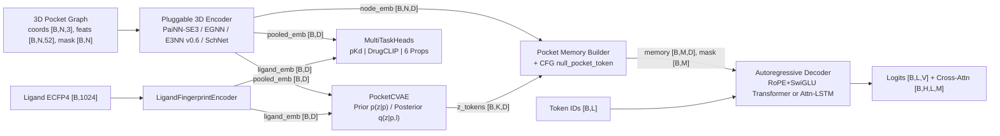
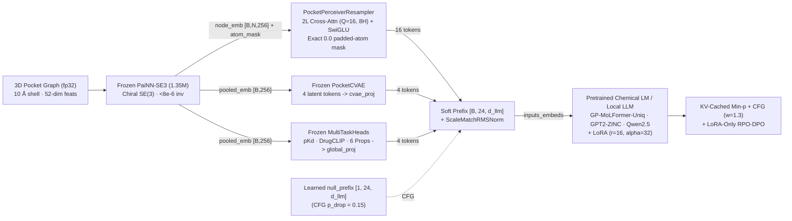

# GenEuclidean v2 & v3 — 3D Geometric, Multimodal LLM & Generative Architecture Specification

GenEuclidean v2 unifies **$SE(3)/E(3)$-equivariant 3D protein pocket representation learning**, **TamGen-style pocket-conditioned variational de novo molecular generation**, **Classifier-Free Guidance (CFG)**, and **multi-task biophysical supervision** (`pKd` binding affinity, `DrugCLIP` contrastive alignment, and auxiliary ligand properties) in a strictly `float32`, Apple Silicon MPS-native pure-PyTorch package.

---

## 1. End-to-End System Overview

### Design Invariants (Strictly Enforced Across All Modules)
1. **Strict `float32` throughout:** Zero `float64` parameters or buffers (all `e3nn` Clebsch-Gordan / spherical-harmonic buffers are cast to `torch.float32` at construction for native Apple M3 Pro MPS execution).
2. **No raw Cartesian node features:** Coordinates `(x, y, z)` enter **only** via relative displacements $\mathbf{r}_{ij} = \mathbf{x}_i - \mathbf{x}_j$ and pairwise Euclidean distances $d_{ij} = \|\mathbf{r}_{ij}\|_2$.
3. **No slot-indexed BatchNorm:** Only atom-wise `LayerNorm`, `RMSNorm`, and `EquivariantRMSNorm` are used — preserving exact atom permutation invariance.
4. **Zero dummy-atom leakage:** Padded atom slots (`atom_mask == False`) are zeroed with `torch.where` prior to centroid centering, excluded from sparse edges, zeroed after every message/update block, and masked with $-\infty$ prior to cross-attention softmax so padded atoms receive **exact `0.0`** attention weight.

---

## 2. Geometric Primitives (`models/encoders/rbf.py`)

### 2.1 Centroid-Centered Sparse Radius-kNN Graph
Given batched pocket coordinates $\mathbf{X} \in \mathbb{R}^{B \times N \times 3}$ and validity mask $M \in \{0, 1\}^{B \times N}$:
1. Mask dummy atoms to $\mathbf{0}$ and subtract the masked real-atom centroid $\bar{\mathbf{x}}_b = \frac{1}{\sum_i M_{b,i}} \sum_i M_{b,i}\mathbf{x}_{b,i}$ to eliminate `float32` catastrophic cancellation under large rigid translations $\mathbf{t} \in [-100, 100]^3$.
2. Compute exact pairwise distances via `torch.cdist(..., compute_mode="donot_use_mm_for_euclid_dist")`.
3. Select directed edges $(j \to i)$ satisfying $M_{b,i} = M_{b,j} = 1$, $i \neq j$, $d_{ij} < r_c$ ($r_c = 5.5\,\text{\AA}$), retaining up to `max_neighbors = 24` nearest neighbors per target atom $i$ in pure PyTorch (`torch.topk` + `index_add_`, zero C++ `torch-cluster`/`torch-scatter` extensions).
4. Emit flat sparse indices `src`, `dst` $\in [0, BN)$, relative displacement $\mathbf{r}_{ij} = \mathbf{x}_i - \mathbf{x}_j$, and stabilized Euclidean length $d_{ij} = \sqrt{\max(\|\mathbf{r}_{ij}\|_2^2, 10^{-12})}$.

### 2.2 Radial Basis Expansions & Smooth Cutoff Envelope
- **Cosine Cutoff Envelope** (`CosineCutoff`):
  $$f_c(d) = \begin{cases} \frac{1}{2}\left(\cos\!\left(\frac{\pi d}{r_c}\right) + 1\right), & d < r_c \\ 0, & d \ge r_c \end{cases}$$
- **Bessel Radial Basis** (`BesselRBF`, evaluated via `torch.sinc` for exact smoothness at $d \to 0$):
  $$\phi_n(d) = \sqrt{\frac{2}{r_c}} \frac{n\pi}{r_c}\,\operatorname{sinc}\!\left(\frac{n d}{r_c}\right), \quad n = 1, \dots, K$$
- **Gaussian Radial Basis** (`GaussianRBF`):
  $$\psi_k(d) = \exp\!\left(-\frac{(d - \mu_k)^2}{2 \Delta\mu^2}\right), \quad \mu_k \in [0, r_c]$$

### 2.3 Equivariant Vector RMSNorm & Masked Pooling
- **`EquivariantRMSNorm`** on $l=1$ vector channels $\mathbf{v} \in \mathbb{R}^{C_v \times 3}$:
  $$\operatorname{EqRMSNorm}(\mathbf{v})_c = \gamma_c \frac{\mathbf{v}_c}{\sqrt{\frac{1}{C_v}\sum_{k=1}^{C_v} \|\mathbf{v}_k\|_2^2 + \epsilon}}$$
  Preserves exact 3D directions ($\operatorname{EqRMSNorm}(\mathbf{v}\mathbf{R}^\top) = \operatorname{EqRMSNorm}(\mathbf{v})\mathbf{R}^\top$ for all $\mathbf{R} \in O(3)$) and maps zeroed dummy atoms to exact $\mathbf{0}$.
- **`MaskedAttentionPool`**: Concatenates masked attention pooling and masked mean pooling over real atoms (`atom_mask == True`), projected through a LayerNormed linear layer into `pooled_emb` $\in \mathbb{R}^{B \times D}$.

---

## 3. Four Pluggable 3D Pocket Encoders

All encoders implement `forward(coords[B,N,3], node_feats[B,N,F], atom_mask[B,N]) -> PocketEncoderOutput(node_emb, pooled_emb, vec_emb)` and are instantiated via `build_encoder(cfg: EncoderConfig)`.

### 3.1 `PaiNNEncoder` (`painn.py` — Flagship Default)
Pure-PyTorch **PaiNN-SE3** maintaining $C_s$ invariant scalar channels $\mathbf{s}_i \in \mathbb{R}^{C_s}$ and $C_v$ equivariant vector channels $\mathbf{v}_i \in \mathbb{R}^{C_v \times 3}$:

- **Message Block:** With $\hat{\mathbf{r}}_{ij} = \mathbf{r}_{ij}/d_{ij}$ and $\mathbf{e}_{ij} = f_c(d_{ij})\boldsymbol{\phi}(d_{ij})$:
  $$(\mathbf{m}^s_{ij}, \mathbf{m}^{vv}_{ij}, \mathbf{m}^{vr}_{ij}) = \text{MLP}_s(\mathbf{s}_j) \odot \mathbf{W}_r \mathbf{e}_{ij}$$
  $$\Delta \mathbf{s}_i = \alpha \sum_{j \in \mathcal{N}(i)} \mathbf{m}^s_{ij}, \qquad \Delta \mathbf{v}_i = \alpha \sum_{j \in \mathcal{N}(i)} \left(\mathbf{m}^{vv}_{ij} \odot \mathbf{v}_j + \mathbf{m}^{vr}_{ij} \otimes \hat{\mathbf{r}}_{ij}\right)$$
- **Update Block + Optional $SE(3)$ Chirality (`use_se3_chirality=True`):**
  Using bias-free linear vector mixes $\mathbf{U}\mathbf{v}_i, \mathbf{V}\mathbf{v}_i, \mathbf{C}_1\mathbf{v}_i, \mathbf{C}_2\mathbf{v}_i \in \mathbb{R}^{C_v \times 3}$:
  $$\mathbf{v}_i^{\times} = \frac{(\mathbf{C}_1 \mathbf{v}_i) \times (\mathbf{C}_2 \mathbf{v}_i)}{\sqrt{\|(\mathbf{C}_1 \mathbf{v}_i) \times (\mathbf{C}_2 \mathbf{v}_i)\|_2^2 + 1}}, \qquad \chi_i = \langle \mathbf{V}\mathbf{v}_i,\, \mathbf{v}_i^{\times} \rangle \in \mathbb{R}^{C_v}$$
  Under proper rotations $\mathbf{R} \in SO(3)$ ($\det\mathbf{R}=+1$), $\mathbf{v}_i^{\times} \mapsto +\mathbf{v}_i^{\times}\mathbf{R}^\top$ and $\chi_i \mapsto +\chi_i$ (exact $SO(3)$ equivariance/invariance). Under mirror reflections $\mathbf{P}$ ($\det\mathbf{P}=-1$), $\chi_i \mapsto -\chi_i$, allowing the encoder to distinguish chiral L- vs. D-amino-acid binding pockets!
  $$(\mathbf{a}_{ss}, \mathbf{a}_{sv}, \mathbf{a}_{vv}, \mathbf{a}_{vc}) = \text{MLP}_u\!\left([\mathbf{s}_i,\, \|\mathbf{V}\mathbf{v}_i\|_2,\, \chi_i]\right)$$
  $$\mathbf{s}_i \leftarrow \text{LayerNorm}\!\left(\mathbf{s}_i + \mathbf{a}_{ss} + \mathbf{W}_d(\mathbf{a}_{sv} \odot \langle \mathbf{U}\mathbf{v}_i, \mathbf{V}\mathbf{v}_i \rangle)\right)$$
  $$\mathbf{v}_i \leftarrow \operatorname{EqRMSNorm}\!\left(\mathbf{v}_i + \mathbf{a}_{vv} \odot (\mathbf{U}\mathbf{v}_i) + \mathbf{a}_{vc} \odot \mathbf{v}_i^{\times}\right)$$
  Setting `use_se3_chirality=False` disables $(\mathbf{v}_i^{\times}, \chi_i)$, recovering exact $E(3)$ invariance including reflections.

### 3.2 `EGNNEncoder` (`egnn.py`)
Pure-PyTorch $E(3)$-equivariant GNN (Satorras et al., ICML 2021) updating scalar embeddings $\mathbf{h}_i$, bounded equivariant coordinates $\mathbf{x}_i^{(l)}$, and $C_v$ equivariant vector channels $\mathbf{v}_i^{(l)}$:
$$\mathbf{m}_{ij} = \phi_e\!\left([\mathbf{h}_i, \mathbf{h}_j, f_c(d^{(0)}_{ij})\boldsymbol{\phi}(d^{(l)}_{ij}), d^{(l)}_{ij}]\right), \qquad \mathbf{x}^{(l+1)}_i = \mathbf{x}^{(l)}_i + \frac{1}{|\mathcal{N}(i)|}\sum_{j} \tanh(\phi_x(\mathbf{m}_{ij}))\, f_c(d^{(0)}_{ij}) \frac{\mathbf{x}^{(l)}_i - \mathbf{x}^{(l)}_j}{d^{(l)}_{ij} + 1}$$
Final `vec_emb` mixes multi-channel directional vectors $\mathbf{v}^{(L)}$ with total equivariant displacement $\mathbf{x}^{(L)} - \mathbf{x}^{(0)}$ via a bias-free linear projection.

### 3.3 `E3NNEncoder` (`e3nn_encoder.py`)
Modern `e3nn==0.6.0` spherical-harmonics tensor-product network honoring GenEuclidean's original 2021 $E(3)$ irreps architecture:
- Edge spherical harmonics $Y_\ell^m(\hat{\mathbf{r}}_{ij})$ up to configurable `e3nn_lmax` $\in \{0, 1, 2, 3\}$ (default `lmax=1`: `32x0e + 16x1o`, plus chiral `8x0o + 8x1e` when `use_se3_chirality=True`).
- Each convolution layer allocates **only** output irreps reachable via Clebsch-Gordan selection rules from the incoming irreps $\otimes Y_\ell$, computes radial-weighted `o3.FullyConnectedTensorProduct(shared_weights=False)`, applies parity-preserving `e3nn.nn.Gate` (`SiLU` on `0e`, odd `tanh` on `0o`, `sigmoid` scalar gates on $l \ge 1$), residual `o3.Linear` skip, and per-irrep `IrrepsEquivariantRMSNorm`.
- Extracts `0e` (and `0o` when chiral) into `node_emb` and `1o` polar vectors into `vec_emb` (`None` when `lmax=0`).

### 3.4 `SchNetEncoder` (`schnet.py`)
Distance-only $E(3)$-invariant continuous-filter SchNet baseline (`GaussianRBF` + `CosineCutoff` + `ShiftedSoftplus`, `vec_emb = None`) for controlled scalar-vs-vector scientific ablation.

---

## 4. Autoregressive Molecular Decoders (`models/decoders/`)

### 4.1 `PocketTransformerDecoder` (`transformer.py`)
Pre-LN Decoder-Only Transformer with **RMSNorm**, **Rotary Positional Embeddings (RoPE)** on causal self-attention Q/K (and position-free cross-attention K/V preserving pocket atom permutation invariance), **SwiGLU** FFN, tied input/output token embeddings, and Flamingo-style **Gated Cross-Attention**:
$$\mathbf{h} \leftarrow \mathbf{h} + \tanh(\gamma)\cdot \operatorname{CrossAttn}\!\left(\operatorname{RMSNorm}(\mathbf{h}),\, \operatorname{RMSNorm}(\mathbf{M}),\, \operatorname{RMSNorm}(\mathbf{M})\right)$$
- **Stage-1 Pretraining (`memory=None`):** Cross-attention is skipped cleanly; `load_pretrained_backbone(state_dict)` transfers Stage-1 weights into Stage-2 while leaving newly added cross-attention blocks and $\gamma$ untouched (`cross_attn_gate_init=0.0` guarantees exact `0.0` Step-0 logit drift; default `0.1` provides immediate non-zero gradient flow and CFG contrast while preserving >99% Stage-1 fluency).
- **Exact Padded-Atom Masking:** Memory keys with `memory_mask == False` are zeroed before projection, masked with $-\infty$ pre-softmax (with an all-masked fallback guard preventing `NaN`), and zeroed post-softmax so padded atoms receive exact `0.0` attention weight.

### 4.2 `PocketLSTMDecoder` (`lstm.py`)
Bug-fixed 2-layer causal Attention-LSTM (`GenEuclidean-v1.5` baseline) with masked pocket-pooled initial hidden state $(h_0, c_0)$, vectorized strictly per-sample masked Bahdanau attention (`[B, 1, L, M]`, exact `0.0` weight on padded atoms, zero cross-batch leakage, arbitrary variable pocket sizes), Stage-1 unconditional support, and `load_pretrained_backbone`.

---

## 5. `PocketCVAE`, CFG, and `MultiTaskHeads`

### 5.1 Pocket-Conditioned CVAE (`cvae.py`)
- **Prior:** $p_\theta(\mathbf{z} \mid \mathbf{p}) = \mathcal{N}(\boldsymbol{\mu}_p(\mathbf{p}), \operatorname{diag}(\boldsymbol{\sigma}_p^2(\mathbf{p})))$
- **Posterior:** $q_\phi(\mathbf{z} \mid \mathbf{p}, \mathbf{l}) = \mathcal{N}(\boldsymbol{\mu}_q(\mathbf{p}, \mathbf{l}), \operatorname{diag}(\boldsymbol{\sigma}_q^2(\mathbf{p}, \mathbf{l})))$ (clamped $\log\sigma^2 \in [-8, 4]$)
- **Latent Memory Bridge:** Projects $\mathbf{z} \in \mathbb{R}^{64}$ into $K=4$ learned memory tokens $\mathbf{Z} \in \mathbb{R}^{B \times K \times D}$ concatenated onto pocket memory $[\mathbf{E}_{\text{pocket}}; \mathbf{Z}]$.
- **Inference Modes:** `sample_prior(pooled_emb, latent_temp)` for high-diversity de novo design; `refine(pooled_emb, ligand_emb_or_fp, latent_temp=0.5)` for TamGen-style hit-to-lead analog generation.

### 5.2 Classifier-Free Guidance (`geneuclidean.py`)
`GenEuclideanModel` maintains a learned `null_pocket_token` $\mathbf{E}_\varnothing \in \mathbb{R}^{1 \times 1 \times D}$. During training (`cfg_drop=True`), each batch item independently drops its pocket+CVAE memory with probability `cfg_drop_prob = 0.15`, replacing slot 0 with $\mathbf{E}_\varnothing$ and masking slots $1 \dots M-1$ to `False` (mathematically identical to `build_memory(..., use_null_pocket=True)`).

### 5.3 Multi-Task Heads (`heads.py`)
- **`LigandFingerprintEncoder`:** Maps 1024-bit ECFP4 Morgan fingerprints to $\mathbf{l} \in \mathbb{R}^D$ (shared by CVAE posterior, `pKd`, and `DrugCLIP`).
- **`pKd` Binding Affinity Head:** Interaction MLP over $[\mathbf{p}, \mathbf{l}, \mathbf{p} \odot \mathbf{l}, |\mathbf{p} - \mathbf{l}|] \to \hat{y}_{\text{pKd}} \in \mathbb{R}$.
- **`DrugCLIP` Contrastive Head:** L2-normalized projections $(\hat{\mathbf{p}}, \hat{\mathbf{l}}) \in \mathbb{S}^{d_{\text{clip}}-1}$ with learnable log-temperature `logit_scale` initialized at $\ln(1/0.07) \approx 2.659$ and clamped to $[-\ln 100, \ln 100]$.
- **Auxiliary Property Head:** Pocket-only MLP $\mathbf{p} \to \mathbb{R}^6$ predicting standardized `[MW, LogP, TPSA, QED, HBD, HBA]`.
- **`score_candidates(pocket_out, ligand_fps)`:** Vectorized microsecond scoring returning `{"pkd": [M], "clip_sim": [M]}` for any candidate pool against an encoded pocket.

---

## 6. Parameter Counts & Verified Equivariance Bounds

### 6.1 Parameter Counts (Default `ExperimentConfig`, `vocab_size=96`, `d_model=256`, `n_layers=6`)

| Model Configuration | Encoder | CVAE | Decoder | Multi-Task Heads | **Total Params** |
| :--- | ---: | ---: | ---: | ---: | ---: |
| **Stage-1 Transformer Prior** (no cross-attn) | — | — | 4,771,072 | — | **4,771,072** |
| **GenEuclidean-v1.5** (`e3nn lmax=1` + 2L LSTM) | 708,521 | — | 1,603,584 | — | **2,970,025** |
| **PaiNN-PocketFormer** (no CVAE / heads) | 1,349,889 | — | 6,347,014 | — | **8,354,823** |
| **GenEuclidean-v2 (`PaiNN-SE3`, Flagship)** | 1,349,889 | 545,280 | 6,347,014 | 1,218,568 | **9,461,007** |
| **GenEuclidean-v2 (`EGNN`)** | 1,300,809 | 545,280 | 6,347,014 | 1,218,568 | **9,411,927** |
| **GenEuclidean-v2 (`E3NN v0.6`, `lmax=1`)** | 708,521 | 545,280 | 6,347,014 | 1,218,568 | **8,819,639** |
| **GenEuclidean-v2 (`SchNet`)** | 876,033 | 545,280 | 6,347,014 | 1,218,568 | **8,987,151** |

*(Note: `v1.5` and `PaiNN-PocketFormer` totals include the shared `LigandFingerprintEncoder` parameter block inside `MultiTaskHeads` and the `null_pocket_token`.)*

### 6.2 Measured Numerical Symmetry & Equivariance Errors (`float32`, 5 Haar-Uniform $SO(3)$ Rotations)

| Encoder | Symmetry Group | Chiral ($\det P = -1$) | CPU Pure $SO(3)$ (Scalar / Vec) | MPS Pure $SO(3)$ (Scalar / Vec) | CPU $SO(3) + t \in [-100, 100]^3$ | MPS $SO(3) + t \in [-100, 100]^3$ |
| :--- | :---: | :---: | :---: | :---: | :---: | :---: |
| **`PaiNN-SE3`** | $SE(3)$ | Yes (sensitive) | `1.91e-6` / `2.56e-6` | `1.79e-6` / `2.86e-6` | `6.79e-6` / `5.11e-5` | `7.33e-6` / `5.13e-5` |
| **`EGNN`** | $E(3)$ | Invariant | `1.67e-6` / `1.13e-6` | `1.55e-6` / `1.13e-6` | `1.91e-6` / `5.66e-6` | `1.43e-6` / `5.13e-6` |
| **`E3NN v0.6`** | $SE(3)$ / $E(3)$ | Yes (`0o`/`1e`) | `2.50e-5` / `3.46e-6` | `2.81e-5` / `4.53e-6` | `2.78e-4` / `3.66e-5` | `2.61e-4` / `3.75e-5` |
| **`SchNet`** | $E(3)$ | Invariant | `1.67e-6` / — | `1.43e-6` / — | `1.67e-6` / — | `1.43e-6` / — |

All 63 unit tests across `tests/test_equivariance.py` and `tests/test_models_and_cvae.py` pass on both CPU and Apple Silicon MPS, including exact `0.0` padded-atom cross-attention weight and full end-to-end multi-task backward gradient flow.

---

## 7. GenEuclidean v3.0 — 3D-to-LLM Multimodal Conditioning

GenEuclidean v3.0 preserves the verified chiral $SE(3)$-equivariant `PaiNN-SE3` encoder, `PocketCVAE`, and `MultiTaskHeads` (`pKd r = 0.746`, `DrugCLIP R@5 = 62.1%`, `AUC = 0.937`) frozen from `runs/geneuclidean_v2_painn/best.pt` and bridges them into pretrained billion-molecule Chemical Foundation Transformers and compact local general LLMs via a **permutation- and $SE(3)$-invariant 3D-to-LLM Perceiver bridge** + **LoRA (`r = 16, α = 32`)**.

### 7.1 `PocketPerceiverResampler` & `ScaleMatchRMSNorm` (`models/llm_bridge.py`)
- **Exact Permutation- & $SE(3)$-Invariant Bottleneck:** `Q = 16` learned latent queries attend over variable-length pocket atom embeddings $\mathbf{H}_{\text{node}} \in \mathbb{R}^{B \times N \times 256}$ through 2 Pre-LN Perceiver blocks (`8` heads, SwiGLU FFN) with **zero positional encoding on pocket atoms** and explicit $-\infty$ pre-softmax + post-softmax masking on padded atoms (`atom_mask == False` receives **exact `0.0`** attention weight).
- **24-Token Composite Soft Prefix:** Concatenates `16` Perceiver atom-contact tokens, `4` projected `PocketCVAE` latent tokens (`cvae_proj`), and `4` projected pooled/property tokens (`global_proj`) into $\mathbf{P} \in \mathbb{R}^{B \times 24 \times d_{\text{llm}}}$.
- **`ScaleMatchRMSNorm`:** Backbone token-embedding RMS spans **64×** across open-weight models (`1.00018` on `ibm-research/GP-MoLFormer-Uniq`, `0.03309` on `entropy/gpt2_zinc_87m`, `0.01561` on `Qwen/Qwen2.5-0.5B`). `ScaleMatchRMSNorm` normalizes the 24-token prefix and scales its learnable gain $\gamma$ (and `null_prefix`) to the backbone's exact empirical `embed_rms`, preventing Step-0 activation shock.

### 7.2 Backbone Loader & Apple Silicon MPS Systems Optimizations (`models/hf_backbones.py`)
1. **`transformers 5.x` `GP-MoLFormer-Uniq` RoPE Meta-Init Fix:** Restores compatibility shims removed in `transformers==5.24.1` and cleanly re-initializes the 9 non-persistent `MolformerRotaryEmbedding` buffers (`inv_freq`, `cos_cached`, `sin_cached`) that otherwise remain `NaN`/`Inf` under v5 meta-device instantiation, while preserving persisted `MolformerFeatureMap.weight` buffers and deterministic eval (`CPU vs MPS max_diff = 2.29e-5`).
2. **`fast_4d_tril` Exact Causal Attention Kernel (`12.5×` Faster):** Replaces the slow 5D `einsum(...).cumsum` fallback in `modeling_molformer.py` with an exact 4D lower-triangular `(q @ k.transpose(-1, -2)).tril() @ v` kernel (`4.77e-7` forward / `6.4e-6` backward parity), accelerating 12-layer attention by **`12.5×`** (`367.1 ms → 29.4 ms`) and end-to-end LoRA training by **`2.40×`** (`631.3 ms → 263.4 ms/step`).
3. **Strict MPS `bfloat16` Precision Policy:** Small chemical transformers (`GP-MoLFormer-Uniq`, `GPT2-ZINC-87M`) run in `float32`; general LLMs (`Qwen2.5-0.5B`, `SmolLM2-360M`, `Qwen3-0.6B-Base`) run in `bfloat16` (`float16` LoRA on MPS is explicitly rejected due to `NaN`/`Inf` gradient underflow).

### 7.3 Two-Phase Anti-Collapse SFT, KV-Cached CFG (`11.15×`), & LoRA-Only RPO-DPO
- **Zero-Overhead 3D Pocket Cache (`precompute_pocket_cache`):** Encodes all 4,543 train and 505 validation 3D pockets once (~180 MB CPU RAM), eliminating GNN forward overhead during Phase A & Phase B (`0 ms/step`).
- **Phase A (Projector Warmup) → Phase B (Joint Perceiver + LoRA):** Phase A freezes LoRA & base LLM and trains only the 3.41M-parameter Perceiver/CVAE/global bridge (`lr = 1e-3`); Phase B unfreezes LoRA (`lr_lora = 1e-4`, `lr_proj = 3e-4`) with `cfg_drop_prob = 0.15` and light CVAE KL regularization (`0.05`). For SMILES-native chemical transformers pretrained on canonical corpora (`GP-MoLFormer-Uniq`, `GPT2-ZINC-87M`), **canonical SMILES alignment (`randomize_smiles: false`)** prevents distribution mismatch and lifts raw CASF-2016 validity by **`+19.5 pp`** (`70.9% → 90.4%`). For general LLMs (`Qwen2.5-0.5B`), targets use `"SMILES: <smi>\n"` with `-100` loss masking on the prompt prefix.
- **KV-Cached Batched CFG Sampler (`sampling/llm_sampler.py`):** Prefills `[cond_prefix; uncond_prefix]` once and decodes 1 token per step using `past_key_values` (both `GP-MoLFormer` $O(1)$ recurrent linear-attention tuples and HF `DynamicCache`), delivering an empirically measured **`11.15×` MPS decoding speedup** (`0.863s` vs. `9.626s`, `< 1e-4` cached-vs-uncached logit parity).
- **LoRA-Only Stabilized RPO-DPO (`run_llm_rpo_dpo`):** Samples on-policy candidates per pocket, constructs MPO preference pairs (`pred_pkd`, `clip_sim`, `QED`, `SA`, `Lipinski`, `PAINS`), caches frozen `ref_logps`, and updates **strictly LoRA parameters** (preserving `PaiNN-SE3`, `PocketPerceiverResampler`, `pKd`, and `DrugCLIP` bit-for-bit, keeping `<4.5 Å` contact enrichment locked at **`6.31×`**).

### 7.4 GenEuclidean v3.0 Parameter Counts, Adapter Footprints & Live MPS Equivariance

| v3.0 Model (`HF Backbone`) | Precision | Total Params | Bridge Params | LoRA Params | Saved Adapter (`best_adapter.pt`) | Live MPS Equivariance / Mask Audit |
| :--- | :---: | ---: | ---: | ---: | ---: | :--- |
| **`v3 GP-MoLFormer-Uniq`** *(+ RPO-DPO)* | `float32` | **55,096,841** | 3,407,872 | 1,794,048 | **19.91 MB** | `SO(3)` prefix `4.05e-6` · logits `4.73e-5` · pad attn `0.0` |
| **`v3 GPT2-ZINC-87M`** | `float32` | **96,212,489** | 3,407,872 | 2,359,296 | **22.05 MB** | Inherited `< 8e-6` `PaiNN-SE3` + exact `0.0` pad attn |
| **`v3 Qwen2.5-0.5B`** *(Track B Control)* | `bfloat16` | **509,553,289** | 3,608,576 | 8,798,208 | **47.46 MB** | Inherited `< 8e-6` `PaiNN-SE3` + exact `0.0` pad attn |
