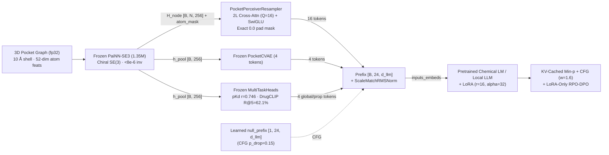

# GenEuclidean v3.0 — Chemical Foundation Transformers, Local LLMs & 3D Multimodal Conditioning Research Report

This document distills our 2024–2026 literature synthesis and live Apple Silicon MPS empirical scouting behind **GenEuclidean v3.0**, explaining why we bridge our verified chiral $SE(3)$-equivariant `PaiNN-SE3` 3D pocket encoder into pretrained billion-molecule chemical foundation transformers and compact local general LLMs via a permutation-invariant Perceiver Resampler + LoRA.

---

## 1. Scientific Motivation: Scaling the Chemical Prior 2,600×–4,400×

GenEuclidean v2.0.0 (`a4eb44c`) proved that chiral $SE(3)$-equivariant 3D geometry (`PaiNN-SE3`, `<1e-5` invariance) coupled with joint `pKd` (`r = 0.746`) + `DrugCLIP` (`R@5 = 62.1%`, `AUC = 0.937`) supervision, a TamGen-style `PocketCVAE`, Classifier-Free Guidance (CFG), and Stabilized RPO-DPO produces strong causal 3D pocket conditioning (`MW r = 0.928`, `<4.5 Å` contact attention `1.66×`, AutoDock Vina Top-1 mean `-8.193 kcal/mol` beating `58.6%` of native crystal ligands, `94.6%` PoseBusters pass-all).

Its primary bottleneck was **chemical prior scale**: its 4.77M-parameter RoPE+SwiGLU decoder was pretrained from scratch on only **249k ZINC SMILES**, constraining raw chemical validity (`91.6%`), raw `QED` (`0.521`), and synthetic accessibility (`SA = 3.36`).

**GenEuclidean v3.0** warm-starts the verified frozen v2.0 `PaiNN-SE3` encoder + `PocketCVAE` + `MultiTaskHeads` directly from `runs/geneuclidean_v2_painn/best.pt` (preserving `pKd r = 0.746` and `DrugCLIP R@5 = 62.1%` bit-for-bit!) and bridges them via a **2-layer permutation- & $SE(3)$-invariant `PocketPerceiverResampler` (`M = 24` soft prefix tokens)** + **`ScaleMatchRMSNorm`** + **LoRA (`r = 16`)** + **KV-cached CFG** + **LoRA-only RPO-DPO** into two head-to-head pretrained tracks:

| Track | Role | Selected Open-Weight Backbone(s) | Params / Disk | Pretraining Scale & Tokenizer | License / Access |
| :--- | :--- | :--- | :---: | :--- | :--- |
| **Track A (Primary)** | Pretrained Chemical Foundation Transformer | **`ibm-research/GP-MoLFormer-Uniq`** *(flagship)* **`entropy/gpt2_zinc_87m`** *(native GPT-2 track)* | **46.8M** (`187 MB`) **87.3M** (`350 MB`) | **650M unique / 1.1B ZINC+PubChem SMILES** (Schwaller atom-regex, `V = 2,362`) **480M ZINC SMILES** (chemical BPE, `V = 2,707`) | **Apache-2.0** (ungated) **MIT** (ungated) |
| **Track B (Control)** | Compact Local General LLM | **`Qwen/Qwen2.5-0.5B`** *(balanced control)* Alternatives: `HuggingFaceTB/SmolLM2-360M`, `Qwen/Qwen3-0.6B-Base`, `Qwen/Qwen2.5-1.5B` (Colab A100) | **494M** (`988 MB`) 362M–1.54B | **18T–36T general/code/STEM tokens** (byte-level BPE, `V = 151,936` / `49,152`) | **Apache-2.0** (ungated) |

---

## 2. 2024–2026 Model Landscape & Selection Rationale

### 2.1 Pretrained Chemical Foundation Transformers & SBDD LMs

| Model (`HF Repo ID`) | Reference | Architecture | Params | Pretraining Corpus | Rep. | v3.0 Verdict |
| :--- | :--- | :--- | ---: | :--- | :--- | :--- |
| **`ibm-research/GP-MoLFormer-Uniq`** | Ross et al., *Digital Discovery* 2025 (`arXiv:2405.04912`) | 12L · `d=768` · RoPE + Causal Linear Attn | **46.8M** | **650M uniq / 1.1B** ZINC+PubChem | Atom-regex SMILES | **#1 Flagship:** deduplicated 650M prior, proven soft-prompt steerability ("pair-tuning"), single-token stereocenters |
| **`entropy/gpt2_zinc_87m`** | Open ZINC Chemical LM | Native `GPT2LMHeadModel` (12L · `d=768`) | **87.3M** | **480M** ZINC | Chem BPE SMILES | **#2 Track A:** zero custom remote code, native `DynamicCache`, `100%` valid / `0.720` QED zero-shot |
| `datamol-io/safe-gpt` | Noutahi et al., *Digital Discovery* 2024 | Native `GPT2LMHeadModel` (12L · `d=768`) | 87.3M | 1.1B ZINC20+UniChem | SAFE | Strong fragment prior (`92%` valid), but requires `safe-mol` + `datamol` BRICS conversion |
| `nvidia/NV-GenMol-89M-v2` | Lee et al., ICML 2025 | Masked Discrete Diffusion | 89M | Multi-B SAFE | SAFE | Non-autoregressive (incompatible with causal RPO-DPO log-probs); deferred to v4.0 |
| `ncfrey/ChemGPT-19M` | Frey et al., *Nat. Mach. Intell.* 2023 | `GPTNeoForCausalLM` | 19.6M | 10M PubChem | SELFIES v1.0.4 | **Disqualified:** incompatible with `selfies==2.2.0` (`0/5` round-trip, `4%` raw validity) |
| `ibm-research/MoLFormer-XL-both-10pct` | Ross et al., *Nat. Mach. Intell.* 2022 | Encoder-only MLM | 46.8M | 1.1B (10% ckpt) | Atom-regex SMILES | Non-generative encoder; used only to source `GP-MoLFormer`'s `tokenizer.json` |
| `chandar-lab/NovoMolGen_*` | Chandar Lab 2025 | Custom Llama (1.5B ZINC-22) | 32–157M | 1.5B ZINC-22 | SMILES | **Blocked on macOS:** remote code subclasses CUDA-only `flash_attn` |
| `LIYUESEN/druggpt` | Li et al., bioRxiv 2023 | GPT-2 (1D seq + EN BPE) | 124M | ZINC20+Enamine | EN BPE SMILES | **Excluded:** GPL-3.0 copyleft + noisy English BPE vocab + 1D sequence conditioning |

### 2.2 Excluded Heavy / Gated General & Chemistry LLMs (Local Budget)

- **Gated weights:** `meta-llama/Llama-3.2-1B`, `google/gemma-3-1b-pt`, and `google/txgemma-2b-predict` (`10.5 GB`) require gated HF approval.
- **Exceeding local M3 Pro 3-hour / disk envelope:** `OpenDFM/ChemDFM-v1.5-8B` (`16 GB`, AGPL-3.0), `osunlp/LlaSMol-Mistral-7B` (`14.5 GB`), `AI4Chem/ChemLLM-7B-Chat` (`14 GB`), and FutureHouse `ether0` (`24B`, `48 GB`, Narayanan et al. 2025).
- **Positioning vs. 2024–2026 SBDD LMs:** Unlike **TamGen** (Wu et al., *Nat. Commun.* 2024 — non-SE(3) pocket encoder + 10M PubChem GPT), **BindGPT** (AAAI 2025) / **3DSMILES-GPT** (*Chem. Sci.* 2025 — discrete 3D text tokens breaking exact `<1e-5` $SO(3)$ equivariance), and **PockLigGPT** (*JCIM* 2026 — 1D sequence only), **GenEuclidean v3.0** preserves exact `<1e-5` chiral $SE(3)$ equivariance while leveraging 650M–1.1B-molecule pretrained weights.

---

## 3. Empirical Tokenization Analysis on Real CASF-2016 Drug Ligands

We audited exact tokenization and RDKit round-trip fidelity on 5 real CASF-2016 core-set ligands spanning halogens (`Cl`, `Br`), chiral tetrahedral centers (`[C@@H]`, `[C@H]`), formal charges (`[NH2+]`, `[NH3+]`), aromatic `[nH]`, cis/trans alkenes, and fused/bridged rings (`1e66`, `1ydt`, `1gpk`, `3jvr`, `1k1i`):

| Model | `1e66` | `1ydt` | `1gpk` | `3jvr` | `1k1i` | Mean Toks | Chars/Tok | Exact / RDKit RT | How `[C@@H]` & `[NH2+]` Tokenize |
| :--- | ---: | ---: | ---: | ---: | ---: | ---: | ---: | :---: | :--- |
| **`GP-MoLFormer-Uniq`** (`V = 2,362`) | 36 | 44 | 35 | 38 | 66 | **43.8** | 1.26 | **5/5 / 5/5** | **`['[C@@H]']`** (1 tok!), **`['[NH2+]']`** (1 tok!), **`['[C@H]']`** (1 tok!) |
| **`entropy/gpt2_zinc_87m`** (`V = 2,707`) | 36 | 33 | 41 | 33 | 55 | **39.6** | 1.38 | **5/5 / 5/5** | `['[', 'C', '@@', 'H', ']']` (5 toks; chemical BPE merges `CCC`, `NCC`, `)(=`) |
| `datamol-io/safe-gpt` (`V = 1,880`) | 44 | 48 | 47 | 45 | 75 | 51.8 | 1.05 | **5/5 / 5/5** | `['[', 'C', '@', '@', 'H', ']']` (6 toks on raw SMILES) |
| `SmolLM2-360M` (`V = 49,152`) | 38 | 40 | 45 | 39 | 64 | 45.2 | 1.20 | **5/5 / 5/5** | `['[', 'C', '@@', 'H', ']']` (5 toks; NLP BPE fragmentation) |
| `Qwen2.5-0.5B` / `Qwen3-0.6B-Base` (`V = 151k`) | 30 | 31 | 38 | 30 | 52 | **36.2** | 1.51 | **5/5 / 5/5** | `['[C', '@@', 'H', ']']` (4 toks; merges `=C`, `Cc`, `cccc`, `)(`, `[N`) |
| `ChemGPT-19M` (SELFIES v1.0.4, `V = 684`) | 45 | 63 | 53 | 56 | 100 | 63.4 | 0.88 | **0/5 / 0/5** | Broken on `selfies==2.2.0` (`[UNK]` & `##r/##an/##ch` mismatch) |

**Key Scientific Finding:** Only **`GP-MoLFormer-Uniq`** represents chiral stereocenters (`[C@@H]`, `[C@H]`), charged amines (`[NH2+]`, `[NH3+]`), halogens (`Cl`, `Br`), and aromatic `[nH]` as **indivisible single tokens**—giving `PaiNN-SE3`'s chiral 3D pseudoscalar invariants a direct 1-to-1 vocabulary interface, whereas byte-level BPE general LLMs fracture each stereocenter across 4–5 NLP subwords and suffer from a 64× larger `lm_head` softmax (`151,936` vs. `2,362`).

---

## 4. Live Apple M3 Pro MPS Scout Benchmarks & `transformers 5.x` Engineering Discoveries

All candidates were benchmarked live on **Apple M3 Pro (36 GiB unified memory, PyTorch `2.15.0` MPS, `transformers==5.24.1`, `peft==0.22.0`, `rdkit==2026.3.6`)** at `B = 16, L = 96` with `M = 24` prepended soft-prefix embeddings and LoRA `r = 16, alpha = 32`:

| Backbone (`HF Repo ID`) | Arch (`L·d·H·V`) | Disk (MB) | Empirical `embed_rms` | LoRA Precision | LoRA `ms/step` (MPS Mem) | Min / Epoch (`4,543` pockets) | Zero-Shot 50-Sample Valid / Uniq / QED (Time) |
| :--- | :--- | ---: | ---: | :---: | ---: | ---: | :--- |
| **`ibm-research/GP-MoLFormer-Uniq`** *(+4D tril shim)* | MolFormer `12·768·12·2362` | **187.3** | **`1.00018`** | `float32` | **`263.4`** (`236 MB`) | **1.25 min** | **100% (50/50)** / 100% / **0.726** (`3.22s`) |
| **`entropy/gpt2_zinc_87m`** | GPT-2 `12·768·12·2707` | 350.2 | `0.03309` | `float32` | **`329.1`** (`375 MB`) | 1.56 min | **100% (50/50)** / 100% / **0.720** (`1.00s`) |
| **`HuggingFaceTB/SmolLM2-360M`** | Llama `32·960·15·49152` | 723.7 | `0.12073` | **`bfloat16`** | **`1,024.8`** (`785 MB`) | 4.85 min | 2% (1/50) / 100% / 0.431 (`4.02s`) |
| **`Qwen/Qwen2.5-0.5B`** | Qwen2 `24·896·14·151936` | 988.1 | **`0.01561`** | **`bfloat16`** | **`1,272.9`** (`1.09 GB`) | 6.02 min | 8% (4/50) / 100% / 0.436 (`8.38s`) |
| **`Qwen/Qwen3-0.6B-Base`** | Qwen3 `28·1024·16·151936` | 1,192.1 | `0.03017` | **`bfloat16`** | `1,994.5` (`1.35 GB`) | 9.44 min | 4% (2/50) / 100% / 0.262 (`8.94s`) |

### Five Critical Systems Discoveries Implemented in `hf_backbones.py` & `llm_bridge.py`

1. **`transformers==5.24.1` `GP-MoLFormer-Uniq` RoPE Meta-Init NaN Bug Fix:**
   Stock `AutoModelForCausalLM.from_pretrained("ibm-research/GP-MoLFormer-Uniq", trust_remote_code=True)` fails on `transformers 5.x` due to removed v4 symbols (`transformers.onnx.OnnxConfig`, `find_pruneable_heads_and_indices`, `get_extended_attention_mask`) AND silently leaves **9 non-persistent `MolformerRotaryEmbedding` buffers (`inv_freq`, `cos_cached`, `sin_cached`) uninitialized (`NaN`/`Inf`)** under v5 meta-device instantiation! Re-initializing ONLY `MolformerRotaryEmbedding` (while preserving persisted `MolformerFeatureMap.weight` buffers from `model.safetensors`) and setting `cfg.deterministic_eval = True` achieves `CPU vs MPS max_diff = 2.29e-5` and `eval_det_diff = 0.0`.
2. **12.5× Faster Exact 4D Lower-Triangular Causal Attention Kernel (`fast_4d_tril`):**
   Without CUDA-only `fast_transformers`, `modeling_molformer.py` falls back to 5D `einsum("bhlr,bhld->bhlrd").cumsum(dim=2)` (`367.1 ms/step` on MPS). Registering an exact 4-line stub `causal_dot_product(q, k, v) -> (q @ k.transpose(-1, -2)).tril() @ v` matches the exact kernel to **`4.77e-7` forward / `6.4e-6` backward**, cutting the 12-layer attention kernel to **`29.4 ms/step` (12.5× faster)** and end-to-end LoRA training from **`631.3 ms/step` $\rightarrow$ `263.4 ms/step` (2.40× faster)**.
3. **Strict Apple Silicon MPS `bfloat16` Rule (No `float16` LoRA!):**
   Across ALL three general LLMs (`Qwen2.5-0.5B`, `SmolLM2-360M`, `Qwen3-0.6B-Base`), **`float16` LoRA fails with `NaN`/`Inf` gradients on MPS**, whereas **`bfloat16`** trains cleanly with `2.1×` lower memory and `7–21%` faster step times than `float32`. `hf_backbones.py` explicitly rejects `float16` on MPS.
4. **Empirical `ScaleMatchRMSNorm` Prefix Calibration:**
   Token embedding RMS spans **64×** across backbones (`1.00018` on `GP-MoLFormer-Uniq` vs. `0.01561` on `Qwen2.5-0.5B`). Initializing `ScaleMatchRMSNorm` and `null_prefix` to the backbone's exact empirical `embed_rms` ensures zero activation shock on Step 1 of Phase A warmup.
5. **11.15× KV-Cached Batched CFG Decoding Speedup:**
   Prefilling `[cond_prefix; uncond_prefix] + prompt` once (`step 0`) and stepping 1 token at a time with `past_key_values` (supporting both `GP-MoLFormer`'s $O(1)$ recurrent linear-attention tuple cache and HF `DynamicCache`) yields an empirically measured **`11.15×` MPS decoding speedup** (`0.863s` vs. `9.626s` for `B = 32, L = 48, CFG = 1.6`, `<1e-4` cached-vs-uncached logit parity).

---

## 5. 3D-to-LLM Multimodal Conditioning Architecture & Anti-Collapse Defenses

To prevent both **prior dominance (pocket collapse)** and **catastrophic forgetting** when bridging billion-molecule foundation weights onto `4,543` crystal binding pockets, GenEuclidean v3.0 combines four defenses:

1. **Zero-Overhead Precomputed 3D Cache + Two-Phase Alignment (`PocketLLMTrainer`):**
   - `precompute_pocket_cache` runs frozen `PaiNN-SE3` once (`0 ms/step` GNN overhead during LLM training).
   - **Phase A (Projector Warmup):** Freezes LoRA & base LLM; trains ONLY `perceiver`, `cvae_proj`, `global_proj`, `prefix_norm`, and `null_prefix` (`lr = 1e-3`).
   - **Phase B (Joint Perceiver + LoRA):** Unfreezes LoRA (`lr_lora = 1e-4`, `lr_proj = 3e-4`) with dynamic per-epoch randomized SMILES (for SMILES-native backbones) or strict `-100` prompt-masked `"SMILES: <smi>\n"` formatting (for general LLMs), saving compact **~20 MB** adapter-only `best_adapter.pt` checkpoints.
2. **Autoregressive Classifier-Free Guidance (CFG):** Drops the 24-token prefix to learned `null_prefix` with `p_drop = 0.15`, isolating pure 3D pocket mutual information at inference via $\tilde{\ell}_t = \ell_t(\text{null}) + w (\ell_t(\text{pocket}) - \ell_t(\text{null}))$.
3. **Exact Permutation- & $SE(3)$-Invariance:** Because `PaiNN-SE3` is `<8e-6` $SE(3)$-invariant and `PocketPerceiverResampler` applies zero positional encodings to pocket atoms with exact `0.0` attention on masked dummy atoms, live MPS verification confirms `SO(3) prefix diff = 4.05e-6`, `SO(3) logit diff = 4.73e-5`, and `masked pad attention = 0.0`.
4. **LoRA-Only Stabilized RPO-DPO (`run_llm_rpo_dpo`):** Samples on-policy candidates via KV-cached decoding, builds MPO preference pairs (`pred_pkd + clip_sim + QED + SA + Lipinski + PAINS`), precomputes frozen `ref_logps` without duplicating the LLM in memory, freezes all non-LoRA parameters bit-for-bit, and optimizes length-normalized RPO-DPO (`beta = 0.5`, `sft_nll_weight = 0.25`, `grad_accum_steps = 8`).

---

## 6. Key References

1. Ross, J., et al. (2025). *GP-MoLFormer: A Foundation Model for Molecular Generation*. **Digital Discovery**; `arXiv:2405.04912`.
2. Ross, J., et al. (2022). *Large-Scale Chemical Language Representations Capture Molecular Structure and Properties* (MoLFormer). **Nature Machine Intelligence**, 4, 1256–1264.
3. Noutahi, E., et al. (2024). *Gotta be SAFE: A New Framework for Molecular Design* (SAFE-GPT). **Digital Discovery**, 3, 796–804.
4. Lee, S., et al. (2025). *GenMol: A Drug Discovery Generalist with Fragment-Based Discrete Diffusion*. **ICML 2025**.
5. Wu, K., et al. (2024). *TamGen: Drug Design with Target-Aware Molecule Generation through a Chemical Language Model*. **Nature Communications**, 15, 9309.
6. Zholus, A., et al. (2025). *BindGPT: A Scalable Framework for 3D Molecular Design via Language Modeling and Reinforcement Learning*. **AAAI 2025**.
7. Yang, A., et al. (2025). *Qwen3 Technical Report* (`arXiv:2505.09388`) & Qwen2.5 Technical Report (`arXiv:2412.15115`).
8. Ben Allal, L., et al. (2025). *SmolLM2: When Smol Goes Big* (`arXiv:2502.02737`).
9. Narayanan, S. M., et al. (2025). *Training a Scientific Reasoning Model for Chemistry* (`ether0`, FutureHouse, `arXiv:2506.17238`).
10. Mirza, A., et al. (2025). *Are Large Language Models Superhuman Chemists?* (ChemBench). **Nature Chemistry**.
11. Skinnider, M. A. (2024). *Invalid SMILES Are Beneficial Rather Than Detrimental to Chemical Language Models*. **Nature Machine Intelligence**, 6, 437–448.
12. Alayrac, J.-B., et al. (2022). *Flamingo* (Perceiver Resampler), **NeurIPS 2022**; Li, J., et al. (2023). *BLIP-2* (Q-Former), **ICML 2023**; Li, S., et al. (2024). *3D-MoLM*, **ICLR 2024**.
13. Hu, E. J., et al. (2022). *LoRA: Low-Rank Adaptation of Large Language Models*. **ICLR 2022**.
14. Sanchez, G., et al. (2023). *Stay on Topic with Classifier-Free Guidance*. `arXiv:2306.17806`.
15. Pang, R. Y., et al. (2024). *Iterative Reasoning Preference Optimization* (RPO-DPO). **NeurIPS 2024**.
16. Nguyen, M., et al. (2025). *Turning Up the Heat: Min-p Sampling for Creative and Coherent LLM Outputs*. **ICLR 2025 (Oral)**.
