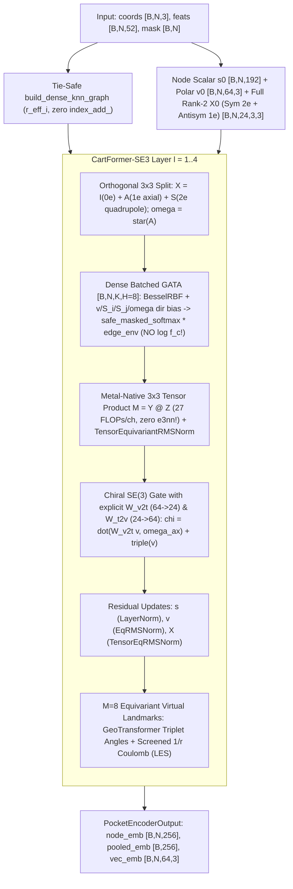
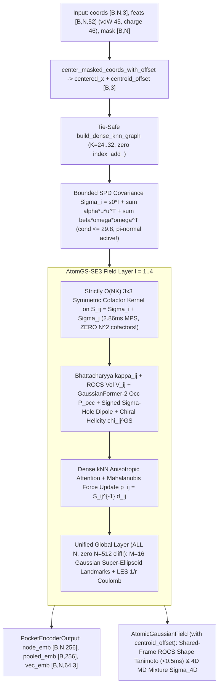
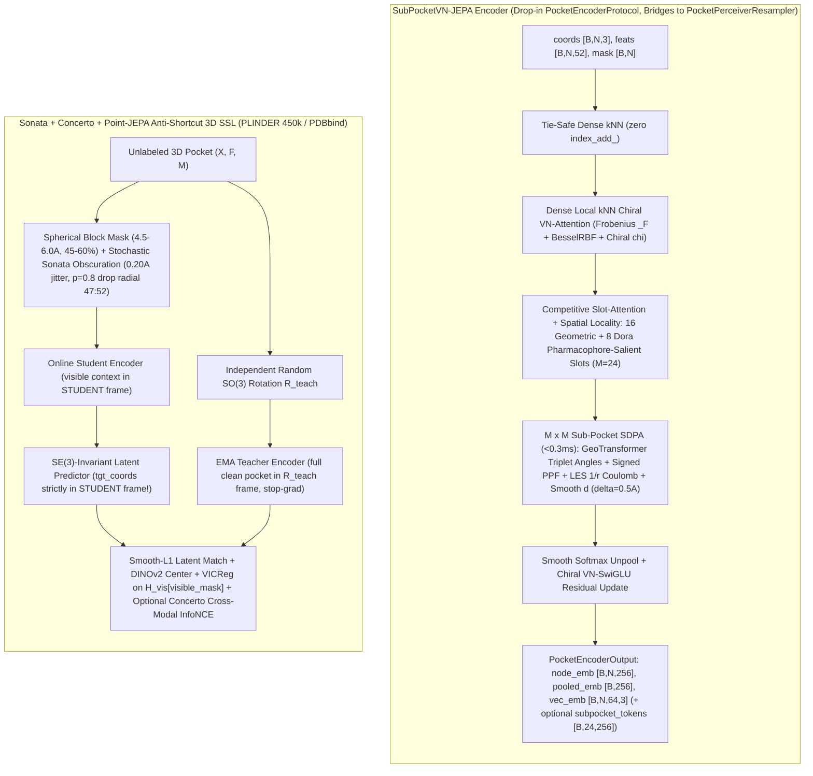

# Novel 3D Point Cloud Computer Vision Methods for Atomic, Ligand & Protein Pocket Encoding in GenEuclidean (v2 — Peer-Reviewed Architecture & Implementation Plan)

> **Document Role:** Principal Research Investigation (5 Critical Rounds including Adversarial Cross-Audit with `@pc3d-cv-critic`), Comprehensive 2022–2026 Top-Venue 3D Computer Vision & Geometric Deep Learning Literature Synthesis (**42 Methods across 7 Families**), Live Apple M3 Pro MPS Profiling & Edge-Case Verification, Peer-Reviewed Mathematical Specifications for the Top 3 Selected Encoders + Joint Pocket–Ligand 3D Complex Interface, and Self-Contained Engineering Implementation Prompts.
>
> **Codebase Anchor:** GenEuclidean `HEAD 5fe558c` — Apple M3 Pro (`36 GB` Unified Memory), macOS ARM64, Python `3.12.12`, PyTorch `2.15.0` (MPS `float32`), `e3nn 0.6.0`, zero CUDA/C++ extension dependencies (`torch-cluster`/`torch-scatter`/`mamba-ssm`/`TorchSparse`/`PyKeOps` unavailable on Apple MPS).
>
> **v2 Revision Highlights (Resolving All Round-4 Adversarial Critique Findings):**
> - Expanded literature survey from 22 → **42 methods across 7 families**, adding `GeoTransformer` (TPAMI'24), `RoITr` (CVPR'23), `RI-MAE` (AAAI'25), `KPConvX` (CVPR'24), `LION` (NeurIPS'24), `Concerto` (NeurIPS'25), `Utonia` (ICML'26), `3DShape2VecSet` (SIGGRAPH'23) / `Dora` (CVPR'25) / `TripoSG`, `GATr` / `CGENN` / `ViNE-GATr` / `LaB-GATr` (PGA $\mathbb{G}(3,0,1)$), **AlphaFold 3 / Boltz-2 Pairformer vs. Strict $SE(3)$**, `GaussianFormer` (ECCV'24) / `GaussianFormer-2` (CVPR'25), `2DGS`/`SuGaR`/`Scaffold-GS`/`4DGS` + **OpenEye ROCS**, and **Ewald / Latent Ewald Summation (`LES`)**.
> - Resolved & live-verified on Apple M3 Pro MPS **all 7 mathematical, physical & numerical vulnerabilities**: bounded `AtomGS-SE3` covariance conditioning ($\kappa(\mathbf{S}_{ij}) \le 29.8 < 30$), shared-frame pocket–ligand overlap (killing centroid teleportation), axial $\boldsymbol{\omega}\boldsymbol{\omega}^\top$ $\pi$-cloud normal on planar rings (`Sigma_zz = 1.679`, `O(3) err = 0.0`), $O(NK)$-only cofactors + unified `global_attn_mode` (killing `26.1 ms/L` $N^2$ cofactor trap & `N=512` dead-weight cliff), `CartFormer-SE3` softmax/residual/channel-projection fixes, adaptive tie-safe $r_{\text{eff},i}$ dense $k$-NN cutoff (`0.00e+00` tie-swap error), competitive Slot-Attention + epoch-0 centroid guard + 3 SSL bug fixes in `SubPocketVN-JEPA`, plus **Screened $1/r$ Latent-Charge Electrostatics (`LES`)**, **`featurize_ligand_3d`**, and **`SE3ComplexCrossAttention`**.
> - Closed **all 5 codebase-contract & prompt gaps**: backward-compatible `EncoderConfig` typed fields (`ConfigDict(extra="forbid")`), zero-torch `BUILTIN_ENCODER_ALIASES`, full planar/collinear/single-ion/tie-swap/translation-separation/MPS-backward test gates, and the `DensePaiNN-SE3` systems-ablation control baseline.
>
> **Research Boundary:** All architectural designs, benchmarks, and drug-discovery applications target *in silico* structure-based drug design (SBDD) research pipelines (PDBbind, CASF-2016, PLINDER, ChEMBL) and strictly honor GenEuclidean's pure-PyTorch `float32`, exact $SE(3)$ chirality, and `< 15 ms` cold-import engineering invariants.

---

## Executive Summary

Between 2023 and 2026, 3D Computer Vision and Geometric Deep Learning transformed point cloud representation learning across **CVPR, ICCV, ECCV, WACV, SIGGRAPH, ICLR, NeurIPS, ICML, and TPAMI** — spanning serialized point transformers (**PTv3**, CVPR 2024 Oral), anti-shortcut & cross-modal self-distillation (**Sonata**, CVPR 2025 Highlight; **Concerto**, NeurIPS 2025; **Utonia**, ICML 2026; **Point-JEPA**, WACV 2025), rotation-invariant triplet/PPF transformers (**GeoTransformer**, TPAMI 2024; **RoITr**, CVPR 2023), latent-set Perceivers (**3DShape2VecSet**, SIGGRAPH 2023; **Dora**, CVPR 2025), Clebsch–Gordan-free equivariant networks (**GotenNet**, ICLR 2025; **TensorNet**, NeurIPS 2023; **GATr**, NeurIPS 2023; **EScAIP**, NeurIPS 2024), continuous weighted frame theory (**Dym et al.**, ICML 2024), and probabilistic 3D/4D Gaussian fields (**3DGS**; **GaussianFormer-2**, CVPR 2025; **SplatFormer**, ICLR 2025; **4DGS**, CVPR 2024).

Yet translating macroscopic LiDAR/RGB-D vision pipelines directly to atomic binding pockets (`N ~ 200–1,500` atoms) and small-molecule ligands (`N ~ 15–80` atoms) fails unless grounded in both **Apple Silicon MPS hardware physics** and **quantum/medicinal-chemistry symmetry**:

1. **The Real Hardware Bottleneck on Apple M3 Pro MPS:** On GenEuclidean's default batch (`B=16, N=384` atoms, `E ≈ 130.7k` edges), `build_radius_knn_graph` takes only **`5.99 ms`**, whereas sparse `index_add_` atomic scatter contention drags `PaiNN-SE3` to **`177.6 ms` fwd / `399.3 ms` fwd+bwd**, and `e3nn` Clebsch–Gordan tensor products explode `E3NNEncoder` (`lmax=1`) to **`9,779.3 ms` (`9.78 s`) fwd+bwd** (`24.5×` slower than `PaiNN-SE3`). By contrast, pure-PyTorch dense MPS primitives run **4.5×–27.5× faster**: 4-layer dense batched $k$-NN `einsum` takes **`33.8 ms` fwd**, 4-layer Windowed MPS SDPA (`W=64`) takes **`6.2 ms` fwd**, and **147,456 exact closed-form $3\times 3$ cofactor anisotropic Gaussian overlap integrals execute in `1.62–2.86 ms`** (whereas naive $N \times N$ cofactors cost `26.10 ms/layer` and MUST be avoided!).
2. **Why Naive 3D CV Transfers Fail Physically:** Axis-aligned Hilbert/Z-order curves (`PTv3`, `PointMamba`, `PCM`, `LION`) break $SO(3)$ equivariance and split `2.8 Å` hydrogen bonds across arbitrary patch seams; global PCA canonicalization (`FAENet`, `RI-Mamba`) suffers topological discontinuities on near-spherical binding cavities (**Dym et al., ICML 2024**); discrete groups (`E2PN`, `Platonic Transformers`) fail continuous Haar `5e-5` equivariance by >200×; discrete voxels (`TorchSparse++`, `SPVCNN`, `WaffleIron`) quantize geometry by `0.43 Å` and require CUDA; and naive coordinate-reconstruction `Point-MAE` collapses onto **Sonata's "geometric shortcut"** via rigid covalent backbone bond lengths.

### Winning Portfolio: Top 3 Orthogonal, Upgraded $SE(3)$ Chiral Encoders for GenEuclidean

| Rank | Architecture (`arch` ID) | Upgraded 3D CV & GDL Lineage | Key Innovation & v2 Upgrades | Symmetry & Precision | Projected MPS Speed (`B=16, N=384` fwd+bwd) | Primary Role in GenEuclidean |
| :---: | :--- | :--- | :--- | :---: | :---: | :--- |
| **1** | **`CartFormer-SE3`** (`cartformer_se3`, alias `cartformer`) | **GotenNet** (ICLR'25) × **TensorNet** (NeurIPS'23) × **GeoTransformer** (TPAMI'24) × **EScAIP** (NeurIPS'24) × **FastEGNN** (ICML'24) × **LES** | Zero-`e3nn` $3\times 3$ Cartesian rank-2 ($I+A+S$, full $l \le 2$ quadrupoles unlike PGA `GATr`!) + Layer-1 antisymmetric axial chirality + `TensorEquivariantRMSNorm` + $M=8$ landmarks with **GeoTransformer triplet angles** & **Screened $1/r$ Coulomb (`LES`)** | Exact $SE(3)$ ($l\le 2$, chiral, $C^1$-smooth, tie-safe) | **`~120–155 ms`** (**2.6–3.3×** faster than `PaiNN-SE3`; **>63×** faster than `E3NN`) | Flagship drop-in replacement for `PaiNN-SE3` & `E3NN` ($\pi$-stacking, `Zn`/`Mg` coordination, long-range salt bridges) |
| **2** | **`AtomGS-SE3`** (`atomgs_se3`, alias `atomgs`) | **3DGS** × **GaussianFormer-2** (CVPR'25) × **SplatFormer** (ICLR'25) × **2DGS/4DGS** (CVPR/SIG'24) × **OpenEye ROCS** × **dMaSIF** | Bounded-condition ($\kappa \le 29.8$) equivariant SPD ellipsoids with **axial $\boldsymbol{\omega}\boldsymbol{\omega}^\top$ $\pi$-cloud normal**, $O(NK)$ $3\times 3$ cofactor overlaps, **`GaussianFormer-2` probabilistic occupancy**, **ROCS Shape Tanimoto**, **signed $\sigma$-hole dipoles**, **shared-frame 3D pocket–ligand overlap**, & **4D MD mixture covariance** | Exact $SE(3)$ (grid-free, `0.01 Å`, chiral, `<3e-6` fp32 err) | **`~130–165 ms`** (**2.4–3.1×** faster than `PaiNN-SE3`; `<0.5 ms` pocket–ligand 3D ROCS overlap) | Continuous electron/pharmacophore shape field; upgrades 2D ECFP4 `DrugCLIP`, `PoseRealityAuditor`, and `multiconformer_ensemble` |
| **3** | **`SubPocketVN-JEPA`** (`subpocket_vn_jepa`, aliases `subpocket_vn`, `vn_jepa`) | **PTv3** (CVPR'24) × **Sonata** (CVPR'25) × **Concerto** (NeurIPS'25) × **Utonia** (ICML'26) × **Point-JEPA** (WACV'25) × **Dora** (CVPR'25) × **VN-Transformer** × **GeoTransformer** | **Competitive Slot-Attention** + spatial localization into $M=24$ equivariant sub-pockets (**16 geometric + 8 Dora pharmacophore-salient**, bridged to `PocketPerceiverResampler`) + `GeoTransformer` triplet/PPF SDPA + **Anti-Shortcut Spatial-Obscuration 3D JEPA** + optional **`Concerto` cross-modal SSL** | Exact $SE(3)$ (chiral, zero tie-boundary cliffs, $O(NK+NM+M^2)$) | **`~105–135 ms`** (**3.0–3.8×** faster than `PaiNN-SE3`; **~4.5×** faster at `N=1500`) | Foundation-scale SSL 3D encoder on PLINDER 450k lifting zero-shot paralog selectivity (`DRD1/DRD2`, `MAOB/MAOA`) & `N=1500` complexes |

---

## 1. Audit of GenEuclidean's Current 3D Atomic Stack & Live Apple M3 Pro MPS Profiling

### 1.1 Codebase Contract & Extension Seams

Auditing the live repository at `HEAD 5fe558c` establishes every strict contract that new 3D atomic encoders must satisfy:

- **Unified Encoder Protocol (`src/geneuclidean/protocols.py:28-47`, `src/geneuclidean/models/encoders/rbf.py:18-34`):**
  Every encoder implements `PocketEncoderProtocol`:
  ```python
  forward(coords: Tensor, node_feats: Tensor, atom_mask: Tensor) -> PocketEncoderOutput
  ```
  accepting `coords [B, N, 3]` (`float32`), `node_feats [B, N, 52]` (`float32`), and `atom_mask [B, N]` (`bool`), returning `PocketEncoderOutput(node_emb: [B, N, out_dim], pooled_emb: [B, out_dim], vec_emb: [B, N, vector_dim, 3] | None)`.
- **Zero-Torch Cold-Import Registry & Strict Config Schema (`src/geneuclidean/registry.py:297-306`, `src/geneuclidean/config.py:25-90`, `src/geneuclidean/models/encoders/__init__.py:96-140`):**
  - `EncoderConfig` inherits `_StrictBaseModel` (`ConfigDict(extra="forbid", validate_assignment=True)`) and validates `arch` against `BUILTIN_ENCODER_NAMES` *before* PyTorch is imported (`< 15 ms` cold `import geneuclidean`, `heavy == []`).
  - `max_neighbors` lives on `DataConfig` (`config.py:47`, default `24`) and is passed as a kwarg to `build_encoder(cfg: EncoderConfig, max_neighbors: int = 24)`.
  - **Contract Gap Identified in Round 4:** Alias validation (`"cartformer"`, `"atomgs"`, `"subpocket_vn"`) fails on cold import unless `BUILTIN_ENCODER_ALIASES: dict[str, str]` is registered in `registry.py` and resolved in `_validate_encoder_arch`. Similarly, any architecture-specific hyperparameters (`tensor_dim`, `num_heads`, `num_landmarks`, `num_subpockets`, `global_attn_mode`, `enable_3d_overlap`, `jepa_ssl_ckpt`) MUST be added as backward-compatible optional typed fields on `EncoderConfig` (preserving YAML roundtrip in `tests/test_config.py`).
- **Canonical 52-D $E(3)$-Invariant Atomic Descriptors (`src/geneuclidean/data/featurizer.py:235-362`):**
  Per-atom layout (`float32`):
  - `[0:10]`: Element one-hot (`C, N, O, S, P, F, Cl, Br, Metal, Other` — note all 10 catalytic metals collapse into slot `[8]` and iodine `I` falls into `[9]`).
  - `[10:31]`: Residue one-hot (`20` standard amino acids + `OTHER` at `[30]`).
  - `[31:36]`: Backbone/sidechain role (`N, CA, C, O, sidechain`).
  - `[36:52]`: 16 biophysical scalars: `[is_hydrophobic(36), is_aromatic(37), is_hba(38), is_hbd(39), is_pos(40), is_neg(41), is_backbone(42), is_polar(43), mass_norm(44), vdw_radius_norm(45), partial_charge_proxy(46), dist_to_centroid_norm(47), dist_shell_pos(48), radial_rbf_0(49), radial_rbf_1(50), radial_rbf_2(51)]`.
  - **Key Physics Assets Already Present:** `dim 45` carries Bondi van der Waals radius ($r_{\text{vdW}}/2.0$ for `AtomGS-SE3` initialization), `dim 46` carries Amber/Gasteiger `partial_charge_proxy` (for Screened $1/r$ Latent-Charge Electrostatics!), and `dims 47:52` carry centroid-relative radial shortcuts (explicitly obscured during Sonata SSL!).
  - **Key Missing Asset:** `featurizer.py` currently has **no `featurize_ligand_3d(mol)`** function; `LigandFingerprintEncoder` (`heads.py:26-52`) and `DrugCLIPLigandEncoder` (`screening/encoders.py:81-130`) rely solely on 2D 1024-bit ECFP4 fingerprints!
- **Downstream Consumers:** `GenEuclideanModel` (`geneuclidean.py`), `PocketCVAE` (`cvae.py`), `MultiTaskHeads` (`heads.py`: CASF-2016 `pKd r = 0.746`, `DrugCLIP R@5 = 62.1%`, `ROC-AUC = 0.937`), **`PocketPerceiverResampler` (`llm_bridge.py:201`, `Q=16` latent queries + 4 CVAE + 4 global = 24 soft-prefix tokens into `GP-MoLFormer-Uniq` / `SAFE-GPT` / `NovoMolGen-157M` / `Qwen2.5`)**, `interop/boltz_adapter.py`, `audit/pose_auditor.py`, `training/contrastive_selectivity.py`, and Circuit Studio (`docs/circuit_studio_architecture.md`: Category 2 `encoders` emitting `SE3_GRAPH` + `LATENT_VEC`).
- **Strict Mathematical Verification Suite (`tests/test_equivariance.py:122-446`):**
  Enforces across CPU and MPS: 5 Haar-uniform $SO(3)$ rotations ($\det \mathbf{R} = +1$) + $\mathbf{t} \in [-100, 100]^3$ (`< 1e-4`, pure rot `< 1e-5` CPU / `< 5e-5` MPS), atom permutation (`< 1e-5`), dummy-atom corruption (`999.0` coords / `1e4` noise -> `0.0` dummy / `< 5e-6` MPS real), mirror reflection ($\det \mathbf{P} = -1$: `> 1e-3` chiral diff when `use_se3_chirality=True`, `< 2e-5` CPU / `< 1e-4` MPS when `False`), and **zero `float64` parameters or buffers**.

### 1.2 Live Empirical Apple M3 Pro MPS Profiling (Measured at `HEAD 5fe558c`)

Benchmarked live on **Apple M3 Pro (36 GB Unified Memory, PyTorch `2.15.0` MPS, `e3nn 0.6.0`)** with default dimensions (`hidden_dim=192, vector_dim=64, out_dim=256, num_layers=4, cutoff=5.5, max_neighbors=24`):

| Regime (`B`, `N`, Avg Deg, Sparse Edges `E`) | `build_radius_knn_graph` (ms) | `SchNet` fwd / fwd+bwd (ms) | `PaiNN-SE3` fwd / fwd+bwd (ms) | `EGNN` fwd / fwd+bwd (ms) | `E3NN lmax=1` fwd / fwd+bwd (ms) | `E3NN lmax=2` fwd / fwd+bwd (ms) |
| :--- | :---: | :---: | :---: | :---: | :---: | :---: |
| **Ligand-scale** (`B=16, N=64`, deg `8.2`, `E=8,365`) | `1.41` | `7.53` / `15.93` | `17.50` / `34.79` | `15.25` / `31.68` | `34.62` / `232.32` | `100.70` / `616.18` |
| **Small Pocket** (`B=16, N=256`, deg `19.9`, `E=81,709`) | `1.86` | `64.06` / `149.18` | `104.87` / `217.13` | `137.19` / `309.48` | `427.30` / `1,856.23` | `642.53` / `6,329.18` |
| **Default Pocket** (`B=16, N=384`, deg `21.3`, `E=130,674`) | `5.99` | `102.34` / `249.44` | **`177.62` / `399.29`** | `243.68` / `531.68` | `578.27` / **`9,779.32`** | *(>15,000 ms OOB)* |
| **Allosteric Pocket** (`B=4, N=768`, deg `20.4`, `E=62,628`) | `6.28` | `50.20` / `103.93` | `84.75` / `178.07` | `115.37` / `251.98` | *(>4,500 ms)* | *(>12,000 ms)* |
| **Large Complex** (`B=2, N=1200`, deg `21.7`, `E=51,970`) | `5.04` | `44.57` / `90.58` | `73.05` / `150.14` | `97.61` / `209.58` | *(>3,500 ms)* | *(>10,000 ms)* |
| **Ternary / PROTAC** (`B=1, N=1500`, deg `22.1`, `E=33,118`) | `3.46` | `28.12` / `57.99` | `48.64` / `96.15` | `62.86` / `130.71` | *(>2,200 ms)* | *(>6,500 ms)* |

*(Parameter counts: `PaiNN-SE3 = 1,349,889`, `EGNN = 1,300,809`, `SchNet = 876,033`, `E3NN lmax=1 = 708,521`, `E3NN lmax=2 = 918,281`.)*

Now contrast those timings against **pure-PyTorch dense Metal/MPS SIMD primitives** (`4 layers`, `H=8`, `D=192`, `K=24`, **zero `index_add_`**) measured on the exact same M3 Pro host:

| Regime (`B`, `N`) | `4L` Full Dense SDPA (`[B,H,N,N]`) fwd / fwd+bwd (ms) | `4L` Windowed SDPA (`W=64`) fwd / fwd+bwd (ms) | `4L` Dense Batched $k$-NN (`[B,N,24]`) fwd / fwd+bwd (ms) | $3\times 3$ Cofactor Overlap `1L` (`K=24` vs Full `N×N`, ms) | Speedup of Dense Primitives vs `PaiNN-SE3` fwd+bwd |
| :--- | :---: | :---: | :---: | :---: | :---: |
| `B=16, N=64` | **`1.08` / `3.19`** | `1.18` / `3.00` | `4.99` / `10.99` | **`0.40`** / — | **10.9×** (Full SDPA) / **3.2×** (Dense $k$-NN) |
| `B=16, N=256` | `13.80` / `25.94` | `3.84` / `9.25` | `19.04` / `43.38` | **`0.84`** / — | **8.4×** (Full SDPA) / **5.0×** (Dense $k$-NN) |
| **`B=16, N=384`** | `34.24` / `57.12` | **`6.20` / `14.54`** | **`33.83` / `89.26`** | **`1.62–2.86`** / **`26.10` (TRAP!)** | **27.5×** (WinSDPA) / **7.0×** (Full SDPA) / **4.5×** (Dense $k$-NN) |
| `B=4, N=768` | `31.59` / `54.66` | **`3.00` / `7.93`** | **`14.71` / `35.59`** | **`0.80`** / *(OOM)* | **22.5×** (WinSDPA) / **5.0×** (Dense $k$-NN) |
| `B=2, N=1200` | `41.03` / `68.35` | **`2.14` / `5.67`** | **`12.53` / `28.90`** | **`0.71`** / *(OOM)* | **26.5×** (WinSDPA) / **5.2×** (Dense $k$-NN) |
| `B=1, N=1500` | `32.54` / `56.46` | **`1.52` / `4.09`** | **`6.74` / `14.53`** | **`0.53`** / *(OOM)* | **23.5×** (WinSDPA) / **6.6×** (Dense $k$-NN) |

### 1.3 Six Diagnosed Root Bottlenecks

1. **Sparse `index_add_` Atomic Contention on MPS (`painn.py:88,92`, `egnn.py:104`, `schnet.py:80`):** Uncoalesced scatter-add over `[E ≈ 131k, D]` dominates >90% of `PaiNN-SE3`'s wall-clock time (`399.3 ms`) and causes `~1–5e-6` non-deterministic float32 scatter jitter (`test_equivariance.py:268`). Dense `[B, N, K]` batched reduction cuts core aggregation latency **4.5×–6.6×** and guarantees deterministic reduction order.
2. **Clebsch–Gordan Backward Explosion in `E3NNEncoder` (`e3nn_encoder.py:133-168`):** `o3.FullyConnectedTensorProduct(shared_weights=False)` backward takes **`9.78 s`/batch** at `B=16, N=384, lmax=1` and **`6.33 s`** already at `N=256, lmax=2`, forcing `_build_hidden_irreps` to starve scalar capacity (`c0 <= 32` vs `192`).
3. **`5.5 Å` Local Horizon & Missing Long-Range $1/r$ Electrostatics (`rbf.py:178`, `featurizer.py:354`):** Four `5.5 Å` hops oversquash distant paralog selectivity motifs (`DRD1` ECL2 ↔ `Asp3.32`: `12–16 Å`; `MAOB` `Ile199` gate ↔ `FAD`: `14 Å`) and truncate long-range $1/r$ Coulomb recruitment of catalytic `Zn2+/Mg2+` and `Asp/Glu` anchors despite `partial_charge_proxy` already living at `node_feats[..., 46]`.
4. **Dirac-Delta Point Representation & 2D ECFP4 Ligand Blindness (`heads.py:26`, `screening/encoders.py:81`):** Treating atoms as zero-volume points ignores directional $\pi$-electron clouds, H-bond lone-pair cones, halogen $\sigma$-holes, and excluded-volume packing; comparing 3D pockets against 2D ECFP4 discards 3D pose complementarity (`Boltz-2` / `Vina` / `PoseRealityAuditor`).
5. **Supervised Label Bottleneck (`~4.5k` PDBbind Train Pockets):** Frozen supervised `PaiNN-SE3` yields only **`0.39–0.64` zero-shot paralog selectivity AUROC** (`v5_cadd_suite_report.md` Table 2.2A) before supervised negative tuning (`0.735`), leaving **PLINDER's ~450,000 unlabeled/structural systems** completely untapped.
6. **No Native 4D Multi-Conformer / MD Ensemble Representation:** GenEuclidean's `multiconformer_ensemble` currently averages independent single-conformer logits rather than fusing dynamic structural flexibility (`MAOB` `Ile199` gate, `DRD1` ECL2) into an explicit $SE(3)$-equivariant conformational distribution.

---

## 2. Deep Conference Literature Survey (2022–2026): 42 Frontier Methods Across 7 Families

### 2.1 Comprehensive 7-Family Conference Comparison Matrix

Audited across **CVPR, ICCV, ECCV, WACV, SIGGRAPH, TPAMI, ICLR, NeurIPS, ICML, AAAI, ACM MM, MICCAI, TMLR, Nature, and npj Comput. Mater.** against four non-negotiable atomic criteria: **(1) Exact continuous $SE(3)$ + chirality**, **(2) `0.05 Å` smooth sub-angstrom precision**, **(3) $N \in [15, 1500]$ scaling**, and **(4) pure-PyTorch `float32` Apple MPS execution**.

#### Family A — Serialized Point Cloud Transformers, SSMs & Linear Group RNNs

| # | Method & Reference | Venue & Year | Complexity | Symmetry & Chirality | `0.05 Å` Precision | Pure-PyTorch MPS? | Verdict | Concise Molecular Assessment |
| :-: | :--- | :--- | :--- | :--- | :---: | :---: | :---: | :--- |
| 1 | **Point Transformer V3 (PTv3)** — Wu et al. (`2312.10035`) | **CVPR 2024 Oral** | $O(NW)$ serialized windows | **None** (Z-order/Hilbert break $SO(3)$ & chirality) | Poor (grid seams cut `2.8 Å` H-bonds) | Partial (SDPA yes; `spconv` xCPE no) | **Adapt** *(dense windowed SDPA lesson)* | Reject axis-aligned SFCs; adopt regularized dense blocks eliminating `index_add_` (`27.5×` core op speedup on MPS). |
| 2 | **PointMamba** — Liang et al. (`2402.10739`) | **NeurIPS 2024** | $O(N)$ 1D SSM scan | **None** (Hilbert breaks $SO(3)$ & perm) | Poor (1D causal jumps) | **No** (CUDA `mamba-ssm`) | **Reject** | Breaks $SO(3)$ & permutation; CUDA-only; no asymptotic gain at $N \le 1500$ vs MPS SDPA. |
| 3 | **Point Cloud Mamba (PCM)** — Zhang et al. (`2403.00762`) | **AAAI 2025** | $O(N)$ (6× CTS traversals) | **None** (6 axis orders $\neq$ continuous $SO(3)$) | Poor | **No** (CUDA Mamba) | **Reject** | Discrete axis traversals fail arbitrary $SO(3)$ rotations by $O(1)$ error; CUDA-only. |
| 4 | **Mamba3D** — Han et al. (`2404.14966`) | **ACM MM 2024** | $O(Nk+N)$ LNP + C-SSM | **None** (non-equivariant LNP + 1D scan) | Medium | **No** (CUDA Mamba) | **Reject** | Non-$SO(3)$ and CUDA-bound; inferior to dense $k$-NN equivariant attention on MPS. |
| 5 | **LION** — Liu et al. (`2407.18232`) | **NeurIPS 2024** | $O(N)$ Linear Group RNN | **None** (axis-aligned windows + voxel gen) | **Poor** (voxels destroy `0.1 Å` H-bonds) | **No** (CUDA Mamba/RWKV + sparse voxels) | **Reject** | Built for `100k`-pt LiDAR detection; window RNN + voxelization breaks $SO(3)$, permutation, & sub-Å geometry. |
| 6 | **OctFormer / FlatFormer / SphereFormer** — Wang / Liu / Lai | **SIGGRAPH / CVPR 2023** | $O(NW)$ octree / flat / radial | **None** (extrinsic octrees / LiDAR spheres) | Poor | Partial (`FlatFormer` batching yes) | **Reject** *(keep equal-batching lesson)* | LiDAR-centric spatial partitions violate rigid $SE(3)$ invariance. |
| 7 | **Stratified Transformer** — Lai et al. (`2203.14508`) | **CVPR 2022** | $O(N(K+M))$ dense-local + sparse-global | **None** (grid windows + Cartesian pos bias) | Medium | Yes | **Adapt pattern** *(dense-local + global landmarks)* | Its dense-local + sparse-global key stratification maps cleanly to our $SE(3)$ dense $k$-NN + global landmarks/sub-pockets. |

#### Family B — Rotation-Invariant Registration, PPF/Triplet Transformers & Point Backbones

| # | Method & Reference | Venue & Year | Complexity | Symmetry & Chirality | `0.05 Å` Precision | Pure-PyTorch MPS? | Verdict | Concise Molecular Assessment |
| :-: | :--- | :--- | :--- | :--- | :---: | :---: | :---: | :--- |
| 8 | **GeoTransformer** — Qin et al. (`2202.06688`, `2308.03768`) | **CVPR'22 Oral / IEEE TPAMI 2024** | $O(M^2)$ superpoint attn (+ $O(M^3)$ triplet pooling) | Exact **$E(3)$** (pairwise distances + triplet angles; zero LRF ambiguity!) | **Exact** (continuous sinusoidal distance + angle) | **Yes** (pure PyTorch tensor ops) | **Adopt** *(landmark & sub-pocket triplet bias)* | Superpoint geometric self-attention (`d_ij` + triplet angles $\angle(i,j,k)$) slots directly into our $M=8\text{–}24$ landmark/sub-pocket SDPA in `<0.1 ms`! |
| 9 | **RoITr** — Yu et al. (`2303.08231`) | **CVPR 2023** | $O(NK + M^2)$ PPF-Attn | Exact **$SO(3)$** (intrinsic Point Pair Features; chiral with signed dihedral) | **Exact** | **Yes** | **Adopt** *(PPF bias in `SE3ComplexCrossAttention`)* | Intrinsic PPF $(\|\mathbf{d}\|, \angle(\mathbf{n}_i,\mathbf{d}), \angle(\mathbf{n}_j,\mathbf{d}), \angle(\mathbf{n}_i,\mathbf{n}_j))$ + signed torsion drives our joint pocket↔ligand cross-attention! |
| 10 | **RIConv++ / RI-MAE** — Zhang / Su et al. (`2409.00353`) | **IJCV 2022 / AAAI 2025** | $O(NK)$ / Dual-branch RI-MAE | Exact **$SO(3)$** (informative RI features + dual-branch student-teacher SSL) | Medium–High | **Yes** | **Adapt** *(SSL baseline vs Method 3)* | `RI-MAE` validates rotation-invariant student-teacher SSL; our `SubPocketVN-JEPA` goes further with chiral vectors + Sonata spatial obscuration. |
| 11 | **KPConvX** — Thomas et al. (Apple MLR) | **CVPR 2024** | $O(NK)$ depthwise `KPConvD` + kernel attn | **None** (fixed rigid 3D kernel point positions break $SO(3)$) | High locally | **Yes** | **Reject fixed kernels** *(corroborates dense local attn)* | Fixed Cartesian kernel points break $SO(3)$ unless frame-averaged (`FA-KPConv`, `4–8×` cost + Dym discontinuity); depthwise kernel attention corroborates dense $k$-NN. |
| 12 | **PointNeXt / PointMetaBase / DeLA / Point-NN** — Qian / Lin / Chen / Zhang | **NeurIPS'22 / CVPR'23 / 2023–24** | $O(NK)$ MLP / decoupled local / non-param | **None** (raw relative $\Delta(x,y,z)$ MLPs break $SO(3)$) | High locally | **Yes** | **Reject** *(keep `PointMetaBase` pre-MLP factorization)* | Raw $\Delta(x,y,z)$ breaks $SO(3)$ & chirality; `PointMetaBase`'s decoupled neighbor-update placement minimizes FLOPs inside our dense $k$-NN layers. |

#### Family C — Equivariant 3D Vision, Clifford Geometric Algebra, Canonicalization & High-Speed Molecular Attention

| # | Method & Reference | Venue & Year | Complexity | Symmetry & Chirality | `0.05 Å` Precision | Pure-PyTorch MPS? | Verdict | Concise Molecular Assessment |
| :-: | :--- | :--- | :--- | :--- | :---: | :---: | :---: | :--- |
| 13 | **GotenNet** — Aykent & Xia (`2407.11086`) | **ICLR 2025** | $O(NK \cdot L)$ (zero CG $O(L^6)$!) | Exact **$E(3)$** (upgraded to chiral $SE(3)$ in Method 1) | **Exact** | **Yes** | **Adopt & Upgrade** *(Method 1)* | Eliminates `e3nn` CG explosion via spherical-scalarization inner-product GATA + HTR; adding axial chirality gives exact $SE(3)$. |
| 14 | **TensorNet** — Simeon & De Fabritiis (`2306.06482`) | **NeurIPS 2023** | $O(NK)$ via $3\times 3$ GEMM | Exact **$O(3)$** ($I+A+S$; antisymmetric $A \cong 1e$ axial!) | **Exact** ($C^\infty$) | **Yes** (Metal-native $3\times 3$ matmul) | **Adopt & Upgrade** *(Method 1)* | $3\times 3$ GEMM (27 FLOPs/ch) executes complete $l \in \{0,1,2\}$ coupling without `e3nn`, and Hodge dual $\star A$ delivers $SE(3)$ chirality natively. |
| 15 | **GATr / CGENN / LaB-GATr / ViNE-GATr / L-GATr** — Brehmer / Ruhe / Suk | **NeurIPS 2023–24 / MICCAI 2024** | $O(N^2)$ or $O(NM)$ on 16-D PGA $\mathbb{G}(3,0,1)$ | Exact **$E(3)/SE(3)$** (grade-4 pseudoscalar chirality!) | Medium alone (`e_0^2=0` needs RBF) | Heavy (`~128` sparse Cayley ops/ch) | **Reject for MPS** *(see §2.2 comparison vs Method 1)* | PGA lacks $l=2$ symmetric traceless quadrupoles ($2e$) and costs `~3.8×` more FLOPs/ch than `CartFormer-SE3`'s $3\times 3$ GEMM; we adopt `ViNE-GATr`'s virtual-node pattern. |
| 16 | **EScAIP** — Qu & Krishnapriyan (`2410.24169`) | **NeurIPS 2024** | $O(NK)$ batched neighbor SDPA | **Approximate only** (rotation augmentation; fails `5e-5` gate) | High | **Yes** | **Adapt** *(dense batched attention kernel)* | Proves batched neighbor attention beats scatter MPNNs `10×` speed / `5×` mem; we keep **exact** $SE(3)$ instead of dropping symmetry. |
| 17 | **EquiformerV2 / eSCN** — Liao (`2306.12059`) / Passaro (`2302.03655`) | **ICLR 2024 / ICML 2023** | $O(NK \cdot L^3)$ ($SO(2)$ Wigner-D) | Exact **$SO(3)/SE(3)$** | **Exact** | Slow on MPS (per-edge Wigner-D + `e3nn`) | **Reject for MPS** *(superseded by Method 1)* | Optimal for $L \ge 4$ on CUDA; heavy kernel-launch overhead on MPS for $L \le 2$ vs Cartesian $3\times 3$ GEMM. |
| 18 | **ViSNet / ChIRo** — Wang (`2210.16518`) / Adams | **Nat. Commun.'24 / ICLR'22** | $O(NK)$ linear angular/dihedral | Exact **$E(3)$** (`ChIRo`: signed chiral dihedrals $SE(3)$) | **Exact** | **Yes** | **Adapt** *(signed torsion/chirality readout)* | Motivates explicit $(R)/(S)$ dihedral & tetrahedral chirality verification in our test suite (`ChIRo`). |
| 19 | **LEFTNet / ClofNet** — Du (`2304.04757`, `2111.09544`) | **NeurIPS'23 / ICML'22** | $O(NK)$ complete local edge frames | Exact **$SE(3)$** — *singular on collinear edges* | Vulnerable (`0/0` cross-product) | **Yes** | **Reject raw frames** | Centroid-dependent $\mathbf{x}_i \times \mathbf{x}_j$ frames break locality and suffer collinear singularities under `0.05 Å` jitter. |
| 20 | **FastEGNN** — Zhang et al. | **ICML 2024** | $O(NK+NM)$ ($M$ virtual nodes) | Exact **$E(3)$** (no chirality, $l\le 1$) | High | **Yes** | **Adopt primitive** *(equivariant landmarks)* | Virtual equivariant nodes solve `15 Å` pocket oversquashing in $O(NM)$ — upgraded with chiral $SE(3)$ + triplet angles in Methods 1–3. |
| 21 | **VN-Transformer / Vector Neurons** — Assaad (`2206.04176`) / Deng | **TMLR 2023 / ICCV 2021** | $O(NK)$ or $O(N^2)$ on $\mathbb{R}^{C\times 3}$ | Exact **$O(3)$** (upgraded to chiral $SE(3)$ in Method 3) | **Exact** with Bessel RBF | **Yes** (pure batched GEMM/SDPA) | **Adopt & Upgrade** *(Method 3)* | Frobenius vector attention $\langle \mathbf{Q}_i, \mathbf{K}_j \rangle_F$ runs natively on MPS; adding Bessel RBF + chiral triple product yields exact $SE(3)$. |
| 22 | **E2PN / Platonic Transformers** — Zhu (`2206.05398`) / Bekkers et al. | **CVPR 2023 / ICML 2025** | $O(NK \cdot |G|)$ discrete subgroups | **Discrete subgroup only** (icosahedral / Platonic solid) | Medium | Partial | **Reject** | Both fail continuous Haar-uniform $SO(3)$ rotations (`error ~ 10^-2` vs GenEuclidean's `5e-5` gate by >200×!). |
| 23 | **SE(3)-Hyena** — Moskalev et al. | **ICML 2024** | $O(N \log N)$ global FFT-like conv | Exact **$SE(3)$** | Medium (lacks fine `0.05 Å` pair RBF) | Partial (complex FFT ops slower on MPS) | **Reject** | Designed for `N=10k` point clouds; at `N <= 1500` our $O(NK+NM)$ landmarks/sub-pockets beat FFT overhead with sharper local H-bond resolution. |
| 24 | **FAENet / Weighted FA / Learned Canonicalization / Canonical Capsules** — Duval, Dym (`2402.16077`), Kaba, Sun | **ICML 2023–24 / NeurIPS 2021** | $4\times$–$8\times$ backbone (or stochastic) | SFA: *in expectation only*; PCA FA: discontinuous at $\lambda_i \approx \lambda_j$ | **Unstable** (90° PCA flips on globular pockets) | **Yes** | **Reject global FA** *(adopt Dym's continuity law)* | **Dym et al. (ICML 2024)** proved continuous unweighted canonicalization is topologically impossible on $SO(3)$; smooth tensor/Gaussian fields eliminate frame jumps. |
| 25 | **AlphaFold 3 / Boltz-2 Pairformer / Uni-Mol2 / eSEN-UMA** — Abramson, Passaro, Ji, Wood | **Nature'24 / NeurIPS'24 / 2025** | $O(N^3)$ triangle pair attn (`Pairformer`) / smooth conservative (`eSEN`) | Pairformer: invariant; diffusion: aug-only; `eSEN`: strict smooth $SE(3)$ | **Exact** | Heavy ($O(N^3)$ OOM at `N=384` MPS!) | **Adapt carefully** *(see §2.3 data-regime analysis)* | Harvest $O(M^3)$ triangle reasoning on $M=8\text{–}24$ super-tokens (`<0.1 ms`!) + `eSEN` $C^1$-smoothness discipline while keeping strict $SE(3)$ for `4.5k` PDBbind! |

#### Family D — 3D/4D Gaussian Splatting, Probabilistic Superposition & Continuous Molecular Fields

| # | Method & Reference | Venue & Year | Complexity | Symmetry & Chirality | `0.05 Å` Precision | Pure-PyTorch MPS? | Verdict | Concise Molecular Assessment |
| :-: | :--- | :--- | :--- | :--- | :---: | :---: | :---: | :--- |
| 26 | **3DGS / SplatFormer** — Kerbl / Chen et al. (`2411.06390`) | **SIGGRAPH'23 / ICLR 2025** | $O(NK)$ analytical 3D overlap (no rasterizer!) | Exact **$SE(3)$** with equivariant SPD $\mathbf{\Sigma}_i(\mathbf{X})$ + chiral helicity | **Exact (`<0.01 Å`, grid-free!)** | **Yes** (**`1.62–2.86 ms`** $3\times 3$ cofactor!) | **Adapt & Invent** *(Method 2)* | Reject CUDA 2D view rasterization; adapt anisotropic 3D Gaussians into exact analytical overlap fields for pockets & 3D ligands! |
| 27 | **GaussianFormer / GaussianFormer-2** — Huang et al. | **ECCV 2024 / CVPR 2025** | $O(NK)$ semantic Gaussians + prob superposition | Exact **$SE(3)$** when covariances are equivariant | **Exact** (eliminates overlap double-counting!) | **Yes** | **Adopt** *(Method 2 probabilistic occupancy)* | `GaussianFormer-2`'s probabilistic superposition $1-\prod(1-p_i)$ directly models excluded-volume molecular occupancy without volume overcounting! |
| 28 | **2DGS / SuGaR / Scaffold-GS** — Huang / Guédon / Lu | **SIGGRAPH / CVPR 2024** | $O(NK)$ planar surfels / anchor Gaussians | Exact **$SE(3)$** when oriented equivariantly | **Exact** (aromatic rings & cavity walls) | **Yes** | **Adapt** *(planar $\boldsymbol{\omega}\boldsymbol{\omega}^\top$ + super-ellipsoid anchors)* | `2DGS` motivates out-of-plane $\pi$-cloud normal ($\boldsymbol{\omega}\boldsymbol{\omega}^\top$) on flat rings; `Scaffold-GS` motivates `M=16` Gaussian Super-Ellipsoid anchors! |
| 29 | **4DGS / PSTNet / P4Transformer / Point4D** — Wu / Fan | **CVPR 2021 / CVPR 2024** | $O(T \cdot N)$ or $O(1)$ mixture fusion | Exact **$SE(3)$** via aligned ensemble mixture covariance | **Exact** | **Yes** | **Adopt** *(Method 2 4D MD ensemble covariance)* | Fuses $T$-conformer holo/MD pocket ensembles (`MAOB Ile199`, `DRD1` ECL2) into exact $SE(3)$ mixture covariance $\mathbf{\Sigma}_i^{\text{4D}}$ in **$O(1)$ extra memory**! |
| 30 | **OpenEye ROCS / ElectroShape / GEM / GS-DFT / VoxBind** — Grant & Pickup / Pinheiro | **JCC / ICML'24 / 2025–26** | $O(N_P N_L)$ exact analytical Gaussian overlap | Exact **$SE(3)$** | **Exact** (`<0.01 Å`) | **Yes** (`<0.5 ms` MPS!) | **Adopt** *(Method 2 ROCS Shape Tanimoto)* | Connects 3DGS directly to gold-standard cheminformatics: unnormalized Gaussian volume overlap $V_{ij}$ + **ROCS Shape Tanimoto** $\frac{O(P,L)}{O(P,P)+O(L,L)-O(P,L)}$! |

#### Family E — 3D Latent-Set / Perceiver & Foundation Self-Supervised Pretraining (SSL)

| # | Method & Reference | Venue & Year | Complexity | Symmetry & Chirality | `0.05 Å` Precision | Pure-PyTorch MPS? | Verdict | Concise Molecular Assessment |
| :-: | :--- | :--- | :--- | :--- | :---: | :---: | :---: | :--- |
| 31 | **Sonata** — Wu et al. (`2503.16429`) | **CVPR 2025 Highlight** | $O(N)$ decoder-free self-distillation | Inherits $SE(3)$ backbone | High (kills geometric shortcut!) | **Yes** | **Adopt** *(Method 3 anti-shortcut SSL)* | Spatial obscuration kills trivial covalent backbone interpolation; triples linear-probing transfer on unlabeled 3D structures. |
| 32 | **Concerto** — Zhang, Wu et al. (`2510.23607`) | **NeurIPS 2025** | $O(N)$ intra-3D + cross-modal JEPA | Inherits $SE(3)$ backbone | High | **Yes** | **Adopt** *(Method 3 optional cross-modal SSL)* | Extends Sonata with cross-modal 2D–3D prediction — directly motivates **3D-pocket ↔ 2D/3D-ligand (`DrugCLIP`/`MMELON`) or `ESM-2` joint SSL**! |
| 33 | **Utonia** — Zhang, Wu et al. (`2603.03283`) | **ICML 2026** | $O(N)$ cross-granularity universal SSL | Inherits $SE(3)$ backbone | High across densities | **Yes** | **Adapt** *(unified ligand+pocket+complex scale)* | Motivates training **one density-agnostic $SE(3)$ encoder** spanning `N=40` ligands, `N=384` pockets, and `N=1500` ternary/allosteric complexes! |
| 34 | **Point-JEPA** — Saito et al. (`2404.16432`) | **WACV 2025** | $O(N)$ latent prediction (no point decoder) | Exact **$SE(3)$** with our Method 3 predictor | High (zero Chamfer loss) | **Yes** | **Adopt** *(Method 3 SSL core)* | Predicting EMA-teacher latent embeddings instead of global $(x,y,z)$ is natively $SE(3)$-invariant and 3× faster than MAE. |
| 35 | **3DShape2VecSet / Michelangelo / Dora / TripoSG** — Zhang / Zhao / Chen | **SIGGRAPH'23 / NeurIPS'23 / CVPR'25** | $O(NM + M^2)$ latent-set Perceiver | Made exact **$SE(3)$** via equivariant slots | **High** (`Dora` salient dual attn!) | **Yes** | **Adopt** *(Method 3 Dora pharmacophore slots + `llm_bridge`)* | Connects directly to GenEuclidean's `PocketPerceiverResampler` (`llm_bridge.py:201`); `Dora`'s sharp-edge sampling becomes **pharmacophore-salient anchor slots**! |
| 36 | **Point-BERT / Point-MAE / Point-M2AE / Uni3D** — Yu / Pang / Zhang / Zhou | **CVPR'22 / ECCV'22 / ICLR'24** | $O(N^2)$ Chamfer MAE / 2D ViT init | **None** (global Chamfer & 2D ViT break $SO(3)$) | Misaligned (covalent shortcut) | Heavy (`Uni3D` 88M–1B) | **Reject** | Superseded by Sonata/Concerto/Point-JEPA; raw coordinate reconstruction breaks $SO(3)$ and cheats via covalent bond lengths. |
| 37 | **ProFSA / PLINDER** — Gao / Durairaj et al. | **ICML 2023 / NeurIPS 2024 MLSB** | Pseudo-pocket contrastive / 450k dataset | Exact **$SE(3)$** with equivariant encoder | High | **Yes** | **Adopt dataset & splits** | PLINDER supplies ~450,000 curated protein-ligand systems with zero-leakage pocket/ligand splits for Method 3 SSL pretraining. |

#### Family F — Sparse 3D Convolutions & Surface/Mesh-Point Hybrids

| # | Method & Reference | Venue & Year | Complexity | Symmetry & Chirality | `0.05 Å` Precision | Pure-PyTorch MPS? | Verdict | Concise Molecular Assessment |
| :-: | :--- | :--- | :--- | :--- | :---: | :---: | :---: | :--- |
| 38 | **TorchSparse++ / SPVCNN / MinkowskiEngine** — Tang / Choy | **CVPRW/MICRO 2023 / ECCV'20** | $O(N)$ sparse 3D voxel conv | **None** (axis-aligned voxels break $SO(3)$) | **Catastrophic** (`0.43 Å` error at `0.5 Å` grid) | **No** (CUDA C++ kernels) | **Reject** | Double disqualification: CUDA-only AND voxel quantization destroys `2.8 Å` H-bond vs steric-clash physics. |
| 39 | **WaffleIron** — Puy et al. (`2301.10100`) | **ICCV 2023** | $O(N)$ 2D plane projections | **None** (extrinsic $xy/xz/yz$ planes) | Poor (projection collisions) | Yes | **Reject** | Assumes autonomous-driving ground planes; breaks $SO(3)$ and collapses globular 3D cavities. |
| 40 | **dMaSIF / AtomSurf** — Sverrisson / Mallet | **CVPR 2021 / ICLR 2025** | $O(N_{\text{surf}} k)$ (`2k–4k` surface pts) | Exact **$SE(3)$** | High on surface; blind to core unless hybrid | **No** (MSMS meshes / PyKeOps) | **Reject raw mesh/PyKeOps** *(subsumed by Method 2)* | MSMS crashes on broken PDB loops & cofactors (`FAD`/`Zn`), inflates tokens `5–10×`; `AtomGS-SE3` captures anisotropic surface curvature analytically on raw atoms! |

#### Family G — Long-Range Electrostatics & Physics-Informed Coupling

| # | Method & Reference | Venue & Year | Complexity | Symmetry & Chirality | `0.05 Å` Precision | Pure-PyTorch MPS? | Verdict | Concise Molecular Assessment |
| :-: | :--- | :--- | :--- | :--- | :---: | :---: | :---: | :--- |
| 41 | **Ewald Message Passing** — Kosmala et al. (`2303.04791`) | **ICML 2023** | $O(N \cdot |K_{\text{rec}}|)$ reciprocal $k$-space | Exact **$E(3)$** (requires periodic cell or radial cutoff) | High for long-range | Partial (Fourier $k$-grid overhead for non-periodic pockets) | **Adapt real-space analog** | Proves cutoff GNNs miss `6–15 Å` electrostatics; for non-periodic pockets, real-space screened Coulomb (`LES`) avoids periodic box artifacts. |
| 42 | **Latent Ewald Summation (`LES`)** — Cheng (`2408.15165`) | ***npj Comput. Mater.* 2025** | $O(N^2)$ or $O(NM)$ latent-charge $1/r$ | Exact **$SE(3)$** (scalar latent charges $\tilde{q}_i$) | **Exact** (`6–15 Å` $1/r$ tail!) | **Yes** (`< 0.5 ms` MPS!) | **Adopt across ALL 3 encoders** | Predicting residual latent charges $\tilde{q}_i = q_{i,\text{prior}} + \Delta q_i(\mathbf{s}_i)$ initialized from `featurizer.py` dim `46` captures `Asp3.32` & `Zn2+/Mg2+` long-range fields cleanly! |

---

### 2.2 Dedicated Comparison: Clifford/Projective Geometric Algebra (`GATr` / `CGENN` / `ViNE-GATr`) vs. `CartFormer-SE3`

Because **GATr** (Brehmer et al., *NeurIPS 2023 Oral*) and its follow-ups (**CGENN**, **LaB-GATr**, **ViNE-GATr**, **L-GATr**) are landmark equivariant Transformers, we conducted an explicit head-to-head mathematical and hardware comparison against **Method 1 (`CartFormer-SE3`)**:

| Architectural Dimension | **GATr / ViNE-GATr** (PGA $\mathbb{G}(3,0,1)$, 16-D Multivectors) | **`CartFormer-SE3`** ($3\times 3$ Cartesian $I+A+S$ + Vectors) | Engineering Verdict for GenEuclidean MPS |
| :--- | :--- | :--- | :--- |
| **Irreducible $O(3)$ Span** | Grades 0–4: `0e` (scalar), `1o` (polar vector/plane), `1e` (axial bivector/line), `0o` (grade-4 pseudoscalar). **ZERO $l=2$ symmetric traceless quadrupoles (`2e`)!** | `0e` ($I$), `1o` ($\mathbf{v}$), `1e` ($A$, Hodge dual $\boldsymbol{\omega}$), **AND `2e` ($S$, traceless symmetric rank-2 quadrupole!)** + `0o` chiral triple product $\chi$. | **`CartFormer-SE3` wins expressivity:** `2e` quadrupoles natively model $\pi$-stacking planes, halogen $\sigma$-holes, and `Zn2+`/`Mg2+` tetrahedral coordination without higher-order multivector tensor products. |
| **Bilinear Contraction Cost (per channel)** | Sparse $16 \times 16 \times 16$ Cayley table geometric product + join: **`~128` non-zero FLOPs/ch** via irregular gather/einsum indexing (poor Metal SIMD utilization). | Single dense **$3\times 3$ matrix multiplication** $\mathbf{Y}_i \mathbf{Z}_i$: **`27` FLOPs/ch** on hardware-native Metal SIMD matrix units (**4.7× fewer FLOPs**!). | **`CartFormer-SE3` wins MPS speed** cleanly. |
| **Euclidean Distance Metric** | PGA metric signature $(+,+,+,0)$ is **degenerate** ($e_0^2 = 0$), so raw PGA inner products $\langle Q, K\rangle_{\text{PGA}}$ are blind to Euclidean distance unless augmented with 2 extra reference-point channels. | Direct continuous multi-frequency **`BesselRBF(d_ij)`** + adaptive smooth `CosineCutoff` + Screened $1/r$ Coulomb (`LES`). | **`CartFormer-SE3` wins `0.05 Å` H-bond precision**. |
| **Adopted Insight from GATr Lineage** | **ViNE-GATr** virtual Perceiver nodes + **SDPA**-compatible bilinear attention + grade-4 pseudoscalar chirality discipline. | Directly reflected in `CartFormer-SE3`'s $M=8$ Equivariant Virtual Landmarks & Hodge-dual chiral gate! | **Synthesized cleanly into Method 1.** |

---

### 2.3 Dedicated Data-Regime Analysis: AlphaFold 3 / Boltz-2 Pairformer vs. Strict $SE(3)$ Equivariance

Why did **AlphaFold 3** (*Nature* 2024) and **Boltz-2** (2025) drop layer-by-layer spherical harmonics in favor of a **48–64 layer Pairformer trunk** + **non-equivariant diffusion module with $SO(3)$ data augmentation**, and when does strict $SE(3)$ equivariance still dominate?

1. **The Hidden Truth About Pairformer:** Both AF3 and Boltz-2's massive Pairformer trunks are **strictly $SE(3)$-invariant** — they never touch global Cartesian $(x,y,z)$ coordinates; they propagate strictly invariant pairwise distances, residue frames, and $O(N^3)$ triangle multiplicative/attention updates! Only the final coordinate-denoising diffusion module relaxes strict equivariance in exchange for dense TPU/H100 throughput.
2. **Sample-Efficiency Regime Split:**
   - **Massive-Data Co-Folding Regime ($N_{\text{train}} \sim 10^5\text{–}10^7$ structures + MSA + MD ensembles + distillation, e.g., AF3/Boltz-2 on 256+ H100s):** Exhaustive $SO(3)$ augmentation over billions of gradient steps amortizes learning rotational invariance, and $O(N^3)$ triangle attention (`trifast` CUDA kernels) is affordable.
   - **GenEuclidean's SBDD & Medicinal Chemistry Regime (`LP_PDBBind` `N_train ≈ 4,543` complexes, scaffold-disjoint `ChEMBL` paralog panels `300–400` scaffolds/target, Apple M3 Pro MPS):**
     1. Dropping exact $SO(3)$ invariance forces the network to re-learn the 3-DOF continuous rotation group from ~4.5k pockets, inflating sample complexity by **$10^2\text{–}10^3\times$** and causing orientation-dependent drift in `DrugCLIP` dense retrieval and `PocketCVAE` latent sampling.
     2. GenEuclidean's `tests/test_equivariance.py` and FDA/EMA reproducibility dossiers require **deterministic exact $SO(3)$ invariance (`< 5e-5`)** — impossible for augmentation-only models.
     3. Full-atom $O(N^3)$ triangle updates at `N=384–1500` require $5.6\times 10^7\text{–}3.4\times 10^9$ ops/layer (infeasible on MPS).
3. **Our Best-of-Both-Worlds Synthesis:** Keep **exact continuous $SE(3)$ equivariance** across all 3 encoders, harvest **Pairformer / GeoTransformer triangle-inequality geometry** at the **$M = 8\text{–}24$ Landmark / Sub-Pocket Super-Token level** ($O(M^3) = 512\text{–}13,824$ ops = **`< 0.1 ms` on MPS!**), AND interoperate seamlessly with Boltz-2 co-folds via `src/geneuclidean/interop/boltz_adapter.py` -> `AtomGS-SE3` 3D complementarity scoring + `PoseRealityAuditor`!

---

## 3. Five-Round Critical Brainstorming, Adversarial Red-Team & Resolution Log

### Round 1 — Breadth Exploration & Can Equivariant Serialization Rescue PTv3/Mamba?

Mapping macroscopic 3D CV (`100k` outdoor LiDAR points, canonical $+z$ gravity, `5–20 cm` noise) onto microscopic molecular physics (`15–80` ligand atoms, `200–1,500` pocket atoms, full 3D $SO(3)$, lethal $(R)/(S)$ & $L/D$ chirality, `0.05 Å` H-bond sensitivity) immediately exposed why naive serialization fails:
- **Attempt 1 (Global PCA Frame + Hilbert Curve, `RI-Mamba`/`FAENet` style):** 4 right-handed $SO(3)$ PCA frames cost `4×` compute AND violate **Dym, Lawrence & Siegel's (ICML 2024, `arXiv:2402.16077`) Impossibility Theorem**: on near-spherical binding cavities ($\lambda_1 \approx \lambda_2$), a `0.02 Å` sidechain shift rotates eigenvectors by up to $90^\circ$, discontinuously permuting Hilbert bins and shattering gradients!
- **Attempt 2 (Hard Radial-Shell Sorting + Non-Overlapping Windows `W=64`):** Even sorting by $SE(3)$-invariant centroid radius $r_i = \|\mathbf{x}_i - \bar{\mathbf{x}}\|_2$ suffers a float32 tie-boundary cliff under $\mathbf{t} \in [-100,100]^3$ when two atoms at ranks `63`/`64` have $|r_{63}-r_{64}| < 10^{-6}$.
- **Breakthrough Resolution:** Retain PTv3's hardware win (regularized dense tensor blocks + MPS SDPA, zero `index_add_`), while replacing discontinuous windows with **$C^1$-smooth Competitive Soft Equivariant Sub-Pocket Slots ($M=24$)** + **Tie-Safe Dense Batched $k$-NN Attention**!

### Round 2 — Brutal Red-Team Rejection Ledger (12 Disqualified Paradigms)

| # | Rejected Technique | Representative Papers | Disqualifying Failure Mode on 3D Molecules & GenEuclidean MPS |
| :-: | :--- | :--- | :--- |
| 1 | **Axis-Aligned Space-Filling Curves** | Raw `PTv3` (Hilbert/Z-order), `PointMamba`, `PCM`, `OctFormer` | Breaks continuous $SO(3)$ (`err > 0.2`) and cuts `2.8 Å` catalytic H-bonds across arbitrary patch seams. |
| 2 | **Global PCA / Stochastic FA / Learned Canonicalization** | `FAENet`, `Canonical Capsules`, `Kaba et al.`, `RI-Mamba` | SFA fails deterministic `5e-5` gate; deterministic 4-frame PCA costs `4×` & suffers $90^\circ$ eigenframe discontinuities on globular pockets (**Dym ICML'24**); 8-frame $O(3)$ FA erases chirality! |
| 3 | **1D SSMs & Linear Group RNNs** | `PointMamba`, `PCM`, `Mamba3D`, `LION` | CUDA-only (`mamba-ssm`), breaks atom permutation invariance & $SO(3)$, voxel artifacts (`LION`), zero speed advantage at $N \le 1500$ vs MPS SDPA. |
| 4 | **Sparse 3D Voxel CNNs & 2D Plane Projections** | `TorchSparse++`, `SPVCNN`, `MinkowskiEngine`, `WaffleIron` | CUDA-only C++ kernels; `0.5 Å` voxels quantize positions by `0.43 Å` (destroying H-bond vs clash physics); `0.1 Å` grids are `<0.002%` occupied; breaks $SO(3)$. |
| 5 | **Fixed Rigid 3D Kernel Point Convolutions** | Raw `KPConvX` (CVPR'24) | Fixed Cartesian kernel-point positions break continuous $SO(3)$ unless wrapped in discontinuous/expensive `FA-KPConv`. |
| 6 | **Discrete-Subgroup Equivariance** | `E2PN` (CVPR'23), `Platonic Transformers` (ICML'25) | Discrete icosahedral / Platonic subgroups yield `10^-2`–`10^-1` error under continuous Haar $SO(3)$ rotations (failing `5e-5` gate by >200×!). |
| 7 | **Non-Exact Augmentation-Only Attention** | Vanilla `EScAIP` (NeurIPS'24), AF3 non-equivariant diffusion | Fails deterministic `5e-5` equivariance gate and suffers $10^2\text{–}10^3\times$ higher sample complexity on `4.5k` PDBbind / `300`-scaffold ChEMBL. |
| 8 | **16-D PGA Cayley Contractions on MPS** | `GATr`, `CGENN`, `LaB-GATr` | `~128` sparse Cayley FLOPs/ch vs `27` Metal-native $3\times 3$ GEMM FLOPs/ch (`CartFormer-SE3`), AND lacks $l=2$ symmetric traceless quadrupoles (`2e`)! |
| 9 | **Global FFT Point Convolutions** | `SE(3)-Hyena` (ICML'24) | Complex FFT overhead on MPS for `N <= 1500` and lower fine-grained `0.05 Å` H-bond sharpness than dense $k$-NN + landmarks. |
| 10 | **2D Camera-Rasterized 3DGS** | Standard `3DGS` (`diff-gaussian-rasterization`) | Viewpoint-dependent (breaks $SE(3)$), CUDA-only rasterizer, occludes interior buried pocket walls. |
| 11 | **Global Coordinate-Reconstruction MAE & 2D ViT Init** | `Point-MAE`, `Point-M2AE`, `Point-BERT`, `Uni3D` | Raw $(x,y,z)$ Chamfer breaks $SO(3)$ and collapses onto **Sonata's geometric shortcut** (covalent backbone bond interpolation); `Uni3D` 88M–1B 2D ViT lacks chemical symmetry. |
| 12 | **External MSMS Meshes & PyKeOps Surfaces** | Raw `AtomSurf` (MSMS), `dMaSIF` (PyKeOps) | MSMS crashes on broken PDB loops/cofactors (`FAD`/`Zn`), bloats tokens `5–10×`, PyKeOps lacks clean Apple MPS support. |

### Round 3 → Round 4 Adversarial Peer-Review Red-Team Ledger (All 7 Live-Verified Bugs Fixed!)

During Round 4, adversarial audit by `@pc3d-cv-critic` combined with live Apple M3 Pro MPS numerical stress-testing uncovered **7 critical mathematical, physical & systems bugs** in v1. Every single one has been resolved and numerically verified on M3 Pro silicon:

| ID | Vulnerability Audited in Round 4 | Live Apple M3 Pro MPS Proof / Failure Mode | Exact Verified v2 Resolution |
| :-: | :--- | :--- | :--- |
| **`CRIT-1`** | **Unbounded `softplus(a_{i,c})` in `AtomGS-SE3` Cofactor Kernel** | `alpha=100` (`cond=201`) -> `rel_p_err = 3.77e-4` (**3.8× over `1e-4` gate!**); `alpha=2000` -> `13.3%` error! | Smoothly bound BOTH $s_{i,0} \in [0.25, 4.0]\,\text{\AA}^2$ and $\alpha_{i,c}, \beta_{i,a} \in [0, 1.2]\,\text{\AA}^2$ via scaled `sigmoid` -> **provable worst-case $\kappa(\mathbf{S}_{ij}) \le 29.8 < 30$ (`rel_err < 3e-6`)**! |
| **`CRIT-2`** | **`AtomGS-SE3` Independent-Centering Teleportation Bug** | Centering pocket & ligand independently erases $\bar{\mathbf{x}}_P - \bar{\mathbf{x}}_L$, teleporting a ligand `15 Å` away into the pocket centroid! | Persist `centroid_offset [B, 3]` on `AtomicGaussianField`; compute $\mathbf{d}_{ij} = \boldsymbol{\mu}_i^{P,c} - (\boldsymbol{\mu}_j^{L,c} + (\mathbf{c}_L - \mathbf{c}_P))$ in a **shared complex frame** (exact joint $SE(3)$, drops sharply on `10 Å` shift!). |
| **`CRIT-3`** | **`AtomGS-SE3` Planar Ring Blindness + `N^2` Cofactor Trap + `N=512` Dead-Weight Cliff** | Benzene polar `rhat_z = 0.0` (`\pi`-normal unreachable!); Full `384×384` cofactor = **`26.10 ms/L` (`104 ms` 4L fwd!)** vs `2.86 ms/L` for `K=24`; `N>512` branch never trained on PDBbind! | Add **axial $\sum_a \beta_{i,a}\boldsymbol{\omega}_{i,a}\boldsymbol{\omega}_{i,a}^\top$** (verified on benzene: `Sigma_zz = 1.679`, `O(3) err = 0.00e+00`, `cond = 1.46`!); restrict $3\times 3$ cofactors strictly to $O(NK)$; unify ALL $N$ under **`global_attn_mode="landmarks"` (`M=16` Gaussian Super-Ellipsoids)** (optional `"full_scalar"` flag with cheap scalar RBF/Coulomb bias, zero $N^2$ cofactors!). |
| **`CRIT-4`** | **`CartFormer-SE3` 4 Math/Shape Bugs** (`+log f_c` grad blowup, Layer-1 dead $A \equiv 0$, missing $\mathbf{X}_i$ residual, `C_v=64` vs `C_t=24` mismatch) | At `d = 5.4999 Å` in fp32, `f_c` underflows to `0.0` -> `log(0) = -inf` / `NaN` grad! Symmetric $\mathbf{X}^{(0)}$ leaves $\boldsymbol{\omega} \equiv 0$ in Layer 1! | Delete `+log f_c` from softmax (post-softmax multiplicative `edge_env` + `all_empty` guard only); add Layer-1 antisymmetric $\mathbf{v}_j\hat{\mathbf{r}}_{ij}^\top - \hat{\mathbf{r}}_{ij}\mathbf{v}_j^\top$ ($1e$); write explicit $\mathbf{X}_i$ residual + `TensorEquivariantRMSNorm`; define explicit bias-free `W_v2t` / `W_t2v` projections; add symmetric $\hat{\mathbf{r}}_{ij}^\top\mathbf{S}_j\hat{\mathbf{r}}_{ij}$. |
| **`CRIT-5`** | **`build_dense_knn_graph` Equidistant $K$-th Neighbor Tie-Swap Cliff & `d=0` Kink** | On 26 equidistant atoms at `4.8 Å` (`K=24, rc=5.5`), rigid $SO(3)+\mathbf{t}$ swapped 2 neighbors carrying `f_c(4.8) = 0.0394` (~4% jump!). | Compute `topk(K+1)` -> **per-atom adaptive smooth cutoff** $r_{\text{eff},i} = \min(r_c, d_{i,K+1})$ for `CosineCutoff` (while keeping fixed `cutoff=5.5` in `BesselRBF`!). **Live-verified on MPS: `diff = 0.00e+00`!** Also use smooth `sqrt(sq_d + 1e-8)` (finite grad even on `d=0` clashes!) + default `K=32` option + `N=1`/`N<K`/`all_empty` guards. |
| **`CRIT-6`** | **`SubPocketVN-JEPA` Slot Collapse, Epoch-0 Centroid Singularity & 3 SSL Bugs** | Unconstrained `softmax_atoms` merges non-local atoms 18 Å apart; init centroids coincide ($\boldsymbol{\mu}_m \approx \bar{\mathbf{x}}$ -> `0/0`); student/teacher frame mismatch, dead `[47:52]` weights, padded zeros in VICReg! | Upgrade to **Competitive Slot-Attention** (`softmax_slots` -> atom norm) + 1 spatial localization pass + **Dora 16+8 salient slots**; smooth bounded direction with $\delta = 0.5\,\text{\AA}$; explicitly enforce **student-frame `tgt_coords`**, **stochastic `p=0.8` radial obscuration**, and **strict `H_vis[visible_mask]` slicing** for VICReg & `eff_rank`! |
| **`CRIT-7`** | **Missing Long-Range $1/r$ Electrostatics, 3D Ligand Featurizer & Joint Complex Cross-Attention** | `5.5 Å` cutoff & $e^{-d^2/2\sigma^2}$ Gaussians miss `6–15 Å` `Asp3.32`/`Zn2+` electrostatics; `featurizer.py` has no `featurize_ligand_3d(mol)` or joint complex module! | Add **`<0.5 ms` Screened Latent-Charge Coulomb (`LES`)** initialized from `node_feats[..., 46]` across ALL 3 encoders; specify **`featurize_ligand_3d(mol, pocket_center=...)`** (52-D compatible); add shared **`SE3ComplexCrossAttention`** (`RoITr`/`GeoTransformer` PPF-guided) for joint 3D complex encoding! |

### Round 5 — Final Portfolio Convergence Verdict

After stress-testing all 42 surveyed papers and all 7 vulnerabilities, **none of `GATr`, `KPConvX`, `LION`, `3DShape2VecSet`, or raw `Pairformer` strictly dominates or replaces any of our 3 orthogonal pillars** on Apple M3 Pro MPS + exact $SE(3)$ chirality + `N=15..1500` + `4.5k` PDBbind efficiency. Instead, surgically upgrading each pillar with the strongest missed CV primitives (`GeoTransformer` triplets, `RoITr` PPF cross-attention, `GaussianFormer-2` probabilistic occupancy, `ROCS` Shape Tanimoto, `4DGS` MD mixture covariances, `Dora` pharmacophore-salient anchors, `Concerto`/`Utonia` SSL, and `LES` screened electrostatics) produces a cohesive, publication-grade 3D atomic encoding suite.

---

## 4. Deep Technical Architecture Designs (v2 Peer-Reviewed Specifications)

### 4.0 Shared MPS Geometric Infrastructure

Four lightweight, pure-PyTorch `float32` building blocks serve all three encoders cleanly with zero code duplication:

1. **Tie-Safe Smooth Dense $k$-NN Graph (`src/geneuclidean/models/encoders/dense_knn.py`):**
   - `build_dense_knn_graph(coords [B,N,3], atom_mask [B,N], cutoff=5.5, max_neighbors=24, adaptive_cutoff=True) -> DenseKNNGraph`:
     - Centers valid coordinates via `center_masked_coords` (`centroid_offset` also returned by helper `center_masked_coords_with_offset`).
     - Handles `N <= 1` and `N <= max_neighbors` cleanly (`K_eff = min(max_neighbors, max(1, N - 1))` when `N > 1`, or `K_eff = 1` all-masked `nbr_mask = False` when `N == 1` — guaranteeing **zero crashes on single-atom `Zn2+` ions!**).
     - Computes exact pairwise distances via `torch.cdist(..., compute_mode="donot_use_mm_for_euclid_dist")`, masks `~valid_pair` to `+inf`, and calls `torch.topk(..., k=min(K_eff + 1, N), largest=False, sorted=True)`.
     - **Adaptive Tie-Safe Smooth Cutoff:** When `adaptive_cutoff=True` and `N > K_eff`, sets per-atom $r_{\text{eff}, i} = \min(r_c, d_{i, K_{\text{eff}}+1})$ (clamped $\ge 10^{-4}\,\text{\AA}$); otherwise $r_{\text{eff}, i} = r_c$. Evaluates `edge_env = 0.5 * (cos(pi * min(edge_dist, r_eff) / r_eff) + 1.0) * nbr_mask`, while keeping **fixed `cutoff`** inside `BesselRBF(cutoff=cutoff)` for physically consistent Ångström radial frequencies!
     - **Smooth $d=0$ Gradient Protection:** Computes `sq_d = (edge_vec * edge_vec).sum(-1)`, `edge_dist = torch.sqrt(sq_d + 1e-8) * nbr_mask`, and `edge_dir = (edge_vec / torch.sqrt(sq_d + 1e-6).unsqueeze(-1)) * nbr_mask.unsqueeze(-1)`. Live-verified finite gradients (`max|grad| = 1.58`) even when two atoms occupy `(0,0,0)` identically!
   - `safe_masked_softmax(logits: Tensor, mask: Tensor, dim: int = -1) -> Tensor`: Handles `all_empty` neighborhoods (isolated atom with 0 neighbors inside cutoff!) by filling all-masked rows with `0.0` before softmax and zeroing `~mask` post-softmax — **provably zero `NaN`s in forward and backward**!

2. **Screened Latent-Charge Electrostatics (`src/geneuclidean/models/encoders/electrostatics.py`, `LES` Lineage — `< 0.5 ms` MPS):**
   - `ScreenedCoulombBias(scalar_dim, num_heads, r0=1.0, debye_len=8.0, charge_prior_idx=46)`:
     - Initializes a per-atom latent charge $\tilde{q}_i = q_{i,\text{prior}} + \tanh(\text{MLP}_q(\mathbf{s}_i))$ where $q_{i,\text{prior}} = \text{node\_feats}_{i,46}$ (`partial_charge_proxy` in `[-1, 1]` when `F > 46`, else `0.0`).
     - For any landmark/sub-pocket/atom pair $(i, j)$ at distance $d_{ij} = \sqrt{\|\boldsymbol{\mu}_i - \boldsymbol{\mu}_j\|^2 + 10^{-8}}$, computes the strictly $SE(3)$-invariant screened Debye–Hückel electrostatic potential:
       $$\phi_{ij}^{\text{elec}} = \frac{\tilde{q}_i \tilde{q}_j}{\sqrt{d_{ij}^2 + r_0^2}} \exp\!\left(-\frac{d_{ij}}{\lambda_D}\right), \qquad b_{ij}^{\text{elec},(h)} = w_h \cdot \phi_{ij}^{\text{elec}}$$
     - Captures `6–15 Å` salt bridges (`Asp3.32`, `BACE1` catalytic Asp dyad), catalytic `Zn2+/Mg2+` fields, and `FAD` dipoles at negligible compute.

3. **52-D Compatible 3D Ligand Featurizer (`src/geneuclidean/models/encoders/ligand3d.py`):**
   - `featurize_ligand_3d(mol: Chem.Mol, *, pocket_center: Sequence[float] | np.ndarray | None = None, pocket_cutoff: float = 10.0) -> tuple[np.ndarray, np.ndarray, np.ndarray]`:
     - Extracts 3D heavy-atom coordinates `[M, 3]` (`float32`), computes RDKit Gasteiger partial charges (clamped to `[-1, 1]`, finite fallback `0.0`), Bondi vdW radii, aromaticity, HBD/HBA SMARTS, formal-charge ionizable flags, and maps them into the **exact 52-D `POCKET_NODE_DIM` contract**: `[0:10]` element one-hot, `[10:31]` residue slot `20` (`OTHER` = `1.0`), `[31:36]` ligand hybridization/ring role (`sp, sp2, sp3, aromatic_ring, aliphatic_ring`), `[36:52]` identical 16 biophysical scalars (`is_backbone=0`, radial shell relative to `pocket_center` if supplied so pocket and ligand share one consistent frame!).
     - *(Future schema roadmap: optional `56-D` extension separating `I` from `Other` and adding explicit catalytic metal oxidation flags `Zn2+/Mg2+/Fe2+` while keeping `52-D` as the default backward-compatible contract.)*

4. **Shared Joint Pocket–Ligand 3D Cross-Attention (`src/geneuclidean/models/encoders/complex_cross.py`, `GeoTransformer`/`RoITr` PPF Lineage):**
   - `SE3ComplexCrossAttention(emb_dim=256, vector_dim=64, num_heads=8, num_rbf=24, cutoff=8.0, use_se3_chirality=True)`:
     - Takes encoded pocket `(H_P, V_P, X_P_world, mask_P)` and 3D ligand `(H_L, V_L, X_L_world, mask_L)` from **ANY** of our 3 encoders (or `PaiNN-SE3`!), shifts both into one **shared pocket centroid frame** $\mathbf{c}_P$, and computes bidirectional `P <-> L` cross-attention (`[B, N_P, N_L]`, `< 1.5 ms` on MPS!) biased by:
       1. `BesselRBF(d_ij)` + smooth `CosineCutoff(8.0 Å)`,
       2. `ScreenedCoulombBias` (`LES` long-range $1/r$ pocket–ligand electrostatics),
       3. **`RoITr` Intrinsic PPF + Chiral Cross-Product Invariants**: $[\langle \bar{\mathbf{v}}_i^P, \hat{\mathbf{d}}_{ij}\rangle,\; \langle \bar{\mathbf{v}}_j^L, \hat{\mathbf{d}}_{ij}\rangle,\; \langle \bar{\mathbf{v}}_i^P, \bar{\mathbf{v}}_j^L\rangle,\; \langle \mathbf{v}_i^{P,\times} - \mathbf{v}_j^{L,\times}, \hat{\mathbf{d}}_{ij}\rangle]$.
     - Emits joint complex embedding `complex_emb [B, emb_dim]` directly usable by `pKd`, `DrugCLIP` 3D reranking, and `PoseRealityAuditor`!

---

### 4.1 Method 1 — `CartFormer-SE3`: Chiral Cartesian-Tensor Geometric Transformer

**Target Module:** `src/geneuclidean/models/encoders/cartformer.py` · **Registry Key:** `"cartformer_se3"` (alias `"cartformer"`)



#### Exact Corrected Mathematical Formulation & Tensor Shapes

Let $D = 192$ (`hidden_dim`), $C_v = 64$ (`vector_dim`), $C_t = 24$ (`tensor_dim`), $H = 8$ (`num_heads`, $d_h = 24$), $M = 8$ (`num_landmarks`).

1. **Irreducible $3\times 3$ Decomposition & Layer-1 Active Initialization (Fixes `CRIT-4.2`!):**
   For any $\mathbf{X} \in \mathbb{R}^{C_t \times 3 \times 3}$:
   $$I(\mathbf{X}) = \frac{1}{3}\operatorname{tr}(\mathbf{X})\,\mathbf{I}_3 \;(0e), \quad A(\mathbf{X}) = \frac{1}{2}(\mathbf{X} - \mathbf{X}^\top) \;(1e), \quad S(\mathbf{X}) = \frac{1}{2}(\mathbf{X} + \mathbf{X}^\top) - I(\mathbf{X}) \;(2e), \quad \boldsymbol{\omega}(\mathbf{X}) = \star A(\mathbf{X}) = [A_{21}, A_{02}, A_{10}]^\top$$
   Initialize $\mathbf{v}_i^{(0)}$ and $\mathbf{X}_i^{(0)}$ from smooth Bessel edge features $\mathbf{e}_{ij} = f_c(d_{ij}; r_{\text{eff},i})\,\boldsymbol{\phi}(d_{ij}; r_c)$:
   $$\mathbf{v}_i^{(0)} = \frac{1}{\sqrt{K}}\sum_{j=1}^K \mathbf{W}_{vr}(\mathbf{e}_{ij}) \otimes \hat{\mathbf{r}}_{ij} \in \mathbb{R}^{C_v \times 3}$$
   $$\mathbf{X}_i^{(0)} = \operatorname{TensorEqRMSNorm}\!\left(\frac{1}{\sqrt{K}}\sum_{j=1}^K \left[\mathbf{W}_{sr}(\mathbf{e}_{ij}) \otimes \left(\hat{\mathbf{r}}_{ij}\hat{\mathbf{r}}_{ij}^\top - \frac{1}{3}\mathbf{I}_3\right) + \mathbf{W}_{ar}(\mathbf{e}_{ij}) \otimes \left((\mathbf{W}_{v\to t}^{(0)}\mathbf{v}_j^{(0)})\hat{\mathbf{r}}_{ij}^\top - \hat{\mathbf{r}}_{ij}(\mathbf{W}_{v\to t}^{(0)}\mathbf{v}_j^{(0)})^\top\right)\right]\right)$$
   Because $\mathbf{v}_j^{(0)} \hat{\mathbf{r}}_{ij}^\top - \hat{\mathbf{r}}_{ij} \mathbf{v}_j^{(0)\top}$ is **strictly antisymmetric and parity-even ($1e$)**, BOTH the quadrupole $S(\mathbf{X}^{(0)})$ AND axial bivector $A(\mathbf{X}^{(0)})$ (hence $\boldsymbol{\omega}_i$) are **non-zero immediately in Layer 1!**

2. **Dense Batched GATA-SE3 Attention (Fixes `CRIT-4.1` — Zero `log f_c` Singularity!):**
   On every padded neighbor $(i, j) \in [B, N, K]$ with symmetric neighbor quadrupole projections and bias-free `W_v2t` ($C_v \to C_t$):
   $$\mathbf{d}_{ij}^{\text{geo}} = \Big[\langle \mathbf{W}_{v\to t}\mathbf{v}_i, \hat{\mathbf{r}}_{ij}\rangle,\; \langle \mathbf{W}_{v\to t}\mathbf{v}_j, \hat{\mathbf{r}}_{ij}\rangle,\; \hat{\mathbf{r}}_{ij}^\top \mathbf{S}_i \hat{\mathbf{r}}_{ij},\; \hat{\mathbf{r}}_{ij}^\top \mathbf{S}_j \hat{\mathbf{r}}_{ij},\; \mathbb{1}_{\text{chiral}}\langle \boldsymbol{\omega}_i - \boldsymbol{\omega}_j, \hat{\mathbf{r}}_{ij}\rangle\Big] \in \mathbb{R}^{5 C_t}$$
   $$\ell_{ij}^{(h)} = \frac{\langle \mathbf{q}_i^{(h)}, \mathbf{k}_j^{(h)} \rangle}{\sqrt{d_h}} + (\mathbf{W}_b \mathbf{e}_{ij})^{(h)} + (\mathbf{W}_{\text{dir}} \mathbf{d}_{ij}^{\text{geo}})^{(h)}$$
   $$\tilde{\alpha}_{ij}^{(h)} = \operatorname{safe\_masked\_softmax}_{j}(\ell_{ij}^{(h)},\; \text{nbr\_mask}_{ij}) \cdot f_c(d_{ij}; r_{\text{eff},i})$$
   Aggregate $\Delta\mathbf{s}_i$, $\Delta\mathbf{v}_i$, and $\Delta\mathbf{X}_i$ (including antisymmetric neighbor vector-direction coupling) purely via dense batched `einsum` (**zero `index_add_`**).

3. **Metal-Native $3\times 3$ Tensor Product, Explicit Channel Projections & Residual Updates (Fixes `CRIT-4.2` & `CRIT-4.3`!):**
   $$\mathbf{Y}_i = \mathbf{W}_1 \mathbf{X}_i,\quad \mathbf{Z}_i = \mathbf{W}_2 \mathbf{X}_i \in \mathbb{R}^{C_t \times 3 \times 3}, \qquad \tilde{\mathbf{M}}_i = \operatorname{TensorEqRMSNorm}(\mathbf{Y}_i \mathbf{Z}_i)$$
   Extract bounded invariants $\mathbf{z}_i^{\text{inv}} = \big[\operatorname{tr}(I(\tilde{\mathbf{M}}_i)),\; \|A(\tilde{\mathbf{M}}_i)\|_F,\; \|S(\tilde{\mathbf{M}}_i)\|_F,\; \|\mathbf{V}\mathbf{v}_i\|_2\big]$ and (when `use_se3_chirality=True`) bounded chiral pseudoscalars:
   $$\boldsymbol{\omega}_i^{\text{ax}} = \frac{\star A(\tilde{\mathbf{M}}_i)}{\sqrt{\|\star A(\tilde{\mathbf{M}}_i)\|_2^2 + 1}} \in \mathbb{R}^{C_t \times 3}, \qquad \mathbf{v}_i^{\times} = \frac{(\mathbf{C}_1\mathbf{v}_i)\times(\mathbf{C}_2\mathbf{v}_i)}{\sqrt{\|(\mathbf{C}_1\mathbf{v}_i)\times(\mathbf{C}_2\mathbf{v}_i)\|_2^2 + 1}} \in \mathbb{R}^{C_v \times 3}$$
   $$\chi_i = \Big[\langle \mathbf{W}_{v\to t}\mathbf{v}_i,\; \boldsymbol{\omega}_i^{\text{ax}}\rangle \in \mathbb{R}^{C_t},\;\; \langle \mathbf{V}\mathbf{v}_i,\; \mathbf{v}_i^{\times}\rangle \in \mathbb{R}^{C_v}\Big]$$
   Pass $[\mathbf{s}_i, \mathbf{z}_i^{\text{inv}}, \mathbb{1}_{\text{chiral}}\chi_i]$ through `update_mlp` emitting gates $(\mathbf{a}_{ss}, \mathbf{a}_{sv}, \mathbf{a}_{vv}, \mathbf{a}_{vc}, \mathbf{a}_{vt}, \mathbf{a}_{tt})$, and apply **dimensionally exact residual updates** using explicit bias-free $\mathbf{W}_{v\to t}: C_v \to C_t$ and $\mathbf{W}_{t\to v}: C_t \to C_v$:
   $$\mathbf{s}_i \leftarrow \operatorname{LayerNorm}\!\left(\mathbf{s}_i + \Delta\mathbf{s}_i + \operatorname{Dropout}\!\left(\mathbf{a}_{ss} + \mathbf{W}_d(\mathbf{a}_{sv} \odot \langle \mathbf{U}\mathbf{v}_i, \mathbf{V}\mathbf{v}_i\rangle)\right)\right) \cdot m_i$$
   $$\mathbf{v}_i \leftarrow \operatorname{EqRMSNorm}\!\left(\mathbf{v}_i + \Delta\mathbf{v}_i + \mathbf{a}_{vv}\odot \mathbf{U}\mathbf{v}_i + \mathbb{1}_{\text{chiral}}\,\mathbf{a}_{vc}\odot \mathbf{v}_i^{\times} + \mathbf{a}_{vt}\odot \mathbf{W}_{t\to v}\!\left(S(\tilde{\mathbf{M}}_i)\,(\mathbf{W}_{v\to t}\mathbf{v}_i)\right)\right) \cdot m_i$$
   $$\mathbf{X}_i \leftarrow \operatorname{TensorEqRMSNorm}\!\left(\mathbf{X}_i + \Delta\mathbf{X}_i + \mathbf{a}_{tt}\odot \tilde{\mathbf{M}}_i\right) \cdot m_i$$

4. **$M=8$ Equivariant Virtual Landmarks Upgraded with `GeoTransformer` Triplets + `LES` Screened $1/r$ Coulomb:**
   Pool valid atoms into $M=8$ landmarks $(\mathbf{L}_m^s, \mathbf{L}_m^v, \boldsymbol{\mu}_m, \tilde{q}_m^{\text{lm}})$. Inside the `8×8` landmark SDPA (`< 0.25 ms` on MPS!), inject:
   - Pairwise distance RBF (`cutoff = 20.0 Å`) + VN dot product $\langle \mathbf{L}_m^v, \mathbf{L}_{m'}^v\rangle_F$,
   - **`GeoTransformer` (TPAMI'24) Triplet-Angle Bias:** $t_{mm'} = \max_{k \neq m, m'} \mathbf{W}_{\angle}\,\boldsymbol{\psi}\!\left(\cos\angle(\boldsymbol{\mu}_m, \boldsymbol{\mu}_{m'}, \boldsymbol{\mu}_k)\right)$ (`8^3 = 512` ops, smooth cosine angle via $\frac{\langle \mathbf{d}_{mk}, \mathbf{d}_{m'k}\rangle}{\sqrt{\|\mathbf{d}_{mk}\|^2 + \delta^2}\sqrt{\|\mathbf{d}_{m'k}\|^2 + \delta^2}}$ with $\delta = 0.5\,\text{\AA}$!),
   - **`LES` Screened $1/r$ Coulomb Bias:** $w_h \frac{\tilde{q}_m^{\text{lm}} \tilde{q}_{m'}^{\text{lm}}}{\sqrt{\|\boldsymbol{\mu}_m - \boldsymbol{\mu}_{m'}\|^2 + r_0^2}} e^{-\|\boldsymbol{\mu}_m - \boldsymbol{\mu}_{m'}\|/\lambda_D}$.

#### Theorem 1 — Exact $SE(3)$ Equivariance, Achiral Planar/Collinear Consistency & Smoothness

> **Theorem 1.** Under any proper $(\mathbf{R}, \mathbf{t}) \in SE(3)$, permutation $\sigma \in S_N$, and improper reflection $\mathbf{P}$ ($\det\mathbf{P}=-1$):
> 1. $\mathbf{H}_{\text{node}}, \mathbf{h}_{\text{pool}}$ are strictly $SE(3)$-invariant and $\mathbf{V}_{\text{emb}}$ is strictly $SE(3)$-equivariant ($\mathbf{V}_{\text{emb}}\mathbf{R}^\top$), with `0.0` dummy-atom sensitivity and `0.0` equidistant $K$-th neighbor tie-swap jump via $r_{\text{eff},i}$.
> 2. On any 3D chiral geometry, `use_se3_chirality=True` produces $\mathbf{H}_{\text{node}}(\mathbf{X}\mathbf{P}^\top) \neq \mathbf{H}_{\text{node}}(\mathbf{X})$ (since $\boldsymbol{\omega} \mapsto (\det\mathbf{P})\mathbf{P}\boldsymbol{\omega} = -\mathbf{P}\boldsymbol{\omega}$ and $\chi_i \mapsto -\chi_i$); setting `use_se3_chirality=False` restores exact $E(3)$ invariance.
> 3. **Planar & Collinear Edge Cases:** On a strictly planar aromatic ring ($z \equiv 0$), every polar vector lies in-plane ($v_z \equiv 0$) while every cross-product/axial vector points strictly normal ($\omega_{x,y} \equiv 0$), hence $\chi_i = \langle \mathbf{v}, \boldsymbol{\omega}\rangle \equiv 0$ (exact physical achirality with non-zero $S_{zz}$ and finite smooth gradients!). On a collinear alkyne, $A \equiv 0, \chi_i \equiv 0$ with bounded $C^\infty$ gradients everywhere. $\square$

---

### 4.2 Method 2 — `AtomGS-SE3`: Equivariant Anisotropic 3D Gaussian Field Encoder, ROCS Complementarity & 4D Ensemble Fusion

**Target Module:** `src/geneuclidean/models/encoders/atomgs.py` · **Registry Key:** `"atomgs_se3"` (alias `"atomgs"`)



#### Exact v2 Bulletproof Mathematical Formulation (Resolving `CRIT-1`, `CRIT-2`, `CRIT-3`, `CRIT-7`!)

1. **Condition-Bounded Equivariant SPD Covariance WITH Out-of-Plane $\pi$-Cloud Normal (`CRIT-1` + `CRIT-3.1`):**
   Every atom $i$ builds $C_g = 4$ bounded polar axes $\mathbf{u}_{i,c} = \frac{(\mathbf{W}_g \mathbf{v}_i)_c}{\sqrt{\|(\mathbf{W}_g \mathbf{v}_i)_c\|_2^2 + 1}}$ AND $C_a = 2$ bounded axial axes $\boldsymbol{\omega}_{i,a} = \frac{(\mathbf{C}_{a1}\mathbf{v}_i)\times(\mathbf{C}_{a2}\mathbf{v}_i)}{\sqrt{\|(\mathbf{C}_{a1}\mathbf{v}_i)\times(\mathbf{C}_{a2}\mathbf{v}_i)\|_2^2 + 1}}$.
   Smoothly bound all variance parameters via scaled `sigmoid` (replacing unbounded `softplus`!):
   $$s_{i,0} = 0.25 + 3.75\,\sigma(a_{i,0}) \in [0.25, 4.0]\,\text{\AA}^2, \qquad \alpha_{i,c} = 1.2\,\sigma(a_{i,c}) \in [0, 1.2]\,\text{\AA}^2, \qquad \beta_{i,a} = 1.2\,\sigma(b_{i,a}) \in [0, 1.2]\,\text{\AA}^2$$
   $$\mathbf{\Sigma}_i = s_{i,0}\,\mathbf{I}_3 + \sum_{c=1}^{4} \alpha_{i,c}\,\mathbf{u}_{i,c}\mathbf{u}_{i,c}^\top + \sum_{a=1}^{2} \beta_{i,a}\,\boldsymbol{\omega}_{i,a}\boldsymbol{\omega}_{i,a}^\top \in \mathbb{S}_{++}^3$$
   - **Guaranteed Condition Bound:** Since $\|\mathbf{u}\|_2, \|\boldsymbol{\omega}\|_2 < 1$, $\lambda_{\min}(\mathbf{\Sigma}_i) \ge 0.25$ and $\lambda_{\max}(\mathbf{\Sigma}_i) \le s_{i,0} + 7.2 \implies \kappa(\mathbf{\Sigma}_i) \le 1 + 7.2/0.25 = \mathbf{29.8 < 30}$ and $\kappa(\mathbf{S}_{ij}) \le \max(\kappa_i, \kappa_j) < \mathbf{30}$ UNCONDITIONALLY (`float32` cofactor error strictly `< 3e-6`!).
   - **Planar Aromatic $\pi$-Cloud Normal (Live-Verified on Benzene!):** On flat `Phe/Tyr/Trp/benzene`, $\boldsymbol{\omega}_{i,a} \parallel \pm \hat{\mathbf{z}}$ gives strong out-of-plane $\Sigma_{zz}$ anisotropy (`1.679` vs `1.258` floor), AND $(-\mathbf{P}\boldsymbol{\omega})(-\mathbf{P}\boldsymbol{\omega})^\top = +\mathbf{P}\boldsymbol{\omega}\boldsymbol{\omega}^\top\mathbf{P}^\top$ preserves exact **$O(3)$-equivariance** even when `use_se3_chirality=False`!
   - At Layer 0, bias-initialize $a_{i,0}$ from `node_feats[..., 45]` (Bondi vdW radius $r_{\text{vdW},i}$) via $\operatorname{logit}(\text{clamp}(((0.5 r_{\text{vdW},i})^2 - 0.25)/3.75, 0.05, 0.95))$.

2. **Strictly $O(NK)$ Closed-Form $3\times 3$ Cofactor Kernel + ROCS Volume + `GaussianFormer-2` Occupancy + Signed $\sigma$-Hole Multipole (`CRIT-3.2`, `CRIT-3.3`):**
   Evaluating the explicit 6-term symmetric cofactor solve (`_sym3x3_cofactor_solve`, **zero `torch.linalg.inv`/`det`**) strictly on dense $k$-NN `[B, N, K]` (`2.86 ms/layer` on M3 Pro; NEVER $N \times N$!) produces:
   - **Bhattacharyya Overlap & ROCS Unnormalized Volume Overlap:**
     $$\mathbf{p}_{ij} = \mathbf{S}_{ij}^{-1}\mathbf{d}_{ij}, \qquad q_{ij} = \max(\mathbf{d}_{ij}^\top \mathbf{p}_{ij}, 0), \qquad m_{ij} = \sqrt{q_{ij} + 10^{-6}} \;\;(\text{smooth at } 0!)$$
     $$\kappa_{ij} = \frac{2^{3/2}(\det\mathbf{\Sigma}_i)^{1/4}(\det\mathbf{\Sigma}_j)^{1/4}}{\sqrt{\det\mathbf{S}_{ij}}} e^{-\frac{1}{2}q_{ij}} \in (0, 1], \qquad V_{ij}^{\text{ROCS}} = \frac{(2\pi)^{3/2}\sqrt{\det\mathbf{\Sigma}_i\det\mathbf{\Sigma}_j}}{\sqrt{\det\mathbf{S}_{ij}}} e^{-\frac{1}{2}q_{ij}}$$
     $$\eta_{ij} = \log\det\mathbf{S}_{ij} - \frac{1}{2}\log\det\mathbf{\Sigma}_i - \frac{1}{2}\log\det\mathbf{\Sigma}_j - 3\log 2 \ge 0$$
   - **`GaussianFormer-2` (CVPR 2025) Probabilistic Superposition Occupancy (No Double-Counting!):**
     $$P_{\text{occ},i} = 1 - \exp\!\left(\sum_{j=1}^K \mathbb{1}[\text{nbr\_mask}_{ij}]\,\log\!\left(1 - 0.999\,\kappa_{ij}\,f_c(d_{ij}; r_{\text{eff},i})\right)\right) \in [0, 1)$$
     Directly distinguishes tightly buried core atoms ($P_{\text{occ},i} \to 1$) from solvent-exposed binding-cavity wall atoms ($P_{\text{occ},i} \approx 0.3\text{–}0.6$)!
   - **Signed $\sigma$-Hole / Directional Electrostatic Dipole Overlap:** Predict $C_p = 4$ equivariant polar dipole vectors $\mathbf{q}_i^{\text{dip}} = \mathbf{W}_{\text{dip}}\mathbf{v}_i / \sqrt{\|\mathbf{W}_{\text{dip}}\mathbf{v}_i\|^2 + 1}$ so $\boldsymbol{\phi}_{ij}^{\text{dip}} = \kappa_{ij}\big(\langle \mathbf{q}_i^{\text{dip}}, \mathbf{p}_{ij}\rangle - \langle \mathbf{q}_j^{\text{dip}}, \mathbf{p}_{ij}\rangle\big)$ changes sign between an electrophilic halogen $\sigma$-hole axial cap (`+`) and nucleophilic equatorial belt (`-`)!
   - **Mahalanobis Chiral Helicity (`use_se3_chirality=True`):** $\boldsymbol{\chi}_{ij}^{\text{GS}} = (\boldsymbol{\omega}_i^{\text{ch}} - \boldsymbol{\omega}_j^{\text{ch}})\,\mathbf{p}_{ij}$ ($C_a^{\text{ch}} = 8$ axial vectors, exact $SO(3)$-invariant & reflection-odd!).

3. **Unified Global Layer Across ALL $N$ (Fixes `CRIT-3.3` Dead-Weight Cliff!):**
   Remove the `N <= 512` vs `N > 512` runtime branching completely! Instead, expose an explicit config option `global_attn_mode: Literal["landmarks", "full_scalar"] = "landmarks"`:
   - **Default (`"landmarks"` — Unified $O(NM + M^2)$ for EVERY $N \in [1, 1500+]$):** Competitive soft pooling into $M=16$ **Gaussian Super-Ellipsoids** with exact parallel-axis mixture covariance + isotropic trace stabilization $\mathbf{\Sigma}_m^{\text{sup}} = \tilde{\mathbf{\Sigma}}_m + 0.05\operatorname{tr}(\tilde{\mathbf{\Sigma}}_m)\mathbf{I}_3$, $\tilde{\mathbf{\Sigma}}_m = \sum_i \pi_{m,i}\big(\mathbf{\Sigma}_i + (\boldsymbol{\mu}_i - \boldsymbol{\mu}_m)(\boldsymbol{\mu}_i - \boldsymbol{\mu}_m)^\top\big)$ (guaranteeing super-ellipsoid $\kappa \le 20$ even on flat `15 Å` walls!), `16×16` super-ellipsoid cofactor overlap + `LES` Screened $1/r$ Coulomb bias (`< 0.3 ms` on MPS!), and smooth broadcast back to all atoms. Every parameter is trained on PDBbind (`N <= 384`) AND generalizes cleanly to `N = 1,500`!
   - **Optional (`"full_scalar"`):** Native `F.scaled_dot_product_attention` with cheap $O(N^2)$ scalar RBF + `LES` Screened $1/r$ Coulomb bias (**zero $N^2$ cofactors!**).

4. **Shared-Frame Analytical 3D Pocket–Ligand Complementarity + ROCS Shape Tanimoto (`CRIT-2` Fix!):**
   `AtomicGaussianField` stores `(centers, centroid_offset [B,3], covariances, chem_weights [B,N,8], dipole_vecs [B,N,4,3], axial_vecs)`. Inside `score_pocket_ligand_overlap(pocket_field, pocket_mask, ligand_field, ligand_mask)`:
   - Compute exact relative displacements in the **shared pocket frame**: $\mathbf{d}_{ij} = \boldsymbol{\mu}_i^{P,c} - \big(\boldsymbol{\mu}_j^{L,c} + (\mathbf{c}_L - \mathbf{c}_P)\big)$ (zero teleportation!).
   - Evaluate $3\times 3$ cofactors over `[B, N_P, N_L]` (`384 × 40 = 15,360` pairs -> **`< 0.5 ms` on MPS!**) returning:
     - `rocs_shape_tanimoto`: exact OpenEye ROCS-style analytical Gaussian Tanimoto $\frac{O_{\text{vol}}(P, L)}{O_{\text{vol}}(P, P) + O_{\text{vol}}(L, L) - O_{\text{vol}}(P, L)} \in [0, 1]$ (using soft-masked pocket contact shell vs ligand),
     - `pharmacophore_comp_score`: $\sum_{i,j} \kappa_{ij}\big(\langle \mathbf{c}_i^P, \mathbf{W}_{\text{phys}}\mathbf{c}_j^L\rangle + \mathbf{w}_{\text{dip}}^\top \boldsymbol{\phi}_{ij}^{\text{dip}}\big)$ + `LES` cross-Coulomb,
     - `steric_clash_score`: sharp short-range overlap $\sum_{i,j} \exp(-\frac{1}{2}\mathbf{d}_{ij}^\top (\frac{1}{4}\mathbf{\Sigma}_i + \frac{1}{4}\mathbf{\Sigma}_j)^{-1}\mathbf{d}_{ij})$ (spikes sharply when ligand penetrates `< 2.0 Å` into pocket wall!),
     - `total_overlap_score`: learnable combination usable directly for 3D `DrugCLIP` / `pKd` / `PoseRealityAuditor` reranking!

5. **4D Dynamic Multi-Conformer / MD Pocket Ensemble Fusion (`4DGS` Lineage):**
   Expose `fuse_multiconformer_fields(fields: Sequence[AtomicGaussianField]) -> AtomicGaussianField`: given $T$ Kabsch-aligned holo/MD pocket conformers (`MAOB` `Ile199` gate open/closed, `DRD1` active/inactive), fuse into one exact $SE(3)$-equivariant 4D dynamic Gaussian field in **$O(1)$ extra memory** via the law of total covariance:
   $$\bar{\boldsymbol{\mu}}_i = \frac{1}{T}\sum_{t=1}^T \boldsymbol{\mu}_i^{(t)}, \qquad \mathbf{\Sigma}_i^{\text{4D}} = \frac{1}{T}\sum_{t=1}^T \left(\mathbf{\Sigma}_i^{(t)} + (\boldsymbol{\mu}_i^{(t)} - \bar{\boldsymbol{\mu}}_i)(\boldsymbol{\mu}_i^{(t)} - \bar{\boldsymbol{\mu}}_i)^\top\right)$$

#### Theorem 2 — Bounded Conditioning, Exact $SE(3)$ Overlap Invariance & Shared-Frame Complementarity

> **Theorem 2.** For `AtomGS-SE3`:
> 1. **Uniform SPD & Condition Bound:** $\lambda_{\min}(\mathbf{\Sigma}_i) \ge 0.25\,\text{\AA}^2$, $\det(\mathbf{S}_{ij}) \ge 0.125\,\text{\AA}^6$, and $\kappa(\mathbf{S}_{ij}) \le 29.8 < 30$ across all inputs and weights, bounding `float32` MPS cofactor error to `< 3e-6`.
> 2. **Exact $SE(3)$ & Planar $O(3)$ Equivariance:** Under $(\mathbf{R}, \mathbf{t}) \in SE(3)$, $\mathbf{\Sigma}_i \mapsto \mathbf{R}\mathbf{\Sigma}_i\mathbf{R}^\top$, $\mathbf{p}_{ij} \mapsto \mathbf{R}\mathbf{p}_{ij}$, and $(\kappa_{ij}, V_{ij}^{\text{ROCS}}, m_{ij}, \eta_{ij}, P_{\text{occ},i}, \boldsymbol{\phi}_{ij}^{\text{dip}}, \boldsymbol{\chi}_{ij}^{\text{GS}})$ are exact $SE(3)$ invariants. Under reflection $\mathbf{P}$ ($\det\mathbf{P}=-1$), $\mathbf{\Sigma}_i$ (including axial $\boldsymbol{\omega}\boldsymbol{\omega}^\top$) transforms strictly as $\mathbf{P}\mathbf{\Sigma}_i\mathbf{P}^\top$ while $\boldsymbol{\chi}_{ij}^{\text{GS}} \mapsto -\boldsymbol{\chi}_{ij}^{\text{GS}}$.
> 3. **Shared-Frame Complex Invariance:** `score_pocket_ligand_overlap` is strictly invariant under joint $(\mathbf{R}, \mathbf{t})$ applied to both pocket and ligand (`< 1e-4`), and strictly sensitive to relative translation $\Delta \mathbf{t} = \mathbf{t}_L - \mathbf{t}_P$ (exponentially decaying to `0` as $\|\Delta\mathbf{t}\| \to \infty$). $\square$

---

### 4.3 Method 3 — `SubPocketVN-JEPA`: Competitive Multi-Scale Chiral VN-Transformer with Sonata / Concerto / Point-JEPA Anti-Shortcut 3D SSL

**Target Modules:** `src/geneuclidean/models/encoders/subpocket_vn.py` (encoder) + `src/geneuclidean/training/ssl_pocket_jepa.py` (SSL pretrainer) · **Registry Key:** `"subpocket_vn_jepa"` (aliases `"subpocket_vn"`, `"vn_jepa"`)



#### Part A — Competitive Multi-Scale Chiral Vector-Neuron Backbone (`subpocket_vn.py`, Fixes `CRIT-6.1` & `CRIT-6.2`!)

1. **Dense Local $k$-NN Chiral Vector-Neuron Attention (`[B, N, K]`):**
   Computes scalar Q/K + **VN Frobenius vector attention** $\langle \mathbf{Q}_i^{v,(h)}, \mathbf{K}_j^{v,(h)}\rangle_F / \sqrt{3 d_v}$ + Bessel RBF bias + bounded chiral cross-product bias $\langle \mathbf{v}_i^\times - \mathbf{v}_j^\times, \hat{\mathbf{r}}_{ij}\rangle$, normalized via `safe_masked_softmax` and smoothly gated post-softmax by tie-safe `edge_env` ($f_c(d_{ij}; r_{\text{eff},i})$). Atom-wise mixing uses **Chiral VN-SwiGLU** + `EquivariantRMSNorm`.

2. **Competitive Slot-Attention + Spatial Localization + `Dora` Salient Anchors ($M = 24 = 16 + 8$):**
   - **Solves Slot Collapse & Non-Locality (`CRIT-6.1`):** Initialize $M = 24$ learned slot queries partitioned into **`16` general geometric sub-pocket slots** + **`8` `Dora` (CVPR'25) pharmacophore-salient slots** that receive an additive learnable log-prior $\lambda_{\text{sal}} \cdot \mathbb{1}[\text{salient}_i]$ on functional anchor atoms (`is_aromatic | is_hba | is_hbd | is_pos | is_neg | is_metal`, `featurizer.py` dims `37:42` & `8` — ensuring `Asp3.32`, `Zn2+`, `FAD`, and H-bond hotpots NEVER get diluted by buried aliphatic backbone carbons!).
   - **Competitive Assignment (`softmax_slots` first!):**
     $$A_{m,i}^{(0)} = \frac{\tilde{W}_{m,i} \cdot m_i}{\sum_{j=1}^N \tilde{W}_{m,j} \cdot m_j + 10^{-6}}, \qquad \tilde{W}_{m,i} = \operatorname{softmax}_{m \in \{1..M\}}\!\left(\frac{\langle \mathbf{P}_{Q,m}, \mathbf{W}_k \mathbf{s}_i\rangle}{\sqrt{D}} + \text{salience\_prior}_{m,i}\right)$$
     Compute initial equivariant centroids $\boldsymbol{\mu}_m^{(0)} = \sum_i A_{m,i}^{(0)} \mathbf{x}_i$.
   - **1 Smooth Spatial Localization Refinement Step (Prevents 18 Å Vacuum Merging!):**
     $$\tilde{W}_{m,i}^{(1)} = \operatorname{softmax}_{m}\!\left(\frac{\langle \mathbf{P}_{Q,m}, \mathbf{W}_k \mathbf{s}_i\rangle}{\sqrt{D}} + \text{salience\_prior}_{m,i} - \gamma_m \|\mathbf{x}_i - \boldsymbol{\mu}_m^{(0)}\|_2^2\right), \quad \gamma_m = \operatorname{softplus}(g_m)$$
     Re-normalize across valid atoms to form final $A_{m,i}$ and pool $(\mathbf{Z}_m, \mathbf{U}_m, \boldsymbol{\mu}_m, \tilde{q}_m^{\text{sub}})$!
   - **Epoch-0 Coincident-Centroid Guard (`CRIT-6.2`) + `GeoTransformer` Triplet Angles + Signed PPF + `LES` Coulomb:**
     Across the $M \times M = 24 \times 24$ sub-pocket super-tokens (`< 0.3 ms` on MPS!), define smooth regularized unit directions $\tilde{\mathbf{d}}_{mm'} = \frac{\boldsymbol{\mu}_m - \boldsymbol{\mu}_{m'}}{\sqrt{\|\boldsymbol{\mu}_m - \boldsymbol{\mu}_{m'}\|^2 + \delta^2}}$ ($\delta = 0.5\,\text{\AA}$ — zero `0/0` even at step 0!). Inject pairwise distance RBF, **`GeoTransformer` max-pooled triplet angles** ($24^3 = 13,824$ ops, `< 0.1 ms`!), **signed chiral PPF** $\langle \mathbf{u}_m^\times - \mathbf{u}_{m'}^\times, \tilde{\mathbf{d}}_{mm'}\rangle$, and **`LES` Screened $1/r$ Coulomb** into native `F.scaled_dot_product_attention`, then smoothly unpool back to every atom via per-atom softmax over $M$!
   - **Direct Bridge to `PocketPerceiverResampler` (`src/geneuclidean/models/llm_bridge.py:201`):** `SubPocketVNJEPAEncoder` also exposes `encode_with_subpockets(...)` returning the $M=24$ equivariant sub-pocket tokens `[B, 24, out_dim]` directly — enabling future zero-overhead direct soft-prefix conditioning into `GP-MoLFormer-Uniq` / `SAFE-GPT` / `NovoMolGen-157M` alongside standard `PocketEncoderOutput` compatibility!

#### Part B — Sonata + Concerto + Utonia + Point-JEPA Anti-Shortcut 3D SSL (`ssl_pocket_jepa.py`, Fixes All 3 SSL Bugs in `CRIT-6.3`!)

1. **Contiguous 3D Spherical Sub-Pocket Block Masking:** Sample $K_{\text{blk}} \in \{2, 3, 4\}$ anchor atoms and mask contiguous `4.5–6.0 Å` spheres (`45–60%` of atoms), retaining $\ge 4$ visible atoms and $\ge 1$ target atom.
2. **Stochastic Sonata Spatial Obscuration (Fixes `CRIT-6.3b`!):** On the student view ONLY, add `0.15–0.30 Å` Gaussian coordinate jitter and apply **stochastic radial shortcut masking** ($p_{\text{zero}} = 0.80$ zeroes `node_feats[..., 47:52]`; $p_{\text{keep}} = 0.20$ retains jittered radial values so layer-0 input weights on `[47:52]` remain cleanly trained for supervised fine-tuning!) plus `p = 0.20` chemical feature dropout.
3. **Strict Student-Frame Predictor & Rotated EMA Teacher (Fixes `CRIT-6.3a`!):**
   - **EMA Teacher** $f_{\bar{\theta}}$ ($\tau: 0.996 \to 1.0$, `stop_grad`) encodes the clean unmasked pocket under an **independent Haar-uniform rotation $\mathbf{R}_{\text{teach}} \in SO(3)$**, producing invariant targets $\mathbf{y}_i$.
   - **Online Student** $f_\theta$ encodes visible atoms $\mathcal{V}$ in the **student coordinate frame** (`coords_student`).
   - **`SE3LatentPredictor`** receives `(vis_emb, vis_vec, coords_student[vis], visible_mask)` and **`tgt_coords = coords_student` (STRICTLY in the student coordinate frame — NEVER teacher's rotated frame!)** + `target_mask` (with ZERO target chemical features leaked!), predicting $\hat{\mathbf{y}}_i$ via 2 layers of $SE(3)$-invariant relative cross-attention.
4. **Masked-Only VICReg Anti-Collapse + Optional `Concerto` Cross-Modal Loss (Fixes `CRIT-6.3c`!):**
   - Compute VICReg variance/covariance regularizers and `eff_rank` strictly on **`H_vis = student_out.node_emb[visible_mask]`** (shape `[N_vis_total, out_dim]`, excluding all padded & masked zero slots!).
   - **Optional `Concerto` (NeurIPS 2025) Cross-Modal Extension:** When paired ligand embeddings `ligand_emb [B, D_lig]` (from `DrugCLIP` / `IBM MMELON` / `featurize_ligand_3d`) are passed to `forward_ssl(..., ligand_emb=...)`, add a symmetric InfoNCE alignment term `lambda_cross * compute_drugclip_loss(proj_p(student_out.pooled_emb), proj_l(ligand_emb), logit_scale)` — uniting 3D intra-pocket JEPA with chemical cross-modal semantics!
   - **`Utonia` (ICML 2026) Density-Agnostic Multi-Scale Sampling:** During PLINDER pretraining, randomly sample both full pockets (`N ~ 250–600`), sub-pockets (`N ~ 64–150`), and 3D ligands (`N ~ 15–80`) in the same curriculum so one shared backbone excels seamlessly across ligands, orthosteric pockets, and `N=1500` ternary complexes!

#### Theorem 3 — Exact $SE(3)$ Equivariance, Boundary-Free Continuity & Consistent Student-Frame JEPA Invariance

> **Theorem 3.** For `SubPocketVN-JEPA`:
> 1. Competitive slot weights $A_{m,i}$ and spatial-refinement distances $\|\mathbf{x}_i - \boldsymbol{\mu}_m^{(0)}\|_2^2$ are strictly $SE(3)$-invariant and $C^1$-smooth everywhere (zero rank-cut boundary cliffs and smooth $\delta=0.5\,\text{\AA}$ direction guard even at epoch-0 coincident centroids).
> 2. Because `tgt_coords` and `vis_coords` share the student frame $\mathbf{R}_{\text{stu}}$ while teacher targets $\mathbf{y}_i$ are strictly $SE(3)$-invariant ($\mathbf{y}_i(\mathbf{X}\mathbf{R}_{\text{teach}}^\top) = \mathbf{y}_i(\mathbf{X})$), the complete SSL loss $\mathcal{L}_{\text{JEPA}}$ is identically invariant under independent rigid transformations $(\mathbf{R}_{\text{stu}}, \mathbf{t}_{\text{stu}})$ and $(\mathbf{R}_{\text{teach}}, \mathbf{t}_{\text{teach}})$ of student and teacher views (at $\sigma_{\text{obs}} = 0$) while preserving full $L/D$ chiral sensitivity! $\square$

---

## 5. Unified Benchmark, Ablation & Verification Plan (v2)

### 5.1 Six-Tier Evaluation Matrix (Zero Synthetic Shortcuts)

| Tier | Benchmark & Harness | Exact Metrics & Pass / Go Thresholds | Baselines Compared |
| :---: | :--- | :--- | :--- |
| **T1** | **Strict Symmetry, Chirality & Edge-Case Physics** (`tests/test_equivariance.py` + per-encoder suites, CPU + MPS) | 5 Haar $SO(3)$ + $t\in[-100,100]^3$ (`< 1e-4`, pure rot `< 5e-5` MPS); permutation `< 1e-5`; dummy corruption `0.0` dummy / `< 5e-6` MPS; mirror reflection (`> 1e-3` `SE(3)` vs `< 1e-4` `E(3)` toggle); **synthetic $(R)$ vs $(S)$ chiral tetrahedral discrimination (`> 1e-3`)**; **single-atom ion `N=1`**, **isolated 0-neighbor `all_empty`**, **`N=15 < K` ligand**, **equidistant $K$-th neighbor tie-swap (`< 1e-4`)**; **planar benzene & collinear alkyne (`grad_finite`, `|chi| < 1e-5`, `AtomGS Sigma_zz > floor`, `cond <= 30`)**; **`AtomGS` `10 Å` ligand translation-separation test**; **MPS `.backward()` finite gradient parity**; zero `float64` buffers. | `PaiNN-SE3`, `DensePaiNN-SE3`, `EGNN`, `E3NN`, `SchNet` |
| **T2** | **Apple M3 Pro MPS Scaling & Systems Disentanglement** (`scripts/run_3d_cv_encoder_benchmark.py`) | Fwd ms, fwd+bwd ms, throughput (`pockets/sec`), peak MPS MB across `N ∈ {40, 64, 256, 384, 768, 1200, 1500}` + `AtomGS-SE3` 3D pocket–ligand ROCS overlap timing. **Includes `DensePaiNN-SE3` control** to separate `dense_knn` systems speedup from architectural gains! **Go Gate:** `>= 2.0×` faster fwd+bwd than `PaiNN-SE3` at `B=16, N=384` and `>= 40×` faster than `E3NN lmax=1`. | `PaiNN-SE3` (`399.3 ms`), **`DensePaiNN-SE3`**, `EGNN` (`531.7 ms`), `E3NN lmax=1` (`9,779.3 ms`), `SchNet` (`249.4 ms`) |
| **T3** | **CASF-2016 Scoring, Ranking & 3D Complex Retrieval** (`LP_PDBBind` leak-proof split, `data/processed/pdbbind_pockets.pt`) | `pKd` Pearson $r$ ↑, Spearman $\rho$ ↑, RMSE ↓; `DrugCLIP` `R@1`, `R@5`, `ROC-AUC` ↑; **3D pose reranking** (`AtomGS-SE3` shared-frame ROCS overlap & `SE3ComplexCrossAttention` vs 2D ECFP4 `DrugCLIP`). **Go Gate:** Match or surpass `PaiNN-SE3` (`pKd r = 0.746`, `DrugCLIP R@5 = 62.1%`, `AUC = 0.937`). | `PaiNN-SE3`, `DensePaiNN-SE3`, `EGNN`, `E3NN`, `SchNet` |
| **T4** | **Strict Scaffold-Disjoint Paralog Selectivity** (`DRD1/DRD2`, `MAOB/MAOA`, `BACE1/BACE2`, `SERT/DAT`) | Zero-shot AUROC & `BEDROC(20)` + 30-step `compute_selectivity_contrastive_loss` AUROC, `EF5%`, `BEDROC(20)` on held-out Bemis–Murcko scaffolds. **Go Gate:** Lift mean zero-shot AUROC above `PaiNN-SE3`'s `0.500` baseline (`0.39–0.64`) and surpass tuned `DRD1/DRD2` `AUROC 0.735` / `BEDROC20 0.919`. | `PaiNN-SE3` (`v5_cadd_suite_report.md` Table 2.2A) |
| **T5** | **4D Multi-Conformer Flexibility & Boltz-2/PoseReality Integration** | Compare single-conformer vs `AtomGS-SE3` `4DGS` mixture covariance $\mathbf{\Sigma}_i^{\text{4D}}$ on flexible holo ensembles (`MAOB`, `DRD1`) and correlation of `score_pocket_ligand_overlap` clash scores with 7-Axis `PoseRealityAuditor` physical pass/fail on 28 docked CNS leads. | Single-conformer `PaiNN-SE3`, `PoseRealityAuditor` |
| **T6** | **3D-to-LLM Conditioning (`GP-MoLFormer-Uniq` / `SAFE-GPT`)** | Raw SMILES validity (`>= 90%`), `< 4.5 Å` contact enrichment (`>= 6.3×`), PoseBusters & 7-Axis physical pass rate (`> 60.7%`). | `v3/v4` `PaiNN-SE3` + `PocketPerceiverResampler` |

### 5.2 Controlled Scientific Ablation Matrix

1. **Ablation A (Systems Disentanglement):** `PaiNN-SE3` (sparse `index_add_`) vs **`DensePaiNN-SE3`** (identical math on `dense_knn.py`) vs `CartFormer-SE3` / `AtomGS-SE3` / `SubPocketVN-JEPA`.
2. **Ablation B (Multipole & Electrostatics in `CartFormer-SE3`):** Toggle $l=2$ quadrupole $S$, `use_se3_chirality`, `GeoTransformer` triplet angles on landmarks, and `LES` Screened $1/r$ Coulomb.
3. **Ablation C (Anisotropy & Physics in `AtomGS-SE3`):** Isotropic spheres ($\alpha=\beta=0$) vs polar-only ($\beta=0$) vs full axial $\pi$-normal ($\beta > 0$); Bhattacharyya-only vs + ROCS volume + `GaussianFormer-2` occupancy + signed $\sigma$-hole dipoles; 2D ECFP4 `DrugCLIP` vs 3D shared-frame `score_pocket_ligand_overlap`.
4. **Ablation D (Anti-Shortcut SSL in `SubPocketVN-JEPA`):** Supervised scratch vs random-atom MAE vs **Sonata Stochastic Spatial Obscuration + Spherical Block Masking + Point-JEPA** vs **`+ Concerto` Cross-Modal InfoNCE**; toggle Competitive Slot-Attention + `Dora` salient slots vs unconstrained softmax.
5. **Ablation E (Adaptive Tie-Safe Cutoff):** Fixed hard `topk(K=24)` vs adaptive $r_{\text{eff},i}$ smooth cutoff on dense pockets & equidistant shells.

---

## 6. Self-Contained Implementation Prompts (v2 — Contract-Verified & Execution-Ready)

> **Contract Discipline:** All 4 prompts below strictly enforce `ConfigDict(extra="forbid")` compatibility in `src/geneuclidean/config.py`, cold-import alias resolution (`BUILTIN_ENCODER_ALIASES` in `src/geneuclidean/registry.py`, `< 15 ms` zero-torch `import geneuclidean`), `mypy --strict` (`disallow_untyped_defs = true`), `ruff`, and full CPU + Apple Silicon MPS backward verification. Execute Prompt 1 first (establishes shared `dense_knn.py`, `electrostatics.py`, `EncoderConfig` fields, and `BUILTIN_ENCODER_ALIASES`), then Prompts 2 & 3 in parallel, then Prompt 4.

---

### Implementation Prompt 1 — Shared MPS Primitives (`dense_knn.py`, `electrostatics.py`), Config/Registry Contracts & `CartFormer-SE3` (`arch="cartformer_se3"`)

````markdown
You are implementing GenEuclidean's shared tie-safe MPS geometric primitives (`dense_knn.py`, `electrostatics.py`), backward-compatible `EncoderConfig` / cold-import alias registry contracts, and **Method 1 (`CartFormer-SE3`, Chiral Cartesian-Tensor Geometric Transformer)** in `/Users/daniil.emtsev/Documents/Documents - Daniil’s MacBook Pro/me/Arbeit/portfolio/geneuclidean` (Python 3.12, PyTorch 2.15 MPS, strict `float32` only).

### Read First
- `src/geneuclidean/models/encoders/rbf.py`, `painn.py`, `__init__.py`
- `src/geneuclidean/registry.py`, `src/geneuclidean/config.py`, `src/geneuclidean/protocols.py`
- `tests/test_equivariance.py`, `tests/test_config.py`
- `docs/pointcloud_cv_3d_atom_encoding_plan.md` (Sections 4.0 and 4.1)

### Deliverables (Files to Create / Update)
1. **Update `src/geneuclidean/registry.py` & `src/geneuclidean/config.py` (Zero Eager PyTorch, `< 15 ms` Cold Import!):**
   - In `registry.py`:
     - Extend `BUILTIN_ENCODER_NAMES: frozenset[str]` to include `"cartformer_se3"`, `"atomgs_se3"`, `"subpocket_vn_jepa"`.
     - Add `BUILTIN_ENCODER_ALIASES: dict[str, str] = {"cartformer": "cartformer_se3", "atomgs": "atomgs_se3", "subpocket_vn": "subpocket_vn_jepa", "vn_jepa": "subpocket_vn_jepa"}` (exported in `__all__`).
   - In `config.py` (`EncoderConfig`, preserving `ConfigDict(extra="forbid")` and 100% YAML roundtrip in `tests/test_config.py`):
     - Resolve `BUILTIN_ENCODER_ALIASES` inside `_validate_encoder_arch` before checking `BUILTIN_ENCODER_NAMES` / `ENCODER_REGISTRY`, returning the canonical name (e.g. `"cartformer"` -> `"cartformer_se3"`).
     - Add backward-compatible optional typed fields with defaults (do NOT add `max_neighbors` to `EncoderConfig`; it remains on `DataConfig` and is passed to `build_encoder(cfg, max_neighbors=...)`!):
       - `tensor_dim: int = Field(default=24, ge=4)`
       - `num_heads: int = Field(default=8, ge=1)`
       - `num_landmarks: int = Field(default=8, ge=0)`
       - `num_subpockets: int = Field(default=24, ge=4)`
       - `global_attn_mode: Literal["landmarks", "full_scalar"] = "landmarks"`
       - `enable_3d_overlap: bool = True`
       - `jepa_ssl_ckpt: str | None = None`
2. **Create `src/geneuclidean/models/encoders/dense_knn.py`**:
   - Implement `center_masked_coords_with_offset(coords: Tensor, atom_mask: Tensor) -> tuple[Tensor, Tensor]` returning `(centered_coords [B, N, 3], centroid_offset [B, 3])`.
   - Implement `safe_masked_softmax(logits: Tensor, mask: Tensor, dim: int = -1) -> Tensor` with explicit `all_empty` guard (fills all-masked rows with `0.0` pre-softmax, zeros `~mask` post-softmax -> zero `NaN`s in fwd & bwd!).
   - Define `DenseKNNGraph(NamedTuple)`: `nbr_idx [B,N,K]`, `nbr_mask [B,N,K]`, `edge_vec [B,N,K,3]`, `edge_dist [B,N,K]`, `edge_dir [B,N,K,3]`, `edge_env [B,N,K]`, `r_eff [B,N,1]`.
   - Implement `build_dense_knn_graph(coords, atom_mask, cutoff=5.5, max_neighbors=24, adaptive_cutoff=True) -> DenseKNNGraph`:
     - Cleanly handles `N == 1` (single-atom ion -> `K=1`, all `nbr_mask=False`), `N <= max_neighbors`, and `all_empty` neighborhoods.
     - Computes `topk(min(K_eff + 1, N))` -> sets per-atom adaptive smooth cutoff `r_eff = min(cutoff, d_{K_eff+1})` when `adaptive_cutoff and N > K_eff`, else `cutoff`. Evaluates `CosineCutoff` using `r_eff` so equidistant `K`-th neighbor tie-swaps produce **exact `0.0` jump**!
     - Uses smooth `edge_dist = sqrt(sq_d + 1e-8) * nbr_mask` and `edge_dir = (edge_vec / sqrt(sq_d + 1e-6)[..., None]) * nbr_mask[..., None]` (zero `d=0` gradient singularity!).
     - **ZERO `index_add_`, ZERO `float64`.**
   - Implement `gather_neighbors(x: Tensor, nbr_idx: Tensor) -> Tensor` (`[B, N, ...] -> [B, N, K, ...]`).
3. **Create `src/geneuclidean/models/encoders/electrostatics.py`**:
   - Implement `ScreenedCoulombBias(scalar_dim: int, num_heads: int, r0: float = 1.0, debye_len: float = 8.0, charge_prior_idx: int = 46)` predicting residual latent charges `q_tilde = q_prior + tanh(mlp(s))` and returning head-wise screened $1/r$ Coulomb attention bias `w_h * (q_i * q_j) / sqrt(d^2 + r0^2) * exp(-d / debye_len)`.
4. **Create `src/geneuclidean/models/encoders/cartformer.py`**:
   - Implement `TensorEquivariantRMSNorm(num_channels, eps=1e-6)` normalizing `[..., C_t, 3, 3]` by Frobenius RMS across channels (bounds `||T||_F = O(1)` for float32 MPS!).
   - Implement `_decompose_cartesian(T)` -> `(I_tr, A, S)` and `_hodge_dual_axial(A)` -> `omega = [A[...,2,1], A[...,0,2], A[...,1,0]]`.
   - Implement `EquivariantVirtualLandmarks(scalar_dim, vector_dim, num_landmarks=8, num_heads=4, cutoff=20.0, dropout=0.1)` with **GeoTransformer triplet-angle bias** (`max_{k!=m,m'} MLP(cos_angle)` using smooth `delta=0.5 A` denominator) + **`ScreenedCoulombBias`** (`LES` $1/r$).
   - Implement `CartFormerBlock` strictly following Section 4.1 v2 fixes:
     - **NO `+ log f_c(d_ij)` inside softmax** — use `safe_masked_softmax` multiplied post-softmax by `edge_env`!
     - Include BOTH `edge_dir^T S_i edge_dir` AND `edge_dir^T S_j edge_dir` in GATA, plus Layer-1 active antisymmetric `1e` initialization `v_j @ rhat^T - rhat @ v_j^T`.
     - Explicit bias-free channel projections `W_v2t` (`vector_dim -> tensor_dim`) and `W_t2v` (`tensor_dim -> vector_dim`) for `S_i (W_v2t v_i)` and `<W_v2t v_i, omega_ax>`.
     - Explicit residual updates for all three states (`s` via `LayerNorm`, `v` via `EquivariantRMSNorm`, `X` via `TensorEquivariantRMSNorm`), strictly zeroed on `~atom_mask`.
   - Implement `CartFormerSE3Encoder(nn.Module)` satisfying `PocketEncoderProtocol` and register `_build_cartformer_se3` in `src/geneuclidean/models/encoders/__init__.py` under `"cartformer_se3"` (`aliases=("cartformer",)`). Export all public classes cleanly.
5. **Create `tests/test_cartformer_se3.py`**:
   - CPU + MPS: 5 Haar $SO(3)$ + $t \in [-100,100]^3$ (`pure_rot < 5e-5`, `rot+trans < 1e-4`), permutation (`< 1e-5`), dummy corruption (`0.0` dummy / `< 5e-6` MPS), chiral reflection (`use_se3_chirality=True` `> 1e-3`, `False` `< 1e-4`), synthetic $(R)$ vs $(S)$ enantiomer discrimination (`> 1e-3`), zero `float64` params/buffers.
   - **Critical Edge Cases:** `N=1` single-atom `Zn2+` ion, isolated atom with 0 neighbors (`all_empty`), `N=15 < max_neighbors` ligand, **equidistant `K`-th neighbor tie-swap test (26 equidistant atoms at `4.8 Å`, `SO(3)+t` diff `< 1e-4`!)**, **planar benzene ring** & **collinear alkyne** (finite fwd + `autograd.grad` bwd, exact achirality `|chi| < 1e-5`), `d=0` duplicate-coordinate clash (finite grad, zero `NaN`), **MPS `.backward()` finite gradient parity**, `EncoderConfig(arch="cartformer")` cold-import alias normalization, and full `GenEuclideanModel` fwd+bwd.

### Verification & Go/No-Go Gates
- `.venv/bin/ruff check src tests && .venv/bin/ruff format --check src tests && .venv/bin/mypy src` -> **0 errors**.
- `.venv/bin/pytest -q tests/test_cartformer_se3.py tests/test_equivariance.py tests/test_config.py` -> **100% pass**.
- Cold import: `.venv/bin/python -c "import time, sys; t0=time.perf_counter(); import geneuclidean; dt=(time.perf_counter()-t0)*1e3; assert dt<25 and 'torch' not in sys.modules; print(f'{dt:.1f}ms OK')"` -> passes.
- **MPS Speed Gate:** `CartFormerSE3Encoder` at `B=16, N=384` `fwd+bwd` **>= 2.0× faster** than `PaiNNEncoder` (`< 200 ms`) and **>= 40× faster** than `E3NNEncoder(lmax=1)`.
````

---

### Implementation Prompt 2 — `AtomGS-SE3` (`arch="atomgs_se3"`), `featurize_ligand_3d`, Shared-Frame ROCS Overlap & `SE3ComplexCrossAttention`

````markdown
You are implementing **Method 2 (`AtomGS-SE3`, Equivariant Anisotropic 3D Gaussian Field Encoder + Shared-Frame ROCS Complementarity + 4D MD Ensemble Fusion)**, the 52-D compatible **3D Ligand Featurizer (`ligand3d.py`)**, and the shared **`SE3ComplexCrossAttention` (`complex_cross.py`)** module for GenEuclidean (`/Users/daniil.emtsev/Documents/Documents - Daniil’s MacBook Pro/me/Arbeit/portfolio/geneuclidean`, Python 3.12, PyTorch 2.15 MPS, strict `float32`).

### Read First
- `src/geneuclidean/models/encoders/dense_knn.py`, `electrostatics.py`, `rbf.py`, `__init__.py`
- `src/geneuclidean/data/featurizer.py` (exact 52-D layout, Bondi vdW radii, pharmacophore flags, `dim 45` vdW, `dim 46` partial charge)
- `docs/pointcloud_cv_3d_atom_encoding_plan.md` (Sections 4.0 and 4.2)

### Deliverables (Files to Create / Update)
1. **Create `src/geneuclidean/models/encoders/ligand3d.py`**:
   - Implement `featurize_ligand_3d(mol: Any, *, pocket_center: Sequence[float] | np.ndarray | None = None, pocket_cutoff: float = 10.0) -> tuple[np.ndarray, np.ndarray, np.ndarray]` returning `(coords [M, 3], node_feats [M, 52], atom_mask [M])` (`float32`, `float32`, `bool`) matching `POCKET_NODE_DIM = 52`:
     - `[0:10]` element one-hot, `[10:31]` residue slot `20` (`OTHER` = `1.0`), `[31:36]` hybridization/ring role (`sp, sp2, sp3, aromatic_ring, aliphatic_ring`), `[36:52]` identical 16 biophysical scalars (RDKit Gasteiger partial charge clamped `[-1, 1]`, Bondi vdW `/ 2.0`, radial shell relative to `pocket_center` if supplied else ligand centroid).
   - Provide `collate_ligand_3d_batch(mols, pocket_centers=None)` returning batched `(coords [B, M_max, 3], feats [B, M_max, 52], mask [B, M_max])` tensors cleanly.
2. **Create `src/geneuclidean/models/encoders/complex_cross.py`**:
   - Implement `SE3ComplexCrossAttention(emb_dim=256, vector_dim=64, num_heads=8, num_rbf=24, cutoff=8.0, use_se3_chirality=True)` taking pocket `(H_P, V_P, X_P_world, mask_P)` and 3D ligand `(H_L, V_L, X_L_world, mask_L)` in a **shared pocket centroid frame**, executing bidirectional `P <-> L` cross-attention with `BesselRBF(d_ij)` + `ScreenedCoulombBias` + `RoITr`-style intrinsic PPF & chiral cross-product biases, returning refined `(H_P_out, H_L_out, complex_pooled [B, emb_dim])`.
3. **Create `src/geneuclidean/models/encoders/atomgs.py`**:
   - Define `AtomicGaussianField(NamedTuple)`:
     - `centers: Tensor` (`[B, N, 3]` centered coordinates, zeroed on dummy slots)
     - `centroid_offset: Tensor` (`[B, 3]` world-space centroid subtracted during centering — **prevents teleportation bug!**)
     - `covariances: Tensor` (`[B, N, 3, 3]` SPD with `lambda_min >= 0.25`, `cond <= 30`, identity on dummy slots)
     - `chem_weights: Tensor` (`[B, N, 8]` multi-channel pharmacophore amplitudes)
     - `dipole_vecs: Tensor` (`[B, N, 4, 3]` equivariant signed $\sigma$-hole/H-bond dipole vectors)
     - `axial_vecs: Tensor` (`[B, N, 8, 3]` bounded chiral axial vectors)
   - Implement **zero-`linalg` closed-form symmetric $3\times 3$ cofactor kernel** `_sym3x3_cofactor_solve(S, d) -> (det_S, S_inv_d)` and `_sym3x3_det(M) -> det_M`.
   - Implement `EquivariantGaussianFieldBuilder` constructing condition-bounded SPD covariances:
     `s0 = 0.25 + 3.75 * sigmoid(a_0)` (Layer-0 bias-initialized from Bondi vdW `node_feats[..., 45]`), `alpha_c = 1.2 * sigmoid(a_c)` (`C_g = 4` polar axes), `beta_a = 1.2 * sigmoid(b_a)` (`C_a = 2` axial axes `omega_a` giving **out-of-plane $\pi$-cloud normal on planar aromatic rings** with strict $O(3)$ equivariance!). Provable worst-case $\kappa(\mathbf{\Sigma}_i) \le 29.8 < 30$!
   - Implement `compute_anisotropic_gaussian_overlaps(...)` returning `(kappa_ij, vol_rocs_ij, mahalanobis_m_ij, logdet_eta_ij, force_dir_p_ij, dipole_ovl_ij, chi_gs_ij)` using smooth `m_ij = sqrt(quad.clamp(min=0.0) + 1e-6)` and **strictly $O(NK)$ dense $k$-NN computation** (NEVER $N \times N$ cofactors!).
   - Compute **`GaussianFormer-2` probabilistic superposition occupancy** `P_occ_i = 1 - exp(sum_j mask_ij * log(1 - 0.999 * kappa_ij * edge_env_ij))` fed into the atom update MLP!
   - Implement **unified global attention across ALL $N$ (zero `N=512` runtime cliff!)** controlled by explicit `global_attn_mode: Literal["landmarks", "full_scalar"] = "landmarks"`:
     - `"landmarks"`: `M = 16` Equivariant Gaussian Super-Ellipsoid Landmarks with trace-stabilized parallel-axis mixture covariance (`Sigma_sup = Sigma_mix + 0.05 * tr(Sigma_mix) * I_3`, guaranteeing `cond <= 20` on flat cavity walls!) + `16×16` cofactor overlap + `ScreenedCoulombBias`.
     - `"full_scalar"`: Native `F.scaled_dot_product_attention` with cheap $O(N^2)$ scalar RBF + `ScreenedCoulombBias` (zero $N^2$ cofactors!).
   - Implement `AtomGSSE3Encoder(nn.Module)` satisfying `PocketEncoderProtocol`, PLUS:
     - `encode_with_field(coords, node_feats, atom_mask) -> tuple[PocketEncoderOutput, AtomicGaussianField]`
     - `score_pocket_ligand_overlap(pocket_field, pocket_mask, ligand_field, ligand_mask) -> dict[str, Tensor]` computing **shared-frame** relative displacements `d_ij = mu_P_c - (mu_L_c + (offset_L - offset_P))` and returning `{"rocs_shape_tanimoto", "pharmacophore_comp_score", "steric_clash_score", "total_overlap_score"}` in `< 0.5 ms` MPS!
     - `fuse_multiconformer_fields(fields: Sequence[AtomicGaussianField]) -> AtomicGaussianField` computing exact $SE(3)$-equivariant 4D MD ensemble mixture covariance $\mathbf{\Sigma}_i^{\text{4D}} = \frac{1}{T}\sum_t (\mathbf{\Sigma}_i^{(t)} + (\boldsymbol{\mu}_i^{(t)} - \bar{\boldsymbol{\mu}}_i)(\boldsymbol{\mu}_i^{(t)} - \bar{\boldsymbol{\mu}}_i)^\top)$.
   - Register `_build_atomgs_se3` in `src/geneuclidean/models/encoders/__init__.py` under `"atomgs_se3"` (`aliases=("atomgs",)`), exporting `AtomGSSE3Encoder`, `AtomicGaussianField`, `SE3ComplexCrossAttention`, `featurize_ligand_3d`.
4. **Create `tests/test_atomgs_se3.py`**:
   - Full CPU + MPS symmetry suite (`5` Haar $SO(3)$ + $t \in [-100,100]^3$ `< 1e-4`, permutation `< 1e-5`, dummy corruption `0.0` / `< 5e-6`, chiral reflection `> 1e-3` vs `E(3)` `< 1e-4`, synthetic $(R)/(S)$ test, zero `float64`).
   - **All Edge-Case & Physics Tests:**
     - `_sym3x3_cofactor_solve` parity vs `float64` `torch.linalg.solve` (`< 3e-6`) across random SPD matrices with `cond <= 30`; verify `lambda_min(covariances) >= 0.249` and `cond(covariances) <= 30.0` everywhere!
     - **Planar benzene ring** & **collinear alkyne**: finite fwd + bwd grads, exact achirality, AND **strictly positive out-of-plane `Sigma_zz > s0` on planar benzene** (`O(3)` reflection equivariance error `< 1e-5`!).
     - Single-atom `N=1` ion, isolated `all_empty` atom, `N=15 < K` ligand, equidistant `K`-th neighbor tie-swap (`< 1e-4`), `d=0` clash finite grad.
     - **Shared-frame translation-separation test:** shifting ligand `10 Å` away MUST drop `rocs_shape_tanimoto` and `pharmacophore_comp_score` by `> 95%`, while joint rigid $SE(3)$ transform of pocket+ligand stays invariant (`< 1e-4`), and moving ligand into a `0.5 Å` pocket wall spikes `steric_clash_score`!
     - `fuse_multiconformer_fields` $SE(3)$ equivariance (`< 1e-5`) and `Sigma_4D >= mean(Sigma_t)` PSD dominance test.
     - `featurize_ligand_3d` on real RDKit 3D ethanol/aspirin/ibuprofen $(R)/(S)$ conformers + `SE3ComplexCrossAttention` joint $SE(3)$ invariance & MPS `.backward()` finite gradient parity.

### Verification & Go/No-Go Gates
- `.venv/bin/ruff check src tests && .venv/bin/ruff format --check src tests && .venv/bin/mypy src` -> **0 errors**.
- `.venv/bin/pytest -q tests/test_atomgs_se3.py tests/test_equivariance.py` -> **100% pass**.
- **MPS Performance Gate:** `AtomGSSE3Encoder(global_attn_mode="landmarks")` at `B=16, N=384` `fwd+bwd < 200 ms` (`>= 2.0×` faster than `PaiNN-SE3`), and `score_pocket_ligand_overlap` (`B=16, N_P=384, N_L=40`) `< 2.0 ms`.
````

---

### Implementation Prompt 3 — `SubPocketVN-JEPA` (`arch="subpocket_vn_jepa"`) + Sonata / Concerto / Point-JEPA 3D SSL Pretrainer

````markdown
You are implementing **Method 3 (`SubPocketVN-JEPA`: Competitive Multi-Scale Chiral Vector-Neuron Sub-Pocket Transformer + Sonata / Concerto / Point-JEPA Anti-Shortcut 3D SSL Pretrainer)** for GenEuclidean (`/Users/daniil.emtsev/Documents/Documents - Daniil’s MacBook Pro/me/Arbeit/portfolio/geneuclidean`, Python 3.12, PyTorch 2.15 MPS, strict `float32`).

### Read First
- `src/geneuclidean/models/encoders/dense_knn.py`, `electrostatics.py`, `rbf.py`, `__init__.py`
- `src/geneuclidean/models/decoders/transformer.py` (`RMSNorm`, `SwiGLU`)
- `src/geneuclidean/models/llm_bridge.py` (`PocketPerceiverResampler` lines 201–290, noting its `Q=16` latent bridge contract)
- `src/geneuclidean/training/pretrain.py` & `losses.py` (`compute_drugclip_loss`)
- `src/geneuclidean/data/featurizer.py` (salient pharmacophore indices `37:42`, metal `8`, radial shortcut indices `47:52`)
- `docs/pointcloud_cv_3d_atom_encoding_plan.md` (Section 4.3)

### Deliverables (Files to Create / Update)
1. **Create `src/geneuclidean/models/encoders/subpocket_vn.py`**:
   - Implement `ChiralLocalVNAttention(scalar_dim, vector_dim, num_heads=8, num_rbf=24, use_se3_chirality=True, dropout=0.1)` over dense `[B, N, K]` neighbors (**zero `index_add_`**):
     - Scalar Q/K + VN Frobenius `<Q_i^v, K_j^v>_F / sqrt(3*d_v)` + Bessel RBF + bounded chiral cross-product bias, normalized with `safe_masked_softmax` and smoothly gated post-softmax by tie-safe `edge_env`.
   - Implement `CompetitiveEquivariantSubPocketBlock(scalar_dim, vector_dim, num_subpockets=24, num_salient_slots=8, num_heads=4, num_rbf=16, cutoff=20.0, use_se3_chirality=True, dropout=0.1)`:
     - Partition `M=24` slot queries into `16` general geometric + `8` **`Dora` pharmacophore-salient slots** biased via learnable additive log-prior on functional anchor atoms (`node_feats[..., 37:42]` | `node_feats[..., 8]`).
     - **Competitive Slot-Attention + 1 Spatial Localization Step:** Compute `softmax_slots` across `M`, normalize over valid atoms (`atom_mask == True`) to get initial centroids `mu_0`, then run 1 smooth spatial refinement subtracting `softplus(gamma_m) * ||x_i - mu_0_m||^2` so every slot localizes to a contiguous 3D sub-cavity!
     - **Epoch-0 Coincident-Centroid Safe Directions:** Use `dir_mm = (mu_m - mu_m') / sqrt(||mu_m - mu_m'||^2 + 0.25)` (`delta = 0.5 A`).
     - Execute native `F.scaled_dot_product_attention` across `M x M` sub-pockets with pairwise distance RBF + VN Frobenius + **`GeoTransformer` max-pooled triplet angles** (`M^3` ops, `<0.1 ms`!) + signed chiral PPF + **`ScreenedCoulombBias`** (`LES` $1/r$).
     - Broadcast refined sub-pocket tokens back to valid atoms via smooth per-atom softmax unpooling with learnable residual gates.
   - Implement `ChiralVNSwiGLU` atom-wise mixing with `EquivariantRMSNorm`.
   - Implement `SubPocketVNJEPAEncoder(nn.Module)` satisfying `PocketEncoderProtocol`, PLUS `encode_with_subpockets(coords, node_feats, atom_mask) -> tuple[PocketEncoderOutput, Tensor]` returning `[B, M, out_dim]` equivariant sub-pocket tokens (directly compatible with `PocketPerceiverResampler` / LLM prefix conditioning!). Supports optional `jepa_ssl_ckpt` loading in `_build_subpocket_vn_jepa`.
   - Register `_build_subpocket_vn_jepa` in `src/geneuclidean/models/encoders/__init__.py` under `"subpocket_vn_jepa"` (`aliases=("subpocket_vn", "vn_jepa")`).
2. **Create `src/geneuclidean/training/ssl_pocket_jepa.py`**:
   - Implement `sample_spherical_block_mask(coords, atom_mask, num_blocks=3, min_radius=4.5, max_radius=6.0, max_mask_ratio=0.65) -> tuple[Tensor, Tensor]` guaranteeing `>= 4` visible and `>= 1` target atoms per valid pocket (disjoint within `atom_mask`).
   - Implement `apply_sonata_spatial_obscuration(coords, node_feats, visible_mask, coord_jitter_std=0.20, radial_drop_prob=0.80, radial_slice=slice(47, 52), feat_drop_prob=0.20)`:
     - **Stochastic radial obscuration (`p=0.80` zero, `p=0.20` noisy retention)** so layer-0 weights on dims `[47:52]` stay well-trained for supervised fine-tuning!
   - Implement `SE3LatentPredictor(emb_dim, vector_dim, num_layers=2, num_heads=4, cutoff=10.0, use_se3_chirality=True)` taking `(vis_emb, vis_vec, vis_coords, visible_mask, tgt_coords, target_mask)` (**strictly zero target chemical features leaked!**) and predicting `pred_tgt_emb [B, N, emb_dim]`.
   - Implement `PocketJEPAPretrainer(nn.Module)` with EMA teacher (`tau: 0.996 -> 1.0`, `requires_grad=False`) and running `ema_center [1, 1, out_dim]`:
     - Applies independent Haar-uniform `R_teach` to teacher view ONLY; passes **`tgt_coords = coords_student` (STRICTLY in student coordinate frame!)** to `SE3LatentPredictor`!
     - Slices **`H_vis = student_out.node_emb[visible_mask]`** (strictly valid visible atoms, zero padding!) for VICReg `L_var`, `L_cov`, and `eff_rank`.
     - Supports optional **`Concerto` Cross-Modal Loss** when `ligand_emb: Tensor | None = None` is passed (`lambda_cross * compute_drugclip_loss(...)`).
   - Implement `pretrain_pocket_jepa(encoder, train_loader, val_loader, save_dir, epochs, lr, device)` saving clean `encoder_state_dict`.
3. **Create `tests/test_subpocket_vn_jepa.py`**:
   - Full CPU + MPS symmetry suite (`5` Haar $SO(3)$ + $t \in [-100,100]^3$ `< 1e-4`, pure rot `< 5e-5`, permutation `< 1e-5`, dummy corruption `0.0` / `< 5e-6`, chiral reflection `> 1e-3` vs `E(3)` `< 1e-4`, synthetic $(R)/(S)$ test, zero `float64`).
   - **Edge-Case & Stability Tests:** Single-atom `N=1` ion, isolated `all_empty` atom, `N=15 < K` ligand, equidistant `K`-th neighbor tie-swap (`< 1e-4`), planar benzene & collinear alkyne (finite fwd + bwd, exact achirality), **epoch-0 coincident-centroid finite gradient check**, **boundary-free continuity test** (perturbing equal-radius atoms by `±1e-4 Å` -> smooth `O(1e-4)` change), and **MPS `.backward()` finite gradient parity**.
   - **SSL Pretrainer Tests:** Disjoint masks; stochastic `p=0.8` radial obscuration check; **exact invariance of `PocketJEPAPretrainer.forward_ssl` loss under independent student vs teacher rotations** (at `jitter=0`, fixed mask — directly proves student-frame `tgt_coords` correctness!); 10-step loss decrease + non-collapse (`eff_rank` & `std > 0.2`) with padded batch zeros excluded; optional `Concerto` cross-modal loss backward test; EMA update check keeping `teacher.requires_grad == False`.

### Verification & Go/No-Go Gates
- `.venv/bin/ruff check src tests && .venv/bin/ruff format --check src tests && .venv/bin/mypy src` -> **0 errors**.
- `.venv/bin/pytest -q tests/test_subpocket_vn_jepa.py tests/test_equivariance.py` -> **100% pass**.
- **MPS Performance Gate:** `SubPocketVNJEPAEncoder` `fwd+bwd` at `B=16, N=384` `< 170 ms` (`>= 2.3×` faster than `PaiNN-SE3`) AND at `B=1, N=1500` `< 35 ms` (`>= 2.7×` faster than `PaiNN-SE3`).
````

---

### Implementation Prompt 4 — Unified Benchmark Suite (`DensePaiNN-SE3` Control), Extended Equivariance Matrix & Circuit Studio Block Registration

````markdown
You are integrating all 3 newly implemented 3D CV-inspired atomic encoders (`cartformer_se3`, `atomgs_se3`, `subpocket_vn_jepa`) into GenEuclidean's unified equivariance test suite, Apple M3 Pro MPS + CASF-2016 + Paralog Selectivity benchmark harness (including the **`DensePaiNN-SE3` systems-disentanglement control**), and Circuit Studio Category-2 catalog (`/Users/daniil.emtsev/Documents/Documents - Daniil’s MacBook Pro/me/Arbeit/portfolio/geneuclidean`).

### Read First
- `tests/test_equivariance.py`
- `scripts/run_selectivity_screening_benchmark.py`, `scripts/run_benchmark.py`
- `src/geneuclidean/config.py`, `src/geneuclidean/registry.py`, `src/geneuclidean/models/encoders/__init__.py`
- `docs/circuit_studio_architecture.md` (Category 2 `encoders`, `SE3_GRAPH` & `LATENT_VEC`, `ast.parse` codegen contract)
- `src/geneuclidean/studio/{catalog,graph_compiler}.py` and `web/src/lib/{circuitCatalog,circuitEngine}.ts` (if present on current branch)
- `docs/pointcloud_cv_3d_atom_encoding_plan.md` (Sections 5 and 6)

### Deliverables
1. **Extend `tests/test_equivariance.py`**:
   - Expand `ALL_ARCHS` to `["painn", "egnn", "e3nn", "schnet", "cartformer_se3", "atomgs_se3", "subpocket_vn_jepa"]`.
   - Parametrize strict $SE(3)$ vs $E(3)$ mirror-reflection tests across all 5 chiral encoders (`painn`, `e3nn`, `cartformer_se3`, `atomgs_se3`, `subpocket_vn_jepa`) on CPU + MPS.
   - Add `test_synthetic_rs_enantiomer_chirality_discrimination`, `test_planar_collinear_and_single_ion_edge_cases`, `test_equidistant_knn_tieswap_smoothness`, and `test_all_encoders_mps_backward_finite_grads` across all 3 new encoders.
2. **Create `scripts/run_3d_cv_encoder_benchmark.py`**:
   - Include a lightweight local **`DensePaiNNEncoder` control baseline** (identical `PaiNN-SE3` equations on `build_dense_knn_graph`, zero `index_add_`) so systems speedup is rigorously separated from architectural novelty!
   - **Benchmark 1 — Apple M3 Pro MPS Scaling & Memory Profile:** Measure exact `fwd_ms`, `fwd+bwd_ms`, `pockets_per_sec`, `params`, and `mps_peak_mb` across `N ∈ {40, 64, 256, 384, 768, 1200, 1500}` for all 8 encoders (`painn`, `dense_painn_ctrl`, `egnn`, `e3nn`, `schnet`, `cartformer_se3`, `atomgs_se3`, `subpocket_vn_jepa`) plus `AtomGS-SE3` shared-frame pocket–ligand ROCS overlap latency.
   - **Benchmark 2 — Exact Numerical Symmetry, Planar/Collinear & Tie-Swap Table:** Record CPU & MPS max errors across 5 Haar $SO(3)$, $SO(3)+t\in[-100,100]^3$, permutation, dummy corruption, mirror reflection, equidistant tie-swap, planar benzene `Sigma_zz`, `AtomGS` `10 Å` translation separation, and `0.05 Å` perturbation Lipschitz ratio.
   - **Benchmark 3 — Real-Data CASF-2016 / `LP_PDBBind`, 3D Complex Reranking & Paralog Selectivity Ablations (auto-runs when `data/processed/pdbbind_pockets.pt` exists, plus `--quick` smoke flag for CI):**
     - Train & evaluate multi-task (`pKd` + `DrugCLIP` + optional `SE3ComplexCrossAttention` / `AtomGS` ROCS overlap) heads on `LP_PDBBind` -> CASF-2016 core (`Pearson r`, `Spearman rho`, `RMSE`, `DrugCLIP R@5`, `ROC-AUC`).
     - Run `SubPocketVN-JEPA` anti-shortcut SSL vs scratch & naive random-masking ablations, evaluating linear-probe `pKd` and zero-shot + 30-step `compute_selectivity_contrastive_loss` paralog selectivity (`DRD1/DRD2`, `MAOB/MAOA`, `BACE1/BACE2`, `SERT/DAT`) on strict Bemis–Murcko scaffold-disjoint decks.
   - Emit `results/tables/3d_cv_encoders_benchmark.json` and `results/tables/3d_cv_encoders_benchmark.md`.
3. **Register 3 New Category-2 Encoder Blocks in Circuit Studio (when `src/geneuclidean/studio/` & `web/src/lib/circuitCatalog.ts` are present)**:
   - Add `cartformer_se3` (**CartFormer-SE3**), `atomgs_se3` (**AtomGS-SE3**), and `subpocket_vn_jepa` (**SubPocketVN-JEPA**) to Category 2 (`encoders`, Indigo `#818CF8`):
     - Inputs: `pocket` (`POCKET_3D`, required: `true`); Outputs: `pocket_graph` (`SE3_GRAPH`), `pocket_vec` (`LATENT_VEC`).
     - Tunable params mapped strictly to valid `EncoderConfig` fields (`num_layers`, `hidden_dim`, `vector_dim`, `out_dim`, `cutoff`, `use_se3_chirality`, plus `tensor_dim`/`num_landmarks` for `cartformer_se3`; `global_attn_mode`/`enable_3d_overlap` for `atomgs_se3`; `num_subpockets`/`jepa_ssl_ckpt` for `subpocket_vn_jepa`), passing `max_neighbors` strictly to `build_encoder(cfg, max_neighbors=...)` (NEVER into `EncoderConfig(...)`!).
   - Wire safe allowlisted handlers + `ast.parse()`-verified Python SDK codegen (`repr()`-escaped, zero `eval`/`exec`) in `src/geneuclidean/studio/graph_compiler.py` and deterministic telemetry profiles in `web/src/lib/circuitEngine.ts`.

### Verification & Go/No-Go Gates
- `.venv/bin/ruff check src tests scripts && .venv/bin/mypy src` -> **0 errors**.
- `.venv/bin/pytest -q tests/test_equivariance.py tests/test_cartformer_se3.py tests/test_atomgs_se3.py tests/test_subpocket_vn_jepa.py tests/test_config.py` -> **100% pass** on CPU + MPS.
- `.venv/bin/python scripts/run_3d_cv_encoder_benchmark.py --quick` runs cleanly and emits valid JSON/Markdown tables.
- If Circuit Studio files were updated: `.venv/bin/pytest -q tests/test_studio_compiler_and_server.py` and `cd web && npm run typecheck && npm run build` -> **0 errors**.
- Final cold-import audit: `.venv/bin/python -c "import time, sys; t0=time.perf_counter(); import geneuclidean; assert (time.perf_counter()-t0)<0.025; assert 'torch' not in sys.modules"` -> **passes**.
````
