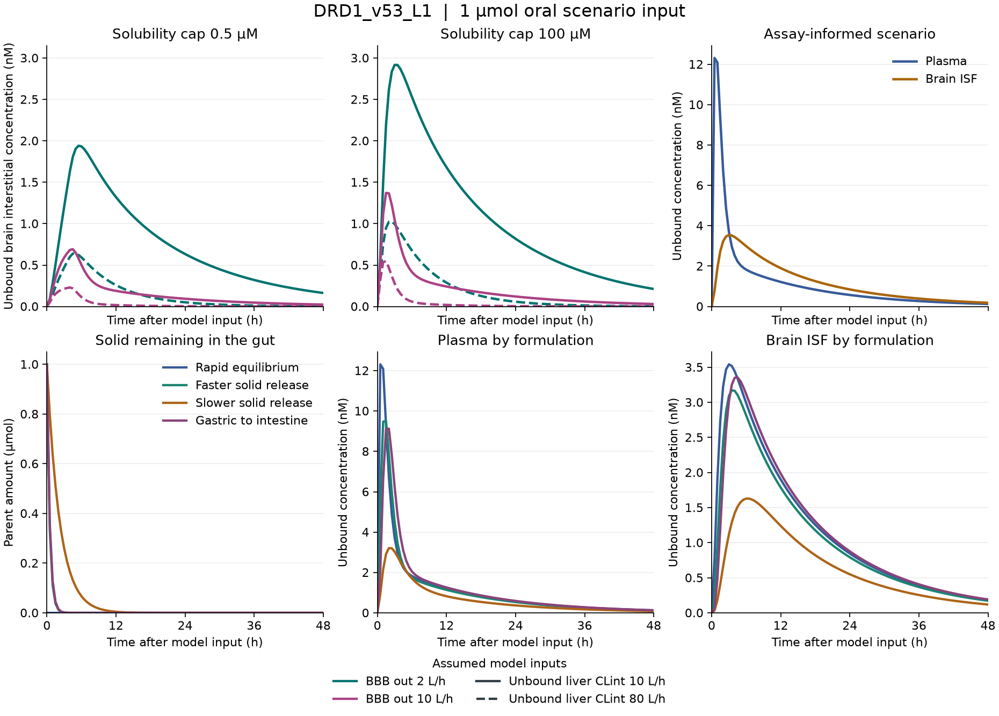

# Testing a Tourette lead in a human exposure model

GenEuclidean nominates two different molecules for the human dopamine D1 receptor. This study uses the later campaign's **DRD1_v53_L1** by default. The earlier **DRD1_1** is selectable by ID. Each dossier supplies a structure and docking evidence. Neither contains measured human pharmacokinetics, D1 affinity, functional antagonism or tic response for its lead. The study asks how much unchanged parent could reach brain interstitial fluid under explicit chemical and physiological assumptions. [v5.3 dossier](../results/tables/ts_scz_realistic_ligands_v53.json) · [Earlier dossier](../results/tables/cns_iter3_top_hits_dossier.json) · [v5.3 docked structure](../results/docked_ts_scz_v53/DRD1_v53_L1_9LLG.sdf)

An exact-structure lookup on 28 November 2026 matched both leads to prior PubChem entries. DRD1_v53_L1 is CID 81540663 (standard InChIKey `GNBFDAWHNCBRMW-UHFFFAOYSA-N`). DRD1_1 is CID 1863793 (`BUDZFNSWLSQCII-UHFFFAOYSA-N`). PubChem PUG REST returned zero linked BioAssay IDs for each CID on that date. The campaign's ChEMBL fingerprint comparisons describe distance to the screened panel. The research hypothesis here is the proposed Tourette application of these existing structures. [v5.3 compound](https://pubchem.ncbi.nlm.nih.gov/compound/81540663) · [Earlier compound](https://pubchem.ncbi.nlm.nih.gov/compound/1863793)

## The candidate result

For a normalized **1 µmol oral model input**, the structure-informed scenario for DRD1_v53_L1 gave a sampled peak unbound brain concentration of **3.54 nM at 3 h**, with **57.2 nM·h** integrated over 48 hours. Eight independent sensitivity cases gave peaks of **0.23–2.92 nM**. These cases vary the assumed gut solubility cap, brain efflux and hepatic intrinsic clearance. They use a fixed plasma unbound fraction of 0.20, which explains why the structure-informed result can lie outside their range. The model has no observations from a person who received this compound. The amount is a normalization for comparing simulations. [Full numerical result and assumptions](../results/tables/tourette_human_exposure.json)



The v5.3 structure is `CCN1CCN(Cc2cc(F)cc(C#N)c2)CC1`, with calculated molecular weight 247.317 g/mol. Its structure-estimated pH 6.8 solubility was 168 µM and its estimated human plasma unbound fraction was 0.267. The most similar molecules in the proper training sets had Morgan fingerprint similarities of 0.432 and 0.269 respectively. The plasma-binding estimate in particular has little close chemical precedent. The result includes an additional sensitivity calculation at the physically feasible corners of the two assay intervals. Those points describe input uncertainty conditional on the selected human disposition parameters. [Packaged predictions and calibration results](../src/geneuclidean/human_twin/assay_estimates.json)

### How the chemical estimates were tested

We reused the library's fingerprint/descriptor regression ensemble with the original 3,521-row Fang table. Counts below refer to numeric observations in the authors' CSV. Structures were grouped by Bemis–Murcko scaffold and assigned to five disjoint folds. Three folds supplied training data, one supplied calibration data and one was held out for testing. The baseline predicts the training median. Errors use the original log10 assay units. Each endpoint has its own split because assay coverage differs. [Fang et al.](https://doi.org/10.1021/acs.jcim.3c00160) · [Authors' data at the revision used](https://github.com/molecularinformatics/Computational-ADME/blob/b00df003de117ce9e5b381afd886095c5f2af2d5/ADME_public_set_3521.csv)

| Assay | Train / calibration / test | Test MAE | Median baseline MAE | Nominal 90% interval coverage on test |
|---|---:|---:|---:|---:|
| Solubility at pH 6.8, log10(µg/mL) | 1,303 / 435 / 435 | 0.418 | 0.466 | 90.8% |
| Human plasma binding, log10(% unbound) | 116 / 39 / 39 | 0.424 | 0.690 | 94.9% |

For this lead the calibrated solubility interval spans roughly 13–2,100 µM. The unbound fraction interval reaches beyond one before intersection with the physical range. At fixed human disposition, evaluating the four assay-interval corners gave sampled brain peaks of **0.46–6.59 nM**. Even the lower solubility bound exceeded the initial 4 µM gut loading, so plasma binding drove the difference in this experiment. The original log-space intervals are retained in the report. These are marginal prediction intervals assessed on scaffold holdouts. Human brain concentrations, adverse effects and symptom changes would each require separate validation.

## What robotic labs have demonstrated

| Implemented system | Findings and implications for testing this lead |
|---|---|
| Automated synthesis, identity and assay | Czechtizky and colleagues connected purification, quantitative LC–MS and a DPP4 enzyme assay. They tested 12 compounds in 24 hours and repeated one reference through ten independent cycles. Dai and colleagues used mobile robots, UPLC–MS and benchtop NMR, then repeated hits that met experiment-specific analytical criteria. A useful digital record links a nomination to its material lot, concentration, raw readout and repeat. [DPP4 platform](https://pmc.ncbi.nlm.nih.gov/articles/PMC4027231/) · [Mobile robots](https://www.nature.com/articles/s41586-024-08173-7) |
| High-throughput metabolism and BBB plates | A 384-well robotic workflow measured CYP3A4 depletion for more than 3,000 compounds using turnover controls. A 96-well barrier study compared nine reference drugs with historical human CSF/plasma and measured barrier integrity and mass recovery. It used bovine pericytes. Keep both directional permeability measurements, unbound donor concentration and tracer integrity. A human tissue transport clearance requires an independently justified scaling model. [Automated CYP assay](https://pubmed.ncbi.nlm.nih.gov/27417180/) · [Barrier plate study](https://www.mdpi.com/1999-4923/13/6/892) |
| Automated multi-organ chips | Novak and colleagues sustained eight intermittently linked chips for three weeks with fluid transfer, sampling and imaging. Herland and colleagues connected chip measurements to human PK for nicotine and cisplatin. Peak nicotine prediction errors reached 26.5%. Cisplatin renal clearance differed from the clinical reference by 99.4%, with the glomerulus absent from the kidney chip. Quantifying material adsorption and qualifying each organ endpoint matter. [Robotic platform](https://pubmed.ncbi.nlm.nih.gov/31988458/) · [PK and clearance comparisons](https://pmc.ncbi.nlm.nih.gov/articles/PMC8011576/) |
| Human neural models and safety assays | Basal-ganglia organoids from five Tourette donors and eleven controls showed altered interneuron development. A separate microfluidic device recorded ten cortical organoids in parallel and measured drug responses in an epilepsy model. An automated patch-clamp comparison across 17 sites and five platforms found substantial variability in hERG potency. For a DRD1 lead, retain donor, cell line, differentiation batch, platform, calibrators and technical replicates. Functional D1 signaling, electrical changes and clinical tics are distinct endpoints. [Tourette organoids](https://doi.org/10.1038/s41380-022-01880-5) · [Parallel organoid recordings](https://pmc.ncbi.nlm.nih.gov/articles/PMC12533132/) · [Patch-clamp comparison](https://pmc.ncbi.nlm.nih.gov/articles/PMC7101356/) |

Human-cell assays, organ chips and computation can replace specific animal experiments when their performance supports the intended question. FDA describes endpoint-specific validation and regulatory uses. OECD describes quality practices for reproducible in vitro studies. A disease-relevant organoid can test a neural phenotype. A claim about tic improvement in people still needs credible clinical evidence. [FDA NAMs program](https://www.fda.gov/science-research/science-and-research-special-topics/new-approach-methodologies-nams) · [FDA March 2026 draft guidance announcement](https://www.fda.gov/news-events/press-announcements/fda-releases-draft-guidance-alternatives-animal-testing-drug-development) · [OECD GIVIMP, second edition](https://www.oecd.org/en/publications/guidance-document-on-good-in-vitro-method-practices-givimp-second-edition_5ba6777b-en.html)

## What the human studies tell us

| External check | Result |
|---|---|
| Ecopipam total parent in plasma | We fitted an oral one-compartment limit using reported AUC, median time to peak and terminal half-life from 18 healthy adults in cohort A before UGT inhibition. A separate mass-balance study of eight healthy men receiving the same free-base equivalent reported 59.4 ng/mL peak parent and 725 ng·h/mL AUC∞. The solver gave 30.2 ng/mL and 736 ng·h/mL over 600 hours. The peak was **49% low** despite a **1.5%** AUC error. Treating terminal half-life as the only disposition phase loses peak information. Neither study measured brain concentrations. [Calibration study, Table 1](https://pmc.ncbi.nlm.nih.gov/articles/PMC12907572/) · [External study, Table 1](https://pmc.ncbi.nlm.nih.gov/articles/PMC13180694/) |
| Linezolid free brain ISF and plasma | At steady state, four neurocritical-care patients had paired observations in plasma, cerebral interstitial fluid and ventricular CSF. The median unbound ISF/plasma AUC ratio was **0.50** (range 0.25–0.81). The corresponding CSF ratio was **0.92**. The symmetric passive transport limit gives **1.00**, twice the observed median brain ratio. This challenges a model assumption and shows the importance of sampling site. [Hosmann et al., Table 2](https://pmc.ncbi.nlm.nih.gov/articles/PMC10904716/) |
| D1 engagement and tic response | A small PET study measured approximately 70% basal-ganglia D1 occupancy after one ecopipam exposure in healthy adults. A separate 153-participant pediatric trial found a placebo-adjusted change in YGTSS total tic score of −3.44 points at week 12 (95% CI −6.09 to −0.79). In the phase 3 withdrawal trial, 90 pediatric responders entered the primary randomized maintenance analysis. The hazard ratio for relapse was 0.47 (95% CI 0.26–0.84). These studies measured different outcomes in different populations. They supply no individual exposure-to-tic-response curve for either nominated lead. [Human D1 PET](https://pubmed.ncbi.nlm.nih.gov/8584610/) · [Phase 2b](https://pubmed.ncbi.nlm.nih.gov/36628546/) · [Phase 3](https://jamanetwork.com/journals/jamaneurology/fullarticle/2849573) |

## Model and interfaces

`geneuclidean.human_twin.simulate_oral` integrates seven amounts in µmol. They track the gut, central compartment, peripheral tissue, brain, material leaving the gut unabsorbed, first-pass loss and systemic loss. Two additional states integrate unbound plasma and brain concentrations in µM·h. Every internal transfer has an equal and opposite term. The solver checks nonnegativity and conservation. Volumes are in L, clearances in L/h and times in h. The report gives sampled peaks on a half-hour grid. [Solver](../src/geneuclidean/human_twin/exposure.py) · [Analytical tests](../tests/test_human_twin.py)

- **Buffered chemistry.** The gut holds a finite amount in rapid equilibrium with solid and an optional soluble 1:1 partner. Only free parent is absorbed. All material in the lumen can leave by transit. At fixed pH, the supplied apparent saturation cap already includes ionization. The model uses a single well-mixed buffer and omits dissolution kinetics, changing GI pH, bile and gastric emptying. In the example vial, 4 µM parent with a 0.5 µM cap yields 0.5 µM dissolved. With 8 µM hypothetical partner and conditional Kd 0.25 µM, all 4 µM dissolves, but only 0.224 µM remains free. The independent ESOL logS is pH-unspecified. [Existing compound assay model](compound_assays.md)
- **First pass and interactions.** Unbound fraction in blood is plasma unbound fraction divided by the whole-blood/plasma concentration ratio. The well-stirred liver model determines both hepatic escape and systemic hepatic blood clearance. Plasma clearance includes the blood/plasma conversion once. An optional competitive inhibitor scales the affected share of intrinsic clearance by `1 / (1 + Iu/Ki)`. In the example, an assumed affected share of one half and an unbound inhibitor concentration equal to Ki yield 75% remaining intrinsic clearance and a 1.20× plasma AUC over 48 h. Identifying an interacting chemical needs measured unbound Ki, pathway contribution and inhibitor exposure. Metabolites and time-varying induction or inhibition lie outside this model. [ICH M12](https://database.ich.org/sites/default/files/ICH_M12_Step4_Guideline_2024_0521_0.pdf)
- **Brain exposure.** The transport flux is `CLin × Cu,plasma − CLout × Cu,brain`. An apparent unbound brain distribution volume relates brain amount to interstitial concentration. At equal initial and final brain amounts, the unbound AUC ratio equals `CLin / CLout`. The brain is a single compartment. Striatal heterogeneity, endogenous dopamine, CSF kinetics, receptor signaling and developmental differences remain unmodeled. Central and peripheral volumes are apparent distribution parameters. [Brain transport framework](https://pubmed.ncbi.nlm.nih.gov/18058202/) · [Multi-compartment CNS PBPK](https://doi.org/10.1007/s10928-021-09768-7)
- **Target binding.** An optional identity-matched equilibrium Kd enables the conditional one-site calculation `Cu,brain / (Cu,brain + Kd)`. It assumes equilibrium access to the receptor and negligible competition and target depletion. A ligand-bound structure alone establishes neither affinity nor antagonist activity. In the registry, 9LLG is the inactive DRD1 template and 9URL is a Gs-bound complex. [9LLG](https://www.rcsb.org/structure/9LLG) · [9URL](https://www.rcsb.org/structure/9URL)

### Running the study

```sh
geneuclidean human-twin --output study.json --figure exposure.png
geneuclidean human-twin --candidate DRD1_1 --output earlier-lead.json
```

The installed package includes the two structural records and compact calibration results. Running the simulation requires no downloads. To reproduce the regression fits, save the linked CSV under its original filename and run the following command from the repository. The script checks the input SHA-256. The output includes the library versions, prediction, interval and nearest training similarity for each lead. [Pinned assay table](https://raw.githubusercontent.com/molecularinformatics/Computational-ADME/b00df003de117ce9e5b381afd886095c5f2af2d5/ADME_public_set_3521.csv)

```sh
python scripts/fit_tourette_assay_estimates.py /path/to/data rebuilt-estimates.json
```

### Bringing robot measurements back into the simulation

`dialysis-plan` generates a randomized worklist for paired buffer/plasma positions, including blanks and a distinct assay reference. The reference must have a qualified acceptance window under the lab's protocol. This example uses caffeine as a layout reference. The worklist describes sample placement. A separate execution record carries instrument observations.

```sh
geneuclidean dialysis-plan --candidate DRD1_v53_L1 --plate-id study-01 \
  --reference-id caffeine --reference-smiles 'Cn1c(=O)c2c(ncn2C)n(C)c1=O' \
  --replicates 3 --seed 42 --output plan.json
```

Join the original plan to the robot/LC–MS export using the plate barcode and paired position. Record the run, instrument, timestamp, protocol, material and plasma lots, pH, temperature, equilibration verification, raw-file URI and the laboratory's reference, recovery, quantification and replicate-precision limits. Initial buffer is drug-free. Recovery uses the measured initial plasma volume and both final chamber volumes. The buffer/plasma concentration ratio estimates unbound fraction at equilibrium. Failed blanks, recovery, precision, identity, missing or duplicate positions prevent a result from replacing the scenario input. Technical replicates describe precision within one run. Additional plasma lots and concentrations are needed to characterize biological variability and concentration dependence. [Run schema and QC](../src/geneuclidean/human_twin/dialysis.py) · [OECD quality practices](https://www.oecd.org/en/publications/guidance-document-on-good-in-vitro-method-practices-givimp-second-edition_5ba6777b-en.html)

```python
import json
from geneuclidean.human_twin import DialysisRun, evaluate_dialysis

print(json.dumps(DialysisRun.model_json_schema(), indent=2))
with open("measured-dialysis.json") as data:
    reviewed = evaluate_dialysis(DialysisRun.model_validate_json(data.read()))
print(reviewed.fraction_unbound_plasma, reviewed.reasons)
```

```sh
geneuclidean human-twin --dialysis-run measured-dialysis.json \
  --solubility measured-solubility.json --d1-binding measured-kd.json --output updated.json
```

Each evidence flag is optional. This predefined study uses nominal human plasma dialysis at pH 7.4 and 37 °C and equilibrium solubility in buffered water at pH 6.8 and 37 °C. `AqueousSolubilityMeasurement` and `D1BindingMeasurement` expose their JSON schemas through the same API. The generic solver accepts other explicitly defined media and dispositions. The highest-value missing observations for these leads are identity-confirmed material, plasma and brain binding, directional BBB transport with recovery, scaled human intrinsic clearance, and orthogonal D1 binding and functional antagonism measurements. A prospective comparison using held-out human exposure data would address a different question from these numerical and reference-drug checks.
