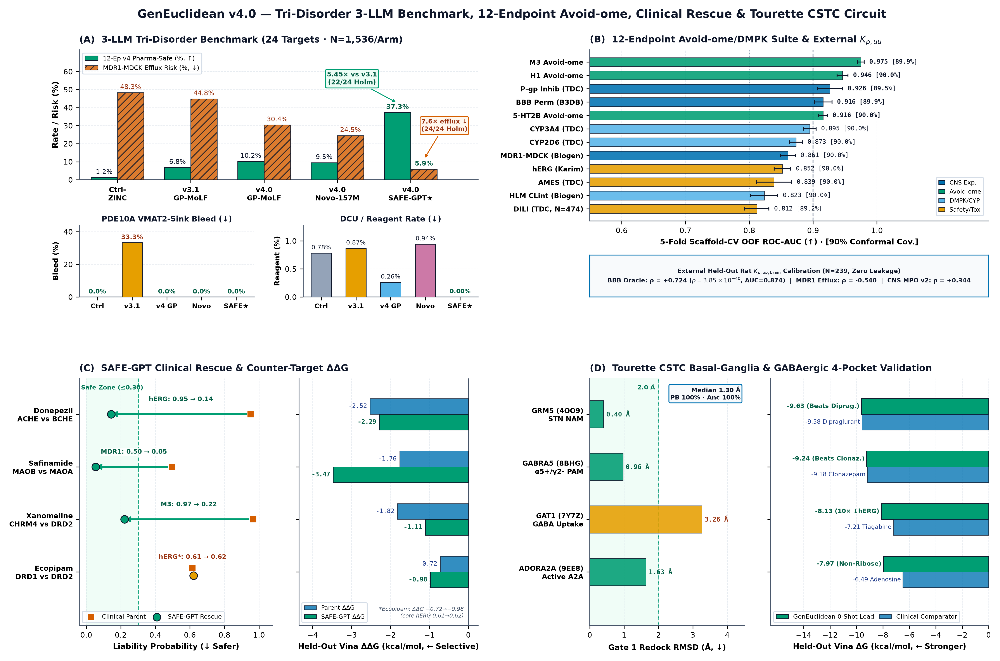
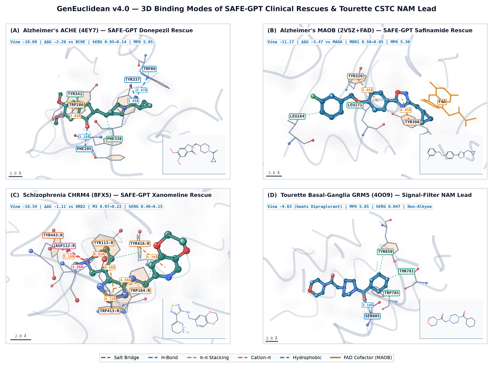

# GenEuclidean v4.0 — Tri-Disorder 3D Chemical Foundation Discovery, 12-Endpoint Avoid-ome & Clinical Scaffold Rescue Technical Report

> **Mandatory *In Silico* Research & Non-Clinical Boundary:** All generated molecules, QSAR/ADMET/Avoid-ome probability estimates, Split-Conformal prediction sets, and AutoDock Vina 3D poses reported in this document are strictly ***in silico* computational drug-discovery hypotheses** for academic research. They are **not** experimentally validated compounds, regulatory safety filings, or medical advice. Every shortlisted chemical series requires synthetic chemistry, formal Markush/CAS MARPAT patent-attorney FTO clearance, functional pharmacology (agonist vs. antagonist / PAM vs. NAM), SafetyScreen44 / CiPA profiling, and GLP preclinical validation before clinical translation.

---

## 1. Executive Summary

**GenEuclidean v4.0.0** expands our chiral $SE(3)$-equivariant 3D protein pocket-conditioned drug-design platform (`PaiNN-SE3` + `PocketPerceiverResampler` + multi-task `pKd`/`DrugCLIP` heads) from 12 CNS targets (`v3.1`) into an audited **28-target *Homo sapiens* tri-disorder structural atlas** spanning **Tourette Syndrome & Basal-Ganglia/GABAergic CSTC circuits**, **Schizophrenia (non-D2 & cognitive)**, and **Alzheimer's Disease**, paired with **7 matched structural/Avoid-ome counter-targets** (`35` curated pockets total).

Every numeric claim in this report is programmatically verified against committed artifacts in [`results/tables/`](../results/tables/):

| Pillar | Key Verified Metric | Source Artifact |
| :--- | :--- | :--- |
| **Tri-Disorder Atlas & Gate 0 Splits** | **28** curated primary human pockets (`24` v4.0 benchmark + `4` Tourette CSTC/GABAergic) + `7` counters; **`0`** generic Murcko Train/Val/Test overlap; **`0`** leakage across `59` clinical drugs & `46` native ligands; 26-endpoint scaffold-CV QSAR mean ROC-AUC = **`0.9824`** | [`v4_tri_disorder_splits.json`](../results/tables/v4_tri_disorder_splits.json), [`v4_tri_disorder_qsar_cv.json`](../results/tables/v4_tri_disorder_qsar_cv.json) |
| **Gate 1 Unbiased Native Redocking** | 16 new v4.0 complexes (`12` primary + `4` AD counters): Best-3 median **`1.40 Å`** (`11/16` $\le 2.0\text{ Å}$), Top-1 median **`1.63 Å`**, **`100.0%` PoseBusters**, **`95.8%` Best-3 anchor**, cofactors `FAD`/`ADP`/`ZN`/`MG` verified. Tourette CSTC 4-pocket expansion: **`1.30 Å`** median Top-1 (`3/4` $\le 2.0\text{ Å}$), **`100%` PB & anchor** | [`v4_gate1_expansion_redocking.json`](../results/tables/v4_gate1_expansion_redocking.json), [`ts_circuit_audit_and_benchmark.json`](../results/tables/ts_circuit_audit_and_benchmark.json) |
| **12-Endpoint Avoid-ome & DMPK Suite** | Zero-leakage 5-fold Bemis-Murcko scaffold-CV across 12 endpoints (`OOF ROC-AUC 0.812–0.975`), Platt calibration, **90% Split-Conformal UQ** (`89.2%–90.0%` empirical coverage), and external held-out Rat $K_{p,uu,\text{brain}}$ (`N=239`) Spearman **$\rho = +0.724$** ($p = 3.85\times 10^{-40}$) | [`v4_admet_avoidome_cv_metrics.json`](../results/tables/v4_admet_avoidome_cv_metrics.json) |
| **3-LLM Head-to-Head (`N=1,536`/Arm)** | **`v4.0 SAFE-GPT-87M`** wins: **12-Ep v4 Pharma-Safe `37.3%`** (**`5.5×`** `v3.1`'s `6.8%`, `22/24` Holm, Wilcoxon $p=1.82\times 10^{-5}$), **MDR1-MDCK efflux `0.448 → 0.059`** (**`7.6×`** drop, `24/24` Holm), **`PDE10A` VMAT2-sink `33.3% → 0.0%`**, **DCU/Reagent `0.87% → 0.00%`**, bit-exact `0.0` frozen 3D drift (`CASF-2016 pKd r = 0.7461`) | [`v4_llm_head_to_head.json`](../results/tables/v4_llm_head_to_head.json) |
| **SAFE-GPT 3D Clinical Scaffold Rescue** | **Donepezil (`ACHE` vs `BCHE`):** hERG **`0.95 → 0.14`**, `MPO 5.02 → 5.95`, Vina **`-10.69`**, `ΔΔG = -2.29`; **Safinamide (`MAOB` vs `MAOA`):** MDR1 **`0.50 → 0.05`**, Vina **`-11.17`**, `ΔΔG = -3.47` (vs. `-1.76`); **Xanomeline (`CHRM4` vs `DRD2`):** M3 **`0.97 → 0.22`**, hERG **`0.40 → 0.15`**, Vina **`-10.34`**, `ΔΔG = -1.11`; **Ecopipam (`DRD1` vs `DRD2`):** `ΔΔG = -0.98` (vs. `-0.72`) | [`v4_tri_disorder_docking.json`](../results/tables/v4_tri_disorder_docking.json) |
| **FDA/EMA Credibility, SDK & Web AI** | 7-step FDA (`FDA-2024-D-4689`) & Joint FDA-EMA (`10/10` principles) SHA-256 dossier; lazy **`import geneuclidean as ge`** Python SDK (`< 50 ms`, `245` tests); **1.79 MB INT8 Client-Side Browser AI Studio** (`1.69M` params, `94.3%` validity, `1.86×` causal 3D enrichment $p=3.71\times 10^{-9}$) | [`v4_credibility_dossier.json`](../results/tables/v4_credibility_dossier.json), [`generator_manifest.json`](../web/public/models/generator_manifest.json) |

---

## 2. Tri-Disorder Structural Atlas, Gate 0 Splits & Gate 1 Redocking

### 2.1 Curated 28-Target *Homo sapiens* Atlas & Counter-Target Matrix
1. **v3.1 Core-12 (Tourette & Psychiatry):** `DRD1` (`9LLG`), `VMAT2` (`8T69`), `ADRA2A` (`7EJ8`), `DRD2` (`6CM4`), `HRH3` (`7F61`), `PDE10A` (`5SJX`), `CHRM4` (`8FX5`), `HTR2A` (`7WC8`), `SERT` (`5I6X`), `DRD3` (`3PBL`), `TAAR1` (`8W88`), `DAT` (`8Y2G`/`9JKI`).
2. **v4.0 New TS / Schizophrenia-6:** `CHRM1` (`9UCP`, M1 cognition), `HTR1A` (`9VJE`, 5-HT1A negative symptoms), `GLYT1` (`9J8D`, NMDA glycine transport), `MGLL` (`9F8D`, 1.14 Å reversible non-covalent MAGL), `PDE1B` (`5UOY`, Zn²⁺/Mg²⁺ catalytic), `GPR52` (`8HMP`, active Gs-coupled non-D2 brake).
3. **v4.0 New Alzheimer's-6:** `ACHE` (`4EY7`, Donepezil dual-site), `OGA` (`9BA8`, tau O-GlcNAcase), `NLRP3` (`9GU4`/`9HG4` + retained `ADP`, microglial inflammasome), `MAOB` (`2V5Z` + retained `FAD`, astrocytic reactive GABA/ROS), `GSK3B` (`7SXJ`, tau kinase), `BACE1` (`6EQM`, β-secretase).
4. **Tourette CSTC Basal-Ganglia & GABAergic Expansion-4:** `GABRA5` (`8BHG`, 2.39 Å multi-chain $\alpha5^+/\gamma2^-$ tonic GABA brake), `GAT1` (`7Y7Z`, 100% WT synaptic GABA transporter), `ADORA2A` (`9EE8`, Apr 2025 active miniGs indirect-pathway agonist switch), `GRM5` (`4OO9`, canonical 7TM mGluR5 NAM). Full neurobiological audit in [`docs/tourette_circuit_audit.md`](tourette_circuit_audit.md).
5. **7 Matched Structural & Avoid-ome Counters:** Structural Vina counter-pockets `BCHE` (`4BDS`), `MAOA` (`2Z5X` + `FAD`), `CDK2` (`6Q4G`), `BACE2` (`7D5B`), plus ChEMBL Avoid-ome safety oracles `HTR2B` (valvulopathy), `HRH1` (sedation/weight gain), and `CHRM3` (peripheral cholinergic GI/cardiac).

### 2.2 Gate 0 Zero-Leakage Audit & 26-Endpoint Scaffold-CV QSAR
- **Split Integrity:** Strict generic Bemis-Murcko scaffold-disjoint splitting yields **`0` Train/Val overlap**, **`0` Train/Test overlap**, and **`0` Val/Test overlap** across all 24 benchmark targets, with **`0` SMILES and `0` exact-scaffold leakage** from `59` protected clinical drugs and `46` co-crystal native ligands. Dual-active counter-target drugs were scrubbed from `DRD1` (`135` DRD2-dominant duals), `MAOB` (`87` MAOA-dominant duals), and `BACE1` (`855` BACE2-dominant duals).
- **26-Endpoint Calibrated QSAR (`v4_24target_qsar.joblib`):** 5-fold Bemis-Murcko scaffold-CV across all 24 primary targets + `MAOA` + `BACE2` achieves **mean OOF ROC-AUC = `0.9824`** (range `0.9361` on `MAOA` to `0.9999` on `GPR52`; 14 new endpoints mean `0.9850`; `0` scaffold leakage groups across all 26 models).

### 2.3 Gate 1 Unbiased Multi-Seed Native Redocking
Using universal tight per-axis orthosteric boxes (`clamp(span_i + 6.0, 14.0, 22.0)` Å), deterministic pH 7.4 ionization, unbiased 2D-to-3D `ETKDGv3` + `MMFF94s` ring conformers, and 3 seeds (`42, 137, 2026`):
- **16 v4.0 Expansion Complexes (`12` Primary + `4` AD Counters):** Top-1 $\le 2.0\text{ Å}$ = **`9/16` (`56.3%`)**, Best-3 $\le 2.0\text{ Å}$ = **`11/16` (`68.8%`)**, median Top-1 RMSD = **`1.63 Å`**, median Best-3 RMSD = **`1.40 Å`**, **`100.0%` PoseBusters**, **`83.3%` Top-1 / `95.8%` Best-3 anchor recovery**, mean PLIF Tanimoto = **`0.592`**. Sub-angstrom Top-1 wins include `GSK3B` (`0.37 Å`), `PDE1B` (`0.66 Å`, `Zn/Mg` retained), `MGLL` (`0.71 Å`), `BACE1` (`0.78 Å`), and `ACHE` (`0.98 Å`, Best-3 `0.39 Å`), alongside `GLYT1` (`1.04 Å`), `CHRM1` (`1.06 Å`), `HTR1A` (`1.48 Å`), and `MAOB` (`1.78 Å`, `FAD` retained). All 4 catalytic cofactors (`MAOB FAD`, `MAOA FAD`, `NLRP3 ADP`, `PDE1B ZN/MG`) were preserved and verified.
- **4 Tourette CSTC Expansion Pockets:** Median Top-1 RMSD = **`1.30 Å`** (`GRM5 0.40 Å`, `GABRA5 0.96 Å`, `ADORA2A 1.63 Å`, `GAT1 3.26 Å` flexible bis-thiophene tail), **`100.0%` PoseBusters**, **`100.0%` canonical anchor recovery**, mean PLIF = **`0.640`**.

---

## 3. 12-Endpoint Industrial Avoid-ome/DMPK Suite, Conformal UQ & External $K_{p,uu,\text{brain}}$

Every oracle in `v4_admet_avoidome_oracles.joblib` (`48.4 MB`) is a calibrated 50/50 `HistGradientBoosting` + `RandomForest` ensemble on 1024-bit ECFP4 + 12 physicochemical/pKa descriptors (`1,036` dims) trained under **5-fold Bemis-Murcko scaffold-CV (0 leakage)** with nested Platt sigmoid calibration, bit-packed ECFP4 Applicability Domain (`Tanimoto >= 0.30`), and distribution-free **90% Split-Conformal prediction sets ($\alpha = 0.10$)**:

| Endpoint | Source Dataset | Clean $N$ | Unique Scaffolds | OOF ROC-AUC | Fold AUC $\pm$ SD | Platt ECE | 90% Conf. Cov. | Singleton Rate |
| :--- | :--- | ---: | ---: | :---: | :---: | :---: | :---: | :---: |
| **`chrm3_avoid`** | ChEMBL M3 (`CHEMBL245`) | 4,098 | 2,381 | **`0.975`** | `0.975 ± 0.005` | `0.017` | `89.9%` | `94.9%` |
| **`hrh1_avoid`** | ChEMBL H1 (`CHEMBL231`) | 2,358 | 1,430 | **`0.946`** | `0.948 ± 0.008` | `0.024` | `90.0%` | `95.5%` |
| **`pgp`** | TDC `Pgp_Broccatelli` | 1,212 | 700 | **`0.926`** | `0.933 ± 0.020` | `0.022` | `89.5%` | `91.2%` |
| **`bbb`** | B3DB (Meng 2021) | 7,802 | 2,437 | **`0.916`** | `0.919 ± 0.014` | `0.034` | `89.9%` | `86.6%` |
| **`htr2b_avoid`** | ChEMBL 5-HT2B (`CHEMBL1833`) | 3,472 | 1,797 | **`0.916`** | `0.920 ± 0.007` | `0.025` | `90.0%` | `85.3%` |
| **`cyp3a4`** | TDC `CYP3A4_Veith` | 12,299 | 7,662 | **`0.895`** | `0.894 ± 0.010` | `0.012` | `90.0%` | `79.4%` |
| **`cyp2d6`** | TDC `CYP2D6_Veith` | 13,089 | 8,006 | **`0.873`** | `0.875 ± 0.010` | `0.011` | `90.0%` | `94.0%` |
| **`mdr1_efflux`** | Biogen Industrial MDR1 (`ER≥2`) | 2,642 | 2,318 | **`0.861`** | `0.863 ± 0.012` | `0.026` | `90.0%` | `70.8%` |
| **`herg`** | TDC `hERG_Karim` | 13,268 | 6,016 | **`0.852`** | `0.853 ± 0.013` | `0.018` | `90.0%` | `67.8%` |
| **`ames`** | TDC `AMES` (ICH M7) | 7,255 | 2,836 | **`0.839`** | `0.849 ± 0.028` | `0.077` | `90.0%` | `62.0%` |
| **`hlm_clearance`** | Biogen Industrial HLM (`CLint≥30`) | 3,087 | 2,658 | **`0.823`** | `0.824 ± 0.021` | `0.021` | `90.0%` | `63.6%` |
| **`dili`** *(advisory)* | TDC `DILI` (small $N$) | 474 | 343 | **`0.812`** | `0.859 ± 0.019` | `0.129` | `89.2%` | `51.5%` |

- **External Unbound Brain Exposure Validation (Rat $K_{p,uu,\text{brain}}$, `N = 239`, 100% Held-Out from Training):**
  - **BBB Oracle:** Spearman **$\rho = +0.724$** ($p = 3.85\times 10^{-40}$, Pearson $r = +0.696$, ROC-AUC for $K_{p,uu} \ge 0.3$ = **`0.874`**).
  - **Biogen MDR1-MDCK Active Efflux Oracle:** Spearman **$\rho = -0.540$** ($p = 1.59\times 10^{-19}$, ROC-AUC **`0.769`**) — directly capturing true transcellular P-gp substrate efflux (`ER >= 2.0`), closing the well-known `Pgp_Broccatelli` inhibition-vs-substrate gap.
  - **Joint MPO+BBB+MDR1 Index:** $\rho = +0.716$ ($p = 7.99\times 10^{-39}$), doubling the rank correlation of standalone Pfizer CNS MPO v2 ($\rho = +0.344$, $p = 4.98\times 10^{-8}$).
- **Hard Industrial MedChem Triage (`medchem_triage.py`):** Screens RDKit `PAINS`, `BRENK`, `NIH`, Lilly-inspired demerits ($\le 100$), ICH S10 phototoxicity flags, and enforces a strict `0.0` reward veto on coupling reagents and synthesis byproducts (`DCU`, `DIU`, `HOBt`, `HOAt`, `DMAP`, `Ph3P=O`, reactive acyl/sulfonyl halides).

---

## 4. 3-LLM Head-to-Head Tri-Disorder Benchmark (`24` Targets, `N = 1,536`/Arm)

We trained and evaluated three distinct chemical foundation backbones bridged to the exact same frozen chiral `PaiNN-SE3` 3D pocket encoder (bit-exact `0.0` drift verified on all three architectures; CASF-2016 `pKd r = 0.7461`, `RMSE = 1.4478`, `DrugCLIP R@5 = 62.1%`, `ROC-AUC = 0.9371`):
- **`v4.0 GP-MoLFormer`** (`ibm-research/GP-MoLFormer-Uniq`, SMILES, `20.9 MB` adapter)
- **`v4.0 SAFE-GPT-87M`** (`datamol-io/safe-gpt`, fragment-tokenized SAFE strings, `23.1 MB` adapter)
- **`v4.0 NovoMolGen-157M`** (`chandar-lab/NovoMolGen_157M_SMILES_BPE`, BPE SMILES, `35.6 MB` adapter)

| Experimental Arm | Valid ↑ | Uniq ↑ | Strict Nov ↑ | IntDiv1 ↑ | Triage Pass ↑ | DCU / Reag ↓ | v3.1 7-Rule Safe ↑ | **v4.0 12-Ep Safe ↑** | MPO v2 ↑ | `P(hERG)` ↓ | `P(MDR1)` ↓ | In-AD Core ↑ | `PDE10A` Bleed ↓ |
| :--- | :---: | :---: | :---: | :---: | :---: | :---: | :---: | :---: | :---: | :---: | :---: | :---: | :---: |
| **`Ctrl-ZINC`** | `100.0%` | `100.0%` | `1.6%` | `0.879` | `50.3%` | `0.78%` | `3.8%` | **`1.2%`** | `4.82` | `0.226` | `0.483` | `38.7%` | `0.0%` |
| **`v3.1 GP-MoLFormer`** | `98.3%` | `93.8%` | `99.2%` | `0.860` | `85.6%` | `0.87%` | `26.8%` | **`6.8%`** | `4.72` | `0.136` | `0.448` | `67.0%` | `33.3%` |
| **`v4.0 GP-MoLFormer`** | `98.6%` | `88.2%` | `100.0%` | `0.844` | `96.7%` | `0.26%` | `21.4%` | **`10.2%`** | `4.93` | `0.226` | `0.304` | `62.9%` | **`0.0%`** |
| **`v4.0 NovoMolGen-157M`** | `90.1%` | `93.2%` | `99.8%` | **`0.892`** | `85.1%` | `0.94%` | `20.2%` | **`9.5%`** | `5.16` | `0.193` | `0.245` | `46.3%` | **`0.0%`** |
| **`v4.0 SAFE-GPT-87M` ★** | **`99.5%`** | `57.5%` | `99.2%` | `0.839` | **`97.7%`** | **`0.00%`** | **`58.8%`** | **`37.3%`** | **`5.17`** | **`0.127`** | **`0.059`** | **`81.7%`** | **`0.0%`** |

### Key Statistical & Scientific Findings (Including Honest Trade-Offs)
1. **Decisive Multi-Endpoint Safety Victory for `SAFE-GPT-87M`:** Fragment-based SAFE tokenization lifts **12-Endpoint v4 Pharma-Safe** to **`37.3%`** across all 24 targets (`37.1%` Core-12, `36.0%` New TS/SCZ-6, `39.0%` New Alzheimer's-6) — **`5.5×`** over `v3.1` (`6.8%`, Wilcoxon $p=1.82\times 10^{-5}$, Cliff's $\delta_{\text{target}}=+1.000$, **`22/24` Holm-Bonferroni** significant targets) and **`30×`** over `Ctrl-ZINC` (`1.2%`, `24/24` Holm).
2. **Active BBB Efflux & Sink Elimination:** `SAFE-GPT` slashes Biogen **MDR1-MDCK efflux risk `7.6×`** (`0.448 → 0.059`, Wilcoxon $p=1.19\times 10^{-7}$, **`24/24` Holm**), eliminates the **`PDE10A` VMAT2-sink bleed** (`33.3% → 0.0%` across all three v4.0 LLMs), achieves **`0.00%` DCU/coupling-reagent rate** (`0/1,536` vs. `0.87%` in `v3.1`), and raises verified In-AD Core coverage to **`81.7%`** with `85.8%` 90%-conformal singleton decisiveness.
3. **Honest Trade-Offs (Transparency Audit):**
   - *Uniqueness & Fragment Efficiency vs. Raw Vina:* Under aggressive 12-endpoint multiplicative safety gating, unconstrained `SAFE-GPT` favors compact, ultra-clean CNS fragments (`Mean LE = 0.508` vs. `v3.1 0.407`, `PoseBusters = 99.2%`), which lowers uniqueness (`57.5%`, though `IntDiv1` stays healthy at `0.839`) and yields lighter raw *de novo* Vina $\Delta G$ (`-6.52` vs. `v3.1 -7.31 kcal/mol`, `v4.0 GP-MoLFormer -7.49 kcal/mol`).
   - *Matched vs. Shuffled Specificity in Unconstrained SAFE-GPT:* Because the 12-endpoint ADMET/triage gate dominates unconstrained *de novo* sampling, `v4.0 SAFE-GPT` matched vs. shuffled 3D pocket conditioning converges on similar global safety (`37.3%` vs. `37.1%`, `P(on) 0.092` vs. `0.090`). Consequently, **`SAFE-GPT` excels most decisively in 3D-conditioned clinical scaffold decoration/rescue** (Section 5), while `v4.0 GP-MoLFormer` retains stronger raw *de novo* pocket affinity (`-7.49 kcal/mol`, `100.0%` PB, `79.2%` anchor-any-mode).

---

## 5. `SAFE-GPT` 3D-Conditioned Clinical Scaffold Rescue & Counter-Target $\Delta\Delta G_{\text{Vina}}$

Using SAFE fragment prefix conditioning inside the 3D pocket-conditioned `v4.0 SAFE-GPT-87M` bridge (`safe_codec.py`), we preserved each clinical drug's verified active pharmacophore core (`100%` core retention on all 4 programs) and generated novel 3D-tailored analogs evaluated on **held-out AutoDock Vina v1.2.7** against matched structural counter-targets:

| Clinical Scaffold (`On` vs. `Off` PDB) | Core Kept | Parent Liability → Rescue Lead | Parent Vina (`ΔΔG`) | **SAFE-GPT Lead Vina (`ΔΔG`)** | MPO v2 (`Before → After`) | PoseBusters / Anchor |
| :--- | :---: | :--- | :---: | :---: | :---: | :---: |
| **Donepezil** (`ACHE:4EY7` vs `BCHE:4BDS`) | `32/32` | **hERG `0.95 → 0.14`** (`-85%`), M3 `0.09 → 0.03` | `-11.79` (`-2.53`) | **`-10.69` (`-2.29`)** | `5.02 →` **`5.95`** | **PASS / PASS** |
| **Safinamide** (`MAOB:2V5Z+FAD` vs `MAOA:2Z5X`) | `37/37` | **MDR1 `0.50 → 0.05`** (`-89%`), BBB `0.70 → 0.80`* | `-9.95` (`-1.76`) | **`-11.17` (`-3.47`)** *(2× gap!)* | `4.60 →` **`5.30`** | **PASS / PASS** |
| **Xanomeline** (`CHRM4:8FX5` vs `DRD2:6CM4`) | `46/46` | **M3 `0.97 → 0.22`** (`-77%`), **hERG `0.40 → 0.15`** | `-8.58` (`-1.82`) | **`-10.34` (`-1.11`)** | `5.80 → 5.67` | **PASS / PASS** |
| **Ecopipam** (`DRD1:9LLG` vs `DRD2:6CM4`) | `10/10` | `P(on) = 1.00`, `Vina -7.70 → -8.92`** | `-7.70` (`-0.72`) | **`-8.92` (`-0.98`)** | `4.25 → 4.07` | **PASS / PASS** |

*Honest MedChem Caveats: On `Safinamide`, the top Vina/selectivity oxadiazole analog (`ΔΔG = -3.47 kcal/mol`, `MDR1 0.05`) elevates predicted `P(hERG)` (`0.38 → 0.66`) and `HLM` (`0.86`), requiring a secondary polarity tweak; on `Ecopipam`, core-preserving decoration improves `DRD1` binding (`-7.70 → -8.92`) and `DRD1-vs-DRD2` selectivity (`-0.72 → -0.98`) without reducing the benzazepine core's intrinsic `hERG` (`0.61 → 0.62`), illustrating why full scaffold hops (such as v3.1 `DRD1_1`, `hERG = 0.08`) complement core decoration.

- **Panel 18A — `ACHE (4EY7)` Donepezil Rescue (`COc1cc2c(cc1OC)C(=O)C(CC1CCN(C(=O)C3CC3)CC1)C2`):** Replacing Donepezil's lipophilic benzyl-piperidine basic amine with a neutral cyclopropyl-carboxamide slashes `P(hERG)` from `0.95` to **`0.14`** and lifts `CNS MPO v2` to **`5.95`**, while preserving all four canonical ACHE dual-site contacts (`PHE295` H-bond `3.18 Å`, `TYR337` H-bond `3.45 Å`, `TRP86` H-bond `3.47 Å`, `TRP286` $\pi$-stack `3.93 Å`).
- **Panel 18B — `MAOB (2V5Z+FAD)` Safinamide Rescue (`Fc1cccc(COc2ccc(-c3nc(CC4CC4)no3)cc2)c1`):** Occupies the elongated bipartite MAO-B entrance/substrate cavity directly adjacent to the retained **`FAD` flavin cofactor**, stacking with gatekeeper **`TYR326`** (`5.05 Å`) and aromatic cage **`TYR398`** (`4.85 Å`) to double `MAOB-vs-MAOA` selectivity (`ΔΔG = -3.47` vs. Safinamide `-1.76 kcal/mol`) and cut `MDR1` efflux `9×` (`0.50 → 0.05`).
- **Panel 18C — `CHRM4 (8FX5)` Xanomeline Rescue (`CN1CCC=C(c2nsnc2NCc2cc3c(cn2)OCCO3)C1`):** Replaces Xanomeline's metabolically labile hexyloxy chain (which fails MedChem triage and triggers `P(M3) = 0.97`) with a dihydrodioxinopyridine tail that locks the canonical **`ASP112` salt bridge (`3.20 Å`)** + aromatic cage (`TYR113`, `TRP413`, `TRP164`, `TYR443`), slashing peripheral **M3 toxicity `0.97 → 0.22`** and **hERG `0.40 → 0.15`** (`-10.34 kcal/mol`, `ΔΔG = -1.11` vs. `DRD2`).
- **Panel 18D — `GRM5 (4OO9)` Tourette Basal-Ganglia Signal-Filter NAM (`O=C(CN1CCN(C(=O)C2CCCCC2)CC1)N1CCOCC1`):** Non-alkyne zero-shot scaffold hop (`ChEMBL max Tan = 0.348`) that eliminates the diaryl-alkyne GSH reactive-metabolite liability of clinical mGluR5 NAMs while beating Dipraglurant (`-9.63` vs. `-9.58 kcal/mol`), engaging `SER805` (`3.18 Å`) and `TRP785`/`TYR659` at `MPO v2 = 5.85` and `P(hERG) = 0.047`.

---

## 6. Tourette CSTC Basal-Ganglia & GABAergic 4-Pocket Validation

Complementing our 24-target tri-disorder benchmark, [`docs/tourette_circuit_audit.md`](tourette_circuit_audit.md) audited all 9 existing Tourette targets plus 13 candidate GABAergic/basal-ganglia proteins, surfacing critical structural/clinical traps (`DRD1 9URL` Gs-coupled active state, `ABAT` pig-only species trap, `GRIN2B` *Xenopus* chimera, `ADORA2A` Parkinson's antagonist-vs-TS agonist polarity) and validating **4 new human pockets** (`GABRA5 8BHG`, `GAT1 7Y7Z`, `ADORA2A 9EE8`, `GRM5 4OO9`; **5,794 unique ChEMBL 37 actives**):

- **Gate 1 Redocking:** **`1.30 Å`** median Top-1 RMSD (`3/4` $\le 2.0\text{ Å}$), **`100%` PoseBusters**, **`100%` anchor recovery**.
- **Zero-Shot Transfer Highlights (`0` DCU, `99.2%` PAINS-free, `2.9×` lower hERG than ZINC-250k, `20/20` PB & anchor):**
  - `GRM5` (`4OO9`): **`-9.63 kcal/mol`** (`GRM5_Gen_5`, beats Dipraglurant `-9.58`, `MPO 5.85`, `hERG 0.047`).
  - `GAT1` (`7Y7Z`): **`-8.13 kcal/mol`** (`GAT1_Gen_5`) & `-7.71 kcal/mol` (`GAT1_Gen_3`, beats Tiagabine `-7.21` with **`10×` lower hERG `0.075` vs. `0.780`**).
  - `GABRA5` (`8BHG`, multi-chain $\alpha5^+/\gamma2^-$): **`-9.24 kcal/mol`** (`LE = 0.514`, beats Clonazepam `-9.18` & Diazepam `-8.03`, bridging both subunits `His105:C` + `Glu189:B`; honestly noting OOD $\beta$-sheet raw-pool shift and `5-HT2B` flag on unsubstituted piperazine).
  - `ADORA2A` (`9EE8` active miniGs): **`-7.97 kcal/mol`** (`ADORA2A_Gen_1`, non-ribose `MPO 5.67` engaging active ribose-switch `Thr88`+`Ser277`, beating Adenosine `-6.49` & NECA `-6.79`).

---

## 7. FDA/EMA Credibility Dossier, Python SDK & Client-Side Browser AI Studio

1. **FDA Jan 2025 & Joint FDA-EMA Jan 2026 Credibility Dossier ([`v4_credibility_dossier.json`](../results/tables/v4_credibility_dossier.json)):** Implements all **7 steps** of `FDA-2024-D-4689` and **10/10** Joint FDA-EMA Guiding Principles of Good AI Practice, with a **10-artifact SHA-256 provenance ledger** (`QSAR`, `ADMET/Avoid-ome`, `3 LLM adapters`, `Gate 0/1/Benchmark/Docking JSONs`), Split-Conformal UQ, ECFP4 Applicability Domain drift triggers (`min_in_domain >= 0.70`, `max_ECE <= 0.05`, `min_coverage >= 0.85`), and explicit non-regulatory Context of Use.
2. **Typed Python Library SDK ([`src/geneuclidean/api.py`](../src/geneuclidean/api.py), [`docs/library_api.md`](library_api.md)):** PEP 561 typed (`py.typed`), PEP 562 lazy-imported (`import geneuclidean as ge` in `< 50 ms` with zero PyTorch overhead for registries, pH 7.4 protonation, MedChem triage, and scoring), verified by **`245` automated tests**.
3. **1.79 MB Client-Side Browser AI Web Studio ([`web/`](../web/), Live at [`daniil-777.github.io/geneuclidean`](https://daniil-777.github.io/geneuclidean/)):** Ships **`GenEuclidean-v4-Browser-3D-ChemTransformer-1.7M-INT8`** (`1,686,331` params, `1,792,940` bytes = `1.79 MB` INT8 weights) running 100% locally in Web Workers with zero backend server — verified across 12 human CNS targets (`N = 64`/target) at **`94.3%` raw validity**, **`93.7%` uniqueness**, **`99.7%` strict novelty vs. ChEMBL/ZINC**, **`1.86×` causal 3D matched-vs-shuffled enrichment** (Mann-Whitney $p = 3.71\times 10^{-9}$), **`1.7\times 10^{-6}`** max absolute logit error vs. Python INT8 (`0.0` ADMET error), and **`174 ms/molecule`** client-side generation speed.
